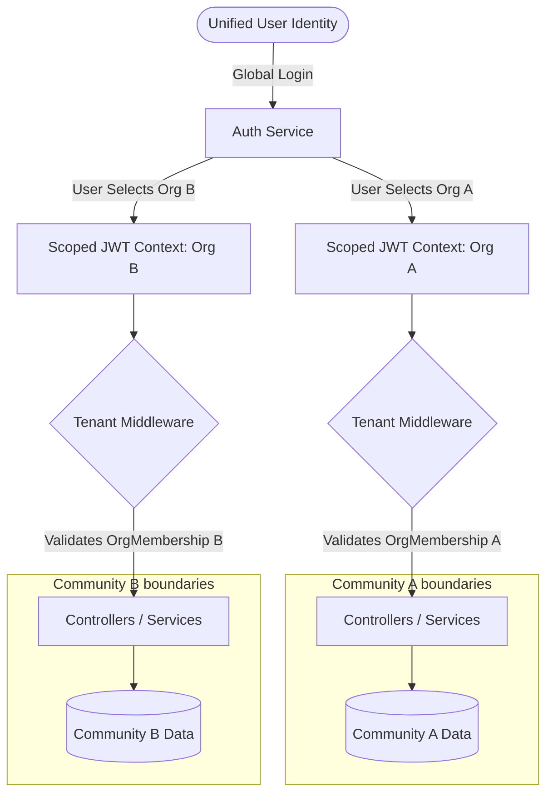
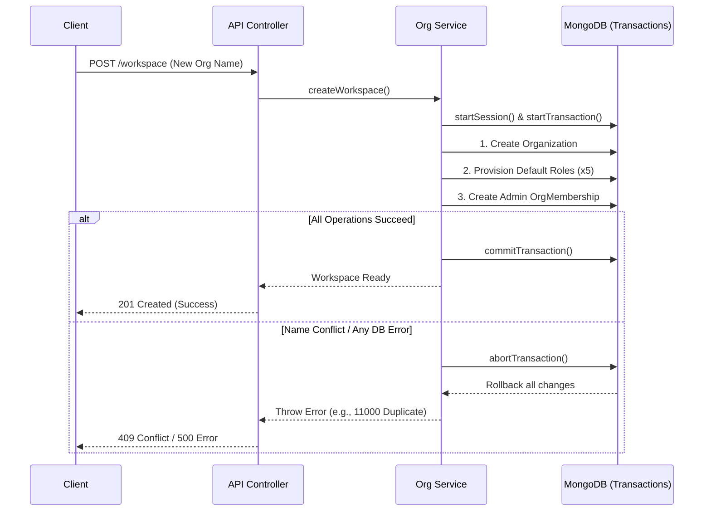

# Multi-Organization Architecture & User Management Report

## 1. Executive Summary
This report summarizes the recent implementations and architectural enhancements completed to support **Multi-Organization Users**. The system has been successfully upgraded to allow a single unified user identity to seamlessly join, manage, and switch between multiple isolated organizations (tenants) without creating duplicate accounts.

### Multi-Organization Isolation Flow

## 2. Core Enhancements Implemented

### A. Unified Identity & Multiple Memberships
* **Single Account Paradigm:** A user can now create or be invited to multiple organizations (e.g., multiple gated communities) under the exact same email and credentials. No duplicate `User` records are ever created in the database.
* **Membership Isolation:** Instead of storing roles directly on the user, access is governed via the `OrgMembership` model. This securely binds a `userId` to a specific `orgId` along with localized roles (e.g., a user can be a 'Super Admin' in Community A and a standard 'Resident' in Community B).

### B. Workspace / Organization Setup
* **Automated Provisioning:** When a user creates a new organization, the system automatically provisions 5 standard roles and assigns the creator the primary administrative role in a single atomic flow.
* **Transaction Rollbacks:** The entire workspace creation process is wrapped in MongoDB transactions. If any step fails (e.g., role creation or membership assignment), the database rolls back completely to prevent orphaned or partial organization data.

### Workspace Creation & Transaction Sequence

### C. Security & Anti-Spoofing
* **Strict Payload Sanitization:** Implemented anti-spoofing checks ensuring malicious clients cannot manually inject `userId`, `status`, or elevate `roles` during the organization creation process.
* **Multi-Org SSO Scoping:** Fixed a critical bug in Single Sign-On (SSO) invitations (`acceptInvitationWithSSO`). The system now properly scopes the generated JWT specifically to the newly accepted `orgId`, preventing cross-tenant token bleeding.

### D. Concurrency & Name Conflict Management
* **Name Availability Checks:** Added a robust `checkNameAvailability` endpoint that properly trims whitespace and performs case-insensitive validation.
* **Concurrency Protection:** Solved race conditions where two users attempt to register the same organization name at the exact same millisecond. The system now guarantees 1 success and translates the MongoDB duplicate key error (11000) into a clean HTTP 409 Conflict for the loser.
* **Rate Limiting:** Applied a dedicated rate limiter (max 60 requests / 15 minutes) specifically to name-checking endpoints to prevent scraping or brute-force enumeration.

### E. Audit Logging & Event Bus
* **Idempotent Event Listeners:** Integrated the `OrgEventEmitter` to trigger background audit logs whenever a new organization is created. The listeners are idempotent, guaranteeing they fire exactly once even under hot module reloading.

## 3. Verification & Testing
A comprehensive integration test suite (`multiOrgAuth.test.js`) containing 15 multi-step E2E cases was implemented and successfully executes, verifying:
1. Registration & login flows.
2. The creation of a 1st and 2nd organization under the same account.
3. Strict isolation between those organizations.
4. Correct translation of database errors to HTTP responses.
5. Concurrent request rejection.

---
**Status:** Multi-Organization user flows and their underlying architectural boundaries are implemented, hardened, and verified complete.
