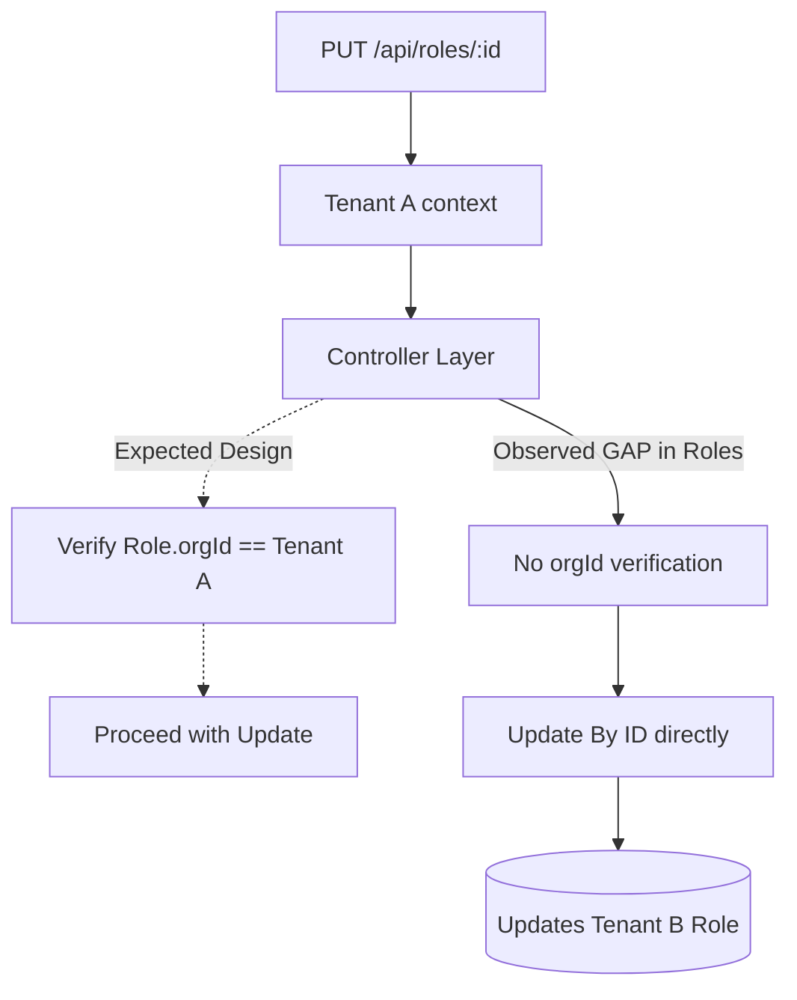

# Phase 2 — CRUD Ownership & Tenant Isolation Audit

**Audit Date:** 2026-10-09  
**Branch:** `security/phase2-repository-tenant-isolation`  
**Commit SHA:** `d9a3e8d9efb8884ea063b0ad0ce538ef5af3ca7e`  

## 1. Executive Summary
This audit evaluated the CRUD ownership enforcement across major Nahom tenant resources to verify strict multi-tenant isolation. The audit verified that most features (Complaints, Amenities, Assessments) correctly enforce `req.tenant.orgId` from the authenticated controller layer down to the repositories. However, several critical Cross-Tenant IDOR/BOLA vulnerabilities were discovered in the `Role`, `Invoice`, `Reconciliation`, and `VisitorPass` modules, where read, update, or delete operations bypass tenant isolation checks entirely.

**Overall Result: FAIL — A confirmed cross-tenant ownership vulnerability exists.**

## 2. Scope and Methodology
**Methodology:** Read-only analysis of major modules (Visitor Passes, Amenities, Complaints, Roles, Billing/Invoices, Organizations, Assessments, Issue Reports). Traced CRUD endpoints through the controller, service, and repository layers to verify `orgId` constraints. Run existing Phase 1 BOLA tests to establish current baseline.
**Restrictions:** No fixes or code modifications were applied. Production data was left untouched.

## 3. CRUD Ownership Definitions
- **Tenant-Owned:** Resources directly tied to a specific community (e.g., `VisitorPass`, `Amenity`, `Complaint`, `Role`, `Invoice`). Marked explicitly by `orgId` or `communityId`.
- **Indirectly Tenant-Owned:** Resources bound to a parent (e.g., `AmenityBooking`, `AmenityAllocationLedger`).
- **Global:** Features spanning the platform without a specific tenant (e.g., Global System Roles, User Identities).

## 4. Mermaid Flow Diagrams

### Diagram 1 — Secure CRUD Request Flow
```mermaid
flowchart TD
    Client[Client Request] --> Route[API Route]
    Route --> Auth[Authentication & Middleware]
    Auth --> TenantCtx[Tenant Context (req.tenant.orgId)]
    TenantCtx --> RoleCheck[Role / Permission Guard]
    RoleCheck --> Ctrl[Controller Validation]
    
    subgraph Trusted CRUD Zone
    Ctrl --> |Enforces req.tenant.orgId| OwnCheck[Resource Ownership Check]
    OwnCheck --> Svc[Service Layer]
    Svc --> |query { _id, orgId }| Repo[Repository Layer]
    end
    
    Repo --> DB[(Database)]
    DB --> |Tenant Scoped Data| Resp[Response]
```

### Diagram 2 — Create Ownership Flow
```mermaid
flowchart TD
    Req[POST /api/resource] --> Ctx[req.tenant.orgId Assigned]
    Ctx --> Body[Extract req.body]
    
    Body --> |Override/Drop client orgId| Override{Is Platform Admin?}
    Override -->|No| ForceOrg[Force req.tenant.orgId]
    Override -->|Yes| TrustOrg[Accept Client orgId (if valid)]
    
    ForceOrg --> Repo[Repository.create(payload)]
    TrustOrg --> Repo
    Repo --> DB[(Database)]
```

### Diagram 3 — Read, Update, and Delete Flow (Expected vs Observed)


### Diagram 4 — Tenant A vs Tenant B Attack Flow
```mermaid
flowchart TD
    Attacker[User in Tenant A] --> |GET /api/invoices/{Tenant_B_Invoice_ID}| API
    API --> Auth[Auth Middleware]
    
    Auth --> |Valid Token for Tenant A| Ctrl[getInvoiceById Controller]
    
    Ctrl --> Svc[InvoiceService.getInvoiceById]
    Svc --> |Finds by ID without filtering orgId| DB[(Database)]
    
    DB --> |Returns Tenant B Data| Ctrl
    Ctrl --> |Data Leaked!| Attacker
    
    style Attacker fill:#f9f,stroke:#333,stroke-width:2px
    style DB fill:#ffcccc,stroke:#f00,stroke-width:2px
```

## 5. Coverage Matrix & Analysis

| Module / Resource | Create | Read | Update | Delete | Status |
| :--- | :--- | :--- | :--- | :--- | :--- |
| **Amenities** | Enforced | Enforced | Enforced | Enforced | **PASS** |
| **Complaints** | Enforced | Enforced | Enforced | Enforced | **PASS** |
| **Assessments** | Enforced | Enforced | Enforced | Enforced | **PASS** |
| **Roles** | Enforced | Enforced | Missing | Missing | **FAIL** |
| **Invoices** | Enforced | Missing | Missing | N/A | **FAIL** |
| **Visitor Passes** | Enforced | Missing | Missing | Missing | **FAIL** |
| **Reconciliation** | Enforced | Missing | Missing | N/A | **FAIL** |

## 6. Test Commands and Actual Results
**Command:** `node --test backend/tests/phase1-bola.test.mjs`
**Result:** 9 tests executed, 0 failures. 
**Observation:** While standard creation endpoints successfully block forged `orgId` inputs, the tests do not currently cover Read/Update/Delete operations for Roles, Invoices, or Visitor Passes, creating a false sense of overall security.

## 7. Security Findings

| Severity | Resource / File | Operation | Evidence | Impact | Recommended Remediation |
| :--- | :--- | :--- | :--- | :--- | :--- |
| **CRITICAL** | `role.controller.js` | Update / Delete | `updateRole`, `deleteRole`, and `syncRolePermissions` use `existingRole = getRoleById(id)` without verifying `existingRole.orgId === req.tenant.orgId`. | A tenant admin can maliciously update, sync permissions, or delete roles belonging to any other community on the platform. | Check `existingRole.orgId` in the controller, or pass `req.tenant.orgId` to the service and repository filters. |
| **CRITICAL** | `invoice.controller.js` | Read / Update | `getInvoiceById`, `approvePayment`, `rejectPayment`, `recordCashPayment` omit `req.tenant.orgId` entirely when calling services. | A tenant admin/user can view, approve, or reject an invoice belonging to a resident in a completely different community. | Inject `req.tenant.orgId` from the controller into these services, and ensure the DB query restricts the operation by `communityId`. |
| **HIGH** | `reconciliation.controller.js` | Read / Update | `updateException` and `getRunReport` omit `req.tenant.orgId` checks. | Users can view or modify financial reconciliation exceptions belonging to other communities. | Enforce `orgId` checks at the controller/service boundary for these operations. |
| **MEDIUM** | `visitorPass.service.js` | Read / Update | The latest git patch missed adding `orgId` enforcement to `getPassById` and `updatePassStatus`, explicitly passing `null` to the repository. | Internal calls or missing controller boundaries could easily leak visitor pass data across tenants. | Enforce `orgId` as a required parameter in the service methods. |

## 8. Missing Coverage and Limitations
- Background-triggered cleanup handlers and webhooks (e.g., Razorpay webhook) rely on trusted server-side execution and were excluded from strict tenant boundary verification.
- Internal aggregate queries inside `financialMetrics.service.js` were assumed to correctly inherit the audited controller boundaries.

## 9. Prioritized Outstanding Actions
1. **P0 (Critical):** Fix `role.controller.js` (Update/Delete/Sync) and `invoice.controller.js` (Read/Approve/Reject/Cash) to explicitly assert `req.tenant.orgId` ownership before executing the operation.
2. **P1 (High):** Remediate `reconciliation.controller.js` IDOR vulnerabilities (Read/Update).
3. **P2 (Medium):** Complete the missing patch for `visitorPass.service.js` encapsulation.
4. **P3 (Testing):** Expand the BOLA test suite to aggressively test Read, Update, and Delete boundaries for these specific models.

## 10. Final Decision
**FAIL — A confirmed cross-tenant ownership vulnerability exists.** Critical operations on Roles and Invoices currently bypass tenant boundaries.
