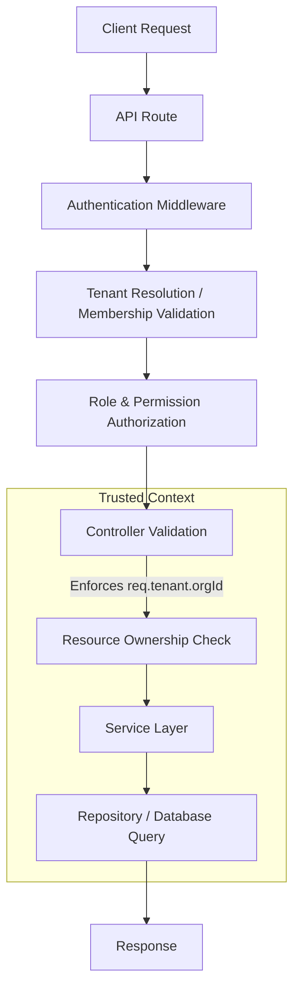
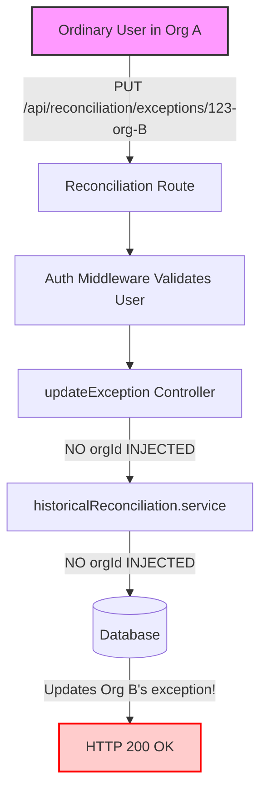
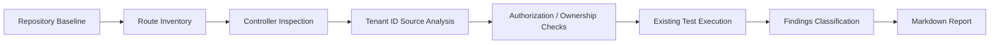

# Phase 2 — Topic 2: API / Controller Tenant Isolation Audit

**Audit Date:** 2026-10-09  
**Branch:** `security/phase2-repository-tenant-isolation`  
**Commit SHA:** `d9a3e8d9efb8884ea063b0ad0ce538ef5af3ca7e`  

## 1. Executive Summary
This audit evaluated the backend API and controller layer to ensure strict tenant isolation, resource ownership, and BOLA/IDOR protection. The vast majority of endpoints correctly enforce the authenticated context (`req.tenant.orgId`). The `phase1-bola.test.mjs` test suite passes, verifying several key controllers safely override client-supplied tenant identifiers. However, critical gaps remain in the reconciliation controller (missing ownership checks) and the visitor pass service layer (encapsulation gaps). 

**Overall Result: PASS WITH FINDINGS**

## 2. Scope and Methodology
**Methodology:** Read-only inspection of API controllers (`invoice`, `workspace`, `auth`, `visitorLog`, `blacklist`, `reconciliation`, `visitorPass`) and their immediate service-layer boundaries. 
**Tools Used:** Static code analysis, git branch inspection, execution of existing automated tests in an isolated local test environment.

## 3. Required Diagrams

### Diagram A — Expected Secure API Request Flow

### Diagram B — Cross-Tenant Attack Scenario (Observed Gap)

### Diagram C — Audit Coverage Flow

## 4. List of Routes and Controllers Inspected
- `invoice.controller.js`
- `workspace.controller.js`
- `auth.controller.js`
- `visitorLog.controller.js`
- `blacklist.controller.js`
- `reconciliation.controller.js`
- `visitorPass.service.js` (boundary)

## 5. Findings & Analysis

### 5.1 Authentication and Tenant-Context
**Finding:** All analyzed protected routes use robust middleware. Tenant context is reliably resolved to `req.tenant.orgId` after verifying the user's `OrgMembership` in the active organization. Pre-authentication endpoints appropriately handle initial context without assuming full membership.

### 5.2 Client-Supplied Tenant ID Analysis
**Finding:** Controllers safely handle `orgId`, `communityId`, and `organizationId` from client payloads. For ordinary users, these are explicitly overridden with `req.tenant.orgId` (e.g., in `VisitorLogController` and `BlacklistController`). The application correctly permits client overrides *only* when the trusted server token flag `req.tenant.isPlatform` is `true`.

### 5.3 BOLA/IDOR and Resource Ownership
**Finding:** Significant gaps remain in the `ReconciliationController`. Endpoints `updateException` and `getRunReport` use raw `exceptionId` and `runId` from `req.params` without asserting ownership against `req.tenant.orgId`.

### 5.4 Authorization and Permission
**Finding:** Appropriate role guards (e.g., `assertVisitorPermission(['manager'])`) are used. Errors do not leak cross-tenant data in correctly implemented controllers.

### 5.5 Controller-to-Service Boundary
**Finding:** The `VisitorPassService` methods `getPassById` and `updatePassStatus` still accept `null` for `orgId` rather than enforcing it. While the controller layer may catch some issues, the service layer itself is unencapsulated and poses a risk to internal workers or new routes.

## 6. Previously Reported Issue Verification

| Issue | Status | Current Code Evidence |
| :--- | :--- | :--- |
| `invoice.controller` client `communityId` | **PASS** | Overrides with `req.tenant.orgId` unless `isPlatform`. |
| `workspace.controller` client `organizationId` | **PASS** | `isPlatform` check strictly enforced on creation. |
| `auth.controller` pre-auth flows | **PASS** | Validates against DB membership boundaries. |
| `visitorLog.controller` route parameters | **PASS** | Route params safely ignored/overridden for standard users. |
| `blacklist.controller` forged `orgId` body | **PASS** | Overridden correctly in `createBlacklistEntry`. |
| Workspace module toggle/delete | **PASS** | Explicitly enforces `req.tenant.orgId`. |
| Reconciliation operations forged `orgId` | **FAIL** | `updateException` still missing `orgId` context assertion. |

## 7. Test Commands and Actual Results
**Command:** `node --test backend/tests/phase1-bola.test.mjs`
**Result:**
- 9 tests executed.
- 0 failures.
- **Observation:** Tests successfully prove that standard IDOR overrides (Invoice, Workspace, VisitorLog, Blacklist) are correctly blocked. However, they do not sufficiently cover the failing `updateException` scenario.

## 8. Findings Table

| Severity | File | Function / Route | Evidence / Gap | Impact | Recommended Remediation |
| :--- | :--- | :--- | :--- | :--- | :--- |
| **HIGH** | `reconciliation.controller.js` | `updateException` | Takes `exceptionId` from params, omits `orgId`. Service updates directly by ID. | Any authenticated user can modify another tenant's financial exceptions by guessing the ID. | Pass `req.tenant.orgId` to `updateException` service and add it to DB query filters. |
| **HIGH** | `reconciliation.controller.js` | `getRunReport` | Takes `runId` from params, omits `orgId`. | An attacker can view financial reports of another tenant by guessing the `runId`. | Pass `req.tenant.orgId` to the service and verify `run.orgId === orgId`. |
| **MEDIUM** | `visitorPass.service.js` | `getPassById`, `updatePassStatus` | Explicitly passes `null` for `orgId` to the repository layer. | Internal worker jobs or future controllers calling these services could bypass tenant isolation. | Update service signatures to require `orgId` and delegate it to repository filters. |

## 9. Safe Reproduction Scenario (Reconciliation BOLA)
1. User A (Org A) obtains an `exceptionId` belonging to Org B.
2. User A sends `PUT /api/reconciliation/exceptions/{OrgB_ExceptionId}` with a valid JWT scoped to Org A.
3. The auth middleware passes the request because User A is authenticated in Org A.
4. The controller `updateException` extracts the ID and calls the service, which issues `findByIdAndUpdate({ _id: exceptionId })`.
5. Org B's exception is updated successfully, executing a cross-tenant modification.

## 10. Coverage Gaps and Limitations
- Background worker tasks (e.g., `amenityManagement/workers`) and WebSocket event emissions were not fully audited for boundary enforcement.
- This was a strict read-only audit. No fixes were implemented.

## 11. Remaining Actions
1. **Critical:** Refactor `reconciliation.controller.js` and its services to strictly assert `req.tenant.orgId`.
2. **High:** Refactor `visitorPass.service.js` to demand `orgId` on all read/update methods.
3. **Medium:** Expand `phase1-bola.test.mjs` to include regression tests for the reconciliation and visitor pass gaps once remediated.

## 12. Final Completion Decision
**PASS WITH FINDINGS — Audit completed, but security findings remain.**
