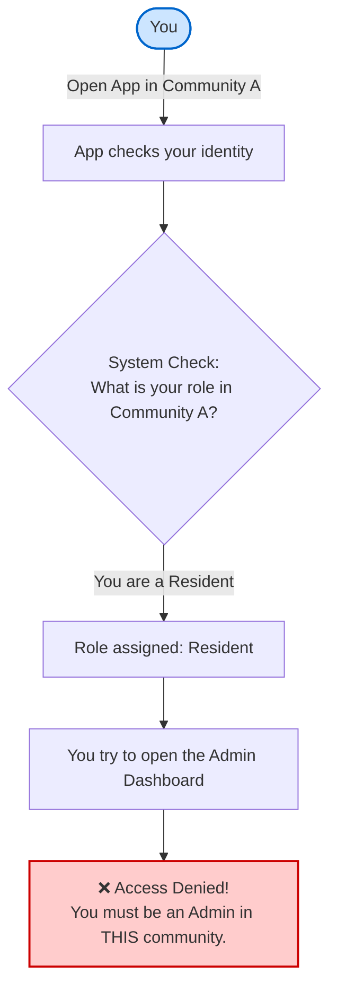
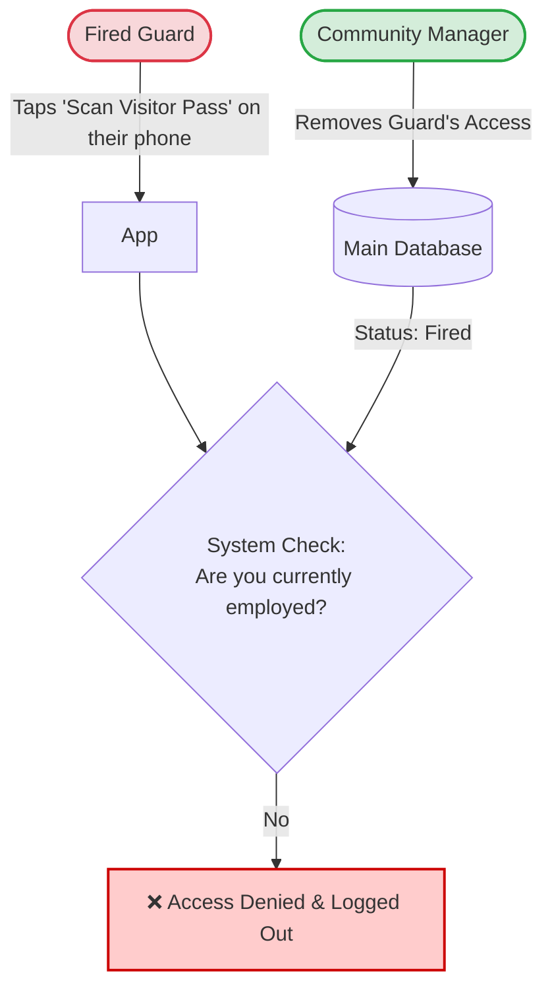
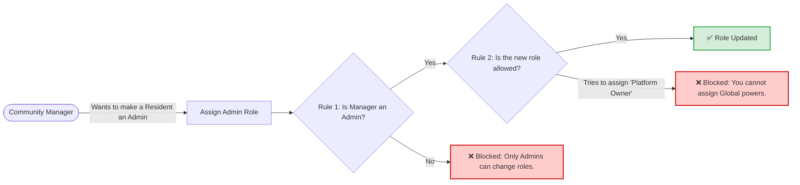

# How Your Community Access Works

This guide explains how the system keeps your community's data secure and ensures that everyone only sees what they are supposed to see.

### 1. The "Two-Community" Scenario (Cross-Tenant Security)
What happens if you are a **Resident** in *Community A*, but you are also an **Admin** in *Community B*? Will the system accidentally give you Admin powers in Community A? 

**No. The system strictly separates your roles.**

### 2. Live Security Updates (Role Revocation)
What happens if a Security Guard is fired or an Admin is removed, but they are still logged into the app on their phone? Can they still access the system?

**No. The system checks the database in real-time, on every tap.**

### 3. Assigning New Roles
How does a Community Manager give someone a new role, and how does the system prevent them from cheating?

### Summary of Your Security
* **Your identity is your key:** Your email/phone logs you in, but your *permissions* change completely depending on which community you are currently viewing.
* **Instant Lockout:** If your permissions are revoked, the app instantly blocks you the next time you tap a button.
* **No cheating:** You cannot trick the system into giving you Admin powers, even if you are an Admin somewhere else.
