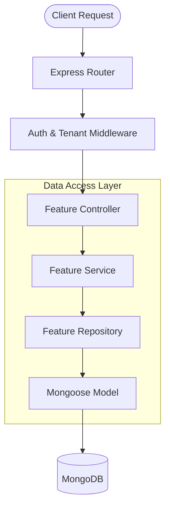
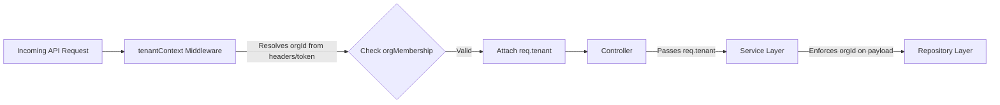

# Phase 2A — Database and Repository Inventory

## 1. Objective and Scope
This document provides a technical inventory of the database models, schemas, repositories, and data-access implementation in the application. It maps the project structure, details the standard representation of organization/tenant relationships, and traces a representative request flow through the data layers.

## 2. Repository and Model Inventory
The application uses a heavily modular, feature-based architecture. Over 160 distinct models and repositories reside within `backend/src/features/`.

### Core Groupings:
* **Tenant & Access Control:**
  * `organization`, `orgMembership`, `role`, `rolePermission`, `permission`, `workspace`
* **Amenity Management Subsystem:**
  * `amenityFacility`, `amenityReservation`, `amenitySlotAllocation`, `amenitySettings`, `amenityAccessPass`
* **Finance & Ledgering:**
  * `ledger`, `financialLedger`, `financialLedgerEntry`, `invoice`, `payment`, `wallet`
* **CRM & Communications:**
  * `crmInquiry`, `crmMeeting`, `crmTask`, `crmThread`, `directoryMessage`, `noticeBoard`
* **Platform Administration:**
  * `platformSubscription`, `platformInvoice`, `platformOrder`, `platformPayment`, `platformProvisioningJob`
* **Support & Auditing:**
  * `issueReport`, `auditLog`, `securityLog`

## 3. Representative Data Flow (Trace)
**Feature Traced:** `IssueReport` Submission

1. **Controller Layer** (`issueReport.controller.js`):
   - Extracts payload, user context (`req.user`), and tenant context (`req.tenant`).
   - Delegates to `issueReportService.submitReport()`.
2. **Service Layer** (`issueReport.service.js`):
   - Handles idempotency checks.
   - Extracts and sanitizes the `organisationId` from `tenantContext`.
   - Resolves the human-readable Organization Name via `organizationService`.
   - Assembles the validated schema object (including the `organisation` snapshot).
3. **Repository Layer** (`issueReport.repository.js`):
   - Handles atomic DB operations like `getNextReportNumber` using sequences.
   - Executes `IssueReport.create()` using Mongoose.
4. **Database Layer** (`issueReport.model.js`):
   - Validates data against the Mongoose schema before persisting to MongoDB.

## 4. Organization Data Representation
The application consistently utilizes Mongoose `ObjectId` references to bind records to their owning tenant.

**Example Implementation (Issue Report Schema):**
```javascript
const organisationSnapshotSchema = new Schema(
  {
    organisationId: { type: Schema.Types.ObjectId, ref: 'Organization', required: true, index: true },
    name: { type: String, required: true, trim: true },
  },
  { _id: false }
);
```
**Key Observations:**
* Tenant boundaries are enforced by requiring `organisationId` in nested schema snapshots.
* The fields are correctly indexed (`index: true`) for performance during tenant-scoped filtering.
* The service layer acts as the authoritative source for populating this field, deriving it directly from the authenticated `req.tenant` context rather than trusting client-provided body parameters.

## 5. Existing Documentation and Tests
* **Documentation:** Models use JSDoc annotations outlining parameter expectations. Features contain local `constants.js` enumerations enforcing strict schema types.
* **Tests:** The main `backend/src/features/` directories do not natively house `.spec.js` or `.test.js` alongside the repositories. The primary testing files identified in the root (`test_orgs.js`, `test_api.cjs`) appear to be manual integration or scratch scripts rather than an automated unit testing suite tightly coupled to individual repositories.

---

## 6. Architecture Diagrams

### A. Core Database Access Flow


### B. Tenant Context Resolution Flow

