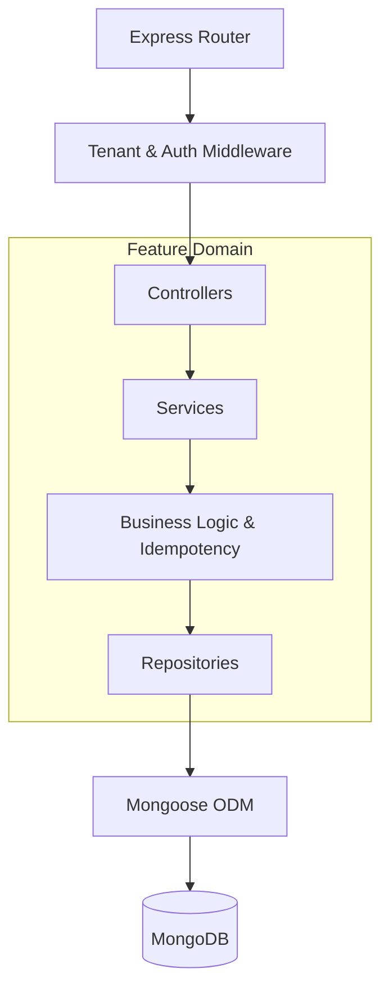
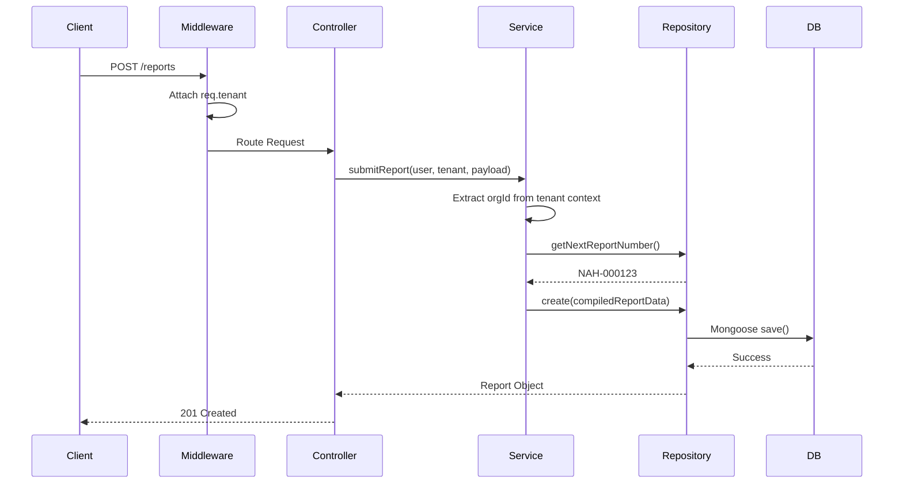

# Phase 2B — Repository Reference and Test Coverage Inventory

## 1. Repository Catalog by Domain

Below is a structured inventory of the primary feature domains, their underlying models, and data-access repositories located in `backend/src/features/`.

### Tenant Access Control
- **Models:** `role.model.js`, `permission.model.js`, `rolePermission.model.js`, `orgMembership.model.js`, `organization.model.js`
- **Repositories:** `role.repository.js`, `permission.repository.js`, `rolePermission.repository.js`, `orgMembership.repository.js`, `organization.repository.js`
- **Core Operations:** `findById`, `createRole`, `updateRolePermissions`, `getPermissionsForUser`, `findMemberships`

### Amenity Management
- **Models:** `amenityFacility.model.js`, `amenityReservation.model.js`, `amenitySlotAllocation.model.js`, `amenitySettings.model.js`
- **Repositories:** `amenityFacility.repository.js`, `amenityReservation.repository.js`, `amenitySettings.repository.js`
- **Core Operations:** `createReservation`, `checkSlotAvailability`, `getFacilitySettings`

### CRM
- **Models:** `crmInquiry.model.js`, `crmMeeting.model.js`, `crmTask.model.js`, `conversation.model.js`
- **Repositories:** `crmInquiry.repository.js`, `crmMeeting.repository.js`, `crmTask.repository.js`
- **Core Operations:** `createInquiry`, `updateTaskStatus`, `listConversations`

### Finance and Ledgering
- **Models:** `ledger.model.js`, `financialLedgerEntry.model.js`, `invoice.model.js`, `payment.model.js`, `wallet.model.js`
- **Repositories:** `financialLedger.repository.js`, `invoice.repository.js`, `payment.repository.js`, `wallet.repository.js`
- **Core Operations:** `createInvoice`, `recordPayment`, `updateWalletBalance`, `getLedgerEntries`

### Platform Administration
- **Models:** `platformSubscription.model.js`, `platformInvoice.model.js`, `platformOrder.model.js`
- **Repositories:** `platformSubscription.repository.js`, `platformInvoice.repository.js`, `platformOrder.repository.js`
- **Core Operations:** `getAllSubscriptions`, `createPlatformOrder`, `renewSubscription`

### Issue Reporting
- **Models:** `issueReport.model.js`, `issueReportSequence.model.js`
- **Repositories:** `issueReport.repository.js`
- **Core Operations:** `getNextReportNumber`, `createReport`, `findReportsByOrg`, `findAllPlatformReports`

---

## 2. Existing Test Inventory

The backend test suite is primarily located in `backend/tests/`. The naming convention (`*.test.js`) and structure indicate the use of standard JavaScript testing frameworks (such as Jest or Mocha).

*Note: These tests were inventoried via file inspection. They have not been executed during this documentation task, and their passing status is unknown.*

### Key Identified Test Files:
- **Tenant Access Control & Auth:**
  - `backend/tests/multiOrgAuth.test.js` (Multi-organization authentication flows)
  - `backend/tests/features/rbac/governanceRbac.test.js` (Role-Based Access Control logic)
  - `backend/tests/auth.integration.test.js`
- **Finance & Billing:**
  - `backend/tests/e2e_billing_invoice.test.js`
  - `backend/tests/invoice.repository.test.js` (Repository-specific testing)
  - `backend/tests/wallet_recharge_security.test.js`
  - `backend/tests/wallet.integration.test.js`
- **Community Engagement & Governance:**
  - `backend/tests/features/communityEngagement/communityEngagementCron.test.js`
  - `backend/tests/features/poll/pollGovernance.service.test.js`
  - `backend/tests/features/noticeBoard/noticeGovernance.service.test.js`
  - `backend/tests/features/scheduler/governanceScheduler.test.js`

### Manual Test Scripts:
A significant number of manual testing/scratch scripts exist at the root of `backend/` (e.g., `test_auth.mjs`, `test_orgs.js`, `test_repo.mjs`). These appear to be developer scratchpads rather than automated CI tests.

---

## 3. Data Model Documentation & Ownership Fields

Organization ownership is primarily handled via direct Mongoose `ObjectId` references to the `Organization` collection. 

### Common Ownership Fields
- `orgId` / `organisationId`: Represents the primary tenant boundary.
- `isTenantRole`: Boolean flag indicating if a role is specific to a community versus a global platform role.
- `isPlatform`: Boolean flag determining global system administrator overrides.

### Representative Data Flow (Issue Reporting)

1. **Controller (`issueReport.controller.js`)**: Receives the incoming POST payload and the `req.tenant` object (populated by `tenantContext` middleware).
2. **Service (`issueReport.service.js`)**: Extracts `organisationId` explicitly from the validated `req.tenant` context. Resolves the human-readable organization name. Compiles the final schema object.
3. **Repository (`issueReport.repository.js`)**: Receives the fully compiled, tenant-bound object from the service. Calls MongoDB to fetch a sequence number and persists the document using `IssueReport.create()`.
4. **Model (`issueReport.model.js`)**: Validates the `organisationSnapshotSchema`, ensuring `organisationId` is a valid `ObjectId` before allowing the database write.

---

## 4. Architecture Diagrams

### Repository Architecture Flow

### Issue Reporting Creation Flow

---

## 5. Documentation Gaps and Engineering Recommendations

Based strictly on the file inventory, the following areas require future engineering attention:
1. **Uneven Test Coverage:** While domains like `poll`, `rbac`, and `finance` have dedicated integration and unit tests, other core domains (e.g., `issueReport`, `crmInquiry`) lack visible co-located `.test.js` or `.spec.js` files.
2. **Repository Unit Testing:** Only one dedicated repository test (`invoice.repository.test.js`) was identified. Most testing appears to happen at the Service/E2E layer. Adding isolated unit tests for repositories is recommended.
3. **Manual Scripts Consolidation:** The abundance of root-level `test_*.js` scratch scripts should be evaluated, formalized into the automated Jest/Mocha suite, and removed from the production structure to reduce clutter.
