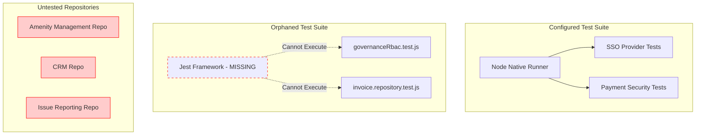

# Phase 2C — Repository Test Coverage and Verification

## 1. Baseline Context
- **Current Branch:** `security/phase2-repository-tenant-isolation`
- **Working Tree Status:** Multiple modified and untracked files present. Working directory preserved as-is.

## 2. Test Framework and Configuration
An inspection of `backend/package.json` reveals a significant discrepancy in the testing architecture:
- **Configured Framework:** The `"test"` script is configured to use the native Node.js test runner (`node --test`), explicitly hardcoded to run only four specific `.mjs` files related to SSO (Apple/Google), Payment Security, and Onboarding.
- **Orphaned Test Suite:** The majority of the application's feature tests (e.g., `invoice.repository.test.js`, `governanceRbac.test.js`) are written using the **Jest** framework (`describe`, `it`, `jest.spyOn`). However, `jest` is neither configured in the NPM scripts nor installed in the `devDependencies`.

## 3. Test Execution and Results
- **Command Executed:** `npm test` (Safe execution, no destructive DB commands detected in configured tests).
- **Exit Code:** `1`
- **Actual Results:** 
  - 20 total tests executed across 3 suites.
  - 18 tests passed (Apple SSO, Payment Security, Phase 10 Onboarding).
  - 2 tests failed (Google SSO client ID assertion mismatches).
- **Skipped Tests:** All Phase 2 feature and repository tests were skipped. **Reason:** The `jest` framework required to run them is missing from the project environment, rendering them unexecutable without modifying `package.json` (which violates the read-only constraints of this phase).

## 4. Coverage Mapping (Phase 2 Domains)

| Domain | Repository / Model | Identified Test Files | Coverage Status |
| :--- | :--- | :--- | :--- |
| **Tenant Access Control** | `role`, `permission`, `orgMembership` | `governanceRbac.test.js`, `multiOrgAuth.test.js` | ⚠️ Found but not executed (Missing Jest) |
| **Amenity Management** | `amenityFacility`, `amenityReservation` | None found | ❌ No relevant test found |
| **CRM** | `crmInquiry`, `crmMeeting`, `crmTask` | None found | ❌ No relevant test found |
| **Finance and Ledgering** | `invoice`, `ledger`, `wallet` | `invoice.repository.test.js`, `e2e_billing_invoice.test.js` | ⚠️ Found but not executed (Missing Jest) |
| **Platform Admin** | `platformSubscription`, `platformOrder` | None found | ❌ No relevant test found |
| **Issue Reporting** | `issueReport`, `auditLog` | None found | ❌ No relevant test found |

## 5. Coverage Gaps & Implementation Priorities
1. **Critical Framework Gap:** The most urgent priority is installing `jest` and configuring a secondary NPM script (e.g., `npm run test:features`) so the existing repository and service tests can actually be executed in CI/CD.
2. **Missing Repository Unit Tests:** Even if Jest were configured, domains like Amenity Management, CRM, Platform Admin, and Issue Reporting have **zero** identifiable test files.
3. **Over-reliance on Manual Scripts:** The project contains dozens of root-level `test_*.js` scratch scripts (e.g., `test_orgs.js`, `test_visitor_log.mjs`). These are manual developer scripts, not automated assertions.

## 6. Testing Architecture Map

