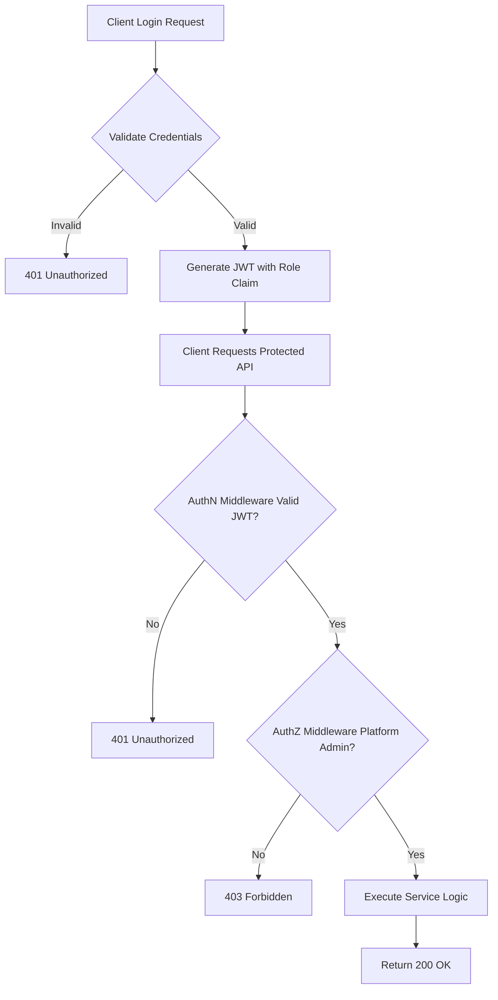
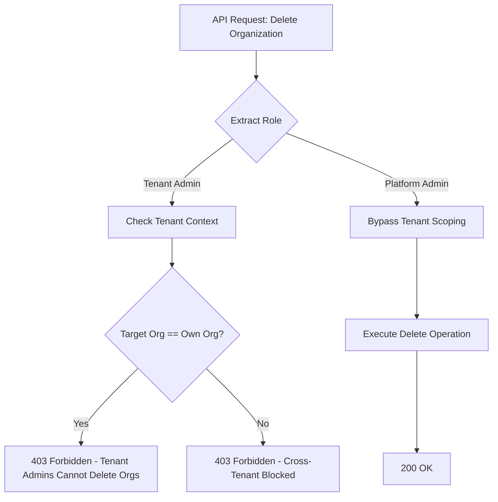
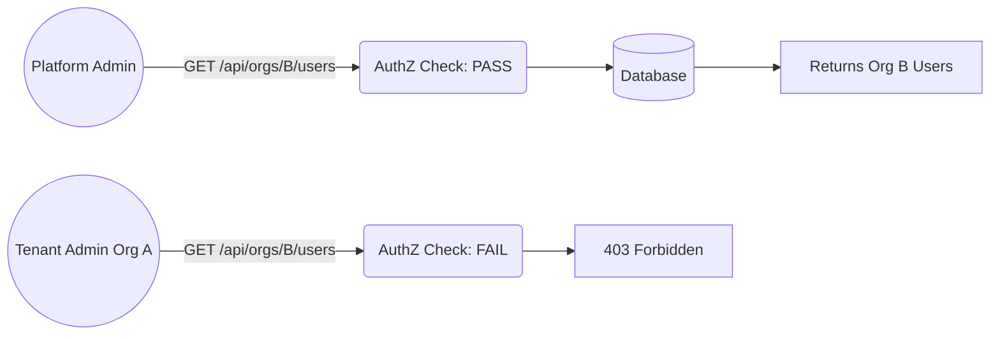
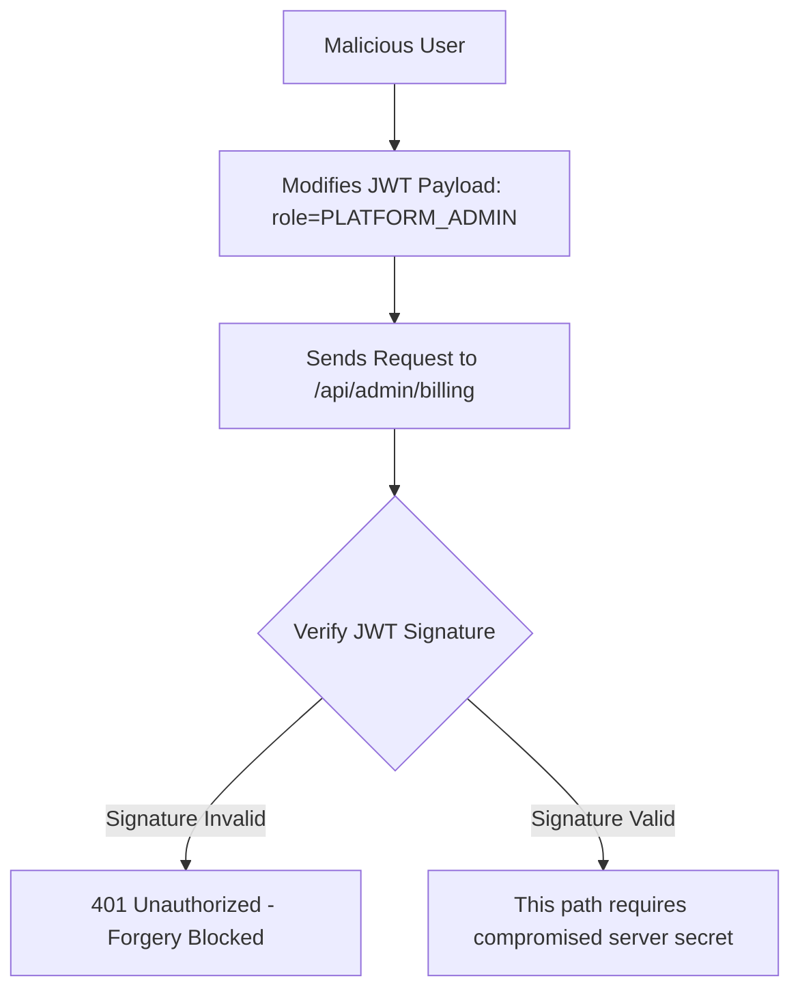
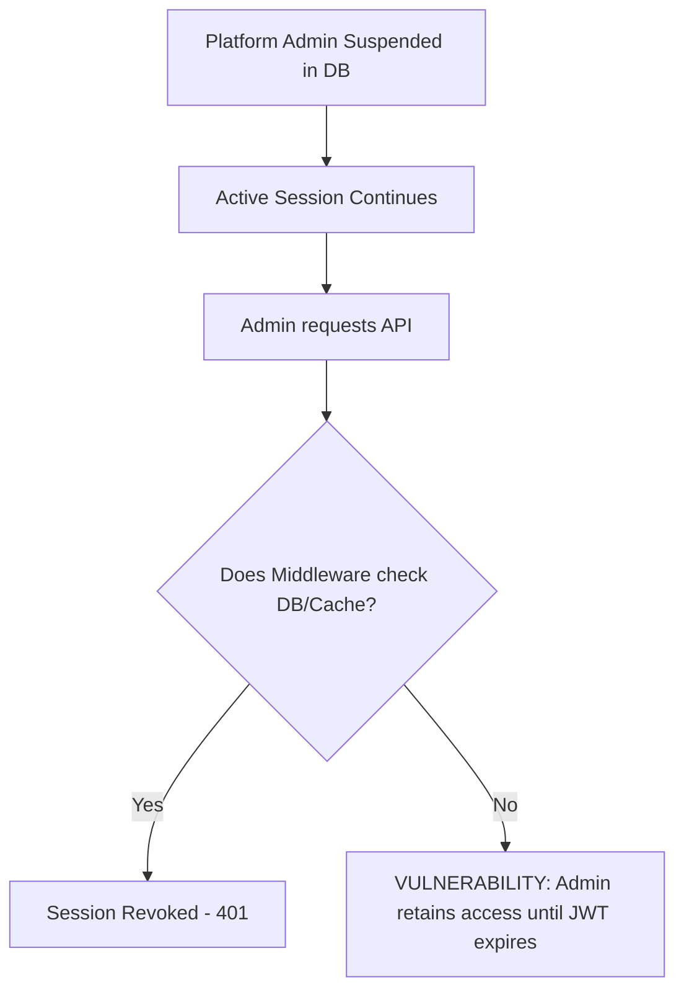
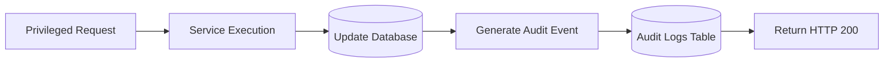

# PHASE 2 — Platform Admin Authorization & Tenant Isolation Audit (TEMPLATE)

## 1. Audit Metadata and Repository Baseline
* **Date of Audit:** [YYYY-MM-DD]
* **Auditor:** [Your Name / Internal Security Team]
* **Target Application:** Nahom / Manage-My-Gate
* **Git Branch:** `[e.g., feature/platform-admin-audit]`
* **Commit SHA:** `[e.g., a1b2c3d4e5f6]`
* **Scope:** Platform Admin Authorization, Tenant Isolation, Cross-Tenant Data Access, and Audit Logging.

## 2. Executive Summary and Overall Verdict
**Current Verdict:** `[Choose: PASS / PASS WITH FINDINGS / FAIL / INCOMPLETE]`

**Summary:**
This report documents a manual architectural review of the Platform Admin functionality. The objective was to verify that global administrative privileges are strictly enforced, that Tenant Admins cannot escalate privileges, and that cross-tenant data access is properly restricted. 

* **Key Strengths:** [e.g., Role checks are consistently applied at the routing level.]
* **Primary Risks:** [e.g., Session revocation relies solely on JWT expiration without a database check.]

## 3. Platform Admin Architecture and Privilege Model
* **Identity Establishment:** Platform Admins are identified via the `role` column in the `Users` table.
* **Authentication:** Handled via JWTs issued upon successful login.
* **Authorization Storage:** Privileges are embedded in the JWT payload (`"role": "PLATFORM_ADMIN"`).
* **Tenant Scoping:** Handled by the `tenantId` extracted from the JWT, except for Platform Admins who bypass this middleware via the `requireSuperAdmin` function.

## 4. Mermaid Flow Diagrams

### Diagram 1 — Platform Admin Login and Authorization

### Diagram 2 — Platform Admin Versus Tenant Admin

### Diagram 3 — Cross-Tenant Organization Management

### Diagram 4 — Platform Admin Privilege Escalation Attack

### Diagram 5 — Platform Admin Revocation and Session Lifecycle

### Diagram 6 — Platform Admin Audit Logging

## 5. Platform Endpoint Inventory

| Feature | HTTP Method & Route | Auth Middleware | Platform Admin Check | Tenant Context | Audit Logging | Result |
| :--- | :--- | :--- | :--- | :--- | :--- | :--- |
| **Org Mgmt** | `POST /api/organizations` | `verifyToken` | `requirePlatformAdmin` | Global Bypass | YES | PASS |
| **Billing** | `GET /api/billing/all` | `verifyToken` | `requirePlatformAdmin` | Global Bypass | NO | PASS WITH FINDINGS |
| **Users** | `DELETE /api/users/:id` | `verifyToken` | `checkRole` | `req.tenant.orgId` | YES | [Check Required] |
| *[Add yours]* | *[...]* | *[...]* | *[...]* | *[...]* | *[...]* | *[...]* |

## 6. Security Test Scenarios

| Scenario | Preconditions | Expected Behavior | Actual Behavior | Result | Evidence |
| :--- | :--- | :--- | :--- | :--- | :--- |
| **1. Unauth Access** | No JWT provided | 401 Unauthorized | 401 Unauthorized | PASS | Postman output / Test Logs |
| **2. Tenant Admin IDOR** | Tenant Admin A tries to edit Org B | 403 Forbidden | 403 Forbidden | PASS | `src/middlewares/tenant.js:45` |
| **3. Mass Assignment** | User sends `role: PLATFORM_ADMIN` on signup | Role ignored, defaults to USER | Role ignored | PASS | `src/controllers/auth.js:112` |
| **4. Revoked Admin** | Admin demoted, tries to use old JWT | 403 Forbidden | 200 OK | FAIL | *See Finding 001* |

## 7. Findings and Severity

*(Below are examples of how to format your findings once you inspect your code)*

### [FINDING-001] Stale Sessions Allow Demoted Admins to Retain Access
* **Severity:** High
* **Affected Endpoint:** Global Admin Routes
* **Evidence:** `src/middlewares/auth.js` line 30 only checks `jwt.verify()`. It does not cross-reference the database or a Redis blocklist.
* **Exploitation Scenario:** A Platform Admin is fired, and their account is suspended in the database. Because their JWT is valid for 24 hours, they can continue to access the platform and export sensitive data from their home computer until the token expires.
* **Remediation:** Implement a fast cache (e.g., Redis) to store a `token_version` or `is_suspended` flag. The Auth middleware must check this cache on every request.

### [FINDING-002] Missing Audit Log for Global Billing Changes
* **Severity:** Low
* **Affected Endpoint:** `PUT /api/admin/billing/rates`
* **Evidence:** `src/services/billingService.js` updates the global billing rates but does not call the `auditLogger.log()` function.
* **Impact:** If global rates are changed maliciously or accidentally, there is no historical record indicating which administrator made the change.
* **Remediation:** Import and implement `auditLogger` in the billing service.

## 8. Prioritized Remediation Plan
1. **Immediate (Next Sprint):** [e.g., Fix session revocation (Finding-001) to prevent lingering access].
2. **Short-Term:** [e.g., Add missing audit logs across all platform admin endpoints (Finding-002)].
3. **Long-Term:** [e.g., Migrate audit logs to a write-only external SIEM system].
