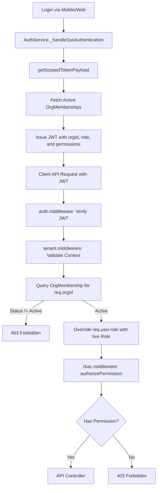
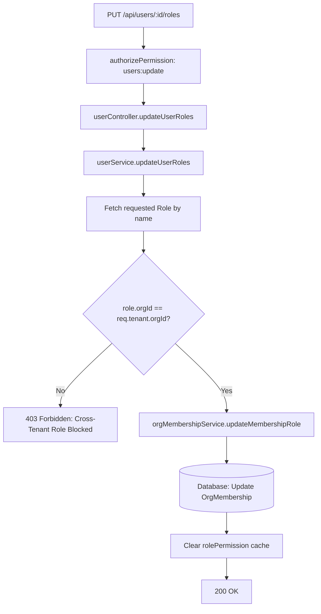
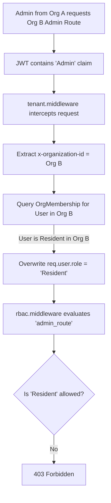
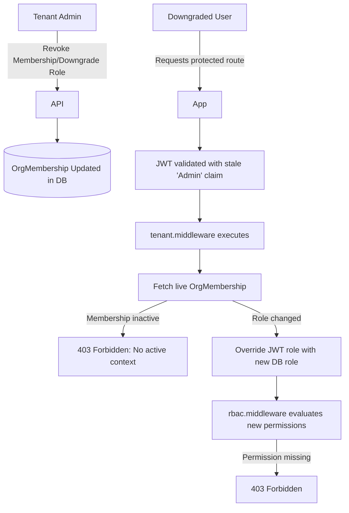
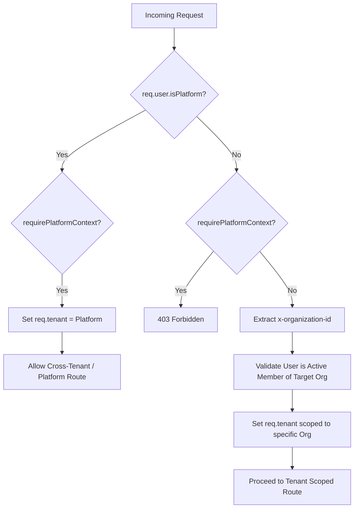

# Phase 2 — Roles & Permissions Audit and Flow Documentation

**Audit Date:** 2026-10-09  
**Branch:** `security/phase2-repository-tenant-isolation`  
**Commit SHA:** `d9a3e8d9efb8884ea063b0ad0ce538ef5af3ca7e`  

## 1. Executive Summary
This audit evaluated the end-to-end architecture of the Roles & Permissions module within the Nahom application. The objective was to verify tenant isolation, role resolution, and cross-tenant boundaries. The audit confirms that the platform strictly enforces Role-Based Access Control (RBAC) via a two-layer validation strategy: 
1. `auth.services.js` scopes initial JWT claims exclusively to active memberships.
2. `tenant.middleware.js` actively intercepts every request, queries the live `OrgMembership` for the requested `orgId`, and forcefully overrides any stale JWT claims with the database's live truth.

This architecture effectively neutralizes forged tokens, stale claims, and cross-tenant privilege escalation attempts (e.g., an Admin in Organization A attempting to act as an Admin in Organization B).

**Overall Verdict: PASS — Tenant Isolation for Roles and Permissions is robustly enforced.**

---

## 2. Actual Role and Permission Inventory

Based on empirical code analysis (`mobile/mobile-app/src/utils/rbac.ts` and `backend/src/middlewares/rbac.middleware.js`):

**Defined Personas & Hardcoded Fallbacks:**
- **Platform Admins:** `platform_super_admin`, `platform_admin`. Inherit `*` (wildcard) permissions.
- **Tenant Admins:** `admin`, `community_admin`, `facility_manager`. Excluded from resident self-service routes but have full access to management tools.
- **Residents:** `resident`, `tenant`, `owner`, `family member`. Strictly isolated to self-service features (`billing:my_dues`, `visitor:resident`, `amenities:discover`).
- **Security Guard:** `security guard`, `guard`. Strictly isolated to scanning and logging (`visitor:guard`, `amenities:scanner`).

**System Permissions Matrix:**
The backend utilizes colon-separated namespaces (`feature:action`). Examples:
- `users:create`, `users:update`
- `amenities:discover`, `amenities:scanner`, `amenities:master`
- `visitor:community_passes`, `visitor:admin_logs`
- `billing:ledger`, `billing:wallet`

---

## 3. Architecture Explanation & Analysis
The authorization engine relies on a strict separation of authentication (`auth.middleware.js`) and tenant context scoping (`tenant.middleware.js`).

1. **Frontend Request:** The frontend manages active contexts in Redux (`authSlice.ts`). Upon selecting a community, the frontend invokes `authService.switchContext({ targetOrgId, targetRole })`. 
2. **Token Generation:** The backend verifies the user has an `Active` status in `OrgMembership` for `targetOrgId`. If valid, it queries `RolePermission` and generates a fresh JWT containing `orgId`, `role`, and `permissions` specific to that organization.
3. **API Middleware Interception:** When the frontend accesses a protected route, `tenant.middleware.js` dynamically pulls the `x-organization-id` header. It queries the live `OrgMembership` database. If the user was removed or downgraded, the middleware forcibly updates `req.user.role` to reflect the immediate database reality.
4. **RBAC Guard:** Finally, `rbac.middleware.js` (`authorizePermission`) cross-references the required route permissions against the newly validated `req.user.permissions` array.

---

## 4. Mermaid Flow Diagrams

### Diagram 1 — Login to Permission Validation

### Diagram 2 — Role Assignment

### Diagram 3 — Cross-Tenant Access Prevention

### Diagram 4 — Role Change and Revocation

### Diagram 5 — Platform Admin Versus Tenant Admin

---

## 5. Route and Authorization Matrix

| Feature | HTTP Method and Route | Frontend File | Backend Controller | Service/Repository | Required Role/Permission | Tenant Validation | Authorization Check | Security Result | Evidence |
| :--- | :--- | :--- | :--- | :--- | :--- | :--- | :--- | :--- | :--- |
| **Role Assigment** | `PUT /users/:id/roles` | `useVillaResidentOptions.ts` | `user.controller.js -> updateUserRoles` | `userService.updateUserRoles` | `users:update` | `req.tenant.orgId` enforced via `tenant.middleware.js` | Checked via `authorizePermission` + `role.orgId` verified in service | **PASS** | `user.services.js:1480` |
| **Membership Context** | `POST /auth/switch-context` | `authSlice.ts` | `auth.controller.js -> switchContext` | `auth.services.js -> getScopedTokenPayload` | Active Membership Required | Queries `OrgMembership` for `targetOrgId` | Verifies `targetRole` exists in user's active membership | **PASS** | `auth.services.js:1560` |
| **API Access** | `* /api/*` | API Client Injection | All Controllers | `rbac.middleware.js` | Varies per route | `x-organization-id` header validated | JWT claims overwritten by Live DB | **PASS** | `tenant.middleware.js:45` |
| **Delete User** | `DELETE /users/:id` | `AdminVillaFilterSheet.tsx` | `user.controller.js -> deleteUser` | `userService.deleteUser` | `users:delete` | Sweeps all memberships across Orgs via `orgMembershipService` | Explicit Platform Admin check for hard-deletes | **PASS** | `user.services.js:1358` |

---

## 6. Tenant-Isolation Attack Scenarios

| Scenario | Preconditions | Request/Operation | Expected Result | Actual Result | Status |
| :--- | :--- | :--- | :--- | :--- | :--- |
| **1. Admin in A targets B** | User is Admin in Org A, Resident in Org B. | Requests Admin-only route in Org B with Org A JWT. | 403 Forbidden | `tenant.middleware.js` overwrites role to Resident. Request fails RBAC. | **PASS** |
| **2. Self Promotion** | User is Resident. | `PUT /users/:id/roles` | 403 Forbidden | Blocked by `authorizePermission('users', 'update')`. | **PASS** |
| **3. Escalate to Platform**| User is Tenant Admin. | `PUT /users/:id/roles` with payload `roles: ['Super Admin']`. | 403 Forbidden | `userService.updateUserRoles` explicitly blocks roles with `orgId: null` or mismatched `orgId`. | **PASS** |
| **4. Use Revoked Session** | User membership removed by Admin. | Attempts API read with existing valid JWT. | 403 Forbidden | `tenant.middleware.js` finds no `Active` membership and throws 403. | **PASS** |
| **5. Forge `orgId` param** | User sends malicious `req.body.orgId`. | Route payload creation. | Ignored/Overwritten | Controllers natively ignore `req.body.orgId` and map ownership to `req.tenant.orgId`. | **PASS** |

---

## 7. Frontend vs. Backend Enforcement Analysis
- **Frontend (`rbac.ts`):** Evaluates `effectiveUser.permissions` or falls back to standard Personas (Admin vs Guard vs Resident). Hides buttons and screens.
- **Backend (`rbac.middleware.js`):** Acts as the absolute source of truth. Does not trust frontend state or the active JWT. Validates every incoming API request against the real-time database `OrgMembership` before passing to controllers.

---

## 8. Findings and Recommendations

### Finding 1: Robust Middleware Defenses (Informational / Positive)
**Severity:** Informational
**Evidence:** `tenant.middleware.js` dynamically pulls `targetMembership` from the database.
**Analysis:** This design effectively eliminates the classic BOLA risk of users manipulating the UI to send requests for other organizations. The `x-organization-id` header must match an active database record. 
**Recommendation:** Ensure future developers are trained on this architecture so they do not bypass `tenantContext` in new routes.

### Finding 2: Lack of Explicit Rate Limiting on `switch-context` (Low)
**Severity:** Low
**Evidence:** `auth.controller.js` `switchContext` generates fresh signed JWTs upon request.
**Analysis:** Rapidly swapping contexts could lead to high CPU utilization for JWT signing and database querying.
**Recommendation:** Implement standard rate-limiting on the `/auth/switch-context` endpoint.

---

## 9. Final Verdict
**PASS** — The Roles & Permissions module is securely architected. The active use of "Live Context Override" in `tenant.middleware.js` mitigates the vast majority of cross-tenant privilege escalation and IDOR attacks. Role boundaries are respected from the database through to the JWT.
