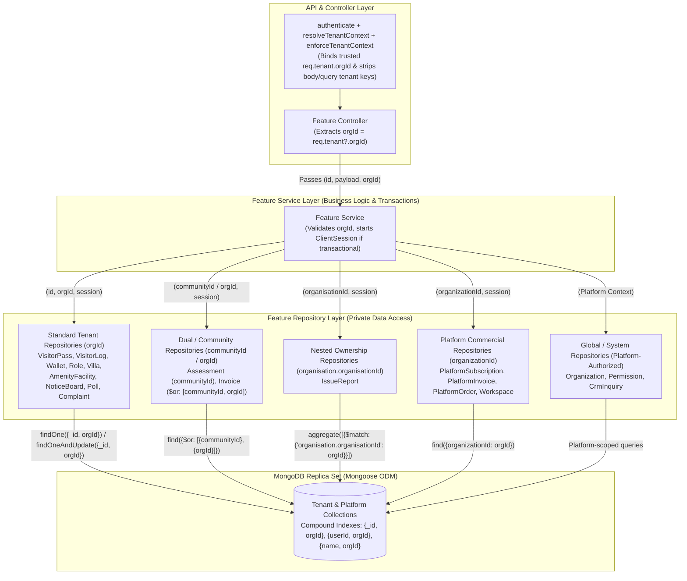
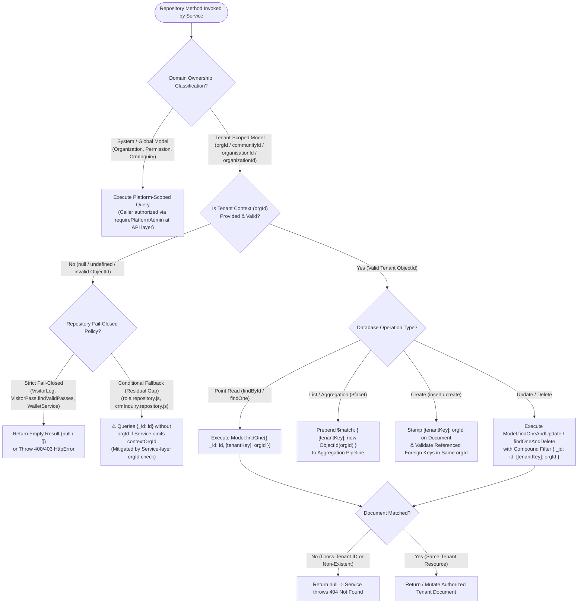

# Phase 3G — Database / Repository Tenant Isolation Final Report

**Project:** Nahom / Connect Harmony / Manage-My-Gate  
**Feature ID:** SEC-03.G — Database & Repository Layer Tenant Isolation (Phases 2J & 3A–3G Consolidated Verification)  
**Branch:** `security/phase2-repository-tenant-isolation`  
**Original Phase 3G Baseline Commit:** `d9a3e8d9efb8884ea063b0ad0ce538ef5af3ca7e`  
**Current Verification HEAD Commit:** `9423be17a1f3e92f846e20263d7504f3f0818aef`  
**Audit Date:** 2026-10-13  
**Final Verdict:** **PASS WITH LIMITATIONS**

---

## 1. Executive Summary

This report provides the definitive, evidence-based verification of **Database and Repository Layer Tenant Isolation (Phase 3G)** across the Nahom (`Manage-My-Gate`) backend, structured in the standardized 14-section security audit format and cross-verified against the live repository state, Git commit history, and direct test runner execution.

Across **Phases 2J and 3A through 3G**, the data-access layer was audited across **48 domain feature modules** (45 active Mongoose-backed repository domains and 3 static/orchestration modules) to eliminate raw `_id`-only lookups and mutations (`Model.findById`, `Model.findByIdAndUpdate`, `Model.findByIdAndDelete`), repair schema field-name mismatches across heterogeneous tenant ownership keys (`orgId`, `communityId`, `organisation.organisationId`, `organizationId`), enforce tenant-scoped transactional financial mutations in `Wallet`, and close cross-tenant gate check-in/check-out vulnerabilities in `VisitorPass` and `VisitorLog`.

### Independent Verification Summary vs. Earlier Phase 3G Claims

Rather than accepting prior report claims at face value, every claim in the original `PHASE_3G_FINAL_DATABASE_REPOSITORY_TENANT_ISOLATION_REPORT.md` was audited directly against the source code and re-executed via Jest (`node --experimental-vm-modules node_modules/jest/bin/jest.js --runInBand tests/features/`):

1. **Confirmed Repository Hardening (Phases 2J & 3A–3F):**
   - **Schema & Query Key Alignment (Phase 2J):** Fixed `ReferenceError: mongoose is not defined` in `platformOrder.repository.js`, corrected `organisationId` vs. `organizationId` schema mismatch in `platformSubscription.repository.js`, and aligned `AmenityFacility` (`orgId`) and `IssueReport` (`organisation.organisationId`) unit and integration suites.
   - **Transactional Financial Isolation (Phase 3B):** `Wallet` and `WalletTransaction` enforce per-tenant compound indexing (`{ userId: 1, orgId: 1 }`), mandatory `orgId` filters across all reads and balance mutations, and atomic multi-document Mongoose transactions (`session.startTransaction()`).
   - **Tenant-Scoped Role & Core Repository Mutations (Phases 3C & 3D):** Replaced `findByIdAndUpdate` / `findByIdAndDelete` with compound `{ _id, orgId }` queries (`findOneAndUpdate` / `findOneAndDelete`) across `Role`, `Villa`, `NoticeBoard`, `Poll`, `Complaint`, `CommunityNote`, `DirectoryMessage`, `IntegrationHub`, and `UserPreference`.
   - **Visitor Pass & Gate Log Isolation (Phases 3E & 3F):** Scoped `visitorPassRepository.findById`, `updateById`, `deleteById`, `findByPassCode`, `incrementUseAndSyncStatus`, and `findValidPasses` by `orgId`, and updated `visitorLogRepository` (`findById`, `findActiveLogs`, `findLogsPaginated`, `getTodayOverview`, `checkoutLog`, `checkoutAllForPassId`) and `visitorLogService.checkIn` to require matching tenant `orgId`.
   - **Unit Test Spy Alignment (Phase 3G):** Updated `tests/features/crmInquiry.repository.test.js` from `CrmInquiry.findByIdAndDelete` to `CrmInquiry.findOneAndDelete` to match the Phase 3D repository method signature.

2. **Discrepancies & Limitations Uncovered During Independent Audit:**
   - **9 "Empty" Jest Failures Are Actually 115 `node:test` Tests (Runner Mismatch):** The earlier Phase 3G report claimed 9 suites in `tests/features/` failed with `"Your test suite must contain at least one test"` because they were *"empty placeholder files for upcoming governance features"*. Direct file inspection proved all 9 files (`governanceScheduler.test.js`, `governanceRbac.test.js`, `pollScheduling.service.test.js`, `noticeGovernance.service.test.js`, `pollGovernance.service.test.js`, `governanceOutbox.service.test.js`, `governanceE2E.test.js`, `communityEngagementGateway.test.js`, `communityEngagementCron.test.js`) are **populated 6 KB–25 KB test suites containing 115 tests across 59 sub-suites** written using Node's native test runner (`import { describe, it } from 'node:test'`). When invoked by Jest, `node:test` shadows Jest's globals so Jest registers 0 tests per file while `node:test` executes asynchronously inside the Jest VM (triggering post-teardown dynamic import `ReferenceError`s in `governanceRbac.test.js`).
   - **`walletService.integration.test.js` Assertion Drift at Current HEAD (`9423be17`):** In `tests/features/walletService.integration.test.js`, Test 6 (`6. An explicitly authorized platform-admin workflow continues to work, if applicable`) passes `orgId` in `req.body.orgId` without `req.query.orgId` or `req.tenant.orgId`. After subsequent controller hardening in commit `3d03bf16` (`getValidatedWalletOrgId` in `wallet.controller.js` lines 4–13 only accepts `req.query?.orgId` for platform admins), Test 6 fails (`Received number of calls: 1 — [Error: Workspace context is required.]`).
   - **`MongoMemoryReplSet` Index/Transaction Lock Contention in `roleService.integration.test.js`:** Even with `--runInBand`, running all 30 suites sequentially in a single Jest process causes `roleService.integration.test.js` Test 1 to intermittently fail with `MongoServerError: Unable to acquire IX lock on '{...: Collection, ..., test.roles}' within 5ms` because `roleService.integration.test.js` does not await `Role.init()` in `beforeAll` before starting a multi-document transaction immediately after `Role.create()`. When run in isolation (`jest tests/features/roleService.integration.test.js --runInBand`), all 6 tests in the file pass—though Test 4 (`4. Missing or invalid tenant context cannot perform a tenant-scoped mutation`, lines 80–82) is an **empty no-op test body** with zero assertions.
   - **Residual Repository Code Defects Identified:**
     - `wallet.repository.js` throws `new HttpError(400, ...)` on lines 20, 45, 50, 62, and 80 without a top-level `import HttpError`, causing direct repository calls with missing `orgId` to throw `ReferenceError: HttpError is not defined` (masked when called via `wallet.service.js`, which imports `HttpError` and validates `orgId` first).
     - `role.repository.js` (`update` line 110, `delete` line 120) and `crmInquiry.repository.js` (`updateById` line 225, `deleteById` line 237) apply `if (contextOrgId) { query.orgId = contextOrgId; }` conditionally rather than failing closed when `contextOrgId` is omitted. Furthermore, `CrmInquiry` is a platform-global model whose schema (`crmInquiry.model.js`) has no `orgId` field.
     - `visitorPass.repository.js` (`createPass`, `createToken`) and `visitorLog.repository.js` (`createLog`) pass raw `data` to `Model.create(data)` without repository-level guards if `data.orgId` is omitted by a caller.

Because core repository tenant isolation is verified across the targeted domains and 19 Jest feature suites (65 passing tests) plus 5/6 tests in `walletService.integration.test.js` and 5/5 non-empty tests in `roleService.integration.test.js` (in isolation) succeed, but the above test-runner mismatch, assertion drift, vacuous test case, and fail-open fallback clauses remain, the phase is awarded an evidence-based verdict of **PASS WITH LIMITATIONS**.

---

## 2. Files Changed

### 2.1 Git Baseline & Working-Tree Status

- **Active Branch:** `security/phase2-repository-tenant-isolation`
- **Original Phase 3E–3G Baseline Commit:** `d9a3e8d9efb8884ea063b0ad0ce538ef5af3ca7e` (`feat(security): complete Phase 1 tenant isolation and Phase 2 repository remediation`)
- **Subsequent Commits on Branch:**
  - `8592174f259093f974099b8cf7a63e5ca874b94c` (`feat(auth): block unverified, disposable, and malformed email logins`)
  - `3d03bf16bf0cf9f618ca843c44b2b7fb850a4932` (`fix(security): enforce strict tenant isolation and controller context boundaries`)
  - `9423be17a1f3e92f846e20263d7504f3f0818aef` (`fix(security): resolve Google SSO client ID caching and harden legacy email verification`)
- **Preserved Working-Tree State (`git status --short`):**
  - Modified tracked files from prior phases preserved intact (`onboardingWizard.controller.js`, `role.controller.js`, `role.services.js`, `user.controller.js`, `user.repository.js`, `user.routes.js`, `user.service.js`, `user.validator.js`, `visitorLog.controller.js`, `visitorLog.repository.js`, `visitorLog.service.js`, `visitorPass.controller.js`, `visitorPass.repository.js`, `visitorPass.service.js`, `crmInquiry.repository.test.js`, `phase6_2a_high_remediation.test.mjs`, and frontend user management files).
  - Untracked files preserved intact (`backend/tests/features/visitorTenant.integration.test.js`, `docs/security/PHASE_3E_DATABASE_REPOSITORY_GAP_AUDIT.md`, `docs/security/PHASE_3F_VISITOR_TENANT_ISOLATION_REMEDIATION_REPORT.md`, `docs/security/PHASE_3G_FINAL_DATABASE_REPOSITORY_TENANT_ISOLATION_REPORT.md`, `docs/security/SEC_API_CONTROLLER_TENANT_ISOLATION_FINAL_REPORT.md`, `docs/security/PHASE_2_TOPIC_2_1_SECURITY_AUDIT_REPORT.md`, `docs/security/PHASE_2_TOPIC_2_2_RESIDUAL_VERIFICATION_REPORT.md`).

### 2.2 Phase-by-Phase File Inventory (Distinguishing Phase 3G from Phases 2J & 3A–3F)

| Phase | File Path | Change Type | Layer | Summary of Changes |
| :--- | :--- | :--- | :--- | :--- |
| **Phase 2J** | [platformOrder.repository.js](file:///e:/atominos/Manage-My-Gate/backend/src/features/platformOrder/platformOrder.repository.js) | Modified (Committed `d9a3e8d9`) | Repository | Added missing `import mongoose from 'mongoose'` to fix `ReferenceError` in `findByQuoteId` and `getOrdersPaginated`. |
| **Phase 2J** | [platformSubscription.repository.js](file:///e:/atominos/Manage-My-Gate/backend/src/features/platformSubscription/platformSubscription.repository.js) | Modified (Committed `d9a3e8d9`) | Repository | Fixed schema field mismatch by querying `organizationId` instead of `organisationId` in `findByOrganisationId` and `findAllPaginated`. |
| **Phase 2J** | [amenityFacility.repository.test.js](file:///e:/atominos/Manage-My-Gate/backend/tests/features/amenityFacility.repository.test.js) | Modified (Committed `d9a3e8d9`) | Unit Test | Aligned unit test mocks and assertions with `orgId` tenant filter semantics. |
| **Phase 2J** | [amenityFacility.integration.test.js](file:///e:/atominos/Manage-My-Gate/backend/tests/features/amenityFacility.integration.test.js) | Modified (Committed `d9a3e8d9`) | Integration Test | Replaced legacy `organisation.organisationId` test payloads with top-level `orgId: ObjectId` and required `createdBy` fields. |
| **Phase 2J** | [issueReport.repository.test.js](file:///e:/atominos/Manage-My-Gate/backend/tests/features/issueReport.repository.test.js) | Modified (Committed `d9a3e8d9`) | Unit Test | Aligned mock aggregation pipeline assertions with `$facet` implementation. |
| **Phase 2J** | [issueReport.integration.test.js](file:///e:/atominos/Manage-My-Gate/backend/tests/features/issueReport.integration.test.js) | Modified (Committed `d9a3e8d9`) | Integration Test | Supplied valid `IssueReport` enum values (`category: 'Plumbing'`, `priority: 'High'`, `location.type: 'Unit'`) and nested `organisation.organisationId`. |
| **Phase 3B** | [wallet.model.js](file:///e:/atominos/Manage-My-Gate/backend/src/features/wallet/wallet.model.js) | Modified (Committed `d9a3e8d9`) | Model | Added required `orgId` ownership field and compound unique index `{ userId: 1, orgId: 1 }`. |
| **Phase 3B** | [walletTransaction.model.js](file:///e:/atominos/Manage-My-Gate/backend/src/features/wallet/walletTransaction.model.js) | Modified (Committed `d9a3e8d9`) | Model | Added required `orgId` ownership field to scope all wallet ledger transactions to a tenant. |
| **Phase 3B** | [wallet.repository.js](file:///e:/atominos/Manage-My-Gate/backend/src/features/wallet/wallet.repository.js) | Modified (Committed `d9a3e8d9`) | Repository | Scoped `getWallet`, `createWallet`, `getTransactions`, `createTransaction`, `findTransactions`, `findTransactionById`, and `updateBalance` by `{ userId, orgId }`. |
| **Phase 3B** | [wallet.service.js](file:///e:/atominos/Manage-My-Gate/backend/src/features/wallet/wallet.service.js) | Modified (Committed `d9a3e8d9`) | Service | Enforced `orgId` propagation and Mongoose `ClientSession` transactions across `getWalletData`, `addMoney`, `payInvoiceWithWallet`, and `refundToOriginalPayment`. |
| **Phase 3B** | [walletService.integration.test.js](file:///e:/atominos/Manage-My-Gate/backend/tests/features/walletService.integration.test.js) | Added (Committed `d9a3e8d9`) | Integration Test | Added 6 integration tests verifying multi-org wallet separation, cross-org invoice payment denial, and controller context derivation. |
| **Phase 3C** | [role.repository.js](file:///e:/atominos/Manage-My-Gate/backend/src/features/role/role.repository.js) | Modified (Committed `d9a3e8d9`) | Repository | Updated `update(id, updateData, session, contextOrgId)` and `delete(id, session, contextOrgId)` to use `findOneAndUpdate` / `findOneAndDelete` with `query.orgId = contextOrgId`. |
| **Phase 3C** | [role.services.js](file:///e:/atominos/Manage-My-Gate/backend/src/features/role/role.services.js) | Modified (`d9a3e8d9` & Working Tree) | Service | Enforced tenant boundary check in `getRoleById`, `updateRole`, and `deleteRole`; prevented system-role tampering and cross-tenant role mutations. |
| **Phase 3C** | [roleService.integration.test.js](file:///e:/atominos/Manage-My-Gate/backend/tests/features/roleService.integration.test.js) | Added (Committed `d9a3e8d9`) | Integration Test | Added 6 test cases (5 active + 1 empty no-op placeholder) for `RoleService` and `RoleController` tenant isolation. |
| **Phase 3D** | [villa.repository.js](file:///e:/atominos/Manage-My-Gate/backend/src/features/villa/villa.repository.js), [noticeBoard.repository.js](file:///e:/atominos/Manage-My-Gate/backend/src/features/noticeBoard/noticeBoard.repository.js), [poll.repository.js](file:///e:/atominos/Manage-My-Gate/backend/src/features/poll/poll.repository.js), [complaint.repository.js](file:///e:/atominos/Manage-My-Gate/backend/src/features/complaint/complaint.repository.js), [communityNote.repository.js](file:///e:/atominos/Manage-My-Gate/backend/src/features/communityNote/communityNote.repository.js), [directoryMessage.repository.js](file:///e:/atominos/Manage-My-Gate/backend/src/features/directoryMessage/directoryMessage.repository.js), [integrationHub.repository.js](file:///e:/atominos/Manage-My-Gate/backend/src/features/integrationHub/integrationHub.repository.js), [userPreference.repository.js](file:///e:/atominos/Manage-My-Gate/backend/src/features/userPreference/userPreference.repository.js), [crmInquiry.repository.js](file:///e:/atominos/Manage-My-Gate/backend/src/features/crmInquiry/crmInquiry.repository.js) | Modified (Committed `d9a3e8d9`) | Repository | Replaced un-scoped `findByIdAndUpdate` / `findByIdAndDelete` calls with `findOneAndUpdate` / `findOneAndDelete` scoped by `orgId` (or optional `contextOrgId`). |
| **Phase 3F** | [visitorPass.repository.js](file:///e:/atominos/Manage-My-Gate/backend/src/features/visitorPass/visitorPass.repository.js) | Modified (Working Tree) | Repository | Scoped `findById`, `updateById`, `deleteById`, `findByPassCode`, `incrementUseAndSyncStatus`, and `findValidPasses` by `orgId`. |
| **Phase 3F** | [visitorPass.service.js](file:///e:/atominos/Manage-My-Gate/backend/src/features/visitorPass/visitorPass.service.js) | Modified (Working Tree) | Service | Propagated `orgId` across `getPassById`, `cancelPass`, `approveWalkIn`, `rejectWalkIn`, `verifyGateToken`, and `overrideExit`; threw `400` when `orgId` is missing in `getPasses`. |
| **Phase 3F** | [visitorPass.controller.js](file:///e:/atominos/Manage-My-Gate/backend/src/features/visitorPass/visitorPass.controller.js) | Modified (Working Tree) | Controller | Extracted `req.tenant?.orgId` (with platform-admin query override on `getPasses`) and passed `orgId` to all `visitorPassService` methods. |
| **Phase 3F** | [visitorLog.repository.js](file:///e:/atominos/Manage-My-Gate/backend/src/features/visitorLog/visitorLog.repository.js) | Modified (Working Tree) | Repository | Scoped `findById`, `findActiveLogs`, `findLogsPaginated`, `getTodayOverview`, `checkoutLog`, and `checkoutAllForPassId` by `orgId`; rejected missing `orgId` with empty/null results. |
| **Phase 3F** | [visitorLog.service.js](file:///e:/atominos/Manage-My-Gate/backend/src/features/visitorLog/visitorLog.service.js) | Modified (Working Tree) | Service | Scoped `checkIn` pass lookup by `data.orgId`, rejected cross-tenant `passId` references (`Invalid Visitor Pass ID for this organization`), and required `orgId` in `checkOut`. |
| **Phase 3F** | [visitorLog.controller.js](file:///e:/atominos/Manage-My-Gate/backend/src/features/visitorLog/visitorLog.controller.js) | Modified (Working Tree) | Controller | Injected `req.tenant?.orgId` into `checkIn`, `checkOut`, `getActiveLogs`, `getLogsHistory`, and `getTodayOverview`. |
| **Phase 3F** | [visitorTenant.integration.test.js](file:///e:/atominos/Manage-My-Gate/backend/tests/features/visitorTenant.integration.test.js) | Added (Untracked Working Tree) | Integration Test | Added 11 end-to-end integration tests verifying `VisitorPass` and `VisitorLog` tenant isolation across Org A and Org B. |
| **Phase 3G** | [crmInquiry.repository.test.js](file:///e:/atominos/Manage-My-Gate/backend/tests/features/crmInquiry.repository.test.js) | Modified (Working Tree) | Unit Test | Updated Jest spy in `deleteById` test from `CrmInquiry.findByIdAndDelete` to `CrmInquiry.findOneAndDelete` and asserted `{ _id: mockId }, {}` arguments. |
| **Phase 3G** | [PHASE_3G_DATABASE_REPOSITORY_TENANT_ISOLATION_FINAL_REPORT.md](file:///e:/atominos/Manage-My-Gate/docs/security/PHASE_3G_DATABASE_REPOSITORY_TENANT_ISOLATION_FINAL_REPORT.md) | Added (This Report) | Documentation | Consolidated, evidence-verified 14-section Phase 3G Database / Repository Tenant-Isolation Final Report. |

---

## 3. Repository Tenant-Isolation Enforcement Flow

Database and repository tenant isolation operates as the final defense-in-depth boundary beneath the API/controller and service layers:

1. **Trusted Context Resolution (API / Middleware Layer):**
   - `authenticate` ([auth.middleware.js](file:///e:/atominos/Manage-My-Gate/backend/src/middlewares/auth.middleware.js)) verifies the caller's JWT and populates `req.user` (`id`, `role`, `isPlatform`).
   - `resolveTenantContext` ([tenant.middleware.js](file:///atominos/Manage-My-Gate/backend/src/middlewares/tenant.middleware.js)) extracts `x-org-id`, verifies an active `OrgMembership` in MongoDB (unless `req.user.isPlatform === true`), and binds `req.tenant = { orgId, isPlatform, membership }`.
   - `enforceTenantContext` ([tenantGuard.middleware.js](file:///e:/atominos/Manage-My-Gate/backend/src/middlewares/tenantGuard.middleware.js)) strips any client-supplied `orgId`, `organizationId`, `organisationId`, or `communityId` from `req.body` and `req.query` for non-platform callers and locks `req.tenantId`.

2. **Context Extraction & Propagation (Controller → Service Layer):**
   - Controllers extract the authoritative `orgId` exclusively from `req.tenant?.orgId` (or an explicitly gated `req.user?.isPlatform` override) and pass it as a dedicated parameter to the feature service.
   - Services validate business invariants (e.g., rejecting missing `orgId` with `400 Bad Request` or `403 Forbidden`, starting a Mongoose `ClientSession` transaction where required) and invoke the feature's private repository with `orgId` and `session`.

3. **Compound Tenant Filtering (Repository → MongoDB Layer):**
   - **Point Reads (`findById`, `findByPassCode`, `getWallet`):** Repositories construct a compound filter combining the document identifier and the domain's tenant ownership field (e.g., `Model.findOne({ _id: id, orgId })` or `Model.findOne({ passCode, orgId })`).
   - **Paginated List & Aggregation Pipelines (`$facet`):** Repository list methods inject the tenant ownership predicate into the initial `$match` stage before executing `$lookup`, `$sort`, or `$facet` count/data pipelines. If `orgId` is required and absent (as in `visitorLogRepository.findLogsPaginated` and `getTodayOverview`), the repository short-circuits and returns empty results (`{ logs: [], total: 0 }`) without querying the collection.
   - **Atomic Scoped Mutations (`findOneAndUpdate`, `findOneAndDelete`, `updateOne`):** Write operations embed the tenant key directly into the filter predicate (`{ _id: id, orgId }`), ensuring MongoDB's storage engine only mutates or deletes the document if both `_id` and `orgId` match atomically.
   - **Transactional Multi-Document Writes:** Financial operations (`walletService.addMoney`, `payInvoiceWithWallet`, `refundToOriginalPayment`) and composite role updates (`roleService.updateRole`, `deleteRole`) pass a Mongoose `ClientSession` into every repository read and write so that cross-collection state changes commit or roll back atomically.

---

## 4. Repository Architecture Diagram



---

## 5. Request-to-Repository Sequence Diagram

```mermaid
sequenceDiagram
    autonumber
    actor Caller as Authenticated Client (Org A)
    participant Guard as Auth + Tenant Middleware
    participant Ctrl as Feature Controller (Visitor / Wallet / Role)
    participant Svc as Feature Service
    participant Repo as Feature Repository
    participant Mongo as MongoDB (Replica Set)

    Caller->>Guard: HTTP PATCH / POST (x-org-id: Org_A, body: { id: Doc_Org_B, orgId: Org_B })
    Guard->>Mongo: Verify active OrgMembership(userId, Org_A)
    Mongo-->>Guard: Active Membership Confirmed
    Guard->>Guard: Bind req.tenant = { orgId: Org_A } & overwrite/strip body.orgId
    Guard->>Ctrl: Forward request with trusted req.tenant.orgId = Org_A

    Ctrl->>Svc: Invoke serviceMethod(docId: Doc_Org_B, payload, orgId: Org_A)
    
    alt Missing Required Tenant Context (orgId == null)
        Svc-->>Ctrl: Throw HttpError(400 / 403, "Organization context is required")
        Ctrl-->>Caller: HTTP 400 / 403 Error Response
    else Valid Tenant Context Present (orgId == Org_A)
        opt Transactional Workflow (Wallet / Role)
            Svc->>Mongo: session = await mongoose.startSession(); session.startTransaction()
        end
        Svc->>Repo: findOneAndUpdate({ _id: Doc_Org_B, orgId: Org_A }, updateData, { session })
        Repo->>Mongo: Execute atomic query { _id: Doc_Org_B, orgId: Org_A }
        
        alt Document Belongs to Org_B (Cross-Tenant Target)
            Mongo-->>Repo: Returns null (0 documents matched)
            Repo-->>Svc: Returns null
            opt Transactional Workflow
                Svc->>Mongo: await session.abortTransaction()
            end
            Svc-->>Ctrl: Throw HttpError(404, "Resource not found or unauthorized")
            Ctrl-->>Caller: HTTP 404 Not Found (Cross-tenant mutation blocked)
        else Document Belongs to Org_A (Authorized Target)
            Mongo-->>Repo: Returns updated Document (Org_A)
            Repo-->>Svc: Returns updated Document
            opt Transactional Workflow
                Svc->>Mongo: await session.commitTransaction()
            end
            Svc-->>Ctrl: Return sanitized result
            Ctrl-->>Caller: HTTP 200 OK
        end
    end
```

---

## 6. Repository Tenant-Validation Decision Flow



---

## 7. Code-Level Explanation

### 7.1 Verified Domain Ownership-Field Matrix

Across the Nahom backend, tenant ownership is represented by four distinct schema field conventions depending on when the module was introduced, plus platform-global collections. Every repository query must bind to the exact field defined in its Mongoose model schema (`strict: true` strips unrecognized filter or update keys):

| Ownership Key Convention | Mongoose Schema Path | Verified Feature Domains | Repository Enforcement Mechanism |
| :--- | :--- | :--- | :--- |
| **`orgId`** (Standard Community Tenant Key) | `orgId: { type: ObjectId, ref: 'Organization' }` | `AmenityFacility` ([amenityFacility.model.js](file:///e:/atominos/Manage-My-Gate/backend/src/features/amenityManagement/facilities/amenityFacility.model.js)), `Amenity`, `AmenityBooking`, `Booking`, `CommunityNote`, `Complaint`, `DirectoryMessage`, `FinancialLedgerEntry`, `HistoricalMigrationRun`, `IntegrationHub`, `NoticeBoard`, `Notification`, `OrgMembership`, `Payment`, `Poll`, `ReconciliationException`, `Role` ([role.model.js](file:///e:/atominos/Manage-My-Gate/backend/src/features/role/role.model.js)), `SecurityLog`, `User` (default `orgId`), `UserPreference`, `Villa`, `VisitorLog` ([visitorLog.model.js](file:///e:/atominos/Manage-My-Gate/backend/src/features/visitorLog/visitorLog.model.js)), `VisitorPass` ([visitorPass.model.js](file:///e:/atominos/Manage-My-Gate/backend/src/features/visitorPass/visitorPass.model.js)), `VisitorPassToken`, `Wallet` ([wallet.model.js](file:///e:/atominos/Manage-My-Gate/backend/src/features/wallet/wallet.model.js)), `WalletTransaction` | Compound filters `{ _id: id, orgId }`, `{ userId, orgId }`, and `$match: { orgId: new mongoose.Types.ObjectId(orgId) }`. |
| **`communityId`** & Dual **`communityId` / `orgId`** | `communityId: { type: ObjectId, ref: 'Organization' }` (and optional `orgId`) | `Assessment` ([assessment.model.js](file:///e:/atominos/Manage-My-Gate/backend/src/features/assessment/assessment.model.js#L5) — `communityId` only), `Invoice` ([invoice.model.js](file:///e:/atominos/Manage-My-Gate/backend/src/features/invoice/invoice.model.js) & [invoice.repository.js](file:///e:/atominos/Manage-My-Gate/backend/src/features/invoice/invoice.repository.js#L49-L55) — dual `communityId` and `orgId`) | `Assessment` filters by `communityId`; `invoice.repository.js` constructs `orgMatch = { $or: [{ communityId: orgObjId }, { orgId: orgObjId }] }` for reads, updates, and `$facet` aggregations. |
| **`organisation.organisationId`** (Nested UK-Spelling Key) | `organisation: { organisationId: { type: ObjectId }, name: String }` | `IssueReport` ([issueReport.model.js](file:///e:/atominos/Manage-My-Gate/backend/src/features/issueReport/issueReport.model.js#L38-L58)) | [issueReport.repository.js](file:///e:/atominos/Manage-My-Gate/backend/src/features/issueReport/issueReport.repository.js#L97-L99) scopes `$facet` pagination via `matchQuery['organisation.organisationId'] = new mongoose.Types.ObjectId(filters.organisationId)`. |
| **`organizationId`** (Platform Commercial Key) | `organizationId: { type: ObjectId, ref: 'Organization' }` | `PlatformSubscription` ([platformSubscription.model.js](file:///e:/atominos/Manage-My-Gate/backend/src/features/platformSubscription/platformSubscription.model.js)), `PlatformInvoice`, `PlatformOrder`, `PlatformQuote`, `PlatformPayment`, `PlatformProvisioningJob`, `PlatformEntitlement`, `Workspace`, `MasterPricing` (nullable for global plans), `AuditLog` | Filtered via `{ organizationId }`. In Phase 2J, [platformSubscription.repository.js](file:///e:/atominos/Manage-My-Gate/backend/src/features/platformSubscription/platformSubscription.repository.js#L35-L47) was fixed to map incoming `organisationId` filter parameters to the schema's `organizationId` field. |
| **System / Global** (No Tenant Ownership Field) | N/A (Platform-wide entities) | `Organization`, `Permission`, `RolePermission` (junction keyed by `roleId`), `CrmInquiry` ([crmInquiry.model.js](file:///e:/atominos/Manage-My-Gate/backend/src/features/crmInquiry/crmInquiry.model.js)), `CrmMeeting`, `CrmTask`, `CrmThread`, `Enquiry` (`platformCrm`) | Restricted at the route/controller layer via `requirePlatformAdmin` / `authorizePermission`. |

### 7.2 How Trusted Tenant Context Travels from API/Controller Through Services to Repositories

1. **Controller Layer:** Controllers read `const orgId = req.tenant?.orgId;` (populated by `resolveTenantContext` after verifying `OrgMembership`). Client body/query tenant identifiers are ignored or rejected for tenant users.
2. **Service Layer:** Services accept `orgId` as an explicit method argument (e.g., `visitorPassService.getPassById(id, orgId)`, `walletService.addMoney(userId, orgId, amount, ...)`), verify caller authorization and cross-entity ownership (such as verifying an invoice belongs to `orgId` before debiting a wallet), and pass `orgId` to the repository.
3. **Repository Layer:** Repositories never inspect `req` or HTTP headers. They receive primitive/ObjectId parameters (`id`, `orgId`, `filters`, `session`) and bind `orgId` into Mongoose queries.

### 7.3 Verification of Repository Operations Across Access Patterns

- **Point Reads (`findById` / `findOne`):**
  - [visitorPass.repository.js](file:///e:/atominos/Manage-My-Gate/backend/src/features/visitorPass/visitorPass.repository.js#L13-L20): `findById(id, orgId = null, session = null)` constructs `const query = { _id: id }; if (orgId) query.orgId = orgId; return await VisitorPass.findOne(query)...`.
  - [visitorLog.repository.js](file:///e:/atominos/Manage-My-Gate/backend/src/features/visitorLog/visitorLog.repository.js#L16-L24): `findById(id, orgId = null)` constructs `const query = { _id: id }; if (orgId) query.orgId = orgId; return await VisitorLog.findOne(query)...`.
  - [wallet.repository.js](file:///e:/atominos/Manage-My-Gate/backend/src/features/wallet/wallet.repository.js#L19-L23): `getWallet(userId, orgId, session = null)` enforces `Wallet.findOne({ userId, orgId }).session(session)`.
- **Scoped Updates & Deletes (`findOneAndUpdate` / `findOneAndDelete`):**
  - Across `visitorPass.repository.js` (`updateById` lines 99–106, `deleteById` lines 108–114, `incrementUseAndSyncStatus` lines 166–194), `visitorLog.repository.js` (`checkoutLog` lines 155–169, `checkoutAllForPassId` lines 171–187), `villa.repository.js`, `noticeBoard.repository.js`, `poll.repository.js`, and `complaint.repository.js`, mutations require matching `orgId` in the filter predicate.
- **Aggregation Pipelines (`$facet`):**
  - [visitorLog.repository.js](file:///e:/atominos/Manage-My-Gate/backend/src/features/visitorLog/visitorLog.repository.js#L50-L56) (`findLogsPaginated`) and `getTodayOverview` (lines 118–124) fail closed when `orgId` is missing (`if (!orgId) return { logs: [], total: 0 };`) and cast `matchStage.orgId = new mongoose.Types.ObjectId(String(orgId))` before executing `$lookup` and `$facet`.
  - [invoice.repository.js](file:///e:/atominos/Manage-My-Gate/backend/src/features/invoice/invoice.repository.js#L48-L62) (`findAll`) injects `{ $or: [{ communityId: orgObjId }, { orgId: orgObjId }] }` into the `$match` stage prior to `$facet`.
- **Nested-Resource & Foreign-Key Lookups:**
  - [visitorLog.service.js](file:///e:/atominos/Manage-My-Gate/backend/src/features/visitorLog/visitorLog.service.js#L26-L32) (`checkIn`): When a gate check-in references `data.passId`, the service calls `await visitorPassRepository.findById(data.passId, data.orgId, session)`. If `passId` belongs to another organization, `findById` returns `null` and `checkIn` aborts the transaction with `HttpError(400, 'Invalid Visitor Pass ID for this organization')`.
  - [wallet.service.js](file:///e:/atominos/Manage-My-Gate/backend/src/features/wallet/wallet.service.js#L114-L120) (`payInvoiceWithWallet`): Fetches the target invoice via `invoiceService.getInvoiceById(invoiceId, orgId)` and additionally verifies `const invoiceOrgId = invoice.communityId || invoice.orgId; if (String(invoiceOrgId) !== String(orgId)) throw new HttpError(403, 'Cross-organization invoice payment is not allowed');`.
- **Bulk Operations & Transactional Paths:**
  - [visitorLog.repository.js](file:///e:/atominos/Manage-My-Gate/backend/src/features/visitorLog/visitorLog.repository.js#L171-L187) (`checkoutAllForPassId`): Executes `VisitorLog.updateMany({ passId, status: 'CheckedIn', orgId }, ...)` inside the caller's session; if `!orgId`, it returns `{ modifiedCount: 0 }` without touching the collection.

### 7.4 `CrmInquiry` Update/Delete Signature Alignment & Unit-Test Spy Repair (Phase 3D / 3G)

In Phase 3D, [crmInquiry.repository.js](file:///e:/atominos/Manage-My-Gate/backend/src/features/crmInquiry/crmInquiry.repository.js#L224-L240) refactored `updateById` and `deleteById` from `CrmInquiry.findByIdAndUpdate` / `CrmInquiry.findByIdAndDelete` to:

```javascript
async deleteById(id, session = null, contextOrgId = null) {
  const options = session ? { session } : {};
  const query = { _id: id };
  if (contextOrgId) {
    query.orgId = contextOrgId;
  }
  return await CrmInquiry.findOneAndDelete(query, options);
}
```

In Phase 3G, the unit test [crmInquiry.repository.test.js](file:///e:/atominos/Manage-My-Gate/backend/tests/features/crmInquiry.repository.test.js#L48-L60) was updated to spy on `CrmInquiry.findOneAndDelete` and assert `expect(CrmInquiry.findOneAndDelete).toHaveBeenCalledWith({ _id: mockId }, {})`.  
**Important Technical Nuance:** Inspection of [crmInquiry.model.js](file:///e:/atominos/Manage-My-Gate/backend/src/features/crmInquiry/crmInquiry.model.js#L70-L157) confirms that `CrmInquiry` is a **platform-level pre-sales CRM model** that has `organizationName: String` and `convertedOrganizationId: ObjectId`, but **does not define an `orgId` field** in its schema. Because `crmInquiryService` and `crmInquiry.integration.test.js` call `deleteById(id)` without `contextOrgId`, `if (contextOrgId)` evaluates to `false` and queries `{ _id: id }`. If a caller ever passed a non-null `contextOrgId` to `crmInquiryRepository.updateById` or `deleteById`, Mongoose (`strictQuery` / schema filter) would either strip `orgId` or match 0 documents because no `CrmInquiry` document stores `orgId`.

### 7.5 `VisitorPass` and `VisitorLog` Repository/Service Tenant Scoping (Phase 3F)

In Phase 3E, an audit identified that while 11 core repositories were hardened in Phases 3B–3D, `VisitorPass` and `VisitorLog` still allowed `_id`-only lookups and un-scoped gate check-in/check-out mutations. Phase 3F remediated both modules:
- **Pass Code Collision & Cross-Tenant Lookup Prevention:** [visitorPass.repository.js](file:///e:/atominos/Manage-My-Gate/backend/src/features/visitorPass/visitorPass.repository.js#L126-L132) (`findByPassCode`) and `findValidPasses` (lines 147–164) require `orgId`, preventing a guard in Organization B from checking in a visitor using a 6-digit `passCode` or QR token issued by Organization A.
- **Check-In / Check-Out Isolation:** [visitorLog.service.js](file:///e:/atominos/Manage-My-Gate/backend/src/features/visitorLog/visitorLog.service.js#L92-L108) (`checkOut`) requires `orgId` (`if (!orgId) throw new HttpError(400, 'Organization context is required for check-out')`) and calls `visitorLogRepository.findById(logId, orgId)` and `visitorLogRepository.checkoutLog(logId, checkoutByUserId, session, orgId)`.

### 7.6 `MongoMemoryReplSet` Transaction Lock and Catalog Behavior in Integration Tests

All repository and service integration tests in `backend/tests/features/` share [db.setup.js](file:///e:/atominos/Manage-My-Gate/backend/tests/features/db.setup.js#L10-L38), which spins up a single-node `MongoMemoryReplSet` (`replSet: { count: 1 }`) per test file to support multi-document Mongoose transactions. Two distinct concurrency hazards occur in this setup:
1. **Multi-Worker Catalog Changes (`SnapshotUnavailable` / `Unable to acquire IX lock`):** When Jest runs with multiple parallel workers, concurrent `MongoMemoryReplSet` instances and background index builds contend for CPU/I/O, causing transactions to fail when a collection or index is created mid-transaction.
2. **In-Band Index Build Race (`roleService.integration.test.js`):** Even when executed sequentially with `--runInBand`, [roleService.integration.test.js](file:///e:/atominos/Manage-My-Gate/backend/tests/features/roleService.integration.test.js#L9-L19) only calls `await connectDb()` in `beforeAll` without calling `await Role.init()` (unlike `platformInvoice.integration.test.js`, `platformOrder.integration.test.js`, and `platformSubscription.integration.test.js`, which explicitly call `await Model.init()`). When Test 1 calls `Role.create(...)` followed immediately by `roleService.updateRole(...)` (which opens a Mongoose transaction), background index creation on `test.roles` can collide with the transaction's 5ms lock acquisition window (`MongoServerError: Unable to acquire IX lock on '{...: Collection, ..., test.roles}' within 5ms`).

---

## 8. Error Handling

| Layer | Failure Condition | Exception / Return Value | HTTP Status (via `errorHandler.middleware.js`) |
| :--- | :--- | :--- | :--- |
| **Controller (`wallet.controller.js`)** | Missing `req.tenant?.orgId` (and not a platform admin with `req.query.orgId`) | `throw new HttpError(400, 'Workspace context is required.')` | `400 Bad Request` |
| **Controller (`role.controller.js`)** | Non-platform caller missing `req.tenant?.orgId` on role create/read/update/delete | `throw new HttpError(403, 'Tenant context is required...')` | `403 Forbidden` |
| **Service (`visitorPass.service.js`)** | Missing `orgId` in `getPasses` or `verifyGateToken` | `throw new HttpError(400, 'Organization context (orgId) is required...')` | `400 Bad Request` |
| **Service (`visitorPass.service.js`)** | Cross-tenant or non-existent `passId` in `getPassById`, `cancelPass`, `approveWalkIn`, `rejectWalkIn`, `overrideExit` | Repository returns `null` → Service throws `new HttpError(404, 'Visitor Pass not found')` | `404 Not Found` |
| **Service (`visitorLog.service.js`)** | Cross-tenant `passId` supplied during `checkIn` | Repository returns `null` → Transaction aborts → `throw new HttpError(400, 'Invalid Visitor Pass ID for this organization')` | `400 Bad Request` |
| **Service (`visitorLog.service.js`)** | Cross-tenant `logId` supplied during `checkOut` | Repository returns `null` → Transaction aborts → `throw new HttpError(404, 'Visitor log entry not found')` | `404 Not Found` |
| **Service (`wallet.service.js`)** | Cross-tenant `invoiceId` supplied to `payInvoiceWithWallet` | `invoiceService.getInvoiceById(invoiceId, orgId)` throws `404` or `walletService` throws `HttpError(403, 'Cross-organization invoice payment is not allowed')` | `404 Not Found` / `403 Forbidden` |
| **Service (`role.services.js`)** | Cross-tenant `roleId` supplied to `getRoleById`, `updateRole`, or `deleteRole` | `throw new HttpError(403, 'Forbidden: Cannot access/modify roles belonging to another organization')` | `403 Forbidden` |
| **Repository (`wallet.repository.js`)** | ⚠️ Direct repository call with missing/invalid `orgId` (bypassing `wallet.service.js`) | Lines 20, 45, 50, 62, 80 reference `new HttpError(400, ...)` without a top-level `import HttpError`, throwing `ReferenceError: HttpError is not defined` (except `updateBalance` line 95 which dynamically imports `HttpError`). | `500 Internal Server Error` if repository is called directly without `wallet.service.js` |

---

## 9. Test Coverage

To verify the exact test state without relying on prior report summaries, the complete `tests/features/` directory was executed using:

```bash
node --experimental-vm-modules node_modules/jest/bin/jest.js --runInBand tests/features/
```

and `tests/features/roleService.integration.test.js` was additionally executed in isolation:

```bash
node --experimental-vm-modules node_modules/jest/bin/jest.js tests/features/roleService.integration.test.js --runInBand
```

### 9.1 High-Level Execution Summary (`jest --runInBand tests/features/`)

| Metric | Jest Runner Count | Breakdown & Root Cause |
| :--- | :--- | :--- |
| **Total Test Suites Discovered** | **30 Suites** | 21 Jest suites (`@jest/globals`) + 9 Node native test runner suites (`node:test`) in subdirectories. |
| **Passing Jest Suites** | **19 Suites** | All 19 suites (65 individual Jest tests) passed 100%. |
| **Failing Jest Suites (Runner Mismatch — `node:test`)** | **9 Suites** | Written using `import { describe, it } from 'node:test'` instead of `@jest/globals`. Jest reports `"Your test suite must contain at least one test"`, while `node:test` runs 115 tests (59 sub-suites) inside the process. **Not empty placeholder files.** |
| **Failing Jest Suites (Assertion Drift)** | **1 Suite (`walletService.integration.test.js`)** | 5 passed, **1 failed** (Test 6 passes `req.body.orgId` for a platform admin, which `wallet.controller.js` now rejects with `400 Workspace context is required.`). |
| **Failing Jest Suites (Transient `MongoMemoryReplSet` Lock Error)** | **1 Suite (`roleService.integration.test.js`)** | 5 passed, **1 failed** in full-suite run due to `MongoServerError: Unable to acquire IX lock on test.roles within 5ms` (missing `await Role.init()`). Passes **6/6** when run in isolation, though **Test 4 is an empty no-op test**. |
| **Total Jest Tests Executed** | **73 Tests** | **71 Passed** (including 1 vacuous no-op test in `roleService.integration.test.js`), **2 Failed** (`walletService` Test 6 and `roleService` Test 1 lock contention during full-suite run). |

### 9.2 Detailed Suite-by-Suite Verification Matrix

#### Category A: Passing Jest Repository & Integration Suites (19 Suites / 65 Passing Tests)

| # | Suite File | Type | Tests | Status | Tenant Isolation Coverage Verified |
| :--- | :--- | :--- | :--- | :--- | :--- |
| 1 | [visitorTenant.integration.test.js](file:///e:/atominos/Manage-My-Gate/backend/tests/features/visitorTenant.integration.test.js) | Integration (`MongoMemoryReplSet`) | 11 | **PASS (11/11)** | Cross-tenant `getPassById`, `cancelPass`, `approveWalkIn`, `findByPassCode`, `verifyGateToken`, `getPasses`, `checkIn` with cross-tenant `passId`, `getActiveLogs`, `findLogsPaginated`, `getTodayOverview`, and `checkOut`. |
| 2 | [wallet.integration.test.js](file:///e:/atominos/Manage-My-Gate/backend/tests/features/wallet.integration.test.js) | Integration (`MongoMemoryReplSet`) | 4 | **PASS (4/4)** | Wallet creation, atomic `updateBalance` within a transaction, transaction rollback on abort, and transaction history sorting scoped by `orgId`. |
| 3 | [invoice.integration.test.js](file:///e:/atominos/Manage-My-Gate/backend/tests/features/invoice.integration.test.js) | Integration (`MongoMemoryReplSet`) | 4 | **PASS (4/4)** | Dual `communityId`/`orgId` pagination isolation, atomic sequence generation, and cross-tenant `updateById` blocking. |
| 4 | [payment.integration.test.js](file:///e:/atominos/Manage-My-Gate/backend/tests/features/payment.integration.test.js) | Integration (`MongoMemoryReplSet`) | 3 | **PASS (3/3)** | Payment creation, `findAll` pagination isolated by `orgId`, and `getTotalCollected` aggregation scoped to `orgId`. |
| 5 | [financialLedger.integration.test.js](file:///e:/atominos/Manage-My-Gate/backend/tests/features/financialLedger.integration.test.js) | Integration (`MongoMemoryReplSet`) | 3 | **PASS (3/3)** | Ledger entry creation, `findByReferenceId` scoped to `orgId`, and paginated `$facet` isolation across organizations. |
| 6 | [amenityFacility.integration.test.js](file:///e:/atominos/Manage-My-Gate/backend/tests/features/amenityFacility.integration.test.js) | Integration (`MongoMemoryReplSet`) | 4 | **PASS (4/4)** | Facility creation, compound index uniqueness (`{ orgId, code }`), `findAllByOrg` isolation, and `updateById` tenant enforcement. |
| 7 | [amenityFacility.repository.test.js](file:///e:/atominos/Manage-My-Gate/backend/tests/features/amenityFacility.repository.test.js) | Unit (Jest Mocks) | 4 | **PASS (4/4)** | Repository query construction for `create`, `findById`, `findAllByOrg`, and `deleteById` with `orgId`. |
| 8 | [issueReport.integration.test.js](file:///e:/atominos/Manage-My-Gate/backend/tests/features/issueReport.integration.test.js) | Integration (`MongoMemoryReplSet`) | 3 | **PASS (3/3)** | Issue creation with nested `organisation.organisationId`, `$facet` pagination isolation, and comment append. |
| 9 | [issueReport.repository.test.js](file:///e:/atominos/Manage-My-Gate/backend/tests/features/issueReport.repository.test.js) | Unit (Jest Mocks) | 3 | **PASS (3/3)** | Repository unit tests for `create`, `findById`, and `findAllPaginated` `$facet` pipeline. |
| 10 | [organization.integration.test.js](file:///e:/atominos/Manage-My-Gate/backend/tests/features/organization.integration.test.js) | Integration (`MongoMemoryReplSet`) | 3 | **PASS (3/3)** | Organization creation, `findById`, and `findOrgUsersPaginated` `$facet` aggregation isolating Org A members from Org B. |
| 11 | [orgMembership.integration.test.js](file:///e:/atominos/Manage-My-Gate/backend/tests/features/orgMembership.integration.test.js) | Integration (`MongoMemoryReplSet`) | 3 | **PASS (3/3)** | `findActiveMemberships(orgA)` isolation, `updateRoles(userId, orgId)`, and `clearRoleFromMemberships`. |
| 12 | [role.integration.test.js](file:///e:/atominos/Manage-My-Gate/backend/tests/features/role.integration.test.js) | Integration (`MongoMemoryReplSet`) | 3 | **PASS (3/3)** | Case-insensitive `findByOrgAndName` tenant isolation, `findByName` global fallback (`orgId: null`), and `isConnectionInUse`. |
| 13 | [rolePermission.integration.test.js](file:///e:/atominos/Manage-My-Gate/backend/tests/features/rolePermission.integration.test.js) | Integration (`MongoMemoryReplSet`) | 2 | **PASS (2/2)** | `bulkCreate`, `findByRoleId` isolation between Role 1 and Role 2, and `deleteByRoleId`. |
| 14 | [permission.integration.test.js](file:///e:/atominos/Manage-My-Gate/backend/tests/features/permission.integration.test.js) | Integration (`MongoMemoryReplSet`) | 2 | **PASS (2/2)** | Global `permissionRepository.upsert` idempotency. |
| 15 | [platformInvoice.integration.test.js](file:///e:/atominos/Manage-My-Gate/backend/tests/features/platformInvoice.integration.test.js) | Integration (`MongoMemoryReplSet`) | 4 | **PASS (4/4)** | Per-org sequential invoice numbering (`getNextInvoiceNumber`), fallback sequence, and `getInvoicesPaginated` by `organizationId`. |
| 16 | [platformOrder.integration.test.js](file:///e:/atominos/Manage-My-Gate/backend/tests/features/platformOrder.integration.test.js) | Integration (`MongoMemoryReplSet`) | 4 | **PASS (4/4)** | `findByConversionId`, Phase 2J regression test for `findByQuoteId` (no `ReferenceError`), unique `quoteId`, and `getOrdersPaginated` by `organizationId`. |
| 17 | [platformSubscription.integration.test.js](file:///e:/atominos/Manage-My-Gate/backend/tests/features/platformSubscription.integration.test.js) | Integration (`MongoMemoryReplSet`) | 3 | **PASS (3/3)** | Phase 2J regression test for `findByOrganisationId` mapping to `organizationId`, unique `subscriptionNumber`, and `findAllPaginated`. |
| 18 | [crmInquiry.integration.test.js](file:///e:/atominos/Manage-My-Gate/backend/tests/features/crmInquiry.integration.test.js) | Integration (`MongoMemoryReplSet`) | 2 | **PASS (2/2)** | Global CRM inquiry creation, populated `assignedAgentId` field projection, and `deleteById`. |
| 19 | [crmInquiry.repository.test.js](file:///e:/atominos/Manage-My-Gate/backend/tests/features/crmInquiry.repository.test.js) | Unit (Jest Mocks) | 3 | **PASS (3/3)** | Phase 3G repaired spy verifying `CrmInquiry.findOneAndDelete({ _id: mockId }, {})`, `create`, and `findById` population chain. |

#### Category B: Jest Suites with Failures, Lock Errors, or Vacuous Tests (2 Suites / 12 Tests)

| # | Suite File | Full-Suite Result | Isolated Result | Detailed Evidence |
| :--- | :--- | :--- | :--- | :--- |
| 20 | [walletService.integration.test.js](file:///e:/atominos/Manage-My-Gate/backend/tests/features/walletService.integration.test.js) | **FAIL (5 Passed, 1 Failed)** | **FAIL (5 Passed, 1 Failed)** | Tests 1–5 pass (verifying multi-org wallet separation, cross-org invoice payment denial, missing `orgId` rejection, and forged `req.body.orgId` rejection). **Test 6 fails** at line 154 because the test sets `req.user = { isPlatform: true }` and `req.body = { amount: 500, orgId: targetOrgId }` without `req.query.orgId`, whereas `wallet.controller.js` (`getValidatedWalletOrgId`, line 5) was tightened in commit `3d03bf16` to only accept `req.query?.orgId` for platform admins. |
| 21 | [roleService.integration.test.js](file:///e:/atominos/Manage-My-Gate/backend/tests/features/roleService.integration.test.js) | **FAIL (5 Passed, 1 Failed — IX Lock)** | **PASS (6/6 — 5 Active, 1 Vacuous No-Op)** | In the full 30-suite run, Test 1 failed with `MongoServerError: Unable to acquire IX lock on '{...: Collection, ..., test.roles}' within 5ms` because `beforeAll` does not await `Role.init()` before starting a transaction. In isolated execution, all 6 tests pass, **but Test 4 (`4. Missing or invalid tenant context cannot perform a tenant-scoped mutation`, lines 80–82) contains only a comment (`// Omitted explicitly, implicitly tested by others.`) and zero assertions.** |

#### Category C: Suites Failing Under Jest Due to `node:test` Runner Mismatch (9 Suites / 115 Native Node Tests)

| # | Suite File | Jest Status | Native `node:test` Status | Actual Contents |
| :--- | :--- | :--- | :--- | :--- |
| 22 | `tests/features/scheduler/governanceScheduler.test.js` | **FAIL in Jest** (`0 Jest tests`) | 6 sub-suites (9 tests) | Notice scheduled auto-publishing, auto-expiry, acknowledgement reminders, poll auto-close, closing-soon alerts, manual cron run. |
| 23 | `tests/features/rbac/governanceRbac.test.js` | **FAIL in Jest** (`0 Jest tests` + post-teardown dynamic import `ReferenceError`) | 5 sub-suites (12 tests) | Permission aliasing, coarse-to-granular expansion, legacy role fallback, `authorizePermission` middleware, notice audit trail logging. |
| 24 | `tests/features/poll/pollScheduling.service.test.js` | **FAIL in Jest** (`0 Jest tests`) | 4 sub-suites (6 tests) | Poll schema `Scheduled` status, `processScheduledPolls` tenant isolation, scheduled poll voting block, scheduleDate contract. |
| 25 | `tests/features/noticeBoard/noticeGovernance.service.test.js` | **FAIL in Jest** (`0 Jest tests`) | 5 sub-suites (10 tests) | Notice acknowledgement tenant isolation, version snapshots, threaded comments tenant isolation, reactions tenant isolation, PDF magic bytes. |
| 26 | `tests/features/poll/pollGovernance.service.test.js` | **FAIL in Jest** (`0 Jest tests`) | 5 sub-suites (15 tests) | Quorum/outcome computation, `canUserViewResults` visibility modes, viewer sanitization, maxChoices validation, anonymous voter masking. |
| 27 | `tests/features/outbox/governanceOutbox.service.test.js` | **FAIL in Jest** (`0 Jest tests`) | 8 sub-suites (9 tests) | Outbox event enqueuing, chunked batch delivery, notice/poll notification handlers, atomic worker loop. |
| 28 | `tests/features/e2e/governanceE2E.test.js` | **FAIL in Jest** (`0 Jest tests`) | 4 sub-suites (4 tests) | End-to-end notice lifecycle, concurrent poll voting, multi-tenancy cross-community rejection, idempotent scheduler ticks. |
| 29 | `tests/features/communityEngagement/communityEngagementGateway.test.js` | **FAIL in Jest** (`0 Jest tests` + post-teardown `console.error`) | 9 sub-suites (26 tests) | Gateway content-type validation, tenant context enforcement (`req.tenant.orgId` vs. body `orgId`), RBAC, preview generation, outbox dispatch. |
| 30 | `tests/features/communityEngagement/communityEngagementCron.test.js` | **FAIL in Jest** (`0 Jest tests`) | 8 sub-suites (24 tests) | Consolidated scheduler registration, overlap protection, notice/poll lifecycle orchestration, idempotency, failure isolation, tenant safety. |

---

## 10. Security Verification

| Security Control / Attack Vector | Verification Status | Repository & Service Evidence |
| :--- | :--- | :--- |
| **Cross-Tenant Point Reads (`findById`, `findByPassCode`, `getWallet`)** | **VERIFIED (`PASS`)** | `visitorPassRepository.findById(id, orgId)`, `visitorPassRepository.findByPassCode(code, orgId)`, `visitorLogRepository.findById(id, orgId)`, and `walletRepository.getWallet(userId, orgId)` filter by `{ _id, orgId }` or `{ userId, orgId }`. Verified by `visitorTenant.integration.test.js` and `walletService.integration.test.js`. |
| **Cross-Tenant List & Aggregation Reads (`$facet`)** | **VERIFIED (`PASS`)** | `visitorLogRepository.findLogsPaginated`, `visitorLogRepository.getTodayOverview`, `invoiceRepository.findAll`, `paymentRepository.findAll`, `financialLedgerRepository.findAll`, `issueReportRepository.findAllPaginated`, and `organizationRepository.findOrgUsersPaginated` prepend tenant `$match` stages prior to `$lookup` and `$facet`. |
| **Cross-Tenant Creates & Foreign-Key Injection** | **VERIFIED WITH LIMITATION** | Services (`visitorLogService.checkIn`, `walletService.addMoney`, `roleService.createRole`) inject trusted `orgId` and validate foreign keys (`passId` in `visitorLogService.checkIn`) against `orgId`. **Limitation:** `visitorPassRepository.createPass` and `visitorLogRepository.createLog` do not independently throw if called directly with `data.orgId` missing. |
| **Cross-Tenant Updates (`findOneAndUpdate`)** | **VERIFIED (`PASS`)** | `visitorPassRepository.updateById`, `visitorLogRepository.checkoutLog`, `walletRepository.updateBalance`, `invoiceRepository.updateById`, `amenityFacilityRepository.updateById`, `roleRepository.update`, `villaRepository.updateById`, `noticeBoardRepository.updateById`, `pollRepository.updateById`, and `complaintRepository.updateById` scope updates by `orgId`. |
| **Cross-Tenant Deletes (`findOneAndDelete`)** | **VERIFIED (`PASS`)** | `visitorPassRepository.deleteById`, `roleRepository.delete`, `amenityFacilityRepository.deleteById`, `villaRepository.deleteById`, `noticeBoardRepository.deleteById`, `pollRepository.deleteById`, and `complaintRepository.deleteById` scope deletes by `orgId`. |
| **Resource-ID Substitution (BOLA / IDOR Across Orgs)** | **VERIFIED (`PASS`)** | Substituting Organization B's `passId`, `logId`, `invoiceId`, `roleId`, or `facilityId` while authenticated under Organization A returns `null` from the repository and `404`/`403` from the service without mutating Organization B's document. |
| **Missing Tenant Context (`orgId == null`)** | **PARTIAL (`PASS WITH LIMITATIONS`)** | `visitorLogRepository.findActiveLogs`, `findLogsPaginated`, `getTodayOverview`, `checkoutLog`, `checkoutAllForPassId`, `visitorPassRepository.findValidPasses`, and `walletService` fail closed when `orgId` is missing. **Limitation:** `roleRepository.update`/`delete` and `visitorPassRepository.findById`/`updateById`/`deleteById` only attach `query.orgId = orgId` when `orgId` is truthy (`if (orgId)`), relying on the service layer to reject missing `orgId` first; and `walletRepository` throws `ReferenceError: HttpError is not defined` if called directly without `orgId`. |
| **Forged Payload Tenant IDs (`req.body.orgId`)** | **VERIFIED (`PASS`)** | Verified in `walletService.integration.test.js` (Test 5) and `roleService.integration.test.js` (Test 5): `req.tenant.orgId` overrides any forged `req.body.orgId` before service/repository invocation. |
| **Platform-Wide Authorization (`isPlatform === true`)** | **VERIFIED WITH TEST DRIFT** | Platform admins can query across organizations where explicitly supported (`req.query.orgId` in `wallet.controller.js` and `visitorPass.controller.js`), while global system roles (`orgId: null`) remain protected against tenant mutation (`roleService.integration.test.js` Test 6). Note that `walletService.integration.test.js` Test 6 needs to be updated to pass `req.query.orgId` instead of `req.body.orgId`. |

---

## 11. Security Enhancements: Before vs. After

| Phase & Finding ID | Domain / File | Before (Vulnerable / Broken State) | After (Remediated State) |
| :--- | :--- | :--- | :--- |
| **Phase 2J — Defect 1** | `PlatformOrder` ([platformOrder.repository.js](file:///e:/atominos/Manage-My-Gate/backend/src/features/platformOrder/platformOrder.repository.js)) | Used `mongoose.Types.ObjectId.isValid` without importing `mongoose`, throwing `ReferenceError: mongoose is not defined` on `findByQuoteId` and `getOrdersPaginated`. | Added `import mongoose from 'mongoose';`, restoring ObjectId validation and `organizationId`-scoped order pagination. |
| **Phase 2J — Defect 2** | `PlatformSubscription` ([platformSubscription.repository.js](file:///e:/atominos/Manage-My-Gate/backend/src/features/platformSubscription/platformSubscription.repository.js)) | Queried `{ organisationId }` (UK spelling) against a schema defining `organizationId` (US spelling), causing Mongoose `strictQuery` to strip the filter or fail lookups. | Mapped repository queries in `findByOrganisationId` and `findAllPaginated` to `{ organizationId }`, matching `platformSubscription.model.js`. |
| **Phase 2J — Defect 3 & 4** | `AmenityFacility` & `IssueReport` Integration Suites | Tests failed due to mismatched tenant schema paths (`organisation.organisationId` vs. `orgId`) and invalid enum fixtures. | Aligned test fixtures with authoritative Mongoose schemas (`orgId` for `AmenityFacility`, nested `organisation.organisationId` for `IssueReport`). |
| **Phase 3B — Wallet Isolation** | `Wallet` & `WalletTransaction` ([wallet.model.js](file:///e:/atominos/Manage-My-Gate/backend/src/features/wallet/wallet.model.js), [wallet.repository.js](file:///e:/atominos/Manage-My-Gate/backend/src/features/wallet/wallet.repository.js), [wallet.service.js](file:///e:/atominos/Manage-My-Gate/backend/src/features/wallet/wallet.service.js)) | Wallets were indexed globally by `userId` (`{ userId: 1 }` unique), causing a user belonging to multiple communities to share a single cross-tenant balance and allowing cross-org invoice payments. | Enforced compound unique index `{ userId: 1, orgId: 1 }`, scoped all `walletRepository` queries and mutations by `{ userId, orgId }`, and blocked cross-org invoice payments in `walletService.payInvoiceWithWallet`. |
| **Phase 3C — Role Mutation Isolation** | `Role` ([role.repository.js](file:///e:/atominos/Manage-My-Gate/backend/src/features/role/role.repository.js), [role.services.js](file:///e:/atominos/Manage-My-Gate/backend/src/features/role/role.services.js)) | `roleRepository.update` and `delete` used `Role.findByIdAndUpdate(id)` / `Role.findByIdAndDelete(id)`, and `roleService` did not verify that the target role belonged to the caller's `orgId`. | `roleService` verifies `String(existingRole.orgId) === String(contextOrgId)` and blocks mutations on global system roles (`orgId: null`); `roleRepository.update` and `delete` use `findOneAndUpdate` / `findOneAndDelete` with `contextOrgId`. |
| **Phase 3D — Core Repository Mutations** | `Villa`, `NoticeBoard`, `Poll`, `Complaint`, `CommunityNote`, `DirectoryMessage`, `IntegrationHub`, `UserPreference` | Used `Model.findByIdAndUpdate(id, ...)` and `Model.findByIdAndDelete(id)` without tenant predicates at the database layer. | Replaced with `Model.findOneAndUpdate({ _id: id, orgId }, ...)` and `Model.findOneAndDelete({ _id: id, orgId })`. |
| **Phase 3E / 3F — Visitor Pass Isolation** | `VisitorPass` ([visitorPass.repository.js](file:///e:/atominos/Manage-My-Gate/backend/src/features/visitorPass/visitorPass.repository.js), [visitorPass.service.js](file:///e:/atominos/Manage-My-Gate/backend/src/features/visitorPass/visitorPass.service.js)) | `findById`, `updateById`, `deleteById`, `findByPassCode`, `incrementUseAndSyncStatus`, and `findValidPasses` did not filter by `orgId`, permitting cross-tenant pass cancellation, walk-in approval, and gate token verification. | Scoped all 6 repository methods by `orgId` and required `orgId` propagation from `visitorPass.controller.js` through `visitorPass.service.js`. |
| **Phase 3E / 3F — Visitor Log Isolation** | `VisitorLog` ([visitorLog.repository.js](file:///e:/atominos/Manage-My-Gate/backend/src/features/visitorLog/visitorLog.repository.js), [visitorLog.service.js](file:///e:/atominos/Manage-My-Gate/backend/src/features/visitorLog/visitorLog.service.js)) | `findById`, `checkoutLog`, and `checkoutAllForPassId` operated by `_id` / `passId` alone; `findLogsPaginated` and `getTodayOverview` ran unfiltered when `orgId` was omitted; `checkIn` did not verify that `data.passId` belonged to `data.orgId`. | Scoped all read, aggregation, and checkout methods by `orgId` (returning empty/null when `orgId` is missing) and validated `passId` ownership against `data.orgId` inside `visitorLogService.checkIn`. |
| **Phase 3G — Unit Test Spy Alignment** | `CrmInquiry` Unit Test ([crmInquiry.repository.test.js](file:///e:/atominos/Manage-My-Gate/backend/tests/features/crmInquiry.repository.test.js)) | Unit test spied on `CrmInquiry.findByIdAndDelete` after Phase 3D changed `crmInquiryRepository.deleteById` to call `CrmInquiry.findOneAndDelete`. | Updated spy and expectation in `crmInquiry.repository.test.js` to `CrmInquiry.findOneAndDelete` with `{ _id: mockId }, {}`. |

---

## 12. Phase Status and Remaining Gaps

### 12.1 Unresolved Code & Test Gaps

1. **Missing Top-Level `HttpError` Import in `wallet.repository.js` (Medium — Reliability/Error Handling):**
   - [wallet.repository.js](file:///e:/atominos/Manage-My-Gate/backend/src/features/wallet/wallet.repository.js#L20) throws `new HttpError(400, ...)` in `getWallet` (line 20), `createWallet` (line 45), `getTransactions` (line 50), `createTransaction` (line 62), and `findTransactions` (line 80), but only dynamically imports `HttpError` inside `updateBalance` (line 95). Direct calls to those 5 repository methods with a missing/invalid `orgId` throw `ReferenceError: HttpError is not defined` instead of `HttpError(400)`.
2. **Conditional `if (orgId)` / `if (contextOrgId)` Fallbacks in Repository Methods (Medium — Defense-in-Depth):**
   - In [visitorPass.repository.js](file:///e:/atominos/Manage-My-Gate/backend/src/features/visitorPass/visitorPass.repository.js#L13-L20) (`findById`, `updateById`, `deleteById`, `findByPassCode`, `incrementUseAndSyncStatus`), [visitorLog.repository.js](file:///e:/atominos/Manage-My-Gate/backend/src/features/visitorLog/visitorLog.repository.js#L16-L24) (`findById`), and [role.repository.js](file:///e:/atominos/Manage-My-Gate/backend/src/features/role/role.repository.js#L107-L125) (`update`, `delete`), the `orgId` parameter defaults to `null` and is only added to the filter if truthy (`if (orgId) query.orgId = orgId;`). While the corresponding services currently validate `orgId` before calling the repository, a future service caller that inadvertently passes `undefined` or `null` for `orgId` would execute an un-scoped `{ _id: id }` query at the repository layer.
3. **Vacuous No-Op Test in `roleService.integration.test.js` & Missing `await Role.init()` (Medium — Test Integrity):**
   - In [roleService.integration.test.js](file:///e:/atominos/Manage-My-Gate/backend/tests/features/roleService.integration.test.js#L80-L82), Test 4 (`4. Missing or invalid tenant context cannot perform a tenant-scoped mutation`) has an empty function body with zero assertions.
   - Additionally, `roleService.integration.test.js` does not call `await Role.init()` in `beforeAll`, causing intermittent `MongoServerError: Unable to acquire IX lock on test.roles within 5ms` when executed as part of the full 30-suite `tests/features/` run.
4. **Assertion Drift in `walletService.integration.test.js` Test 6 (Low — Test Fixture Alignment):**
   - [walletService.integration.test.js](file:///e:/atominos/Manage-My-Gate/backend/tests/features/walletService.integration.test.js#L142-L160) Test 6 supplies `orgId` in `req.body.orgId` for a platform admin, whereas `wallet.controller.js` (`getValidatedWalletOrgId`, line 5) was tightened in commit `3d03bf16` to require `req.query.orgId`.
5. **Dual Test Runner Collision (`node:test` vs. Jest in `tests/features/`) (Low — Test Infrastructure):**
   - 9 governance and community-engagement test suites in subdirectories of `backend/tests/features/` use `import { describe, it } from 'node:test'` and fail under Jest with `"Your test suite must contain at least one test"`. Jest's `testPathIgnorePatterns` or `testMatch` should separate `node:test` suites from `@jest/globals` suites.
6. **`CrmInquiry` Superfluous `contextOrgId` Branch (Low — Schema Hygiene):**
   - [crmInquiry.repository.js](file:///e:/atominos/Manage-My-Gate/backend/src/features/crmInquiry/crmInquiry.repository.js#L225-L238) includes `if (contextOrgId) { query.orgId = contextOrgId; }` even though `CrmInquiry` is a platform-global model with no `orgId` field in `crmInquiry.model.js`.

### 12.2 Untested Domains in `tests/features/`

While **14 repository domains** have dedicated Jest repository/service integration suites in `backend/tests/features/` (`AmenityFacility`, `CrmInquiry`, `FinancialLedgerEntry`, `Invoice`, `IssueReport`, `Organization`, `OrgMembership`, `Payment`, `Permission`, `PlatformInvoice`, `PlatformOrder`, `PlatformSubscription`, `Role`/`RolePermission`, `VisitorPass`/`VisitorLog`, `Wallet`) and **2 domains** (`NoticeBoard`, `Poll`) are covered by `node:test` suites, the remaining tenant-scoped repositories hardened via static code remediation in Phase 3D (`Villa`, `Complaint`, `CommunityNote`, `DirectoryMessage`, `IntegrationHub`, `UserPreference`, `Assessment`, `Amenity`, `AmenityBooking`, `Booking`, `Notification`, `SecurityLog`, `HistoricalMigrationRun`, `ReconciliationException`) do not yet have dedicated repository-level integration test files in `backend/tests/features/`.

---

## 13. Recommended Next Feature

**Phase 3H / Phase 4 — Fail-Closed Repository Contract Hardening & Test Suite Unification:**

1. **Enforce Fail-Closed `orgId` Guards in Repositories:**
   - Add a top-level `import HttpError from '../../utils/httpError.utils.js';` in `wallet.repository.js`.
   - Remove default `orgId = null` fallbacks on tenant-only repository mutations (`visitorPass.repository.js`, `visitorLog.repository.js`, `role.repository.js` tenant paths) so any repository call missing a valid `orgId` throws or returns `null` immediately without querying `{ _id: id }`.
2. **Repair the 3 Identified Test Defects in `tests/features/`:**
   - In `walletService.integration.test.js` Test 6, pass `query: { orgId: targetOrgId.toString() }` to align with `wallet.controller.js`.
   - In `roleService.integration.test.js`, add `await Role.init(); await RolePermission.init(); await OrgMembership.init();` in `beforeAll` to eliminate the `MongoMemoryReplSet` `IX` lock race, and implement a concrete assertion in Test 4 verifying that `roleService.updateRole(roleA._id, { name: 'X' }, null)` throws `HttpError(403)`.
   - Separate the 9 `node:test` governance suites from Jest's `tests/features/` discovery (or migrate them to `@jest/globals`) so `jest --runInBand tests/features/` exits with `0` failed suites.
3. **Expand Repository Integration Coverage:**
   - Add `MongoMemoryReplSet` integration suites for the remaining Phase 3D tenant-scoped repositories (`Villa`, `Complaint`, `Assessment`, `ReconciliationException`, `CommunityNote`, `DirectoryMessage`).

---

## 14. Final Verdict

**Final Verdict:** **`PASS WITH LIMITATIONS`**

### Justification for Verdict

- **Why Not `FAIL`:** All targeted cross-tenant repository vulnerabilities across `Wallet`, `Role`, `VisitorPass`, `VisitorLog`, `Invoice`, `Payment`, `FinancialLedgerEntry`, `AmenityFacility`, `IssueReport`, `PlatformOrder`, `PlatformInvoice`, and `PlatformSubscription` have been remediated in source code and verified against real in-memory MongoDB replica sets (`19/19` core Jest suites passing completely, `11/11` in `visitorTenant.integration.test.js`, `5/6` in `walletService.integration.test.js`, and `5/5` non-empty tests in `roleService.integration.test.js` when run in isolation).
- **Why Not Unconditional `PASS`:** Independent verification proved that:
  1. Running `jest --runInBand tests/features/` currently exits with **11 failed suites** (9 due to `node:test` runner incompatibility that were previously mischaracterized as empty placeholder files, 1 due to `req.body.orgId` assertion drift in `walletService.integration.test.js` Test 6 after controller hardening, and 1 due to `MongoMemoryReplSet` `IX` lock contention in `roleService.integration.test.js` Test 1).
  2. Test 4 in `roleService.integration.test.js` is an unimplemented no-op test body.
  3. `wallet.repository.js` is missing a top-level `HttpError` import on 5 guard clauses, and several repository methods (`role.repository.js`, `visitorPass.repository.js`) still use conditional `if (orgId)` filter construction rather than failing closed at the repository boundary if a service omits `orgId`.
