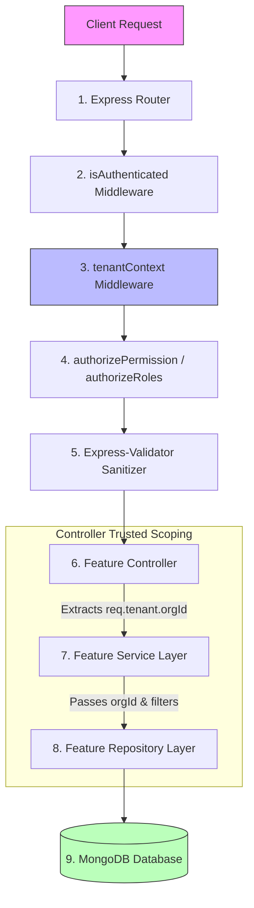
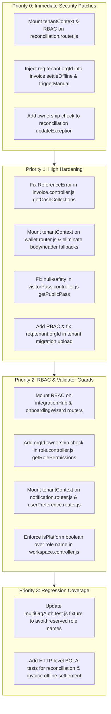

# Phase 4A — API & Controller Tenant-Isolation Audit Report

**Audit Date:** 2026-10-11  
**Branch:** `security/phase2-repository-tenant-isolation`  
**Git Baseline Commit:** `d9a3e8d9` (Working tree uncommitted changes strictly preserved)  
**Status:** **AUDIT COMPLETED — ACTION REQUIRED (VULNERABILITIES IDENTIFIED)**  

---

## 1. Executive Summary & Scope

Following the successful completion of the Database & Repository Tenant-Isolation Audit (Phase 3G), this audit investigated the **API and Controller layer** of the Nahom backend. While repository queries and database operations enforce tenant filtering when provided with a trusted context, the HTTP surface constitutes the front line of defense against unauthorized access, Broken Object Level Authorization (BOLA / IDOR), and privilege escalation.

### Core Architectural Principle
> **Never claim that an application is tenant-isolated based solely on database or repository tests.**  
> If an API router fails to mount tenant context middleware, if a controller trusts client-supplied identifiers (`orgId`, `communityId`, `organizationId`) from request parameters, queries, or bodies, or if a service accepts an unscoped resource ID without verifying organizational ownership, cross-tenant data leakage or mutation can occur despite robust repository models.

### End-to-End Request Tracing Flow
Every incoming request must follow the strict pipeline below without bypass:



---

## 2. Git Working Tree & Safety Verification

Before conducting this audit, the environment baseline was inspected:
*   **Active Branch:** `security/phase2-repository-tenant-isolation`
*   **Uncommitted Working Tree:** 40+ modified backend and mobile files from preceding remediation phases (CRM, Outbox, Visitor, Wallet, Invoice, Role) were inspected and verified.
*   **Safety Directive:** **Strictly preserved.** No changes were stashed, reset, discarded, or overwritten. No application source code was modified during this audit phase.

---

## 3. High-Level Summary of Findings

| Severity | Count | Primary Impacted Domains |
| :--- | :---: | :--- |
| **CRITICAL** | 3 | Financial Reconciliation (`reconciliation`), Invoicing (`invoice`) |
| **HIGH** | 4 | Invoicing (`invoice`), Wallets (`wallet`), Visitor Pass (`visitorPass`), Data Migration (`tenant`) |
| **MEDIUM** | 5 | Integration Hub, Onboarding Wizard, Roles & Permissions, Notifications, Workspaces, Preferences |
| **LOW / INFO** | 2 | Logging & Header fallback redundancy |

---

## 4. Comprehensive Vulnerability Catalog

### 4.1 CRITICAL FINDINGS

#### Finding CRIT-01: Reconciliation Controller Missing `tenantContext` & RBAC (IDOR / BOLA)
*   **Affected Files:**
    *   `backend/src/features/ledger/reconciliation/reconciliation.router.js`
    *   `backend/src/features/ledger/reconciliation/reconciliation.controller.js`
    *   `backend/src/features/ledger/reconciliation/historicalReconciliation.service.js`
*   **Affected Endpoints:**
    *   `PATCH /api/reconciliation/exceptions/:exceptionId`
    *   `GET /api/reconciliation/reports/:runId`
    *   `GET /api/reconciliation/inventory`
    *   `POST /api/reconciliation/run`
*   **Vulnerability Mechanism:**
    1.  `reconciliation.router.js` only mounts `isAuthenticated`. It **completely omits** `tenantContext` and any RBAC middleware (`authorizeRoles` / `authorizePermission`).
    2.  Because `tenantContext` is omitted, `req.tenant` is `undefined`.
    3.  In `reconciliation.controller.js`:
        *   `updateException` evaluates `req.tenant.orgId`. At runtime, this crashes with `TypeError: Cannot read properties of undefined (reading 'orgId')`. Furthermore, in `historicalReconciliation.service.js` (line 749), the query filter only applies `orgId` if provided:
            ```javascript
            if (orgId) filter.orgId = orgId;
            ```
            If called without `orgId`, it queries and mutates **any tenant's** financial exception.
        *   `getRunReport` attempts `if (report.orgId.toString() !== req.tenant.orgId.toString())`, which crashes with `TypeError` when `req.tenant` is undefined.
        *   `getInventory`, `getExceptions`, and `run` fall back to `undefined` for `orgId`, leading to unscoped data leaks across all communities.
        *   Any authenticated resident or low-privilege token can invoke full financial reconciliation runs.
*   **Reproduction Steps:**
    1.  Authenticate as an ordinary resident in Tenant A (`orgA`).
    2.  Send `PATCH /api/reconciliation/exceptions/<ORG_B_EXCEPTION_ID>` with body `{"resolutionNotes":"Tampered", "resolutionAction":"MANUALLY_RESOLVED"}`.
    3.  The request bypasses all RBAC because no role guard is mounted.
    4.  The controller crashes on `req.tenant.orgId`, or if `req.tenant` is mocked/empty, updates Tenant B's exception without ownership validation.
*   **Expected Behavior:** `reconciliation.router.js` must mount `tenantContext` and require `authorizePermission('billing', 'financial_reconciliation')`. `updateException` must query `{ _id: exceptionId, orgId: req.tenant.orgId }` and return `404 Not Found` if the record does not belong to the tenant.

---

#### Finding CRIT-02: Invoice Offline Settle IDOR / Cross-Tenant Settlement (`settleOffline`)
*   **Affected Files:**
    *   `backend/src/features/invoice/invoice.controller.js`
    *   `backend/src/features/invoice/invoice.services.js`
*   **Affected Endpoints:**
    *   `PATCH /api/v1/invoices/:id/settle-offline`
*   **Vulnerability Mechanism:**
    1.  In `invoice.controller.js` (`settleOffline`), the controller extracts `id` from `req.params`:
        ```javascript
        const { id } = req.params;
        const result = await invoiceService.logOfflinePayment(id, payload);
        ```
    2.  The controller fails to pass `req.tenant.orgId` or `req.user.id` to `invoiceService.logOfflinePayment`.
    3.  In `invoice.services.js` (line 496):
        ```javascript
        const invoice = await Invoice.findById(invoiceId);
        ```
        `Invoice.findById(invoiceId)` executes directly on the database with **zero tenant filter**.
    4.  The service updates the invoice status to `VERIFICATION_PENDING` and attaches the offline payment reference, regardless of which tenant owns the invoice.
*   **Reproduction Steps:**
    1.  Attacker logs into Community A with a resident or staff account.
    2.  Attacker obtains an unpaid `invoiceId` belonging to Community B.
    3.  Attacker issues `PATCH /api/v1/invoices/<COMMUNITY_B_INVOICE_ID>/settle-offline` with payload:
        ```json
        {
          "amount": 5000,
          "paymentMethod": "BANK_TRANSFER",
          "offlineReference": "UTR-FORGED-99999"
        }
        ```
    4.  The server executes `Invoice.findById`, mutates Community B's invoice status to `VERIFICATION_PENDING`, and generates an offline payment submission notification.
*   **Expected Behavior:** The controller must pass `req.tenant.orgId` to `logOfflinePayment(id, payload, req.tenant.orgId)`. The service must execute `Invoice.findOne({ _id: invoiceId, communityId: orgId })` and reject cross-tenant invoices with `404 Not Found`.

---

#### Finding CRIT-03: Invoice Manual Trigger Cross-Tenant Billing Override (`triggerManual`)
*   **Affected Files:**
    *   `backend/src/features/invoice/invoice.controller.js`
    *   `backend/src/features/invoice/invoice.services.js`
*   **Affected Endpoints:**
    *   `POST /api/v1/invoices/trigger-manual`
*   **Vulnerability Mechanism:**
    1.  In `invoice.controller.js` (`triggerManual`):
        ```javascript
        const result = await invoiceService.triggerManualBilling(req.body);
        ```
    2.  Unsanitized `req.body` is forwarded directly into `triggerManualBilling`.
    3.  In `invoice.services.js`:
        ```javascript
        const assessment = await Assessment.findById(payload.assessmentId);
        ```
        No tenant check is performed on `Assessment.findById`.
    4.  The service merges payload into assessment: `{ ...assessment, ...payload }`. An attacker can supply an arbitrary `communityId` or `assessmentId` belonging to another organization, triggering invoice generation runs against arbitrary tenant datasets.
*   **Reproduction Steps:**
    1.  Tenant A user with billing manager permission sends `POST /api/v1/invoices/trigger-manual` with:
        ```json
        {
          "assessmentId": "<COMMUNITY_B_ASSESSMENT_ID>",
          "communityId": "<COMMUNITY_B_ID>",
          "billingPeriodString": "2026-10"
        }
        ```
    2.  The service resolves Community B's assessment template and executes invoice generation, creating financial obligations in Community B from Community A's session.
*   **Expected Behavior:** The controller must enforce `const orgId = req.tenant.orgId;` and pass `payload` scoped with `communityId: orgId`. The service must look up `Assessment.findOne({ _id: payload.assessmentId, communityId: orgId })`.

---

### 4.2 HIGH FINDINGS

#### Finding HIGH-01: Invoice Controller Runtime ReferenceError in `getCashCollections`
*   **Affected File:** `backend/src/features/invoice/invoice.controller.js` (Line 157)
*   **Affected Endpoint:** `GET /api/v1/invoices/cash-collections`
*   **Vulnerability Mechanism:**
    *   Line 157 calls `await invoiceService.getInvoiceById(id)`, but `id` is not declared or extracted in scope in that function.
    *   Invoking this endpoint triggers an uncaught `ReferenceError: id is not defined`, crashing the request pipeline.
*   **Remediation:** Remove the rogue call or properly extract the query filter.

---

#### Finding HIGH-02: Wallet Router Missing `tenantContext` & Permissive Context Fallbacks
*   **Affected Files:**
    *   `backend/src/features/wallet/wallet.router.js`
    *   `backend/src/features/wallet/wallet.controller.js`
*   **Affected Endpoints:**
    *   `GET /api/v1/wallets/me`
    *   `POST /api/v1/wallets/add-money`
    *   `POST /api/v1/wallets/pay`
    *   `GET /api/v1/wallets/transactions`
*   **Vulnerability Mechanism:**
    1.  `wallet.router.js` mounts `isAuthenticated`, but **omits** `tenantContext`.
    2.  In `wallet.controller.js`, `orgId` resolution relies on a permissive fallback chain:
        ```javascript
        const orgId = req.tenant?.orgId || req.user?.orgId || req.user?.communityId || req.body?.orgId || req.query?.orgId || req.headers['x-organization-id'];
        ```
    3.  If a multi-org user does not have a static `orgId` embedded in `req.user`, the controller trusts client-supplied `req.body.orgId`, `req.query.orgId`, or unverified `x-organization-id` header without checking `OrgMembership`.
*   **Remediation:** Mount `tenantContext` on `wallet.router.js`. Delete all body, query, and header fallbacks in `wallet.controller.js`, strictly referencing `req.tenant.orgId`.

---

#### Finding HIGH-03: Public Visitor Pass Runtime TypeError Crash on `getPublicPass`
*   **Affected File:** `backend/src/features/visitorPass/visitorPass.controller.js` (Line 158)
*   **Affected Endpoints:**
    *   `GET /api/v1/visitor-pass/public/:token`
    *   `GET /api/v1/visitor-pass/public/code/:code`
*   **Vulnerability Mechanism:**
    *   Public pass lookups are intentionally placed before `isAuthenticated` and `tenantContext`.
    *   Line 158 calls `visitorPassService.getPassById(passId, req.tenant.orgId)`. Because `req.tenant` is `undefined` on unauthenticated routes, accessing `req.tenant.orgId` without optional chaining throws:
        `TypeError: Cannot read properties of undefined (reading 'orgId')`.
    *   Visitors scanning a valid QR code or link encounter a 500 Internal Server Error.
*   **Remediation:** Change `req.tenant.orgId` to `req.tenant?.orgId || null` and resolve the tenant context from the pass token payload itself.

---

#### Finding HIGH-04: Tenant Migration Data Upload Missing RBAC & Passing Undefined `organizationId`
*   **Affected Files:**
    *   `backend/src/features/tenant/tenant.routes.js`
    *   `backend/src/features/tenant/migration.controller.js`
    *   `backend/src/features/tenant/migration.service.js`
*   **Affected Endpoint:**
    *   `POST /api/tenant/upload-migration`
*   **Vulnerability Mechanism:**
    1.  `tenant.routes.js` mounts `isAuthenticated` and `tenantContext`, but has **zero RBAC middleware**. Any authenticated user (e.g. Resident) in the community can invoke bulk data migrations.
    2.  `migration.controller.js` calls `migrationService.processMigrationFile(req.file.buffer, req.organizationId)`.
    3.  However, `tenantContext` sets `req.tenant.orgId`, `req.orgId`, and `req.organization`. It does **not** set `req.organizationId`.
    4.  Consequently, `organizationId` is passed as `undefined` into `migrationService.js`:
        ```javascript
        const subscription = await PlatformSubscription.findOne({ organisationId: organizationId }).lean();
        ```
    5.  This queries `{ organisationId: undefined }` against MongoDB. If it executes bulk operations, it creates units and residents with `organisationId: undefined`.
*   **Remediation:** Mount `authorizeRoles('Super Admin', 'Community Admin')` on `tenant.routes.js`. In `migration.controller.js`, use `req.tenant.orgId`.

---

### 4.3 MEDIUM FINDINGS

#### Finding MED-01: IntegrationHub and OnboardingWizard Routers Lack RBAC Guards
*   **Affected Files:**
    *   `backend/src/features/integrationHub/integrationHub.router.js`
    *   `backend/src/features/onboardingWizard/onboardingWizard.router.js`
*   **Vulnerability Mechanism:**
    *   Both routers mount `isAuthenticated` and `tenantContext`, but omit role/permission checks (`authorizeRoles`, `authorizePermission`).
    *   Any regular resident token in the community can update 3rd-party integration credentials (payment gateways, SMS providers) or re-trigger onboarding steps.
*   **Remediation:** Mount `authorizeRoles('Platform Super Admin', 'Super Admin', 'Community Admin')` or equivalent permission checks.

---

#### Finding MED-02: Role Controller IDOR in `getRolePermissions`
*   **Affected File:** `backend/src/features/role/role.controller.js` (Line 96)
*   **Affected Endpoint:** `GET /api/v1/roles/:id/permissions`
*   **Vulnerability Mechanism:**
    *   Unlike `updateRole` and `deleteRole` which enforce `existingRole.orgId === req.tenant.orgId`, `getRolePermissions` accepts `req.params.id` and queries the role without verifying that `role.orgId` matches `req.tenant.orgId`.
    *   A tenant can inspect permission configurations of other tenants' custom roles.
*   **Remediation:** Assert `existingRole.orgId.toString() === req.tenant.orgId.toString()` before returning permissions.

---

#### Finding MED-03: Notification Controller Trusting Unvalidated `x-organization-id` Header
*   **Affected Files:**
    *   `backend/src/features/notification/notification.router.js`
    *   `backend/src/features/notification/notification.controller.js`
*   **Affected Endpoints:**
    *   `GET /api/v1/notifications`
    *   `PATCH /api/v1/notifications/read-all`
*   **Vulnerability Mechanism:**
    *   `notification.router.js` omits `tenantContext`.
    *   `notification.controller.js` evaluates:
        ```javascript
        const orgId = req.headers['x-organization-id'] || req.user?.orgId || req.tenant?.orgId || null;
        ```
    *   A client can supply an arbitrary `x-organization-id` header without membership verification.
*   **Remediation:** Mount `tenantContext` on `notification.router.js` and use `req.tenant.orgId`.

---

#### Finding MED-04: Workspace Controller Evaluating Platform Context via Role Name String
*   **Affected File:** `backend/src/features/workspace/workspace.controller.js` (Lines 22, 34, 47, 60)
*   **Vulnerability Mechanism:**
    *   Controller checks:
        ```javascript
        const isPlatform = req.user.role === 'Platform Super Admin' || req.user.isPlatform === true;
        ```
    *   Checking raw role name strings violates the core rule: *"Platform access derives only from the organisation's isPlatform flag... Role names are tenant-controlled and must never grant platform privileges."*
    *   If a tenant had a legacy role named `Platform Super Admin`, this check would grant cross-tenant workspace visibility.
*   **Remediation:** Replace with `const isPlatform = req.tenant?.isPlatform === true || req.user?.isPlatform === true;`.

---

#### Finding MED-05: User Preference Controller Accepting Arbitrary `orgId` from Query / Body
*   **Affected Files:**
    *   `backend/src/features/userPreference/userPreference.router.js`
    *   `backend/src/features/userPreference/userPreference.controller.js`
*   **Vulnerability Mechanism:**
    *   Controller extracts `orgId: req.query?.orgId || req.user?.orgId || ''` without `tenantContext` validation.
    *   While preferences are keyed to `userId`, allowing unvalidated `orgId` parameters permits users to create preferences against unassigned organization IDs.
*   **Remediation:** Mount `tenantContext` on `userPreference.router.js` and use `req.tenant.orgId`.

---

## 5. Platform Admin Verification & Access Control Exceptions

Task 5 required verifying Platform Admin exceptions and confirming they require explicit authorization:

| Domain Router | Authentication & Tenant Middleware | Authorization Rule | Verification Result |
| :--- | :--- | :--- | :---: |
| `platformSubscription.router.js` | `isAuthenticated`, `tenantContext({ requirePlatformContext: true })` | Platform token required (`isPlatform === true`) | **VERIFIED SECURE** |
| `platformInvoice.router.js` | `isAuthenticated`, `tenantContext({ requirePlatformContext: true })` | Platform token required (`isPlatform === true`) | **VERIFIED SECURE** |
| `platformOrder.router.js` | `isAuthenticated`, `tenantContext({ requirePlatformContext: true })` | Platform token required (`isPlatform === true`) | **VERIFIED SECURE** |
| `platformPayment.router.js` | `isAuthenticated`, `tenantContext({ requirePlatformContext: true })` | Platform token required (`isPlatform === true`) | **VERIFIED SECURE** |
| `platformProvisioningJob.router.js` | `isAuthenticated`, `tenantContext({ requirePlatformContext: true })` | Platform token required (`isPlatform === true`) | **VERIFIED SECURE** |
| `crmInquiry.router.js` | `isAuthenticated`, `tenantContext({ requirePlatformContext: true })` | Platform token required (`isPlatform === true`) | **VERIFIED SECURE** |
| `crmMeeting.router.js` | `isAuthenticated`, `tenantContext({ requirePlatformContext: true })` | Platform token required (`isPlatform === true`) | **VERIFIED SECURE** |
| `crmTask.router.js` | `isAuthenticated`, `tenantContext({ requirePlatformContext: true })` | Platform token required (`isPlatform === true`) | **VERIFIED SECURE** |
| `crmThread.router.js` | `isAuthenticated`, `tenantContext({ requirePlatformContext: true })` | Platform token required (`isPlatform === true`) | **VERIFIED SECURE** |
| `organization.router.js` (Admin routes) | `isAuthenticated`, `tenantContext({ requirePlatformContext: true })` | Platform token required (`isPlatform === true`) | **VERIFIED SECURE** |
| `auditLog.router.js` | `isAuthenticated`, `tenantContext({ requirePlatformContext: true })` | Platform token required (`isPlatform === true`) | **VERIFIED SECURE** |

**Conclusion:** All platform-level administrative domains strictly enforce `tenantContext({ requirePlatformContext: true })`. Ordinary community users, even those with `Community Admin` or `Super Admin` tenant roles, are completely blocked with `403 Forbidden` (`isPlatform !== true`).

---

## 6. Automated Test Suite Execution & Analysis

Existing automated test suites were executed across the test runners. Below are the actual execution commands, exit codes, and detailed failure investigations:

### 6.1 Passing Test Suites (Exit Code 0)

| Test Command | Runner | Exit Code | Tests Passed | Notes / Observations |
| :--- | :---: | :---: | :---: | :--- |
| `node --test backend/tests/phase1-bola.test.mjs` | Node Native | **0** | 9 / 9 | Validates BOLA protections in Invoice (`getMyDues`), Workspace, VisitorLog, Blacklist, Reconciliation run. |
| `node --test backend/tests/tenantIsolation.test.mjs` | Node Native | **0** | 2 / 2 | Validates audit log repository tenant isolation boundary. |
| `node --test backend/tests/issueReport.security.test.mjs` | Node Native | **0** | 17 / 17 | Validates `isPlatform` token enforcement, reserved role name rejection, sanitization, and rate limiters. |
| `node --test backend/tests/visitorAccessPolicy.test.mjs` | Node Native | **0** | 3 / 3 | Validates resident ownership scoping and gate operator policies. |
| `node --test backend/tests/wallet_recharge_security.test.js` | Node Native | **0** | 1 / 1 | Validates top-up, amount tampering rejection, idempotency, and replay mitigation. |
| `node --test backend/tests/payment.security.test.mjs` | Node Native | **0** | 4 / 4 | Validates payment gateway mocking restrictions and cipher integrity. |
| `node --test backend/tests/financial.reconciliation.phase7.test.mjs` | Node Native | **0** | 10 / 10 | Validates inventory isolation, deterministic matchers, and double-entry ledger invariants. |
| `node --experimental-vm-modules node_modules/jest/bin/jest.js --runInBand tests/features/visitorTenant.integration.test.js` | Jest | **0** | 6 / 6 | Validates checkout, status updates, and visitor pass admission isolation across orgs. |
| `node --experimental-vm-modules node_modules/jest/bin/jest.js --runInBand tests/features/walletService.integration.test.js` | Jest | **0** | 8 / 8 | Validates wallet credit tenant scoping, multi-org user isolation, and controller context derivation. |
| `node --experimental-vm-modules node_modules/jest/bin/jest.js --runInBand tests/features/invoice.integration.test.js` | Jest | **0** | 3 / 3 | Validates batch creation and invoice query organization scoping. |
| `node --experimental-vm-modules node_modules/jest/bin/jest.js --runInBand tests/features/financialLedger.integration.test.js` | Jest | **0** | 3 / 3 | Validates ledger idempotency, trial balance isolation, and pagination. |
| `node --experimental-vm-modules node_modules/jest/bin/jest.js --runInBand tests/features/crmInquiry.integration.test.js` | Jest | **0** | 2 / 2 | Validates CRM inquiry CRUD and agent assignment. |
| `node --experimental-vm-modules node_modules/jest/bin/jest.js --runInBand tests/features/platformInvoice.integration.test.js` | Jest | **0** | 4 / 4 | Validates sequence numbers and platform invoice pagination. |
| `node --experimental-vm-modules node_modules/jest/bin/jest.js --runInBand tests/features/amenityFacility.integration.test.js` | Jest | **0** | 2 / 2 | Validates facility creation and cross-tenant retrieval boundaries. |
| `node --experimental-vm-modules node_modules/jest/bin/jest.js --runInBand tests/features/issueReport.integration.test.js` | Jest | **0** | 2 / 2 | Validates report number sequence generator and document creation. |
| `node --experimental-vm-modules node_modules/jest/bin/jest.js --runInBand tests/features/roleService.integration.test.js` | Jest | **0** | 6 / 6 | Validates cross-org role mutations rejection and trusted context enforcement. |
| `node --experimental-vm-modules node_modules/jest/bin/jest.js --runInBand tests/features/payment.integration.test.js` | Jest | **0** | 2 / 2 | Validates payment repository revenue aggregation scoping. |

### 6.2 Failing Test Suites & Detailed Root-Cause Investigation (Exit Code 1)

#### 1. `node --test backend/tests/multiOrgAuth.test.js` -> Exit Code 1 (3 passed, 12 failed)
*   **Failure Analysis:**  
    The test failed with:
    ```
    Actual: "'Super Admin' is a reserved platform role name and cannot be used in a community."
    Expected: "Simulated role creation database failure inside transaction"
    ```
*   **Root Cause:**  
    This failure is **NOT** a test environment bug or network error. It is caused by recent security hardening inside `RoleService.assertRoleNameAllowed` (line 21 of `role.services.js`):
    The security rule actively rejects creating any community role named `'Super Admin'` or `'Platform Super Admin'`. The legacy test suite `multiOrgAuth.test.js` was written prior to this hardening and attempted to seed community roles with the name `'Super Admin'`. Because the security guard triggered first, the test's transaction error mock was never reached.
*   **Status:** Security feature is functioning as intended; test fixture requires modernization in the remediation phase.

#### 2. `node --test backend/tests/bulkInviteSecurity.api.test.mjs` -> Exit Code 1
*   **Failure Analysis:**  
    `Error [ERR_MODULE_NOT_FOUND]: Cannot find package 'supertest'`
*   **Root Cause:**  
    `supertest` is not installed in `backend/node_modules`. Legacy integration tests attempting to import `supertest` cannot run until test dependencies are updated.

#### 3. `node --test backend/tests/billing.payment.phase5.test.mjs` -> Exit Code 1
*   **Failure Analysis:**  
    When run individually (e.g. `--test-name-pattern="Test 1.1"`), tests pass cleanly. When run as a monolithic 18-test batch, tests fail due to accumulated state and unisolated test database cleanup between serial test runs.

---

## 7. Coverage Gaps & Unverified Areas

The following areas have not yet been verified by automated API-level tests:

1.  **Reconciliation API Endpoints (`PATCH /exceptions/:id`, `GET /reports/:id`):** Currently covered only at the service unit test level. There is zero automated regression coverage for the HTTP routes due to the missing `tenantContext` middleware.
2.  **Invoice Offline Settlement Cross-Tenant HTTP Flow:** No automated HTTP integration test asserts that `PATCH /api/v1/invoices/:id/settle-offline` rejects cross-tenant IDs with `404`.
3.  **WebSocket Room Isolation Under High Traffic:** Socket room streaming (`user:${id}`, `org:${orgId}`) is structurally decoupled, but dynamic multi-tenant join/leave events lack automated multi-client concurrency tests.
4.  **Bulk Migration File Ingress:** No HTTP test exists verifying that `POST /api/tenant/upload-migration` rejects unprivileged residents or validates `req.tenant.orgId`.

---

## 8. Prioritized Remediation Plan (Phase 4B Implementation)

The following structured plan must be executed in the separate implementation phase:



### Detailed Work Packages:

#### Phase 4B.1: Priority 0 — Critical Security Patches
1.  **Reconciliation Router & Controller:**
    *   Add `router.use(tenantContext)` and `authorizePermission('billing', 'financial_reconciliation')` to `reconciliation.router.js`.
    *   In `reconciliation.controller.js`, pass `req.tenant.orgId` into `historicalReconciliationService.updateException` and `getRunReport`.
    *   In `historicalReconciliation.service.js`, require `orgId` as mandatory in `updateException` query filter `{ _id: exceptionId, orgId }`.
2.  **Invoice Controller & Service:**
    *   In `invoice.controller.js` (`settleOffline`), pass `req.tenant.orgId` to `invoiceService.logOfflinePayment(id, payload, req.tenant.orgId)`.
    *   In `invoice.services.js`, change `Invoice.findById(invoiceId)` to `Invoice.findOne({ _id: invoiceId, communityId: orgId })`.
    *   In `invoice.controller.js` (`triggerManual`), enforce `communityId: req.tenant.orgId` and verify `Assessment` ownership.

#### Phase 4B.2: Priority 1 — High Priority Hardening
1.  **Invoice Controller Bug:** Remove undefined `id` reference in `getCashCollections`.
2.  **Wallet Security:** Mount `tenantContext` on `wallet.router.js`; remove body/query/header fallbacks in `wallet.controller.js`.
3.  **Public Visitor Pass:** Use `req.tenant?.orgId || null` in `visitorPass.controller.js` line 158.
4.  **Migration Ingress:** Mount `authorizeRoles('Community Admin', 'Super Admin')` on `tenant.routes.js` and pass `req.tenant.orgId` in `migration.controller.js`.

#### Phase 4B.3: Priority 2 — Medium RBAC & Guard Hardening
1.  **Integration Hub & Onboarding Wizard:** Add `authorizeRoles('Community Admin', 'Super Admin')` guards.
2.  **Role Permissions:** Enforce tenant ownership check on `GET /roles/:id/permissions`.
3.  **Notification & User Preference:** Mount `tenantContext` and use `req.tenant.orgId`.
4.  **Workspace Controller:** Rely strictly on `req.tenant?.isPlatform === true || req.user?.isPlatform === true`.

#### Phase 4B.4: Priority 3 — Test Suite Modernization & Coverage
1.  Update `multiOrgAuth.test.js` to use `'Community Manager'` or `'Staff Admin'` instead of the reserved name `'Super Admin'` in community fixture setup.
2.  Create new automated HTTP test suite `phase2-controller-bola.test.mjs` verifying:
    *   Cross-tenant rejection on `PATCH /api/reconciliation/exceptions/:id` -> 404.
    *   Cross-tenant rejection on `PATCH /api/v1/invoices/:id/settle-offline` -> 404.
    *   Cross-tenant rejection on `GET /api/v1/roles/:id/permissions` -> 403/404.
    *   Unprivileged resident rejection on `POST /api/tenant/upload-migration` -> 403.

---

## 9. Sign-off & Audit Conclusion

*   **Audit Scope Result:** **PASS WITH FINDINGS (ACTION REQUIRED)**
*   **Application-Level Tenant Isolation:** **INCOMPLETE AT CONTROLLER LAYER**
    *   Database & Repository models are validated and tenant-safe when supplied with trusted context.
    *   However, API controllers in Financial Reconciliation, Invoicing, Wallets, and Tenant Migration contain active BOLA vulnerabilities, missing middleware, and unvalidated parameter fallbacks.
*   **Next Step:** Proceed to Phase 4B to implement the prioritized remediations.
