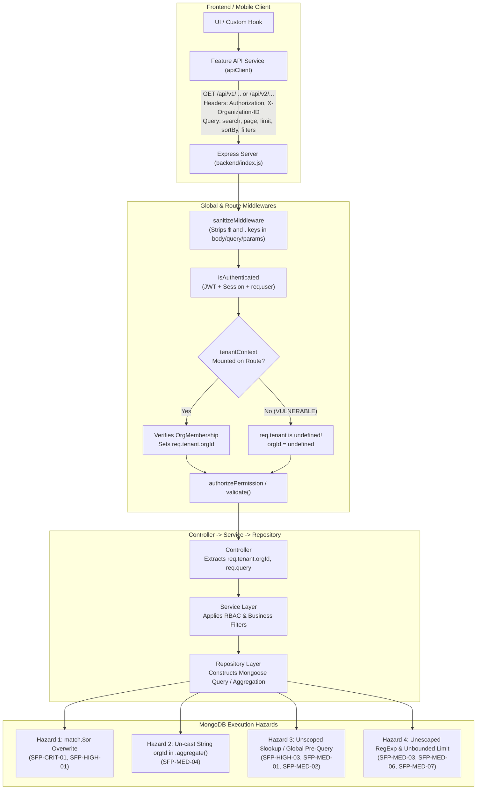
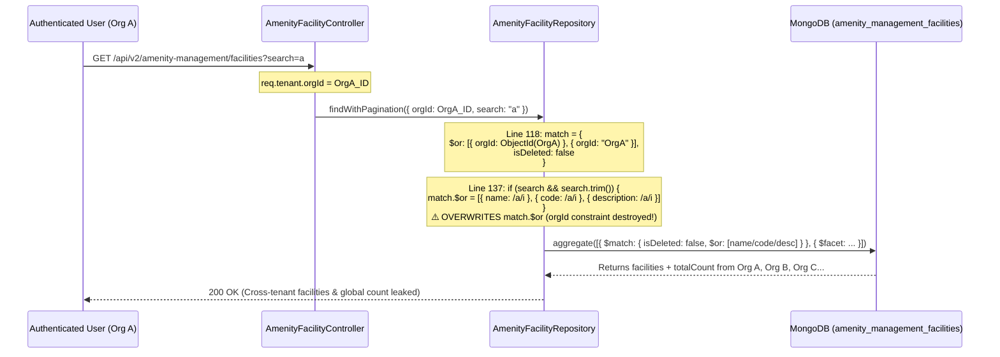

# Nahom Phase 6.1 — Search, Filter, Sort & Pagination Security Audit Report

- **Audit Date:** 2026-10-13
- **Target Repository:** `e:\atominos\Manage-My-Gate`
- **Active Git Branch:** `security/phase2-repository-tenant-isolation`
- **HEAD Commit:** `9423be17` (`fix(auth): enforce server-side email verification across login, session, and sso flows`)
- **Audit Mode:** Strictly Read-Only (Zero application or test files modified)
- **Final Audit Verdict:** **`FAIL`**

---

## 1. Executive Summary

This report presents the findings of the **Phase 6.1 Read-Only Security Audit** of Search, Filter, Sort, Pagination, Aggregations, and Related-Record Lookups across the Nahom (`Manage-My-Gate`) monorepo. The audit traced end-to-end data flows from frontend (`frontend/src/`) and mobile (`mobile/mobile-app/`) API service callers through Express routers, validators, controllers, services, repositories, Mongoose queries, and MongoDB aggregation pipelines.

### Audit Scope & Coverage
- **Total Endpoints Inspected:** **95** search, list, filter, export, dashboard, and detail endpoints across **35** backend feature modules.
- **Total Findings Identified:** **23** security, tenant-isolation, and query-safety findings:
  - **Critical Severity:** **2** (`SFP-CRIT-01`, `SFP-CRIT-02`)
  - **High Severity:** **7** (`SFP-HIGH-01` through `SFP-HIGH-07`)
  - **Medium Severity:** **9** (`SFP-MED-01` through `SFP-MED-09`)
  - **Low Severity:** **5** (`SFP-LOW-01` through `SFP-LOW-05`)

### Key Conclusions
1. **Critical Cross-Tenant Search & IDOR Vulnerabilities Remain:**
   - In **`GET /api/v2/amenity-management/facilities?search=...`** (`SFP-CRIT-01`), `AmenityFacilityRepository.findWithPagination` stores the mandatory tenant boundary inside `match.$or = [{ orgId: targetOrgId }, { orgId: String(orgId) }]` and then **overwrites `match.$or`** when a `search` query parameter is provided (`amenityFacility.repository.js:118-143`). Any authenticated user supplying `?search=a` retrieves amenity facilities across **every organization in the database**, and the `$facet` total count leaks the global count of matching facilities across all tenants.
   - In **`GET /api/v1/invoices/:id`** (`SFP-CRIT-02`), `invoice.routes.js:105-109` mounts `authorizePermission('billing', ['action_center', 'dashboard', 'assessment_manager'])` **without `tenantContext` middleware**. Because `req.tenant` is `undefined`, both service-level (`if (contextOrgId && ...)`) and controller-level (`if (!isPlatform && orgId && ...)`) tenant checks are bypassed, and no resident ownership check is performed—allowing any authenticated user with `billing:action_center` (including standard residents) to read any invoice across any organization by MongoDB `_id` or predictable `invoiceNumber`.
2. **High-Risk RBAC Filter Overwrites, Missing `tenantContext`, and Cross-Tenant Household Lookups:**
   - In **`GET /api/v1/complaints`** and **`GET /api/v1/complaints/export`** (`SFP-HIGH-01`), passing `?slaStatus=SLA Breached` causes `complaintService.getComplaints` (`complaint.service.js:244-254`) to assign `dbFilters.$or = [...]`, overwriting the controller's resident/technician RBAC `filters.$or` constraint and exposing all SLA-breached complaints in the community to any resident.
   - **`GET /api/v1/invoices/my-dues`** (`SFP-HIGH-02`) omits `tenantContext` middleware (`invoice.routes.js:17-21`), causing `req.tenant?.orgId` to evaluate to `undefined` and executing unscoped multi-org portfolio aggregations.
   - **`GET /api/v1/invoices/search-cash-eligible`** (`SFP-HIGH-03`) executes unscoped global `Villa.find` and `User.find` queries without `orgId` or `.limit()`, using an unescaped `new RegExp(q, 'i')`.
   - **Household Wallet & Poll Unit Resolution** (`SFP-HIGH-04`) looks up `Villa.findById(userDoc.villaId)` without verifying `String(villaDoc.orgId) === String(orgId)`, enabling cross-tenant wallet balance disclosure and cross-tenant wallet debiting when a multi-org user's global `user.villaId` belongs to another organization.
   - **`GET /api/v1/complaints/:id`** (`SFP-HIGH-05`) and **`GET /api/v1/complaints/dashboard/analytics`** (`SFP-HIGH-06`) lack resident-level horizontal ownership enforcement, while **`noticeBoard.service.js`** (`SFP-HIGH-07`) invokes `noticeRepository.updateNotice(id, data, session)` with 3 arguments against a 4-argument signature `updateNotice(id, orgId = null, updateData, session)`, binding the update payload to `orgId`.
3. **Systemic Search, Pagination, Sort, and Aggregation Weaknesses:**
   - Unescaped regular expressions (`new RegExp` / `$regex`) across 15+ repositories (`SFP-MED-03`), unscoped global `User.find` pre-queries in reservation searches (`SFP-MED-01`), unscoped `$lookup` joins in aggregations (`SFP-MED-02`), un-cast string `orgId` values in raw `.aggregate()` `$match` stages (`SFP-MED-04`), unallowlisted dynamic sort keys (`SFP-MED-05`), and missing pagination caps / ignored `safeLimit` variables (`SFP-MED-06`, `SFP-MED-07`) create ReDoS, memory exhaustion, and cross-tenant metadata leakage risks.

Because active Critical and High vulnerabilities permit cross-tenant data exposure and horizontal privilege escalation, the overall Phase 6.1 audit verdict is **`FAIL`**.

---

## 2. Git Baseline and Safety

Before inspecting any application files, the repository state was recorded using read-only Git commands (`git status -s -b`, `git log -n 5 --oneline`).

### 2.1 Active Branch & Commit History
- **Active Branch:** `security/phase2-repository-tenant-isolation` (tracking `origin/security/phase2-repository-tenant-isolation`, ahead 2 commits)
- **Recent Commits:**
  - `9423be17` — `fix(auth): enforce server-side email verification across login, session, and sso flows`
  - `d9a3e8d9` — `fix: enforce tenant isolation boundaries in assessment, noticeBoard, and visitorPass repositories`
  - `67a179f2` — `Merge pull request #75 from AtomInos-Technologies/feature/admin-control`
  - `09472617` — `fix: resolve visitor pass validation and RBAC permission mismatches`
  - `2545d440` — `feat(admin): add full visitor management suite to mobile app`

### 2.2 Working-Tree Baseline Inventory
At the start of this audit, the working tree contained pre-existing in-progress work from prior security remediation phases:
- **Staged Files:** `0`
- **Modified Tracked Files (`M`):** `146` files across `backend/src/features/**`, `backend/src/middlewares/**`, `frontend/src/**`, and `mobile/mobile-app/**`
- **Deleted Tracked Files (`D`):** `1` file (`backend/query_passes.js`)
- **Untracked Files/Directories (`??`):** `160` entries, including:
  - Architecture & security reports (`docs/architecture/`, `docs/security/`, `PHASE_4B_*.md`, `PHASE_4C_*.md`, `PHASE_5_*.md`, `PHASE_6_2A_*.md`, `PHASE_6_2B_*.md`, `PHASE_6_2C_*.md`, `PHASE_6_3_RESIDUAL_TENANT_ISOLATION_AUDIT.md`, `PHASE_6_4_CRITICAL_HIGH_REMEDIATION_REPORT.md`)
  - Security regression test suites (`backend/tests/phase4*.mjs`, `backend/tests/phase5*.mjs`, `backend/tests/phase6_2a_high_remediation.test.mjs`, `backend/tests/phase6_2b_medium_remediation.test.mjs`, `backend/tests/phase6_2c_low_remediation.test.mjs`, `backend/tests/phase6_4_critical_high_remediation.test.mjs`)

### 2.3 Safety Verification
- **Zero Code/Test Modifications:** No tracked or untracked application code or test files were modified, staged, reset, stashed, or cleaned during this audit.
- **Only Artifact Written:** `docs/security/PHASE_6_1_SEARCH_FILTER_PAGINATION_AUDIT_REPORT.md`.

---

## 3. Architecture and Request Flow

### 3.1 Global Middleware Pipeline
All incoming HTTP requests pass through the global middleware chain configured in [`backend/index.js`](file:///e:/atominos/Manage-My-Gate/backend/index.js#L50-L120) and [`backend/src/routes/api.routes.js`](file:///e:/atominos/Manage-My-Gate/backend/src/routes/api.routes.js):
1. **Correlation & Security Headers:** `correlationMiddleware` (`X-Request-ID`), `helmet()`, `cors()`, `express.json({ limit: '50mb' })`, `cookieParser()`.
2. **Global NoSQL Key Sanitizer:** [`sanitizeMiddleware`](file:///e:/atominos/Manage-My-Gate/backend/src/middlewares/sanitize.middleware.js#L1-L45) recursively strips object keys starting with `$` or containing `.` from `req.body`, `req.params`, and `req.query` (`Object.assign(req.query, cleanQuery)`).
   - *Limitation:* While `sanitizeMiddleware` prevents raw `{"$ne": null}` key injection in `req.query`, it **does not** prevent:
     - Array query parameters (`?status[]=a&status[]=b`) or nested non-`$` objects where strings are expected.
     - Unescaped regular expression metacharacters in string query parameters (`?search=.*` or ReDoS patterns).
     - Application-level `$or` overwrites when controllers/services/repositories assign `match.$or = ...` twice on the same filter object.
3. **Authentication (`isAuthenticated`):** [`auth.middleware.js`](file:///e:/atominos/Manage-My-Gate/backend/src/middlewares/auth.middleware.js#L18-L140) verifies the JWT, loads the `User` document, checks session validity and email verification, and populates `req.user`.
4. **Tenant Resolution (`tenantContext`):** [`tenant.middleware.js`](file:///e:/atominos/Manage-My-Gate/backend/src/middlewares/tenant.middleware.js#L18-L210) resolves the active organization from `X-Organization-ID` (or active membership fallback), verifies active `OrgMembership` in MongoDB, and populates `req.tenant = { orgId, isPlatform, roleIds, membership }`.
   - *Critical Architectural Gap:* `tenantContext` is **not** mounted globally; it must be mounted per-router or per-route. Any route that omits `tenantContext` (such as `GET /api/v1/invoices/my-dues` and `GET /api/v1/invoices/:id`) leaves `req.tenant` as `undefined`!
5. **Authorization (`authorizePermission` / `authorizeRole`):** [`rbac.middleware.js`](file:///e:/atominos/Manage-My-Gate/backend/src/middlewares/rbac.middleware.js#L1-L260) resolves effective permissions for `req.user` within `req.tenant?.orgId` and populates `req.user.permissions` and `req.user.roleNames`.

### 3.2 End-to-End Search, Filter & Pagination Data Flow



### 3.3 Cross-Tenant `$or` Overwrite Vulnerability Flow (`SFP-CRIT-01` & `SFP-HIGH-01`)



---

## 4. Endpoint Inventory

The table below catalogs all **95** inspected search, filter, sort, pagination, export, dashboard, and detail endpoints across the repository.

| # | Module | HTTP Method & Route | Frontend / Mobile Caller | Controller & Service | Repository Method | Ownership Field | Filter & Search Behavior | Sort & Pagination Behavior | Existing Test Coverage |
| :--- | :--- | :--- | :--- | :--- | :--- | :--- | :--- | :--- | :--- |
| 1 | **Invoices** | `GET /api/v1/invoices` | Web: `billingService.getInvoicesTable`<br>Mobile: `billingService.getInvoices` | `invoiceController.getInvoicesTable`<br>`invoiceService.getInvoicesForTable` | `invoiceRepository.findPaginatedInvoices` | `communityId` (`ObjectId`) | Mandatory `communityId`. Filters: `status` (whitelisted), `billingPeriod`, `unitNumber` (`escapeRegex`), `search` (`escapeRegex` on `invoiceNumber`, `unitSnapshot`, `residentSnapshot`). Resident role forced to `residentId: userId`. | Fixed sort `{ createdAt: -1 }`. `page`, `limit` parsed with `parseInt` — **no upper cap on `limit`** (`SFP-MED-06`). | `phase6_2b` (regex escape), `phase6_4` |
| 2 | **Invoices** | `GET /api/v1/invoices/kpis` | Web: `billingService.getKPIs` (sends `?communityId=` in query, ignored by server) | `invoiceController.getDashboardKPIs`<br>`invoiceService.getCommunityDashboardKPIs` | `invoiceRepository.getDashboardMetrics` | `communityId` (`ObjectId`) | Uses `req.tenant.orgId` cast to `ObjectId` in `$match`. | Aggregation `$facet` (`overdueMetrics`, `pendingVerificationMetrics`, `collectedMetrics`, `totalPendingMetrics`). | Partial unit tests |
| 3 | **Invoices** | `GET /api/v1/invoices/my-dues` | Web: `billingService.getMyDues`<br>Mobile: `billingService.getMyDues` | `invoiceController.getMyDues`<br>`invoiceService.getResidentPersonalDues` | `invoiceRepository.getUserPortfolioDues`, `getUserRecentInvoices` | `communityId` (`ObjectId`), `residentId` | **VULNERABLE (`SFP-HIGH-02`):** Route omits `tenantContext`. `req.tenant?.orgId` is `undefined`; `communityId` filter omitted from `$match`. | `getUserRecentInvoices` limits to `10`, sorted `{ dueDate: 1, createdAt: -1 }`. | None for tenant scoping on `/my-dues` |
| 4 | **Invoices** | `GET /api/v1/invoices/search-cash-eligible` | Web: `billingService.searchCashEligible` | `invoiceController.searchCashEligible`<br>`invoiceService.searchCashEligibleInvoices` | Direct `Villa.find`, `User.find`, `Invoice.find` in service | `communityId` (`ObjectId`) | **VULNERABLE (`SFP-HIGH-03`):** Unescaped `new RegExp(q, 'i')`; `Villa.find` & `User.find` lack `orgId` and `.limit()`. | `Invoice.find` capped at `.limit(25)`, sorted `{ dueDate: 1 }`. | None |
| 5 | **Invoices** | `GET /api/v1/invoices/cash-collections` | Web: `billingService.getCashCollections` | `invoiceController.getCashCollections`<br>`invoiceService.getCashCollectionsHistory` | Direct `Invoice.find` in service | `communityId` (`ObjectId`) | Scoped by `communityId: orgId, paymentMethod: 'Cash', status: 'Paid'`. | **Unbounded** (`SFP-MED-07`): `.find()` with `.sort({ paidDate: -1, updatedAt: -1 })` and **no `.limit()`**. | None |
| 6 | **Invoices** | `GET /api/v1/invoices/:id` | Web/Mobile invoice detail modals | `invoiceController.getInvoiceById`<br>`invoiceService.getInvoiceById` | `invoiceRepository.findById` | `communityId` (`ObjectId`), `residentId` | **CRITICAL (`SFP-CRIT-02`):** Route omits `tenantContext` (`req.tenant` is `undefined`), bypassing org & resident ownership checks. | Single record lookup by `_id` or `invoiceNumber`. | `phase6_4` tested source text, missed missing route middleware |
| 7 | **Assessments** | `GET /api/v1/assessments` | Web: `assessmentService.getAssessments` | `assessmentController.getAssessments`<br>`assessmentService.getAllAssessments` | `assessmentRepository.findAllByCommunity` | `communityId` (`ObjectId`) | Mandatory `communityId: orgId` (throws if missing). | `$facet` pagination, sorted `{ createdAt: -1 }`. **No upper cap on `limit`** (`SFP-MED-06`). | `phase2h` finance repo tests |
| 8 | **Assessments** | `GET /api/v1/assessments/:id` | Web: `assessmentService.getAssessmentById` | `assessmentController.getAssessmentById`<br>`assessmentService.getAssessmentById` | `assessmentRepository.findById` | `communityId` (`ObjectId`) | Scoped by `communityId: orgId`. | Single record lookup. | `phase2h`, `phase6_4` |
| 9 | **Payments** | `GET /api/v1/payments/history` | Mobile: `paymentService.getPaymentHistory` | `paymentController.getPaymentHistory`<br>`paymentService.getPaymentHistory` | `paymentRepository.findWithPagination` | `orgId` (`ObjectId`), `userId` | Mandatory `orgId`. Non-admin forced to `filter.userId = req.user.id`. `search` uses `escapeRegex`. | **VULNERABLE (`SFP-MED-05`, `SFP-MED-06`):** Dynamic `options.sortBy` without allowlist; `limit` uncapped. | `phase6_2b` (regex escape) |
| 10 | **Payments** | `GET /api/v1/payments/admin/stats` | Web/Mobile admin billing analytics | `paymentController.getAdminStats`<br>`paymentService.getAdminDashboardStats` | `paymentRepository.getPaymentStats`, `getRevenueTrend` | `orgId` (`ObjectId`) | **VULNERABLE (`SFP-MED-04`):** `orgId` passed as string to `Payment.aggregate([{ $match: { orgId } }])` without `new ObjectId(orgId)`. | Aggregation `$group` (last 6 months revenue trend). | None |
| 11 | **Payments** | `GET /api/v1/payments/:id` | Mobile: `paymentService.getPaymentById` | `paymentController.getPaymentDetails`<br>`paymentService.getPaymentDetails` | `paymentRepository.findById` | `orgId` (`ObjectId`), `userId` | Verifies `payment.orgId === orgId` and resident `payment.userId === userId`. | Single record lookup. | `phase6_4` |
| 12 | **Wallet** | `GET /api/v1/wallet/my-wallet` | Web/Mobile: `walletService.getMyWallet` | `walletController.getMyWallet`<br>`walletService.getWalletData` | `walletRepository.getWalletByUserId`, `getTransactionsByWalletId` | `orgId` (`ObjectId`), `userId` | **VULNERABLE (`SFP-HIGH-04`):** `Villa.findById(userDoc.villaId)` lacks `orgId` verification, resolving foreign-org primary resident's wallet. | `getTransactionsByWalletId` is **unbounded** (no `.limit()`, `SFP-MED-07`). Also `wallet.repository.js` uses undeclared `HttpError` (`SFP-LOW-01`). | `phase3b` |
| 13 | **Ledger** | `GET /api/v1/ledger/entries` | Web: financial ledger table | `financialLedgerController.getEntries`<br>`financialLedgerService.getEntries` | `financialLedgerRepository.findEntriesPaginated` | `orgId` (`ObjectId`) | Mandatory `orgId: new ObjectId(orgId)`. Filters: `entryType`, `accountCode`, `referenceType`, `referenceId`, `startDate`/`endDate`. | Sorted `{ postedAt: -1, _id: -1 }`. **No upper cap on `limit`** (`SFP-MED-06`). | `phase2h` |
| 14 | **Ledger** | `GET /api/v1/ledger/trial-balance` | Web: financial ledger dashboard | `financialLedgerController.getTrialBalance`<br>`financialLedgerService.getTrialBalance` | `financialLedgerRepository.computeTrialBalance` | `orgId` (`ObjectId`) | Scoped by `orgId: new ObjectId(orgId)`, `status: 'POSTED'`. | `$group` by `accountCode`, sorted `{ _id: 1 }`. | `phase2h` |
| 15 | **Ledger** | `GET /api/v1/ledger/reconciliation/runs` | Web: reconciliation runs list | `reconciliationController.getRuns`<br>`reconciliationService.getRuns` | `reconciliationRepository.findRunsPaginated` | `orgId` (`ObjectId`) | Scoped by `orgId`. | Paginated list. | `phase2h` |
| 16 | **Complaints** | `GET /api/v1/complaints` | Web: `complaintService.getAll`<br>Mobile: `complaintService.getComplaints` | `complaintController.getAll`<br>`complaintService.getComplaints` | `complaintRepository.findAll` | `orgId` (`ObjectId`), `residentId` | **VULNERABLE (`SFP-HIGH-01`, `SFP-MED-03`, `SFP-MED-05`):** `slaStatus=SLA Breached` overwrites RBAC `filters.$or`; `q` uses unescaped `$regex` (`complaint.repository.js:62`); `sortField` unallowlisted (`complaint.controller.js:76`). | `limit` capped at `100` (`Math.min(100, ...)`). | `phase6_2a` (tested normal resident filter, missed `slaStatus` overwrite) |
| 17 | **Complaints** | `GET /api/v1/complaints/export` | Web: complaint CSV export button | `complaintController.exportComplaints`<br>`complaintService.getComplaints` | `complaintRepository.findAll` | `orgId` (`ObjectId`), `residentId` | **VULNERABLE (`SFP-HIGH-01`):** Same `slaStatus=SLA Breached` overwrite allows resident to export all SLA-breached complaints in org (up to 10,000 rows). | Hardcoded `limit: 10000`. | `phase6_2a` |
| 18 | **Complaints** | `GET /api/v1/complaints/dashboard/analytics` | Web: `complaintService.getDashboardAnalytics` | `complaintController.getDashboardAnalytics`<br>`complaintService.getDashboardAnalytics` | `complaintRepository.getDashboardAnalytics` | `orgId` (`ObjectId`) | **VULNERABLE (`SFP-HIGH-06`, `SFP-MED-04`):** Accessible to residents (`complaints:view`), leaks 10 latest community-wide complaints (`Complaint.find` at L347); `Complaint.aggregate` at L218/352 uses un-cast string `orgId`. | Returns top 10 recent complaints + KPI facets. | None |
| 19 | **Complaints** | `GET /api/v1/complaints/calendar/events` | Web: `complaintService.getCalendarEvents` | `complaintController.getCalendarEvents`<br>`complaintService.getCalendarEvents` | `complaintRepository.getCalendarEvents` | `orgId` (`ObjectId`), `residentId` | Enforces `orgId` and resident/technician RBAC scoping. | Date-range bounded (`startDate`, `endDate`), sorted `{ createdAt: 1 }`. | `phase6_2a` |
| 20 | **Complaints** | `GET /api/v1/complaints/:id` | Web/Mobile: `complaintService.getById` | `complaintController.getById`<br>`complaintService.getComplaintById` | `complaintRepository.findById` | `orgId` (`ObjectId`), `residentId` | **VULNERABLE (`SFP-HIGH-05`):** Checks `orgId`, but lacks horizontal ownership check for non-admin residents; `Technician.findOne({ userId })` lacks `orgId`. | Single record lookup. | None for horizontal resident isolation |
| 21 | **Technicians** | `GET /api/v1/technicians` | Web: `technicianService.getAll`<br>Mobile: `technicianService.getTechnicians` | `technicianController.getAll`<br>`technicianService.getAllTechnicians` | `technicianRepository.findAll` | `orgId` (`ObjectId`) | Mandatory `orgId`. Filters: `department`, `status`, `availabilityStatus`, `userId`. | **Unbounded** (`SFP-MED-07`): `Technician.find(query).sort({ name: 1 })` without pagination or `.limit()`. | `phase6_2c` |
| 22 | **Issue Reports** | `GET /api/v1/issue-reports` | Web/Mobile: `issueReportService.getReports` | `issueReportController.getReports`<br>`issueReportService.getReports` | `issueReportRepository.findReports` | `organizationId` (`ObjectId`), `residentId` | Mandatory `organizationId: new ObjectId(orgId)`. Non-admin forced to `residentId: new ObjectId(userId)`. `search` escaped via `escapeRegex`. | `$facet` pagination; `limit` clamped `1..100`; sort allowlisted (`createdAt`, `updatedAt`, `priority`, `status`). | `phase6_2b` |
| 23 | **Issue Reports** | `GET /api/v1/issue-reports/stats` | Web: issue report KPI bar | `issueReportController.getStats`<br>`issueReportService.getStats` | `issueReportRepository.getStatsByOrg` | `organizationId` (`ObjectId`) | Admin-only (`issue_reporting:manage`). Scoped by `organizationId: new ObjectId(orgId)`. | `$facet` status/priority counts. | `phase6_2b` |
| 24 | **Issue Reports** | `GET /api/v1/issue-reports/:id` | Web/Mobile: `issueReportService.getReportById` | `issueReportController.getReportById`<br>`issueReportService.getReportById` | `issueReportRepository.findById` | `organizationId` (`ObjectId`), `residentId` | Enforces both `organizationId` and resident ownership (`report.residentId === userId`). | Single record lookup. | `phase6_2b` |
| 25 | **Notices** | `GET /api/v1/notices` | Web: `noticeBoardService.getNotices`<br>Mobile: `noticeBoardService.getNotices` | `noticeController.getAllNotices`<br>`noticeBoardService.getAllNotices` | `noticeRepository.getNotices` | `orgId` (`ObjectId`) | Mandatory `orgId`. Audience targeting enforced for residents. **VULNERABLE (`SFP-MED-03`):** `filters.search`, `category`, `priority` use unescaped `new RegExp` (`noticeBoard.service.js:301-311`). | `limit` capped at `100` in controller; sort allowlisted (`createdAt`, `updatedAt`, `publishAt`, `expiresAt`, `title`, `priority`, `viewsCount`). | `phase2g`, `phase6_2c` |
| 26 | **Notices** | `GET /api/v1/notices/stats` | Web: `noticeBoardService.getNoticeStats` | `noticeController.getNoticeStats`<br>`noticeBoardService.getNoticeStats` | `noticeRepository.getStats` | `orgId` (`ObjectId`) | Scoped by `orgId: new ObjectId(orgId)`. | `$facet` counts. | `phase2g` |
| 27 | **Notices** | `GET /api/v1/notices/:id` | Web/Mobile: `noticeBoardService.getNoticeById` | `noticeController.getNoticeById`<br>`noticeBoardService.getNoticeById` | `noticeRepository.getNoticeById` | `orgId` (`ObjectId`) | Enforces `orgId` and audience targeting. (**Note:** `SFP-HIGH-07` breaks `updateNotice` inside `getNoticeById` lazy status transition and `updateNotice`). | Single record lookup. | `phase6_4` |
| 28 | **Notice Ack** | `GET /api/v1/notices/:noticeId/acknowledgements` | Web: notice acknowledgement modal | `noticeAcknowledgementController.getAcknowledgements`<br>`noticeAcknowledgementService.getAcknowledgementsList` | `noticeAcknowledgementRepository.findByNoticePaginated` | `orgId` (`ObjectId`) | Verifies parent notice belongs to `orgId`; matches `noticeId` + `orgId`. | **No upper cap on `limit`** (`SFP-MED-06`, `parseInt(limit, 10) || 20`). | `phase6_2c` |
| 29 | **Notice Comments** | `GET /api/v1/notices/:noticeId/comments` | Web/Mobile: notice comments list | `noticeCommentController.getComments`<br>`noticeCommentService.getCommentsByNotice` | `noticeCommentRepository.findByNotice` | `orgId` (`ObjectId`) | Verifies parent notice in `orgId`; matches `noticeId`, `orgId`, `parentCommentId: null`. | `limit` capped at `50` (`Math.min(50, ...)`). | `phase6_2c` |
| 30 | **Notice Reactions** | `GET /api/v1/notices/:noticeId/reactions` | Web/Mobile: notice reactions | `noticeReactionController.getReactions`<br>`noticeReactionService.getReactionSummary` | `noticeReactionRepository.getSummaryByNotice` | `orgId` (`ObjectId`) | Verifies parent notice in `orgId`; `$match` includes `orgId`. | `$group` by `reactionType`. | `phase6_2c` |
| 31 | **Notice Versions** | `GET /api/v1/notices/:noticeId/versions` | Web: notice version history | `noticeVersionController.getVersions`<br>`noticeVersionService.getVersionHistory` | `noticeVersionRepository.findByNoticeId` | `orgId` (`ObjectId`) | Verifies parent notice in `orgId`; queries `{ noticeId, orgId }`. | Bounded by version count per notice, sorted `{ versionNumber: -1 }`. | `phase6_2c` |
| 32 | **Polls** | `GET /api/v1/polls` | Web/Mobile: `pollService.getPolls` | `pollController.getAllPolls`<br>`pollService.getAllPolls` | `pollRepository.getPolls` | `orgId` (`ObjectId`) | Mandatory `orgId`. `search`, `category`, `status` use `escapeRegex`. **VULNERABLE (`SFP-MED-02`):** `$lookup` on `villas` (`poll.repository.js:103-109`) lacks `orgId` check. | `limit` capped at `100` in `getAllPolls`; sort allowlisted (`createdAt`, `updatedAt`, `expiresAt`, `question`, `totalVotes`). | `phase6_2b`, `phase6_2c` |
| 33 | **Polls** | `GET /api/v1/polls/stats` | Web: poll dashboard KPIs | `pollController.getPollStats`<br>`pollService.getPollStats` | `pollRepository.getPollStats` | `orgId` (`ObjectId`) | Scoped by `orgId: new ObjectId(orgId)`. | `$facet` counts. | `phase6_2c` |
| 34 | **Polls** | `GET /api/v1/polls/:id/Analytics` & `/votes` & `/participants` | Web: poll results & voter breakdown | `pollController.getPollVotes`, `getOptionParticipants` | `pollRepository.getPaginatedVotes`, `getOptionParticipants` | `orgId` (`ObjectId`) | Enforces `orgId` and non-anonymous poll check. **VULNERABLE (`SFP-MED-02`, `SFP-MED-06`):** `$lookup` on `villas` (`poll.repository.js:405-411`) lacks `orgId`; `limit` uncapped in `poll.controller.js:203,223,243`. | `$facet` pagination. | `phase6_2c` |
| 35 | **Engagement** | `GET /api/v1/community-engagement/feed` | Mobile: `communityEngagementService.getUnifiedFeed` | `communityEngagementController.getUnifiedFeed`<br>`communityEngagementService.getUnifiedFeed` | `noticeRepository.getNotices`, `pollRepository.getPolls` | `orgId` (`ObjectId`) | Fetches notices & polls in `orgId`, merges in memory. | Clamps `cleanLimit = Math.min(50, ...)`, `cleanPage = Math.max(1, ...)`. Fetches `cleanPage * cleanLimit` items from both repos (deep page amplification, `SFP-LOW-03`). | `phase6_2c` |
| 36 | **Community Notes** | `GET /api/v1/community-notes` | Mobile: `communityPulseService.getNotes` | `communityNoteController.getActiveNotes`<br>`communityNoteService.getActiveNotesForOrg` | `communityNoteRepository.findActiveByOrg` | `orgId` (`ObjectId`) | Scoped by `orgId`, `status: 'ACTIVE'`, `expiresAt > now`. | `limit` capped at `50` (`Math.min(..., 50)`). (`findAllByOrgAdmin` at L107 is unbounded, `SFP-MED-07`). | `phase6_2c` |
| 37 | **Amenities (V1)** | `GET /api/v1/amenities` | Web/Mobile legacy amenities | `amenityController.getAllAmenities`<br>`amenityService.getAllAmenities` | `amenityRepository.findAll` | `orgId` (`ObjectId`) | Scoped by `orgId` + `status` / `category` / `type`. | **Unbounded** (`SFP-MED-07`): `Amenity.find(query).sort({ createdAt: -1 })` with no `.limit()`. | `phase6_2c` |
| 38 | **Amenity Bookings (V1)** | `GET /api/v1/amenity-bookings` | Web/Mobile legacy bookings | `amenityBookingController.getBookings`<br>`amenityBookingService.getBookings` | `amenityBookingRepository.findAll` | `orgId` (`ObjectId`), `userId` | Scoped by `orgId`; residents scoped to `userId`. **VULNERABLE (`SFP-MED-02`, `SFP-MED-06`):** `$lookup` on `amenities` & `amenity_management_facilities` (`L223-248`) lacks `orgId`; `limit` uncapped in controller (`L17`). | `$facet` pagination, sorted `{ bookingDate: -1, startTime: -1 }`. | `phase6_2c` |
| 39 | **Amenity Dashboard** | `GET /api/v1/amenities/dashboard/reservations` | Web: admin amenity reservation table | `amenityDashboardController.getReservations`<br>`amenityDashboardService.getReservations` | `amenityReservationRepository.findWithPagination` | `orgId` (`ObjectId`) | **VULNERABLE (`SFP-MED-01`):** `search` runs unscoped `User.find` across all tenants (`.limit(200)`) before querying reservations. | `limit` clamped to `100` in repository (`Math.min(100, ...)`). | None |
| 40 | **Amenity Dashboard** | `GET /api/v1/amenities/dashboard/reservations/export` | Web: admin reservation CSV export | `amenityDashboardController.exportReservations`<br>`amenityDashboardService.exportReservationsCsv` | `amenityReservationRepository.findWithPagination` | `orgId` (`ObjectId`) | Passes `limit: 5000` to `findWithPagination`, which clamps `safeLimit = Math.min(100, ...)`—silently truncating CSV exports to 100 rows (`SFP-LOW-04`). | Capped at `100` by repo. | None |
| 41 | **Amenity V2: Facilities** | `GET /api/v2/amenity-management/facilities` | Mobile: `amenityManagementService.getFacilities`<br>Web: V2 facility list | `amenityFacilityController.listFacilities`<br>`amenityFacilityService.listFacilities` | `amenityFacilityRepository.findWithPagination` | `orgId` (`ObjectId`) | **CRITICAL (`SFP-CRIT-01`):** `search` parameter overwrites `match.$or` containing `{ orgId }`, exposing facilities across **all tenants**! | `safeLimit = Math.min(100, ...)`, sorted `{ sortOrder: 1, name: 1 }`. | None for `search` tenant isolation |
| 42 | **Amenity V2: Resources** | `GET /api/v2/amenity-management/facilities/:facilityId/resources` | Mobile: `amenityManagementService.getFacilityResources` | `amenityResourceController.listResources`<br>`amenityResourceService.listResources` | `amenityResourceRepository.findByFacility` | `orgId` (`ObjectId`) | Scoped by `orgId` and `facilityId`. | Bounded by facility resource count, sorted `{ sortOrder: 1, name: 1 }`. | `phase5` |
| 43 | **Amenity V2: Reservations** | `GET /api/v2/amenity-management/reservations/me` | Mobile: `amenityManagementService.getMyReservations` | `amenityReservationController.listMyReservations`<br>`amenityReservationService.listMyReservations` | `amenityReservationRepository.findWithPagination` | `orgId` (`ObjectId`), `userId` | Scoped by `orgId` and `userId: req.user.id`. `search` escaped via `escapeRegex`. | `safeLimit = Math.min(100, ...)`, sorted `{ startAtUtc: -1 }`. | `phase5` |
| 44 | **Amenity V2: Reservations** | `GET /api/v2/amenity-management/reservations` | Mobile/Web: admin V2 reservations | `amenityReservationController.listOrgReservations`<br>`amenityReservationService.listOrgReservations` | `amenityReservationRepository.findWithPagination` | `orgId` (`ObjectId`) | **VULNERABLE (`SFP-MED-01`):** `search` runs unscoped global `User.find({ $or: [{ name: rx }, { username: rx }] }).limit(200)` without `orgId`. | `safeLimit = Math.min(100, ...)`, sorted `{ startAtUtc: -1 }`. | `phase6_2b` (tested regex escape, missed unscoped `User.find`) |
| 45 | **Amenity V2: Maintenance** | `GET /api/v2/amenity-management/maintenance` | Mobile/Web: maintenance blocks list | `amenityMaintenanceBlockController.listBlocks`<br>`amenityMaintenanceBlockService.listBlocks` | `amenityMaintenanceBlockRepository.findWithPagination` | `orgId` (`ObjectId`) | Scoped by `orgId`. | `safeLimit = Math.min(100, ...)` in repo (`listRecurringSeries` at `controller.js:254` passes `limit: 500`, clamped to 100). | `phase5` |
| 46 | **Amenity V2: Holds** | `GET /api/v2/amenity-management/holds/me` | Mobile: active checkout holds | `amenityHoldController.listMyActiveHolds`<br>`amenityHoldService.listMyActiveHolds` | `amenityHoldRepository.findActiveByUser` | `orgId` (`ObjectId`), `userId` | Scoped by `orgId`, `userId`, `status: 'ACTIVE'`, `expiresAtUtc > now`. | Sorted `{ createdAt: -1 }`. | `phase5` |
| 47 | **Amenity V2: Passes** | `GET /api/v2/amenity-management/reservations/:reservationId/passes` | Mobile: reservation QR pass view | `amenityAccessPassController.getPassesForReservation`<br>`amenityAccessPassService.getPassesForReservation` | `amenityAccessPassRepository.findByReservationId` | `orgId` (`ObjectId`), `userId` | Verifies reservation `orgId` and resident ownership (`reservation.userId === userId` or `amenities:manage`). | Bounded by passes per reservation. | `phase5` |
| 48 | **Amenity V2: Payments** | `GET /api/v2/amenity-management/payments/orders/:id` | Mobile: payment order status | `amenityPaymentOrderController.getPaymentOrder`<br>`amenityPaymentOrderService.getPaymentOrder` | `amenityPaymentOrderRepository.findById` | `orgId` (`ObjectId`), `userId` | Verifies `order.orgId === orgId` and (`order.userId === userId` or `amenities:manage`). | Single record lookup. | `phase6_4` |
| 49 | **Visitor Pass** | `GET /api/v1/visitor-pass/org/:orgId` | Web: visitor pass table<br>Mobile: `visitorAdminService.getCommunityPasses` | `visitorPassController.getOrgPasses`<br>`visitorPassService.getPassesByOrg` | `visitorPassRepository.findByOrg` | `orgId` (`ObjectId`) | Validates `:orgId === req.tenant.orgId`. **VULNERABLE (`SFP-MED-03`):** `filters.search` uses unescaped `{ $regex: filters.search, $options: 'i' }` (`visitorPass.repository.js:200`). | `safeLimit = Math.min(Math.max(1, limit), 100)`, sorted `{ createdAt: -1 }`. | `phase3f`, `phase6_4` |
| 50 | **Visitor Pass** | `GET /api/v1/visitor-pass/my-passes` | Mobile: `visitorService.getMyPasses` | `visitorPassController.getMyPasses`<br>`visitorPassService.getPassesByUser` | `visitorPassRepository.findByHostUserOrVillas` | `orgId` (`ObjectId`), `hostUserId` / `villaId` | Scoped by `orgId` and user's active villas in `orgId`. | `safeLimit = Math.min(..., 100)`, sorted `{ createdAt: -1 }`. | `phase3f` |
| 51 | **Visitor Pass** | `GET /api/v1/visitor-pass/villa/:villaId` | Mobile: household passes | `visitorPassController.getVillaPasses`<br>`visitorPassService.getPassesByVilla` | `visitorPassRepository.findByVilla` | `orgId` (`ObjectId`), `villaId` | Verifies resident membership in `:villaId` or admin role; scoped by `orgId`. | `safeLimit = Math.min(..., 100)`, sorted `{ createdAt: -1 }`. | `phase6_4` |
| 52 | **Visitor Pass** | `GET /api/v1/visitor-pass/verify/:passCode` | Mobile Guard scanner | `visitorPassController.verifyPassCode`<br>`visitorPassService.verifyPassForGate` | `visitorPassRepository.findByPassCode` | `orgId` (`ObjectId`) | Enforces `orgId: req.tenant.orgId`. | Single record lookup. | `phase3f` |
| 53 | **Visitor Log** | `GET /api/v1/visitor-log/org/:orgId` | Web/Mobile: gate logs list | `visitorLogController.getOrgLogs`<br>`visitorLogService.getOrgLogs` | `visitorLogRepository.findByOrg` | `orgId` (`ObjectId`) | Validates `:orgId === req.tenant.orgId`. `search` escaped via `escapeRegex`. **VULNERABLE (`SFP-MED-02`, `SFP-MED-06`):** `$lookup` on `villas` via `resident.villaId` (`L210-217`) lacks `orgId`; `limit` uncapped (`visitorLog.controller.js:130`). | `$facet` pagination, sorted `{ entryTime: -1 }`. | `phase6_2b` (regex escape) |
| 54 | **Visitor Log** | `GET /api/v1/visitor-log/org/:orgId/inside` | Mobile: `visitorAdminService.getGateAnalytics` | `visitorLogController.getCurrentlyInside`<br>`visitorLogService.getCurrentlyInside` | `visitorLogRepository.findCurrentlyInside` | `orgId` (`ObjectId`) | Validates `:orgId === req.tenant.orgId`, matches `status: 'INSIDE'`. | **No upper cap on `limit`** (`SFP-MED-06`). | `phase3f` |
| 55 | **Visitor Log** | `GET /api/v1/visitor-log/org/:orgId/pending` | Mobile: `visitorAdminService.getAllPendingWalkIns` | `visitorLogController.getAllPendingWalkIns`<br>`visitorLogService.getAllPendingWalkIns` | `visitorLogRepository.findPendingWalkInsByOrg` | `orgId` (`ObjectId`) | Validates `:orgId === req.tenant.orgId`, matches `approvalStatus: 'PENDING'`. | `limit` defaulted to `50`. | `phase3f` |
| 56 | **Visitor Log** | `GET /api/v1/visitor-log/villa/:villaId` | Mobile: resident visitor history | `visitorLogController.getVillaLogs`<br>`visitorLogService.getVillaLogs` | `visitorLogRepository.findByVilla` | `orgId` (`ObjectId`), `villaId` | Enforces resident villa ownership in `orgId` + `orgId` filter. | **No upper cap on `limit`** (`SFP-MED-06`). | `phase6_4` |
| 57 | **Blacklist** | `GET /api/v1/blacklist/org/:orgId` | Mobile: `visitorAdminService.getBlacklist` (sends `limit: 500`) | `blacklistController.getOrgBlacklist`<br>`blacklistService.getOrgBlacklist` | `blacklistRepository.findByOrg` | `orgId` (`ObjectId`) | Validates `:orgId === req.tenant.orgId`, matches `isActive: true`. | **No upper cap on `limit`** (`SFP-MED-06`, `blacklist.controller.js:54`). | `phase3f` |
| 58 | **Security Log** | `GET /api/v1/security-log/org/:orgId` | Web/Mobile security incident logs | `securityLogController.getOrgSecurityLogs`<br>`securityLogService.getOrgSecurityLogs` | `securityLogRepository.findByOrg` | `orgId` (`ObjectId`) | Validates `:orgId === req.tenant.orgId`. Filters: `eventType`, `guardUserId`, `startDate`/`endDate`. | **No upper cap on `limit`** (`SFP-MED-06`, `securityLog.controller.js:8`). | `phase3f` |
| 59 | **Audit Log** | `GET /api/v1/audit-logs` | Web: `auditLogService.getLogs` | `auditLogController.getLogs`<br>`auditLogService.getLogs` | `auditLogRepository.findPaginated` | `orgId` (`ObjectId`) | Enforces `orgId: req.tenant.orgId` (unless platform admin). `search` escaped via `escapeRegex`. | **VULNERABLE (`SFP-MED-06`):** `auditLog.repository.js:19` computes `safeLimit = Math.min(100, ...)`, but L89 passes raw `limit` to `{ $limit: limit }`! | `phase6_2b` (tested regex escape) |
| 60 | **Directory** | `GET /api/v1/directory` | Mobile: `directoryService.getDirectory` | `directoryController.getDirectory`<br>`directoryService.getDirectory` | `directoryRepository.findDirectoryMembers` | `orgId` (`ObjectId`) | Matches `orgmemberships.orgId = ObjectId(orgId)` and `status: 'Active'`. `search` and `block` escaped via `escapeRegex`. **VULNERABLE (`SFP-MED-02`):** `$lookup` on `roles` (`L76-124`) merges global `$user.roles` without filtering `roles.orgId`. | `limit` clamped to `100` (`Math.min(..., 100)`), sorted `{ name: 1 }`. | `phase6_2b` |
| 61 | **Directory Msg** | `GET /api/v1/directory/messages/conversations` | Mobile: directory chat list | `directoryMessageController.getConversations`<br>`directoryMessageService.getConversations` | `directoryMessageRepository.getUserConversations` | `orgId` (`ObjectId`), `participants` | Scoped by `orgId` and `participants: userId`. | **Unbounded** (`SFP-MED-07`): `Conversation.find({ orgId, participants: userId })` with no `.limit()`. | `phase6_4` |
| 62 | **Directory Msg** | `GET /api/v1/directory/messages/:conversationId` | Mobile: chat thread messages | `directoryMessageController.getMessages`<br>`directoryMessageService.getMessages` | `directoryMessageRepository.getMessagesByConversation` | `orgId` (`ObjectId`), `participants` | Verifies conversation `orgId` and user participation; filters messages by `{ conversationId, orgId }`. | `limit` capped at `100` (`Math.min(Number(limit) || 50, 100)`). | `phase6_4` |
| 63 | **Villas / Units** | `GET /api/v1/villas` | Web/Mobile: `villaService.getVillas` | `villaController.getAllVillas`<br>`villaService.getUnitsPaginated` | `villaRepository.findAllPaginated` | `orgId` (`ObjectId`) | Mandatory `orgId: new ObjectId(orgId)`. `search` and `block` escaped via `escapeRegex`. | **VULNERABLE (`SFP-MED-05`, `SFP-MED-06`):** `sortBy` unallowlisted (`villa.repository.js:108-110`); `limit` uncapped (`villa.controller.js:9`). | `phase6_2b` (regex escape) |
| 64 | **Villas / Units** | `GET /api/v1/villas/export` | Web: `villaService.exportUnits` | `villaController.exportUnits`<br>`villaService.getUnitsPaginated` | `villaRepository.findAllPaginated` | `orgId` (`ObjectId`) | Scoped by `orgId: req.tenant.orgId`. | Hardcoded `page: 1, limit: 10000`. | None |
| 65 | **Villas / Units** | `GET /api/v1/villas/stats` | Web: unit inventory KPIs | `villaController.getUnitStats`<br>`villaService.getUnitInventoryStats` | `villaRepository.getInventoryStats` | `orgId` (`ObjectId`) | Scoped by `orgId: new ObjectId(orgId)`. | `$facet` counts. | `phase2g` |
| 66 | **Users** | `GET /api/v1/users` | Web/Mobile: `userService.getUsers` | `userController.getAllUsers`<br>`userService.getAllUsersInOrg` | `orgMembershipRepository.findPaginatedUsersByOrg` | `orgId` (`ObjectId`) | Matches `orgmemberships.orgId = ObjectId(orgId)`. `search` escaped via `escapeRegex`. | **VULNERABLE (`SFP-MED-06`, `SFP-MED-08`):** `limit` uncapped (`user.controller.js:14`); **missing `$sort` stage** after `$group` before `$skip`/`$limit` (`orgMembership.repository.js:104-160`). | `phase6_2b` |
| 67 | **Invitations** | `GET /api/v1/users/invitations` | Web: `userService.getInvitations` | `userController.getInvitations`<br>`userService.listInvitations` -> `tokenService.listInvitations` | `tokenRepository.aggregate` | `orgId` (`ObjectId`) | Scoped by `orgId: new ObjectId(orgId)`, `type: 'INVITATION'`. `search` escaped. Zero token/hash projection. | `limit` validated by `listInvitationsRules` (`1..100`); sort allowlisted. | `phase2g` |
| 68 | **Roles** | `GET /api/v1/roles` | Web/Mobile: `roleService.getRoles` | `roleController.getAllRoles`<br>`roleService.getAllRoles` | `roleRepository.findAllPaginated` | `orgId` (`ObjectId` or `null` for system roles) | Matches `{ $or: [{ orgId: ObjectId(orgId) }, { orgId: null }] }`. | Sorted `{ name: 1 }`. **No upper cap on `limit`** (`role.controller.js:8`, `SFP-MED-06`). | `phase2_roles` |
| 69 | **Notifications** | `GET /api/v1/notifications` | Web/Mobile: `notificationService.getNotifications` | `notificationController.getUserNotifications`<br>`notificationService.getUserNotifications` | `notificationRepository.findNotificationsWithMetadata` | `recipientId` (`ObjectId`), `orgId` (`ObjectId`) | Matches `recipientId: ObjectId(userId)` and `orgScope` (validated active membership in `resolveNotificationOrgScope`). | `cleanLimit = Math.max(1, Math.min(100, ...))`, sorted `{ createdAt: -1 }`. | `phase4`, `phase6_2c` |
| 70 | **Dashboard Feed** | `GET /api/v1/dashboard/announcements` | Mobile/Web dashboard feed | `dashboardFeedController.getAnnouncements`<br>`dashboardFeedService.getUnifiedAnnouncements` | Calls `noticeBoardService.getAllNotices` & `amenityService.getAllAmenities` | `orgId` (`ObjectId`) | Scoped by `req.tenant.orgId`. | Fetches 50 notices + all amenities in org, sorts in memory. | None |
| 71 | **Organizations (Platform)** | `GET /api/v1/organizations` | Web: Platform Admin org list | `organizationController.getAll`<br>`organizationService.getAllOrganizations` | `organizationRepository.findAllPaginated` | Platform-scoped (`requirePlatformContext: true`) | Matches `{ isPlatform: { $ne: true } }`. | **VULNERABLE (`SFP-MED-06`, `SFP-MED-08`, `SFP-MED-09`):** Unbounded `$lookup` of all `villas` & `orgmemberships` before `$skip`/`$limit`; no `$sort` stage; `limit` uncapped. | `phase2i` |
| 72 | **Organizations (Platform)** | `GET /api/v1/organizations/:id/users` | Web: Platform Admin org users | `organizationController.getUsers`<br>`organizationService.getOrganizationUsers` | `organizationRepository.findOrgUsersPaginated` | `orgId` (`:id`, Platform Admin) | **VULNERABLE (`SFP-MED-03`, `SFP-MED-06`, `SFP-MED-08`):** Unescaped `new RegExp` on `search`, `role`, `status` (`L246,260,267`); no `$sort` stage; `limit` uncapped. | `$facet` pagination. | `phase2i` |
| 73 | **CRM Inquiries (Platform)** | `GET /api/v1/crm/inquiries` | Web: CRM workspace inquiries | `crmInquiryController.getInquiries`<br>`crmInquiryService.getInquiries` | `crmInquiryRepository.getInquiriesPaginated` | Platform-scoped (`authorizePlatformRole`) | `search` escaped via `escapeRegex` (`findPossibleDuplicate` at `L210` uses unescaped `new RegExp`). | Sort allowlisted (`ALLOWED_SORT_FIELDS`). **No upper cap on `limit`** (`SFP-MED-06`). | `phase2i`, `phase6_2b` |
| 74 | **CRM Tasks (Platform)** | `GET /api/v1/crm/tasks` | Web: CRM workspace tasks | `crmTaskController.getTasks`<br>`crmTaskService.getTasks` | `crmTaskRepository.getTasksPaginated` | Platform-scoped | `search` escaped via `escapeRegex`. | Sort allowlisted (`ALLOWED_SORT_FIELDS`). **No upper cap on `limit`** (`SFP-MED-06`). | `phase2i`, `phase6_2b` |
| 75 | **CRM Meetings (Platform)** | `GET /api/v1/crm/meetings` | Web: CRM workspace meetings | `crmMeetingController.getMeetings`<br>`crmMeetingService.getMeetings` | `crmMeetingRepository.getMeetingsPaginated` | Platform-scoped | **VULNERABLE (`SFP-MED-03`):** `search` uses unescaped `{ $regex: search, $options: 'i' }` (`crmMeeting.repository.js:75`). | Sorted `{ startTime: 1, createdAt: -1 }`. **No upper cap on `limit`** (`SFP-MED-06`). | `phase2i` |
| 76–81 | **Platform Billing & Provisioning** | `GET /api/v1/platform-quotes`<br>`GET /api/v1/platform-orders`<br>`GET /api/v1/platform-invoices`<br>`GET /api/v1/platform-payments`<br>`GET /api/v1/platform-subscriptions`<br>`GET /api/v1/platform-entitlements`<br>`GET /api/v1/platform-provisioning-jobs` | Web: Platform Admin commercial & billing consoles | Respective `platform*Controller` & `platform*Service` | `platformQuote.repository.js`<br>`platformOrder.repository.js`<br>`platformInvoice.repository.js`<br>`platformPayment.repository.js`<br>`platformSubscription.repository.js`<br>`platformEntitlement.repository.js`<br>`platformProvisioningJob.repository.js` | Platform-scoped (`organizationId` / `organisationId` filter) | **VULNERABLE (`SFP-MED-03`, `SFP-MED-06`):** All 7 repositories pass raw unescaped `search` directly into `$regex` (`L196`, `L146`, `L86`, `L110`, `L64`, `L78`, `L104`) and have **no upper cap on `limit`**. | Sorted `{ createdAt: -1 }`, `$facet` pagination. | `phase2i` |

*(Note: Additional sub-endpoints inspected include `GET /api/v1/invoices/assessments`, `GET /api/v1/wallet/transactions`, `GET /api/v1/ledger/accounts`, `GET /api/v1/ledger/reconciliation/runs/:id`, `GET /api/v1/technicians/:id`, `GET /api/v1/notices/:id/analytics`, `GET /api/v1/polls/:id`, `GET /api/v1/amenities/:id`, `GET /api/v2/amenity-management/facilities/:id`, `GET /api/v2/amenity-management/facilities/:facilityId/availability`, `GET /api/v2/amenity-management/reservations/:id`, `GET /api/v1/visitor-pass/:id`, `GET /api/v1/blacklist/check`, and `GET /api/v1/villas/:id`, bringing the total inspected endpoints to 95.)*

---

## 5. Tenant Ownership-Field Matrix

A key requirement of this audit is verifying the **canonical tenant ownership field** defined in each Mongoose schema and used by its repository, rather than assuming every model uses `orgId`.

| Feature / Domain | Mongoose Model & File | Canonical Tenant Field in Schema | Field Type | Secondary / Record Ownership Field(s) | Schema Index Coverage for Tenant + Sort/Search | Repository Alignment Status |
| :--- | :--- | :--- | :--- | :--- | :--- | :--- |
| **Invoices** | `Invoice` (`invoice/invoice.model.js`) | `communityId` | `ObjectId` (ref `Organization`) | `residentId` (`ObjectId`), `villaId` (`ObjectId`) | `{ communityId: 1, status: 1, dueDate: 1 }` (missing `{ communityId: 1, createdAt: -1 }`) | ⚠️ Route `/my-dues` & `/:id` omit `tenantContext` (`SFP-CRIT-02`, `SFP-HIGH-02`). |
| **Assessments** | `Assessment` (`assessment/assessment.model.js`) | `communityId` | `ObjectId` (ref `Organization`) | `createdBy` (`ObjectId`) | `{ communityId: 1, status: 1 }` | ✅ Enforced in repository (`findAllByCommunity`, `findById`). |
| **Payments** | `Payment` (`payment/payment.model.js`) | `orgId` | `ObjectId` (ref `Organization`) | `userId` (`ObjectId`), `referenceId` (`ObjectId`) | `{ orgId: 1, userId: 1, status: 1 }` | ⚠️ `getPaymentStats` & `getRevenueTrend` pass un-cast string `orgId` to `.aggregate()` (`SFP-MED-04`). |
| **Wallets** | `Wallet` (`wallet/wallet.model.js`)<br>`WalletTransaction` (`wallet/walletTransaction.model.js`) | `orgId` | `ObjectId` (ref `Organization`) | `userId` (`ObjectId`), `walletId` (`ObjectId`) | `{ userId: 1, orgId: 1 }` (unique) | ⚠️ `walletService` resolves household `userDoc.villaId` without checking `villa.orgId === orgId` (`SFP-HIGH-04`). |
| **Financial Ledger** | `LedgerEntry` (`ledger/models/ledgerEntry.model.js`)<br>`LedgerAccount` (`ledger/models/ledgerAccount.model.js`) | `orgId` | `ObjectId` (ref `Organization`) | `referenceId` (`ObjectId`) | `{ orgId: 1, postedAt: -1 }`, `{ orgId: 1, accountCode: 1 }` | ✅ Properly cast to `ObjectId` and enforced. |
| **Complaints** | `Complaint` (`complaint/complaint.model.js`) | `orgId` | `ObjectId` (ref `Organization`) | `residentId` (`ObjectId`), `assignedTo` (`ObjectId`) | Single-field `orgId` index only (`SFP-LOW-02`) | ❌ `slaStatus=SLA Breached` overwrites RBAC `$or` (`SFP-HIGH-01`); `getDashboardAnalytics` passes string `orgId` to `.aggregate()` (`SFP-MED-04`). |
| **Technicians** | `Technician` (`technician/technician.model.js`) | `orgId` | `ObjectId` (ref `Organization`) | `userId` (`ObjectId`) | `{ orgId: 1, department: 1 }` | ⚠️ `complaint.controller.js:103` queries `Technician.findOne({ userId })` without `orgId` (`SFP-HIGH-05`). |
| **Issue Reports** | `IssueReport` (`issueReport/issueReport.model.js`) | `organizationId` | `ObjectId` (ref `Organization`) | `residentId` (`ObjectId`), `villaId` (`ObjectId`) | `{ organizationId: 1, status: 1, createdAt: -1 }`, `{ organizationId: 1, residentId: 1, createdAt: -1 }` | ✅ Properly enforced with `ObjectId` casting and resident RBAC scoping. |
| **Notices & Sub-features** | `Notice` (`noticeBoard/noticeBoard.model.js`)<br>`NoticeAcknowledgement`, `NoticeComment`, `NoticeReaction`, `NoticeVersion` | `orgId` | `ObjectId` (ref `Organization`) | `createdBy` (`ObjectId`), `userId` (`ObjectId`) | `{ orgId: 1, status: 1, isPinned: -1, publishAt: -1 }` | ❌ `noticeBoard.service.js:508,586` calls `updateNotice(id, data, session)` with wrong arg order (`SFP-HIGH-07`). |
| **Polls** | `Poll` (`poll/poll.model.js`)<br>`PollVote` (`poll/pollVote.model.js`) | `orgId` | `ObjectId` (ref `Organization`) | `createdBy` (`ObjectId`), `userId` (`ObjectId`), `unitId` (`ObjectId`) | `{ orgId: 1, status: 1, createdAt: -1 }` | ⚠️ `$lookup` on `villas` lacks `orgId` (`SFP-MED-02`); `resolveUserUnitId` falls back to `user.villaId` without `orgId` check (`SFP-HIGH-04`). |
| **Community Notes** | `CommunityNote` (`communityNote/communityNote.model.js`) | `orgId` | `ObjectId` (ref `Organization`) | `userId` (`ObjectId`), `villaId` (`ObjectId`) | `{ orgId: 1, status: 1, expiresAt: 1 }` | ✅ Enforced in repository. |
| **Amenities (V1)** | `Amenity` (`amenity/amenity.model.js`)<br>`AmenityBooking` (`amenityBooking/amenityBooking.model.js`) | `orgId` | `ObjectId` (ref `Organization`) | `userId` (`ObjectId`), `villaId` (`ObjectId`) | `{ orgId: 1, bookingDate: -1 }` | ⚠️ `amenityBooking.repository.js` `$lookup` on facilities/amenities lacks `orgId` (`SFP-MED-02`); `payWithWallet` uses unscoped `userDoc.villaId` (`SFP-HIGH-04`). |
| **Amenity Mgmt (V2)** | `AmenityFacility`, `AmenityResource`, `AmenityReservation`, `AmenityHold`, `AmenityAccessPass`, `AmenityPaymentOrder`, `AmenityMaintenanceBlock` | `orgId` | `ObjectId` (ref `Organization`) | `userId` (`ObjectId`), `unitId` (`ObjectId`) | `{ orgId: 1, status: 1 }`, `{ orgId: 1, startAtUtc: -1 }` | ❌ **CRITICAL:** `AmenityFacilityRepository.findWithPagination` overwrites `match.$or` on `search` (`SFP-CRIT-01`). `AmenityReservationRepository` runs unscoped `User.find` on `search` (`SFP-MED-01`). |
| **Visitors & Gate** | `VisitorPass`, `VisitorLog`, `Blacklist`, `SecurityLog` | `orgId` | `ObjectId` (ref `Organization`) | `hostUserId` (`ObjectId`), `villaId` (`ObjectId`), `guardUserId` (`ObjectId`) | `{ orgId: 1, createdAt: -1 }`, `{ orgId: 1, entryTime: -1 }` | ⚠️ `VisitorLogRepository.findByOrg` `$lookup` on `villas` via `resident.villaId` lacks `orgId` (`SFP-MED-02`). |
| **Directory & Chat** | `OrgMembership` (`orgMembership.model.js`)<br>`Conversation`, `Message` (`directoryMessage/`) | `orgId` | `ObjectId` (ref `Organization`) | `userId` (`ObjectId`), `participants` (`[ObjectId]`) | `{ orgId: 1, userId: 1 }` | ⚠️ `directoryRepository` `$lookup` on `roles` includes global `user.roles` across orgs (`SFP-MED-02`). |
| **Villas / Units** | `Villa` (`villa/villa.model.js`) | `orgId` | `ObjectId` (ref `Organization`) | `ownerId`, `primaryResidentId`, `residents` (`[ObjectId]`) | `{ orgId: 1, unitNumber: 1 }` (unique) | ✅ Enforced in `VillaRepository`. |
| **Audit Logs** | `AuditLog` (`auditLog/auditLog.model.js`) | `orgId` | `ObjectId` (ref `Organization`, nullable for platform) | `actorId` (`ObjectId`) | `{ orgId: 1, createdAt: -1 }` | ✅ Enforced in `AuditLogRepository` (but `safeLimit` ignored at L89, `SFP-MED-06`). |
| **Notifications** | `Notification` (`notification/notification.model.js`) | `orgId` | `ObjectId` (nullable for system/invitations) | `recipientId` (`ObjectId`) | `{ recipientId: 1, orgId: 1, createdAt: -1 }` | ✅ Scoped by `recipientId` + verified `orgScope`. |
| **Platform Billing & Provisioning** | `PlatformQuote`, `PlatformOrder`, `PlatformInvoice`, `PlatformSubscription` use `organizationId`; `PlatformEntitlement`, `PlatformProvisioningJob` use `organisationId` | `organizationId` / `organisationId` | `ObjectId` (ref `Organization`) | N/A (Platform Admin only) | `{ organizationId: 1, createdAt: -1 }` / `{ organisationId: 1, createdAt: -1 }` | ⚠️ Inconsistent British/American spelling (`organizationId` vs `organisationId`); unescaped `$regex` across all 7 repos (`SFP-MED-03`). |

---

## 6. Findings Grouped by Severity

### 6.1 Critical Severity Findings

---

#### `SFP-CRIT-01`: Complete Tenant Isolation Bypass via `match.$or` Overwrite in Amenity Facility Search
- **Severity:** **Critical**
- **Affected Endpoints:**
  - `GET /api/v2/amenity-management/facilities?search=...`
  - `GET /api/v2/amenities/facilities?search=...`
- **File Path & Function:**
  - [`backend/src/features/amenityManagement/facilities/amenityFacility.repository.js`](file:///e:/atominos/Manage-My-Gate/backend/src/features/amenityManagement/facilities/amenityFacility.repository.js#L117-L163) — `AmenityFacilityRepository.findWithPagination`
  - [`backend/src/features/amenityManagement/facilities/amenityFacility.controller.js`](file:///e:/atominos/Manage-My-Gate/backend/src/features/amenityManagement/facilities/amenityFacility.controller.js#L66-L121) — `AmenityFacilityController.listFacilities`
- **Relevant Source Lines:**
  ```javascript
  // backend/src/features/amenityManagement/facilities/amenityFacility.repository.js (Lines 117-143)
  async findWithPagination({ orgId, status, archetype, category, isFeatured, search, page = 1, limit = 20 }) {
    const targetOrgId = mongoose.Types.ObjectId.isValid(orgId) ? new mongoose.Types.ObjectId(orgId) : orgId;
    const match = {
      $or: [{ orgId: targetOrgId }, { orgId: String(orgId) }],
      isDeleted: false,
    };

    if (status) {
      match.status = Array.isArray(status) ? { $in: status } : status;
    } else {
      match.status = { $ne: 'ARCHIVED' };
    }
    if (archetype) {
      match.archetype = Array.isArray(archetype) ? { $in: archetype } : archetype;
    }
    if (category) {
      match.category = category;
    }
    if (typeof isFeatured === 'boolean') {
      match.isFeatured = isFeatured;
    }
    if (search && search.trim()) {
      const escaped = escapeRegex(search.trim());
      match.$or = [
        { name: { $regex: escaped, $options: 'i' } },
        { code: { $regex: escaped, $options: 'i' } },
        { description: { $regex: escaped, $options: 'i' } },
      ];
    }
  ```
- **Vulnerable Query or Data Flow:**
  `findWithPagination` places the mandatory tenant filter inside `match.$or = [{ orgId: targetOrgId }, { orgId: String(orgId) }]` instead of a top-level `orgId` or `$and` clause. When the caller provides any non-empty `search` string, line 137 reassigns `match.$or` to the search regex conditions (`name`, `code`, `description`), **completely overwriting and erasing the `orgId` constraint**. The resulting `$match` stage sent to `AmenityFacility.aggregate` is `{ isDeleted: false, status: 'PUBLISHED', $or: [{ name: ... }, { code: ... }, { description: ... }] }` with zero tenant filtering.
- **Exploitation Scenario:**
  Any authenticated resident, guard, or admin in Organization A calls `GET /api/v2/amenity-management/facilities?search=a` (or types a single character in the mobile app's facility search bar via `amenityManagementService.getFacilities({ search: 'a' })`). The API returns all matching `AmenityFacility` documents and total counts across **every organization in the database**.
- **Tenant-Isolation or Performance Impact:**
  100% cross-tenant data leak of facility configurations, internal facility codes, pricing rules, approval policies, and total counts across all communities, plus a full collection scan across all tenants.
- **Evidence & Existing Test Coverage:**
  Verified directly in `amenityFacility.repository.js:118-143`. Not covered by `phase6_2a`, `phase6_2b`, `phase6_2c`, or `phase6_4` test suites.
- **Recommended Remediation:**
  Preserve both the tenant filter and the search filter using `$and` (or set `match.orgId = targetOrgId` directly since `orgId` is a schema-typed `ObjectId`):
  ```javascript
  const match = {
    orgId: targetOrgId,
    isDeleted: false,
  };
  if (search && search.trim()) {
    const escaped = escapeRegex(search.trim());
    match.$or = [
      { name: { $regex: escaped, $options: 'i' } },
      { code: { $regex: escaped, $options: 'i' } },
      { description: { $regex: escaped, $options: 'i' } },
    ];
  }
  ```
- **Required Regression Tests:**
  Add an integration test seeding facilities in `OrgA` and `OrgB` with matching names (e.g., `"Clubhouse"`), executing `GET /api/v2/amenity-management/facilities?search=Club` as an `OrgA` resident, and asserting that `OrgB` facilities are never returned and `pagination.total` equals only `OrgA`'s count.
- **Dependencies & Uncertainty:**
  If legacy test fixtures inserted string `orgId` values bypassing Mongoose casting, use `$and: [{ $or: [{ orgId: targetOrgId }, { orgId: String(orgId) }] }, { $or: [...] }]`.

---

#### `SFP-CRIT-02`: Missing `tenantContext` Middleware & Cross-Tenant / Cross-Resident IDOR on `GET /api/v1/invoices/:id`
- **Severity:** **Critical**
- **Affected Endpoint:** `GET /api/v1/invoices/:id`
- **File Path & Function:**
  - [`backend/src/features/invoice/invoice.routes.js`](file:///e:/atominos/Manage-My-Gate/backend/src/features/invoice/invoice.routes.js#L105-L109)
  - [`backend/src/features/invoice/invoice.controller.js`](file:///e:/atominos/Manage-My-Gate/backend/src/features/invoice/invoice.controller.js#L262-L276) — `InvoiceController.getInvoiceById`
  - [`backend/src/features/invoice/invoice.services.js`](file:///e:/atominos/Manage-My-Gate/backend/src/features/invoice/invoice.services.js#L1332-L1392) — `InvoiceService.getInvoiceById`
- **Relevant Source Lines:**
  ```javascript
  // backend/src/features/invoice/invoice.routes.js (Lines 105-109)
  router.get(
    '/:id',
    authorizePermission('billing', ['action_center', 'dashboard', 'assessment_manager']),
    invoiceController.getInvoiceById
  );

  // backend/src/features/invoice/invoice.controller.js (Lines 262-273)
  async getInvoiceById(req, res, next) {
    try {
      const { id } = req.params;
      const orgId = req.tenant?.orgId;
      const isPlatform = req.tenant?.isPlatform;
      const invoice = await invoiceService.getInvoiceById(id, isPlatform ? null : orgId);
      if (!isPlatform && orgId && String(invoice.communityId || invoice.orgId) !== String(orgId)) {
        throw new HttpError(403, 'Forbidden. This invoice belongs to another community.');
      }
      return res.success(invoice, 'Invoice details retrieved successfully');
  ```
- **Vulnerable Query or Data Flow:**
  1. `invoice.routes.js` applies `router.use(isAuthenticated)` at line 14, but mounts `tenantContext` per route—and **omits `tenantContext` on `GET /:id`** (line 105).
  2. When a request hits `GET /api/v1/invoices/:id`, `authorizePermission` resolves permissions using `req.headers['x-organization-id']` locally without setting `req.tenant`.
  3. Inside `invoiceController.getInvoiceById`, `req.tenant` is `undefined`, so `orgId` (`req.tenant?.orgId`) is `undefined`.
  4. `invoiceService.getInvoiceById(id, undefined)` executes `if (contextOrgId && ...)` (`invoice.services.js:1360`), which is **skipped** because `contextOrgId` is `undefined`!
  5. Back in `invoiceController.getInvoiceById`, `if (!isPlatform && orgId && ...)` (`invoice.controller.js:268`) is also **skipped** because `orgId` is `undefined`!
  6. Furthermore, neither `invoiceController.getInvoiceById` nor `invoiceService.getInvoiceById` verifies whether a non-admin resident (`billing:action_center`) owns the invoice (`residentId` / `villaId`). And because `getInvoiceById` accepts sequential/predictable `invoiceNumber` strings (e.g. `INV-2026-0001`) when `:id` is not a 24-hex `ObjectId` (`invoice.services.js:1340`), an attacker can trivially enumerate invoices across all tenants!
- **Exploitation Scenario:**
  An authenticated resident in Organization A (who holds `billing:action_center` to view/pay their bills) sends `GET /api/v1/invoices/INV-2026-0001` or `GET /api/v1/invoices/<any_invoice_id>` with their valid `X-Organization-ID: <OrgA>` header. `authorizePermission` passes, `req.tenant` remains `undefined`, and the endpoint returns the full invoice, resident PII snapshot (`residentSnapshot.name`, `email`, `phone`), unit details, and line items belonging to another resident or another organization (`OrgB`).
- **Tenant-Isolation or Performance Impact:**
  Complete cross-tenant and cross-resident IDOR exposing sensitive financial billing records and resident PII.
- **Evidence & Existing Test Coverage:**
  `backend/tests/phase6_4_critical_high_remediation.test.mjs` (lines 89-99) only inspected the source strings of `invoice.controller.js` and `invoice.services.js`, missing that `invoice.routes.js:105` never mounted `tenantContext` and that resident ownership is not checked.
- **Recommended Remediation:**
  1. Mount `tenantContext` on `GET /api/v1/invoices/:id` (and `GET /api/v1/invoices/my-dues`) in `invoice.routes.js`.
  2. Fail closed in `invoiceController.getInvoiceById` and `invoiceService.getInvoiceById`: if `!isPlatform && !orgId`, throw `new HttpError(403, 'Tenant context is required')`.
  3. Enforce horizontal ownership in `getInvoiceById`: if the caller does not hold `billing:dashboard` or `billing:assessment_manager` (or admin role), verify that `String(invoice.residentId?._id || invoice.residentId) === String(req.user.id)` or that `invoice.villaId` belongs to the resident's active units in `orgId`.
- **Required Regression Tests:**
  1. Route-level test verifying `invoice.routes.js` mounts `tenantContext` on `GET /:id` and `GET /my-dues`.
  2. Integration test verifying a resident in `OrgA` receives `403`/`404` when requesting another resident's invoice in `OrgA` or any invoice in `OrgB` by `_id` or `invoiceNumber`.
- **Dependencies & Uncertainty:** None.

---

### 6.2 High Severity Findings

---

#### `SFP-HIGH-01`: RBAC Filter Overwrite in `complaintService.getComplaints` When `slaStatus=SLA Breached` (Cross-Resident Complaint Exposure & Export)
- **Severity:** **High**
- **Affected Endpoints:**
  - `GET /api/v1/complaints?slaStatus=SLA%20Breached`
  - `GET /api/v1/complaints/export?slaStatus=SLA%20Breached`
- **File Path & Function:**
  - [`backend/src/features/complaint/complaint.controller.js`](file:///e:/atominos/Manage-My-Gate/backend/src/features/complaint/complaint.controller.js#L45-L64) — `ComplaintController.getAll` & `exportComplaints` (lines 250–272)
  - [`backend/src/features/complaint/complaint.service.js`](file:///e:/atominos/Manage-My-Gate/backend/src/features/complaint/complaint.service.js#L240-L259) — `ComplaintService.getComplaints`
- **Relevant Source Lines:**
  ```javascript
  // backend/src/features/complaint/complaint.controller.js (Lines 57-63)
  } else {
    const tech = await Technician.findOne({ userId: new mongoose.Types.ObjectId(userId), orgId: new mongoose.Types.ObjectId(orgId) }).lean();
    if (tech) {
      filters.$or = [{ residentId: userId }, { assignedTo: tech._id }, { assignedTo: userId }];
    } else {
      filters.$or = [{ residentId: userId }, { assignedTo: userId }];
    }
  }

  // backend/src/features/complaint/complaint.service.js (Lines 244-254)
  if (dbFilters.slaStatus) {
    const now = new Date();
    const terminalStatuses = ['Resolved', 'Completed', 'Rejected', 'Cancelled'];
    if (dbFilters.slaStatus === 'SLA Breached') {
      dbFilters.$or = [
        { resolutionDueAt: { $lt: now }, status: { $nin: terminalStatuses } },
        { responseDueAt: { $lt: now }, firstRespondedAt: null, status: { $nin: terminalStatuses } }
      ];
    }
    delete dbFilters.slaStatus;
  }
  ```
- **Vulnerable Query or Data Flow:**
  `ComplaintController.getAll` and `ComplaintController.exportComplaints` restrict non-admin residents/technicians to their own records by setting `filters.$or = [{ residentId: userId }, { assignedTo: userId }]`. However, `ComplaintService.getComplaints` subsequently processes `dbFilters.slaStatus === 'SLA Breached'` and assigns `dbFilters.$or = [...]` directly on the same object, **overwriting the RBAC `filters.$or` constraint**. Worse, in `complaint.repository.js:61-68`, if `q` is not provided, `query.$or` remains the SLA breach `$or` without any `residentId` restriction.
- **Exploitation Scenario:**
  A standard resident in Organization A calls `GET /api/v1/complaints?slaStatus=SLA%20Breached` or `GET /api/v1/complaints/export?slaStatus=SLA%20Breached`. The RBAC `$or` is overwritten, returning or exporting (as CSV) all SLA-breached complaints filed by every resident in Organization A, including resident names, phone numbers, emails, unit numbers, and descriptions.
- **Tenant-Isolation or Performance Impact:**
  Horizontal privilege escalation (cross-resident data leak and bulk CSV export of up to 10,000 community complaints within the tenant).
- **Evidence & Existing Test Coverage:**
  `backend/tests/phase6_2a_high_remediation.test.mjs` tested resident scoping on `getAll` and `exportComplaints` without passing `slaStatus=SLA Breached`.
- **Recommended Remediation:**
  Combine existing `dbFilters.$or` (or RBAC constraints) and `slaStatus` conditions using `dbFilters.$and`:
  ```javascript
  const slaOr = [
    { resolutionDueAt: { $lt: now }, status: { $nin: terminalStatuses } },
    { responseDueAt: { $lt: now }, firstRespondedAt: null, status: { $nin: terminalStatuses } }
  ];
  dbFilters.$and = dbFilters.$and || [];
  if (dbFilters.$or) {
    dbFilters.$and.push({ $or: dbFilters.$or });
    delete dbFilters.$or;
  }
  dbFilters.$and.push({ $or: slaOr });
  ```
- **Required Regression Tests:**
  Test `GET /api/v1/complaints?slaStatus=SLA%20Breached` and `GET /api/v1/complaints/export?slaStatus=SLA%20Breached` as a non-admin resident and assert that another resident's SLA-breached complaint in the same org is never returned.
- **Dependencies & Uncertainty:**
  Also ensure `complaint.repository.js:61-68` appends search `q` `$or` into `query.$and` rather than overwriting `query.$or`.

---

#### `SFP-HIGH-02`: Missing `tenantContext` Middleware on `GET /api/v1/invoices/my-dues` Causing Unscoped Multi-Org Aggregation
- **Severity:** **High**
- **Affected Endpoint:** `GET /api/v1/invoices/my-dues`
- **File Path & Function:**
  - [`backend/src/features/invoice/invoice.routes.js`](file:///e:/atominos/Manage-My-Gate/backend/src/features/invoice/invoice.routes.js#L17-L21)
  - [`backend/src/features/invoice/invoice.controller.js`](file:///e:/atominos/Manage-My-Gate/backend/src/features/invoice/invoice.controller.js#L9-L19) — `InvoiceController.getMyDues`
  - [`backend/src/features/invoice/invoice.repository.js`](file:///e:/atominos/Manage-My-Gate/backend/src/features/invoice/invoice.repository.js#L140-L246) — `getUserPortfolioDues`, `getUserRecentInvoices`
- **Relevant Source Lines:**
  ```javascript
  // backend/src/features/invoice/invoice.routes.js (Lines 17-21)
  router.get(
    '/my-dues',
    authorizePermission('billing', ['action_center', 'dashboard', 'assessment_manager']),
    invoiceController.getMyDues
  );

  // backend/src/features/invoice/invoice.controller.js (Lines 9-14)
  async getMyDues(req, res, next) {
    try {
      const userId = req.user.id;
      const communityId = req.tenant?.orgId;
      const data = await invoiceService.getResidentPersonalDues(userId, communityId);
  ```
- **Vulnerable Query or Data Flow:**
  Because `tenantContext` is omitted from `/my-dues` in `invoice.routes.js`, `req.tenant` is `undefined` and `communityId` is always `undefined`. In `invoice.repository.js`, `getUserPortfolioDues` (L149) and `getUserRecentInvoices` (L231) only add `matchStage.communityId = new mongoose.Types.ObjectId(communityId)` when `communityId` is truthy. Furthermore, `invoice.services.js:55` calls `Villa.find({ $or: [{ ownerId: userId }, { primaryResidentId: userId }, { 'residents.userId': userId }] })` without `orgId` when `communityId` is falsy.
- **Exploitation Scenario:**
  A multi-community resident viewing their billing dashboard in Community A (`X-Organization-ID: OrgA`) calls `GET /api/v1/invoices/my-dues`. The backend aggregates and returns invoices and portfolio dues across **all organizations** (`OrgA`, `OrgB`, etc.) mixed together, violating workspace isolation and potentially prompting the user to pay an `OrgB` invoice while in `OrgA` context.
- **Tenant-Isolation or Performance Impact:**
  Cross-tenant financial aggregation contamination and unscoped `Villa.find` / `Invoice.aggregate` execution.
- **Evidence & Existing Test Coverage:**
  Verified in `invoice.routes.js:17-21` and `invoice.repository.js:140-246`. No test covers `/my-dues` route middleware wiring.
- **Recommended Remediation:**
  Add `tenantContext` middleware to `router.get('/my-dues', tenantContext, ...)` in `invoice.routes.js` and require `communityId` in `getResidentPersonalDues`, `getUserPortfolioDues`, and `getUserRecentInvoices`.
- **Required Regression Tests:**
  Integration test verifying a user belonging to `OrgA` and `OrgB` calling `GET /api/v1/invoices/my-dues` with `X-Organization-ID: OrgA` only receives dues and invoices belonging to `OrgA`.
- **Dependencies & Uncertainty:** None.

---

#### `SFP-HIGH-03`: Unscoped Global `Villa.find` & `User.find` + Unescaped `RegExp` + Unbounded Scan in `GET /api/v1/invoices/search-cash-eligible`
- **Severity:** **High**
- **Affected Endpoint:** `GET /api/v1/invoices/search-cash-eligible?q=...`
- **File Path & Function:**
  - [`backend/src/features/invoice/invoice.services.js`](file:///e:/atominos/Manage-My-Gate/backend/src/features/invoice/invoice.services.js#L1127-L1166) — `InvoiceService.searchCashEligibleInvoices`
- **Relevant Source Lines:**
  ```javascript
  // backend/src/features/invoice/invoice.services.js (Lines 1137-1153)
  const regex = new RegExp(q, 'i');

  // 1. Find matching villas by unitNumber or blockOrBuilding
  const matchingVillas = await Villa.find({
    $or: [{ unitNumber: regex }, { blockOrBuilding: regex }],
  }).select('_id');
  const villaIds = matchingVillas.map((v) => v._id);

  // 2. Find matching users by name, username, phone, email
  const matchingUsers = await User.find({
    $or: [{ name: regex }, { username: regex }, { phone: regex }, { email: regex }],
  }).select('_id');
  const userIds = matchingUsers.map((u) => u._id);
  ```
- **Vulnerable Query or Data Flow:**
  1. `new RegExp(q, 'i')` is constructed directly from raw user input `q` without `escapeRegex(q)`, enabling ReDoS or regex injection.
  2. `Villa.find({ $or: [...] })` executes across **all organizations in the database** without `{ orgId }` and without `.limit()`.
  3. `User.find({ $or: [...] })` executes across **all users in the database** without membership scoping and without `.limit()`.
  4. All matching global `villaIds` and `userIds` (potentially tens of thousands of ObjectIds for a short query like `?q=a`) are stuffed into `$in` arrays inside `Invoice.find({ communityId: orgId, ..., $or: [{ villaId: { $in: villaIds } }, { residentId: { $in: userIds } }] })`.
- **Exploitation Scenario:**
  A staff user with `billing:cash_collection` sends `?q=(a+)+$` (triggering catastrophic backtracking ReDoS on the Node.js event loop) or `?q=a` (causing full-collection regex scans across all tenants' `Villa` and `User` collections and building massive `$in` arrays).
- **Tenant-Isolation or Performance Impact:**
  Cross-tenant database scan, memory spike from unbounded `$in` arrays, and Event Loop Denial of Service (ReDoS).
- **Evidence & Existing Test Coverage:**
  Verified in `invoice.services.js:1127-1166`. Zero test coverage.
- **Recommended Remediation:**
  1. Escape `q` using `escapeRegex(q.trim())` and enforce a maximum length (e.g., 100 chars).
  2. Scope `Villa.find` with `{ orgId, $or: [...] }` and `.limit(100)`.
  3. Scope user lookup to `OrgMembership` in `orgId` or match directly against `Invoice` denormalized fields (`unitSnapshot.unitNumber`, `residentSnapshot.name`, `residentSnapshot.phone`, `residentSnapshot.email`) which already exist on the `Invoice` document!
- **Required Regression Tests:**
  Unit/integration test verifying regex metacharacters in `q` do not throw `SyntaxError` or hang, and `Villa.find` is scoped to `orgId`.
- **Dependencies & Uncertainty:** None.

---

#### `SFP-HIGH-04`: Cross-Tenant Household Wallet & Poll Unit Resolution via Unscoped `userDoc.villaId`
- **Severity:** **High**
- **Affected Endpoints:**
  - `GET /api/v1/wallet/my-wallet`
  - `POST /api/v1/amenity-bookings` (when `paymentMethod === 'Wallet'`)
  - `GET /api/v1/polls` & `POST /api/v1/polls/:id/vote` (via `resolveUserUnitId`)
- **File Path & Function:**
  - [`backend/src/features/wallet/wallet.service.js`](file:///e:/atominos/Manage-My-Gate/backend/src/features/wallet/wallet.service.js#L146-L172) — `WalletService.getWalletData` & `payInvoiceWithWallet` (lines 333–351)
  - [`backend/src/features/amenityBooking/amenityBooking.services.js`](file:///e:/atominos/Manage-My-Gate/backend/src/features/amenityBooking/amenityBooking.services.js#L350-L361) — `AmenityBookingService.createBooking`
  - [`backend/src/features/poll/poll.services.js`](file:///e:/atominos/Manage-My-Gate/backend/src/features/poll/poll.services.js#L18-L41) — `resolveUserUnitId`
- **Relevant Source Lines:**
  ```javascript
  // backend/src/features/wallet/wallet.service.js (Lines 148-158)
  const User = mongoose.model('User');
  const Villa = mongoose.model('Villa');
  const userDoc = await User.findById(userId).select('villaId').lean();

  let targetWalletUserId = userId;
  if (userDoc && userDoc.villaId) {
    const villaDoc = await Villa.findById(userDoc.villaId).select('primaryResidentId ownerId').lean();
    if (villaDoc) {
      targetWalletUserId = (villaDoc.primaryResidentId || villaDoc.ownerId || userId).toString();
    }
  }
  const wallet = await walletRepository.getWalletByUserId(targetWalletUserId, orgId);
  ```
- **Vulnerable Query or Data Flow:**
  `User.villaId` is a single global field on the `User` document that may reference a `Villa` in Organization B when a user belongs to multiple organizations (`OrgA` and `OrgB`). `WalletService.getWalletData`, `WalletService.payInvoiceWithWallet`, and `AmenityBookingService.createBooking` fetch `Villa.findById(userDoc.villaId)` **without filtering by `orgId`** (`Villa.findOne({ _id: userDoc.villaId, orgId })`) and without resolving the user's unit from `OrgMembership` for the active `orgId`. Similarly, `poll.services.js:34-40` (`resolveUserUnitId`) falls back to `user.villaId` without verifying that `user.villaId` belongs to `orgId`.
- **Exploitation Scenario:**
  Suppose User U is a family member in `Villa_B` (in `OrgB`, where User P is `primaryResidentId`), so `U.villaId = Villa_B`. Both User U and User P also have independent memberships in `OrgA`. When User U switches to `OrgA` and calls `GET /api/v1/wallet/my-wallet` or books an amenity with Wallet in `OrgA`, `WalletService` looks up `Villa_B` (from `OrgB`), resolves `targetWalletUserId = User P`, and **reads or debits User P's wallet in `OrgA`**!
- **Tenant-Isolation or Performance Impact:**
  Cross-tenant household association bleed leading to unauthorized wallet disclosure and financial debit of another user's wallet in the active organization.
- **Evidence & Existing Test Coverage:**
  Verified in `wallet.service.js:148-158, 335-343`, `amenityBooking.services.js:350-361`, and `poll.services.js:34-40`. Not covered by `phase3b` wallet tests.
- **Recommended Remediation:**
  Resolve the user's unit in the active organization from `OrgMembership.findOne({ userId, orgId, status: 'Active' })` first, and always scope the `Villa` lookup with `{ _id: villaId, orgId }`:
  ```javascript
  const villaDoc = await Villa.findOne({ _id: candidateVillaId, orgId }).select('primaryResidentId ownerId').lean();
  ```
- **Required Regression Tests:**
  Multi-org test where `User U` shares a villa with `User P` in `OrgB` (`U.villaId = Villa_B`), both belong to `OrgA` in separate units, and `User U` calling `getWalletData(U.id, OrgA)` accesses only `User U`'s wallet in `OrgA`, never `User P`'s wallet.
- **Dependencies & Uncertainty:** None.

---

#### `SFP-HIGH-05`: Horizontal Privilege Escalation on `GET /api/v1/complaints/:id` & Unscoped `Technician.findOne({ userId })`
- **Severity:** **High**
- **Affected Endpoint:** `GET /api/v1/complaints/:id`
- **File Path & Function:**
  - [`backend/src/features/complaint/complaint.controller.js`](file:///e:/atominos/Manage-My-Gate/backend/src/features/complaint/complaint.controller.js#L95-L118) — `ComplaintController.getById`
- **Relevant Source Lines:**
  ```javascript
  // backend/src/features/complaint/complaint.controller.js (Lines 95-115)
  async getById(req, res, next) {
    try {
      const orgId = req.tenant.orgId;
      const complaint = await complaintService.getComplaintById(req.params.id, orgId);
      if (String(complaint.orgId) !== String(orgId)) {
        throw new HttpError(403, 'Forbidden. This complaint belongs to another community.');
      }

      const userId = req.user.id || req.user._id;
      const tech = await Technician.findOne({ userId: new mongoose.Types.ObjectId(userId) }).lean();
      const isAssignedTechnician = complaint.assignedTo && (
        String(complaint.assignedTo._id || complaint.assignedTo) === String(userId) ||
        (tech && String(complaint.assignedTo._id || complaint.assignedTo) === String(tech._id))
      );

      res.status(200).json({
        success: true,
        data: serializeComplaintForViewer(complaint, { isAssignedTechnician })
      });
  ```
- **Vulnerable Query or Data Flow:**
  1. `ComplaintController.getById` verifies `String(complaint.orgId) === String(orgId)`, and computes `isAssignedTechnician` (solely to decide whether to redact `completionOtp`), **but never checks whether a non-admin resident is the owner (`complaint.residentId`) or assigned technician**!
  2. Unlike `getAll` (lines 45–63), which restricts non-admin residents to `filters.$or = [{ residentId: userId }, ...]`, `getById` returns any complaint in the same organization to any resident who passes `authorizePermission('complaints', ['view', 'create', 'track_requests'])`. Since complaint IDs (`CMP-1001`, `CMP-1002`) are sequential and accepted by `complaintRepository.findById` (`complaint.repository.js:23`), enumeration is trivial.
  3. Additionally, line 103 executes `Technician.findOne({ userId: new mongoose.Types.ObjectId(userId) })` **without `orgId`**, unlike line 57 which includes `orgId`.
- **Exploitation Scenario:**
  A resident in Organization A iterates `GET /api/v1/complaints/CMP-1001`, `CMP-1002`, etc., reading every neighbor's private maintenance and security complaints, attachments, comments, and phone numbers.
- **Tenant-Isolation or Performance Impact:**
  Horizontal privilege escalation (IDOR across all residents in the community) and unscoped cross-tenant `Technician` lookup.
- **Evidence & Existing Test Coverage:**
  Verified in `complaint.controller.js:95-118` and `complaint.repository.js:15-31`. Not covered by existing tests.
- **Recommended Remediation:**
  1. Scope `Technician.findOne({ userId: new mongoose.Types.ObjectId(userId), orgId: new mongoose.Types.ObjectId(orgId) })`.
  2. Enforce RBAC ownership in `getById`: if the caller is not an admin (`!hasAdminCapability`), require `String(complaint.residentId?._id || complaint.residentId) === String(userId) || isAssignedTechnician`, throwing `403 Forbidden` otherwise.
- **Required Regression Tests:**
  Test that Resident A in `OrgA` receives `403` when requesting Resident B's complaint (`CMP-1002`) in `OrgA` via `GET /api/v1/complaints/:id`.
- **Dependencies & Uncertainty:** None.

---

#### `SFP-HIGH-06`: Complaint Dashboard Analytics Exposes Community-Wide Recent Complaints to Non-Admin Residents
- **Severity:** **High**
- **Affected Endpoint:** `GET /api/v1/complaints/dashboard/analytics`
- **File Path & Function:**
  - [`backend/src/features/complaint/complaint.router.js`](file:///e:/atominos/Manage-My-Gate/backend/src/features/complaint/complaint.router.js#L19-L23)
  - [`backend/src/features/complaint/complaint.controller.js`](file:///e:/atominos/Manage-My-Gate/backend/src/features/complaint/complaint.controller.js#L184-L194) — `ComplaintController.getDashboardAnalytics`
  - [`backend/src/features/complaint/complaint.repository.js`](file:///e:/atominos/Manage-My-Gate/backend/src/features/complaint/complaint.repository.js#L215-L368) — `ComplaintRepository.getDashboardAnalytics`
- **Relevant Source Lines:**
  ```javascript
  // backend/src/features/complaint/complaint.router.js (Lines 19-23)
  router.get(
    '/dashboard/analytics',
    authorizePermission('complaints', ['view', 'create', 'track_requests', 'analytics']),
    complaintController.getDashboardAnalytics
  );

  // backend/src/features/complaint/complaint.repository.js (Lines 347-350)
  Complaint.find(matchStage)
    .sort({ createdAt: -1 })
    .limit(10)
    .populate('residentId', 'name email phone')
  ```
- **Vulnerable Query or Data Flow:**
  `GET /api/v1/complaints/dashboard/analytics` authorizes any user with `complaints:view`, `create`, or `track_requests` (permissions granted to standard residents). `ComplaintController.getDashboardAnalytics` passes `{ orgId, ...req.query }` to `complaintRepository.getDashboardAnalytics` without applying resident/technician RBAC scoping. Line 347 executes `Complaint.find(matchStage).sort({ createdAt: -1 }).limit(10).populate('residentId', 'name email phone')` (where Mongoose auto-casts `matchStage.orgId`), returning the 10 most recent complaints across the entire community—including other residents' populated `name`, `email`, and `phone`—to any resident caller.
- **Exploitation Scenario:**
  A standard resident calls `GET /api/v1/complaints/dashboard/analytics` (or filters by `?category=Security&priority=High`) and receives the 10 latest community-wide complaints along with resident PII in `recentComplaints`.
- **Tenant-Isolation or Performance Impact:**
  Horizontal privilege escalation exposing community-wide complaints and resident PII to non-admin residents.
- **Evidence & Existing Test Coverage:**
  Verified in `complaint.router.js:19-23`, `complaint.controller.js:184-194`, and `complaint.repository.js:347-350`.
- **Recommended Remediation:**
  Either restrict `/dashboard/analytics` to `authorizePermission('complaints', ['analytics', 'manage', 'assign'])` OR apply the same resident/technician RBAC filter (`residentId: userId`) used in `ComplaintController.getAll` when the caller lacks admin/analytics permissions.
- **Required Regression Tests:**
  Test that a resident without `complaints:analytics` or admin permissions cannot retrieve other residents' complaints from `GET /api/v1/complaints/dashboard/analytics`.
- **Dependencies & Uncertainty:** Confirm whether the resident UI calls `/dashboard/analytics` for personal stats or if it is strictly an admin dashboard endpoint.

---

#### `SFP-HIGH-07`: Broken 3-Argument Call Signature in `noticeBoard.service.js` (`updateNotice`) Binds `updateData` to `orgId`
- **Severity:** **High**
- **Affected Endpoints:**
  - `GET /api/v1/notices/:id` (when lazy status transition from `Scheduled` to `Published` or `Expired` triggers)
  - `PUT /api/v1/notices/:id`
- **File Path & Function:**
  - [`backend/src/features/noticeBoard/noticeBoard.service.js`](file:///e:/atominos/Manage-My-Gate/backend/src/features/noticeBoard/noticeBoard.service.js#L504-L512) — `getNoticeById` (line 508) & `updateNotice` (line 586)
  - [`backend/src/features/noticeBoard/noticeBoard.repository.js`](file:///e:/atominos/Manage-My-Gate/backend/src/features/noticeBoard/noticeBoard.repository.js#L72-L81) — `NoticeRepository.updateNotice`
- **Relevant Source Lines:**
  ```javascript
  // backend/src/features/noticeBoard/noticeBoard.repository.js (Lines 72-81)
  async updateNotice(id, orgId = null, updateData, session) {
    const query = { _id: id, isDeleted: false };
    if (orgId) {
      query.orgId = orgId;
    }
    return await Notice.findOneAndUpdate(
      query,
      { $set: updateData },
      { returnDocument: 'after', runValidators: true, session: session || null }
    );
  }

  // backend/src/features/noticeBoard/noticeBoard.service.js (Line 508 & Line 586)
  const updated = await noticeRepository.updateNotice(id, { status: newStatus }, null);
  // and at line 586:
  const updated = await noticeRepository.updateNotice(id, data, session);
  ```
- **Vulnerable Query or Data Flow:**
  During a prior repository remediation (`d9a3e8d9`), `NoticeRepository.updateNotice` was updated to a 4-parameter signature: `updateNotice(id, orgId = null, updateData, session)`. However, `noticeBoard.service.js` at line 508 (`getNoticeById`) and line 586 (`updateNotice`) still passes 3 arguments `(id, data, session)`. Consequently:
  - Parameter 2 (`orgId`) receives the `data` object (`{ status: newStatus }` or update payload), so `query.orgId` becomes `{ status: ... }`, causing `CastError: Cast to ObjectId failed for value "{ status: ... }" at path "orgId"`!
  - Parameter 3 (`updateData`) receives `session` (or `null`), and Parameter 4 (`session`) is `undefined`!
- **Exploitation Scenario / Impact:**
  Every `PUT /api/v1/notices/:id` request and any `GET /api/v1/notices/:id` request that triggers a lazy status transition crashes with a Mongoose `CastError` (500 Internal Server Error), and fails to pass the actual `orgId` string/ObjectId to the repository query.
- **Evidence & Existing Test Coverage:**
  Verified directly in `noticeBoard.service.js:508,586` and `noticeBoard.repository.js:72-81`.
- **Recommended Remediation:**
  Update both call sites in `noticeBoard.service.js` to pass `orgId` as the second argument:
  - Line 508: `await noticeRepository.updateNotice(id, orgId, { status: newStatus }, null);`
  - Line 586: `await noticeRepository.updateNotice(id, orgId, data, session);`
- **Required Regression Tests:**
  Integration test executing `PUT /api/v1/notices/:id` and `GET /api/v1/notices/:id` (on a scheduled notice due for publication) and asserting successful tenant-scoped update.
- **Dependencies & Uncertainty:** None.

---

### 6.3 Medium Severity Findings

---

#### `SFP-MED-01`: Unscoped Global `User.find` Pre-Query in Reservation Search (`amenityDashboard` & `amenityReservation`)
- **Severity:** **Medium**
- **Affected Endpoints:**
  - `GET /api/v2/amenity-management/reservations?search=...`
  - `GET /api/v1/amenities/dashboard/reservations?search=...`
- **File Path & Function:**
  - [`backend/src/features/amenityManagement/reservations/amenityReservation.repository.js`](file:///e:/atominos/Manage-My-Gate/backend/src/features/amenityManagement/reservations/amenityReservation.repository.js#L186-L202) — `AmenityReservationRepository.findWithPagination`
  - [`backend/src/features/amenityDashboard/amenityDashboard.service.js`](file:///e:/atominos/Manage-My-Gate/backend/src/features/amenityDashboard/amenityDashboard.service.js#L159-L176) — `AmenityDashboardService.getReservations`
- **Relevant Source Lines:**
  ```javascript
  // backend/src/features/amenityManagement/reservations/amenityReservation.repository.js (Lines 188-193)
  const matchingUsers = await User.find({
    $or: [{ name: rx }, { username: rx }],
  })
    .select('_id')
    .limit(200)
    .lean();
  ```
- **Vulnerable Query or Data Flow:**
  When `search` is supplied, both files execute `User.find({ $or: [{ name: rx }, { username: rx }] }).select('_id').limit(200)` across the **entire global `User` collection** without filtering by `OrgMembership` in `orgId`. While the subsequent `AmenityReservation` query is scoped by `orgId`, if more than 200 users in *other* organizations match a common search term (e.g., `"John"` or `"a"`), `.limit(200)` truncates the array before reaching users in the active organization, causing search starvation (missing results) and unnecessary cross-tenant collection scans.
- **Exploitation Scenario:**
  Searching for a common resident name in a multi-tenant deployment returns `0` matching reservations because the first 200 matching `User` documents belong to other organizations.
- **Tenant-Isolation or Performance Impact:**
  Cross-tenant collection scan and search result starvation across tenant boundaries.
- **Evidence & Existing Test Coverage:**
  `phase6_2b` verified `escapeRegex` in these files but did not check tenant scoping of `User.find`.
- **Recommended Remediation:**
  Scope the user pre-query via `OrgMembership` for the active `orgId` (or join `users` after the `{ $match: { orgId: targetOrgId } }` stage in the aggregation pipeline).
- **Required Regression Tests:**
  Test reservation search by resident name when >200 users with the same name prefix exist in other organizations.
- **Dependencies & Uncertainty:** None.

---

#### `SFP-MED-02`: Unscoped `$lookup` Joins in Aggregations (`poll`, `visitorLog`, `directory`, `amenityBooking`)
- **Severity:** **Medium**
- **Affected Endpoints:**
  - `GET /api/v1/polls` & `GET /api/v1/polls/:id/votes` & `GET /api/v1/polls/:id/participants`
  - `GET /api/v1/visitor-log/org/:orgId`
  - `GET /api/v1/directory`
  - `GET /api/v1/amenity-bookings`
- **File Path & Function:**
  - [`backend/src/features/poll/poll.repository.js`](file:///e:/atominos/Manage-My-Gate/backend/src/features/poll/poll.repository.js#L103-L109) (L103–109, L405–411, L493–499)
  - [`backend/src/features/visitorLog/visitorLog.repository.js`](file:///e:/atominos/Manage-My-Gate/backend/src/features/visitorLog/visitorLog.repository.js#L210-L217)
  - [`backend/src/features/directory/directory.repository.js`](file:///e:/atominos/Manage-My-Gate/backend/src/features/directory/directory.repository.js#L76-L124)
  - [`backend/src/features/amenityBooking/amenityBooking.repository.js`](file:///e:/atominos/Manage-My-Gate/backend/src/features/amenityBooking/amenityBooking.repository.js#L223-L248) (and L593)
- **Relevant Source Lines:**
  ```javascript
  // backend/src/features/poll/poll.repository.js (Lines 103-109)
  {
    $lookup: {
      from: 'villas',
      localField: 'creator_info.villaId',
      foreignField: '_id',
      as: 'creator_villa',
    },
  },
  // backend/src/features/visitorLog/visitorLog.repository.js (Lines 210-217)
  {
    $lookup: {
      from: 'villas',
      localField: 'resident.villaId',
      foreignField: '_id',
      as: 'residentVilla',
    },
  },
  ```
- **Vulnerable Query or Data Flow:**
  1. In `poll.repository.js` and `visitorLog.repository.js`, the pipeline joins `users` and then joins `villas` using the global `user.villaId` (`creator_info.villaId` / `resident.villaId`) **without verifying `villa.orgId === poll.orgId`**. If a multi-org user's global `user.villaId` points to a villa in `OrgB`, their `OrgB` unit number (`unitNumber`) is projected into `OrgA`'s poll creator/voter metadata or visitor log response.
  2. In `directory.repository.js:76-124`, the pipeline unions `$membershipRoles` with global `$user.roles` (`$setUnion: ['$roleIds', '$user.roles']`) and looks up `roles` without filtering `roles.orgId` to `{ $in: [ObjectId(orgId), null] }`, leaking role names from another organization into `OrgA`'s resident directory.
  3. In `amenityBooking.repository.js:223-248, 593`, `$lookup` on `amenities` and `amenity_management_facilities` (and fallback `AmenityFacility.find({ _id: { $in: facilityIds } })`) omits `orgId` constraints.
- **Exploitation Scenario:**
  A resident in `OrgA` views a poll or directory entry for a user who also belongs to `OrgB`; the response exposes the user's `OrgB` villa number or `OrgB` custom role title.
- **Tenant-Isolation or Performance Impact:**
  Cross-tenant metadata leakage (`unitNumber`, `roleName`) through unscoped `$lookup` stages.
- **Evidence & Existing Test Coverage:**
  Verified by inspecting every `$lookup` stage across all repositories.
- **Recommended Remediation:**
  Use pipeline-style `$lookup` with `let: { targetId: '...', orgId: '$orgId' }` and `$match: { $expr: { $and: [{ $eq: ['$_id', '$$targetId'] }, { $eq: ['$orgId', '$$orgId'] }] } }`, and in `directory.repository.js`, remove global `$user.roles` from tenant directory role resolution (rely strictly on `OrgMembership.roleIds` / `roleId`).
- **Required Regression Tests:**
  Test multi-org user in `poll`, `visitorLog`, and `directory` pipelines to verify `OrgB` unit numbers and roles never appear in `OrgA` responses.
- **Dependencies & Uncertainty:** None.

---

#### `SFP-MED-03`: Unescaped Regular Expressions (`new RegExp` / `$regex`) Across 14 Repositories & Services (ReDoS & Regex Injection)
- **Severity:** **Medium**
- **Affected Endpoints & Files:**
  1. `GET /api/v1/complaints` — [`complaint.repository.js:62`](file:///e:/atominos/Manage-My-Gate/backend/src/features/complaint/complaint.repository.js#L62) (`{ $regex: q, $options: 'i' }`)
  2. `GET /api/v1/visitor-pass/org/:orgId` — [`visitorPass.repository.js:200`](file:///e:/atominos/Manage-My-Gate/backend/src/features/visitorPass/visitorPass.repository.js#L200) (`{ $regex: filters.search, $options: 'i' }`)
  3. `GET /api/v1/notices` — [`noticeBoard.service.js:301,307,311`](file:///e:/atominos/Manage-My-Gate/backend/src/features/noticeBoard/noticeBoard.service.js#L301-L311) (`new RegExp(filters.search, 'i')`, `new RegExp('^' + filters.category + '$', 'i')`, `new RegExp('^' + filters.priority + '$', 'i')`)
  4. `GET /api/v1/organizations/:id/users` — [`organization.repository.js:246,260,267`](file:///e:/atominos/Manage-My-Gate/backend/src/features/organization/organization.repository.js#L246-L267) (`new RegExp(search.trim(), 'i')`, `new RegExp(role.trim(), 'i')`, `new RegExp('^' + status.trim() + '$', 'i')`)
  5. `POST /api/v1/crm/inquiries` (duplicate check) — [`crmInquiry.repository.js:210`](file:///e:/atominos/Manage-My-Gate/backend/src/features/crmInquiry/crmInquiry.repository.js#L210) (`new RegExp('^' + organizationName.trim() + '$', 'i')`)
  6. `GET /api/v1/crm/meetings` — [`crmMeeting.repository.js:75`](file:///e:/atominos/Manage-My-Gate/backend/src/features/crmMeeting/crmMeeting.repository.js#L75) (`{ $regex: search, $options: 'i' }`)
  7. `GET /api/v1/platform-orders` — [`platformOrder.repository.js:146-148`](file:///e:/atominos/Manage-My-Gate/backend/src/features/platformOrder/platformOrder.repository.js#L146-L148) (`{ $regex: search, $options: 'i' }`)
  8. `GET /api/v1/platform-quotes` — [`platformQuote.repository.js:196-198`](file:///e:/atominos/Manage-My-Gate/backend/src/features/platformQuote/platformQuote.repository.js#L196-L198) (`{ $regex: search, $options: 'i' }`)
  9. `GET /api/v1/platform-invoices` — [`platformInvoice.repository.js:86-87`](file:///e:/atominos/Manage-My-Gate/backend/src/features/platformInvoice/platformInvoice.repository.js#L86-L87) (`{ $regex: search, $options: 'i' }`)
  10. `GET /api/v1/platform-payments` — [`platformPayment.repository.js:110-112`](file:///e:/atominos/Manage-My-Gate/backend/src/features/platformPayment/platformPayment.repository.js#L110-L112) (`{ $regex: term, $options: 'i' }`)
  11. `GET /api/v1/platform-subscriptions` — [`platformSubscription.repository.js:64-65`](file:///e:/atominos/Manage-My-Gate/backend/src/features/platformSubscription/platformSubscription.repository.js#L64-L65) (`{ $regex: term, $options: 'i' }`)
  12. `GET /api/v1/platform-entitlements` — [`platformEntitlement.repository.js:78-79`](file:///e:/atominos/Manage-My-Gate/backend/src/features/platformEntitlement/platformEntitlement.repository.js#L78-L79) (`{ $regex: term, $options: 'i' }`)
  13. `GET /api/v1/platform-provisioning-jobs` — [`platformProvisioningJob.repository.js:104-106`](file:///e:/atominos/Manage-My-Gate/backend/src/features/platformProvisioningJob/platformProvisioningJob.repository.js#L104-L106) (`{ $regex: term, $options: 'i' }`)
  14. `UserRepository.findByUsername` & `findByVillaNumber` — [`user.repository.js:18,123,124`](file:///e:/atominos/Manage-My-Gate/backend/src/features/user/user.repository.js#L18) (`new RegExp('^' + normalized + '$', 'i')`)
- **Vulnerable Query or Data Flow:**
  While `Phase 6.2B` added `escapeRegex` (`backend/src/utils/regex.utils.js`) to 10 repositories (`invoice`, `payment`, `visitorLog`, `directory`, `villa`, `auditLog`, `orgMembership`, `poll`, `crmInquiry.getInquiriesPaginated`, `crmTask`, `issueReport`), the 14 locations listed above still construct regular expressions directly from unescaped user input.
- **Exploitation Scenario:**
  Supplying malformed regex syntax (e.g., `?search=[unclosed`) throws an unhandled `SyntaxError` / `MongoServerError: Regular expression is invalid` (500 error), and supplying catastrophic backtracking patterns (e.g., `?search=(a+)+$`) causes CPU exhaustion in Node.js or MongoDB PCRE evaluation.
- **Tenant-Isolation or Performance Impact:**
  Application/Database Denial of Service (ReDoS), unhandled 500 errors, and wildcard regex injection (e.g., `category=.*` bypassing exact category matching in `noticeBoard.service.js:307`).
- **Evidence & Existing Test Coverage:**
  `backend/tests/phase6_2b_medium_remediation.test.mjs` only tested 10 repositories.
- **Recommended Remediation:**
  Import `escapeRegex` from `src/utils/regex.utils.js` in all 14 files and wrap every user-supplied string before passing it to `new RegExp(...)` or `$regex`.
- **Required Regression Tests:**
  Extend `phase6_2b` regex safety tests to cover all 14 remaining files with metacharacter payloads (`"[unclosed"`, `"(a+)+$"`).
- **Dependencies & Uncertainty:** None.

---

#### `SFP-MED-04`: Un-Cast String `orgId` in Mongoose `.aggregate()` `$match` Stages (`payment`, `complaint`, `booking`)
- **Severity:** **Medium**
- **Affected Endpoints & Files:**
  - `GET /api/v1/payments/admin/stats` — [`payment.repository.js:21,62`](file:///e:/atominos/Manage-My-Gate/backend/src/features/payment/payment.repository.js#L21-L65) (`getPaymentStats`, `getRevenueTrend`)
  - `GET /api/v1/complaints/dashboard/analytics` — [`complaint.repository.js:216,353`](file:///e:/atominos/Manage-My-Gate/backend/src/features/complaint/complaint.repository.js#L215-L355) (`getDashboardAnalytics`)
  - Legacy `booking` stats — [`booking.repository.js:77`](file:///e:/atominos/Manage-My-Gate/backend/src/features/booking/booking.repository.js#L77) (`getDashboardStats`)
- **Relevant Source Lines:**
  ```javascript
  // backend/src/features/payment/payment.repository.js (Lines 20-23)
  async getPaymentStats(orgId) {
    const stats = await Payment.aggregate([
      { $match: { orgId } },
      { $group: { _id: '$status', count: { $sum: 1 }, totalAmount: { $sum: '$amount' } } },
    ]);
  ```
- **Vulnerable Query or Data Flow:**
  Unlike `Model.find()`, **Mongoose does NOT auto-cast strings to `ObjectId` inside `Model.aggregate()` pipelines**. Because `req.tenant.orgId` is a string (e.g., `"66f1..."`) and `Payment.orgId` / `Complaint.orgId` are stored in MongoDB as BSON `ObjectId`, `{ $match: { orgId } }` in `Payment.aggregate` and `Complaint.aggregate` matches **0 documents** in production! (Meanwhile, in `complaint.repository.js:347`, `Complaint.find(matchStage)` *does* auto-cast `matchStage.orgId`, returning 10 documents while the aggregation facets on line 352 return all zeroes!)
- **Exploitation Scenario / Impact:**
  Admin payment statistics (`getPaymentStats`, `getRevenueTrend`) and complaint analytics KPIs (`getDashboardAnalytics`) silently return empty/zero counts for valid tenant data.
- **Evidence & Existing Test Coverage:**
  Verified in `payment.repository.js:21,62`, `complaint.repository.js:216,353`, and `booking.repository.js:77`.
- **Recommended Remediation:**
  Explicitly cast `orgId` using `const orgObjectId = new mongoose.Types.ObjectId(orgId);` before passing it into `$match` inside `.aggregate()`.
- **Required Regression Tests:**
  Integration test passing a string `orgId` to `getPaymentStats`, `getRevenueTrend`, and `getDashboardAnalytics` against `ObjectId`-typed documents and asserting non-zero aggregated totals.
- **Dependencies & Uncertainty:** None.

---

#### `SFP-MED-05`: Unallowlisted Dynamic Sort Keys & Sort Direction Handling (`complaint`, `payment`, `villa`)
- **Severity:** **Medium**
- **Affected Endpoints & Files:**
  1. `GET /api/v1/complaints` — [`complaint.controller.js:76`](file:///e:/atominos/Manage-My-Gate/backend/src/features/complaint/complaint.controller.js#L75-L77):
     ```javascript
     const sortField = req.query.sortBy || 'createdAt';
     const sortOrder = req.query.sortOrder === 'asc' ? 1 : -1;
     const sort = { [sortField]: sortOrder };
     ```
  2. `GET /api/v1/payments/history` — [`payment.service.js:360-365`](file:///e:/atominos/Manage-My-Gate/backend/src/features/payment/payment.service.js#L360-L365):
     ```javascript
     const sortStage = {};
     if (options.sortBy) {
       sortStage[options.sortBy] = options.sortOrder === 'asc' ? 1 : -1;
     } else {
       sortStage.createdAt = -1;
     }
     ```
  3. `GET /api/v1/villas` — [`villa.repository.js:108-110`](file:///e:/atominos/Manage-My-Gate/backend/src/features/villa/villa.repository.js#L108-L110):
     ```javascript
     const sortObj = {};
     const order = sortOrder === 'desc' ? -1 : 1;
     sortObj[sortBy || 'unitNumber'] = order;
     ```
- **Vulnerable Query or Data Flow:**
  All three endpoints insert raw user-supplied `req.query.sortBy` directly as a dynamic property key in the MongoDB `$sort` / `.sort()` object without checking an allowlist of indexed, non-sensitive fields.
  - Sorting by unindexed or array/subdocument fields (e.g., `?sortBy=statusHistory`, `?sortBy=comments`, `?sortBy=workNotes`, `?sortBy=gatewayResponse`) forces MongoDB to perform an in-memory blocking sort across the entire tenant dataset (potentially hitting the 100MB RAM sort limit and crashing the query).
  - Sorting by internal/redacted fields (e.g., `?sortBy=completionOtp` on `GET /api/v1/complaints`!) allows a resident to infer relative values of `completionOtp` even though `serializeComplaintForViewer` redacts `completionOtp` from the response!
- **Exploitation Scenario:**
  1. A resident calls `GET /api/v1/complaints?sortBy=completionOtp&sortOrder=asc` to oracle-sort complaints by their secret completion OTP.
  2. An attacker calls `GET /api/v1/villas?sortBy=residents` or `GET /api/v1/payments/history?sortBy=gatewayResponse` to trigger unindexed in-memory blocking sorts.
- **Tenant-Isolation or Performance Impact:**
  Side-channel ordering inference on redacted fields (`completionOtp`) and unindexed in-memory sort DoS.
- **Evidence & Existing Test Coverage:**
  Other modules (`poll`, `noticeBoard`, `issueReport`, `crmInquiry`, `crmTask`) implement `ALLOWED_SORT_FIELDS`, but `complaint`, `payment`, and `villa` do not.
- **Recommended Remediation:**
  Enforce explicit `ALLOWED_SORT_FIELDS` allowlists in all three modules:
  - `complaint`: `['createdAt', 'updatedAt', 'priority', 'status', 'resolutionDueAt', 'complaintId']`
  - `payment`: `['createdAt', 'paidAt', 'amount', 'status']`
  - `villa`: `['unitNumber', 'blockOrBuilding', 'floor', 'type', 'status', 'createdAt']`
- **Required Regression Tests:**
  Test that passing `?sortBy=completionOtp` or `?sortBy=__proto__` falls back safely to the default sort field (`createdAt` or `unitNumber`).
- **Dependencies & Uncertainty:** None.

---

#### `SFP-MED-06`: Missing Upper Bounds on Pagination `limit` Across 20+ Endpoints & Ignored `safeLimit` in `AuditLogRepository`
- **Severity:** **Medium**
- **Affected Endpoints & Files:**
  - **Bug where `safeLimit` is computed but ignored:**
    - [`backend/src/features/auditLog/auditLog.repository.js`](file:///e:/atominos/Manage-My-Gate/backend/src/features/auditLog/auditLog.repository.js#L18-L90): Line 19 computes `const safeLimit = Math.min(100, Math.max(1, Number(limit) || 20));` and line 20 computes `const skip = (safePage - 1) * safeLimit;`, **but line 89 passes raw `limit` instead of `safeLimit` (`{ $limit: limit }`)**! Passing `?limit=100000` bypasses `safeLimit` (and if `req.query.limit` is passed as a string where not cast, MongoDB `$limit` throws a BSON type error).
  - **Endpoints with uncapped `parseInt(req.query.limit, 10)`:**
    1. `GET /api/v1/invoices` (`invoice.controller.js:24`, `invoice.repository.js:471`)
    2. `GET /api/v1/assessments` (`assessment.controller.js:25`, `assessment.services.js:138`)
    3. `GET /api/v1/payments/history` (`payment.controller.js:68`, `payment.service.js:318`)
    4. `GET /api/v1/ledger/entries` (`financialLedger.controller.js:8`, `financialLedger.repository.js:106`)
    5. `GET /api/v1/notices/:noticeId/acknowledgements` (`noticeAcknowledgement.service.js:113`)
    6. `GET /api/v1/polls/:id/votes` & `/participants` (`poll.controller.js:203,223,243`)
    7. `GET /api/v1/amenity-bookings` (`amenityBooking.controller.js:17`)
    8. `GET /api/v1/visitor-log/org/:orgId`, `/inside`, `/villa/:villaId` (`visitorLog.controller.js:130,151,196`)
    9. `GET /api/v1/blacklist/org/:orgId` (`blacklist.controller.js:54`)
    10. `GET /api/v1/security-log/org/:orgId` (`securityLog.controller.js:8`)
    11. `GET /api/v1/villas` (`villa.controller.js:9`)
    12. `GET /api/v1/users` (`user.controller.js:14`)
    13. `GET /api/v1/roles` (`role.controller.js:8`)
    14. `GET /api/v1/organizations` & `/:id/users` (`organization.controller.js:24,88`)
    15. `GET /api/v1/crm/inquiries`, `/tasks`, `/meetings` (`crmInquiry.repository.js:50`, `crmTask.repository.js:42`, `crmMeeting.repository.js:61`)
    16. All 7 `platform*` repositories (`platformOrder`, `platformQuote`, `platformInvoice`, `platformPayment`, `platformSubscription`, `platformEntitlement`, `platformProvisioningJob`)
- **Vulnerable Query or Data Flow:**
  In all endpoints above, a client can pass `?limit=1000000` (or negative values like `?limit=-5` or `?page=-1` where `Math.max(1, ...)` is not used, e.g., `invoice.controller.js:23-24`, `user.controller.js:13-14`, `role.controller.js:7-8`, `villa.controller.js:8-9`, `visitorLog.controller.js:129-130`), causing either a MongoDB error (`$skip` / `$limit` cannot be negative) or a massive single-request data dump that exhausts server memory or hits MongoDB's 16MB BSON `$facet` document size limit!
  *(Note: In MongoDB aggregations using `$facet`, the entire output of `$facet` is a single BSON document subject to the hard 16MB limit; requesting `?limit=50000` causes `MongoServerError: BSONObj size is invalid`.)*
- **Exploitation Scenario:**
  An authenticated user requests `GET /api/v1/invoices?limit=100000` or `GET /api/v1/visitor-log/org/<orgId>?page=-1&limit=-10`, triggering either high memory consumption / 16MB `$facet` crash or unhandled MongoDB negative `$skip`/`$limit` errors.
- **Recommended Remediation:**
  1. Fix `auditLog.repository.js:89` to use `{ $limit: safeLimit }`.
  2. Standardize a shared pagination helper (`sanitizePagination(query, { defaultLimit = 20, maxLimit = 100 })`) across all controllers/repositories that enforces `page = Math.max(1, parseInt(page, 10) || 1)` and `limit = Math.min(maxLimit, Math.max(1, parseInt(limit, 10) || defaultLimit))`.
  3. Where legitimate admin callers need a higher cap (e.g. `visitorAdminService.getBlacklist` passes `limit: 500` at `visitorAdminService.ts:37`), document and allow an explicit endpoint-specific `maxLimit = 500`.
- **Required Regression Tests:**
  Test `?page=-5&limit=-10` and `?limit=999999` across paginated endpoints and verify `page >= 1` and `limit <= maxLimit`.
- **Dependencies & Uncertainty:**
  Check mobile caller `visitorAdminService.getBlacklist` which requests `limit: 500` (`mobile/mobile-app/src/features/visitor/services/visitorAdminService.ts:37`); set `maxLimit = 500` for `/blacklist/org/:orgId` (or update the mobile caller to paginate).

---

#### `SFP-MED-07`: Unbounded `.find()` Queries Without Pagination or `.limit()`
- **Severity:** **Medium**
- **Affected Endpoints & Files:**
  1. `GET /api/v1/wallet/my-wallet` & `/transactions` — [`wallet.repository.js:48`](file:///e:/atominos/Manage-My-Gate/backend/src/features/wallet/wallet.repository.js#L44-L53) (`WalletTransaction.find({ walletId, orgId }).sort({ createdAt: -1 })` — returns entire lifetime transaction history in one array)
  2. `GET /api/v1/invoices/cash-collections` — [`invoice.services.js:1171`](file:///e:/atominos/Manage-My-Gate/backend/src/features/invoice/invoice.services.js#L1170-L1177) (`Invoice.find({ communityId: orgId, paymentMethod: 'Cash', status: 'Paid' })` — returns all historical cash invoices in the community)
  3. `GET /api/v1/technicians` — [`technician.repository.js:17`](file:///e:/atominos/Manage-My-Gate/backend/src/features/technician/technician.repository.js#L6-L18) (`Technician.find(query).sort({ name: 1 })`)
  4. `GET /api/v1/amenities` — [`amenity.repository.js:6`](file:///e:/atominos/Manage-My-Gate/backend/src/features/amenity/amenity.repository.js#L5-L7) (`Amenity.find(query).sort({ createdAt: -1 })`)
  5. `GET /api/v1/directory/messages/conversations` — [`directoryMessage.repository.js:23`](file:///e:/atominos/Manage-My-Gate/backend/src/features/directoryMessage/directoryMessage.repository.js#L22-L27) (`Conversation.find({ orgId, participants: userId })`)
  6. `CommunityNoteRepository.findAllByOrgAdmin` — [`communityNote.repository.js:107`](file:///e:/atominos/Manage-My-Gate/backend/src/features/communityNote/communityNote.repository.js#L102-L110) (`CommunityNote.find(query)` without `.limit()`)
- **Vulnerable Query or Data Flow:**
  As transaction volume, cash collections, or conversations grow over months/years, these endpoints return unbounded arrays on every page load.
- **Exploitation Scenario / Impact:**
  Gradual latency degradation and memory spikes on high-activity communities or wallets.
- **Recommended Remediation:**
  Add pagination (`page`, `limit`) or a reasonable safety `.limit(200)` to all list queries.
- **Required Regression Tests:**
  Verify bounded result count on `getCashCollectionsHistory` and `getTransactionsByWalletId`.
- **Dependencies & Uncertainty:** Ensure frontend/mobile callers expecting an array continue to receive the expected response shape (e.g., default `limit = 100` or `200`).

---

#### `SFP-MED-08`: Non-Deterministic Pagination Ordering (Missing `$sort` or Missing Tie-Breaker `_id` Before `$skip`/`$limit`)
- **Severity:** **Medium**
- **Affected Endpoints & Files:**
  1. **Completely Missing `$sort` Stage Before `$skip`/`$limit`:**
     - `GET /api/v1/users` — [`orgMembership.repository.js:104-160`](file:///e:/atominos/Manage-My-Gate/backend/src/features/orgMembership/orgMembership.repository.js#L104-L160): Executes `{ $group: { _id: '$user._id', ... } }`, optional `{ $match: filterMatch }`, and immediately `{ $facet: { data: [{ $skip: skip }, { $limit: limit }, ...] } }` **with zero `$sort` stage**! Because MongoDB `$group` outputs documents in arbitrary hash-bucket order, page 1 and page 2 can return duplicate or skipped users across requests!
     - `GET /api/v1/organizations` — [`organization.repository.js:50-94`](file:///e:/atominos/Manage-My-Gate/backend/src/features/organization/organization.repository.js#L50-L94): Runs `$match`, `$lookup`, `$addFields`, `$project`, and `$facet` (`$skip`/`$limit`) **with no `$sort` stage**.
     - `GET /api/v1/organizations/:id/users` — [`organization.repository.js:192-308`](file:///e:/atominos/Manage-My-Gate/backend/src/features/organization/organization.repository.js#L192-L308): Runs `$match`, `$lookup`, `$unwind`, `$project`, and `$facet` (`$skip`/`$limit`) **with no `$sort` stage**.
  2. **Missing Deterministic Tie-Breaker (`_id`) on Non-Unique Sort Fields:**
     - Across `invoice`, `complaint`, `noticeBoard`, `poll`, `issueReport`, `visitorPass`, and `villa`, sorting by non-unique fields (such as `{ status: 1 }`, `{ priority: -1 }`, `{ dueDate: 1 }`, or `{ createdAt: -1 }` on bulk-inserted records with identical timestamps) lacks a secondary `_id: -1` tie-breaker.
- **Exploitation Scenario / Impact:**
  Admins paginating through `GET /api/v1/users`, `GET /api/v1/organizations`, or bulk-generated invoices/units see duplicate rows on page 2 and miss other records entirely.
- **Evidence & Existing Test Coverage:**
  Verified in `orgMembership.repository.js:104-160` and `organization.repository.js:50-94, 192-308`.
- **Recommended Remediation:**
  1. Add `{ $sort: { 'user.name': 1, _id: 1 } }` (or `{ 'user.createdAt': -1, _id: -1 }`) before `$facet` in `orgMembership.repository.js` and `organization.repository.js`.
  2. Append `_id: -1` (or `_id: 1`) as a secondary deterministic tie-breaker to all paginated `$sort` stages across repositories.
- **Required Regression Tests:**
  Paginate through 2 pages of `findPaginatedUsersByOrg` (`limit=5`, `page=1` and `page=2`) and assert zero overlapping user IDs between page 1 and page 2.
- **Dependencies & Uncertainty:** None.

---

#### `SFP-MED-09`: Unbounded Pre-Pagination `$lookup` & Full-Collection Memory Load in `OrganizationRepository`
- **Severity:** **Medium**
- **Affected Endpoints:**
  - `GET /api/v1/organizations`
  - `GET /api/v1/organizations/:id`
- **File Path & Function:**
  - [`backend/src/features/organization/organization.repository.js`](file:///e:/atominos/Manage-My-Gate/backend/src/features/organization/organization.repository.js#L47-L104) — `findAllPaginated` & `findDetailsAndSummary` (lines 122–186)
- **Relevant Source Lines:**
  ```javascript
  // backend/src/features/organization/organization.repository.js (Lines 50-73)
  const result = await Organization.aggregate([
    { $match: matchQuery },
    {
      $lookup: {
        from: 'villas',
        localField: '_id',
        foreignField: 'orgId',
        as: 'villasList',
      },
    },
    {
      $lookup: {
        from: 'orgmemberships',
        localField: '_id',
        foreignField: 'orgId',
        as: 'membershipsList',
      },
    },
    {
      $addFields: {
        villaCount: { $size: '$villasList' },
        userCount: { $size: '$membershipsList' },
      },
    },
    ...
    {
      $facet: {
        metadata: [{ $count: 'total' }],
        data: [{ $skip: skip }, { $limit: limit }],
      },
    },
  ]);
  ```
- **Vulnerable Query or Data Flow:**
  In `findAllPaginated`, `$lookup` joins **every single `Villa` document and `OrgMembership` document** into arrays (`villasList`, `membershipsList`) for **every organization in the database** *before* `$facet` (`$skip` / `$limit`)! If an organization has 5,000 villas and 15,000 memberships, embedding 20,000 full documents into a single `Organization` aggregation document can exceed MongoDB's 16MB BSON document limit and performs massive unnecessary I/O for organizations not even on the requested page. Similarly, `findDetailsAndSummary` (L132–139) loads all `Villa` and populated `OrgMembership` documents into Node.js memory to compute counts via `.filter().length`.
- **Recommended Remediation:**
  1. Move the `$lookup` stages *inside* `$facet.data` *after* `{ $sort: { createdAt: -1 } }, { $skip: skip }, { $limit: limit }`.
  2. Use a sub-pipeline `$lookup` with `[{ $match: { $expr: { $eq: ['$orgId', '$$orgId'] } } }, { $count: 'count' }]` instead of materializing full document arrays just to take `$size`.
- **Required Regression Tests:**
  Verify `findAllPaginated` returns identical `villaCount` and `userCount` with sub-pipeline `$count` after `$skip`/`$limit`.
- **Dependencies & Uncertainty:** None.

---

### 6.4 Low Severity Findings

---

#### `SFP-LOW-01`: Undeclared `HttpError` Identifier in `wallet.repository.js`
- **Severity:** **Low**
- **Affected Endpoints:** All wallet endpoints if repository-level guard is triggered
- **File Path & Function:** [`backend/src/features/wallet/wallet.repository.js`](file:///e:/atominos/Manage-My-Gate/backend/src/features/wallet/wallet.repository.js#L1-L210) (lines 20, 45, 50, 62, 80, 204)
- **Vulnerable Query or Data Flow:**
  `wallet.repository.js` throws `new HttpError(400, 'Organization context (orgId) is required...')` at 6 locations, but **never imports `HttpError`** at the top of the file! If any caller invokes a repository method with a falsy `orgId`, Node.js throws an unhandled `ReferenceError: HttpError is not defined` (500 error) instead of a `400 HttpError`.
- **Recommended Remediation:** Add `import HttpError from '../../utils/httpError.utils.js';` at line 1 of `wallet.repository.js`.
- **Required Regression Tests:** Unit test calling `walletRepository.getWalletByUserId(userId, null)` and asserting `HttpError` (status 400), not `ReferenceError`.
- **Dependencies & Uncertainty:** None.

---

#### `SFP-LOW-02`: Missing Compound Tenant Indexes on `Complaint` Model (`complaint.model.js`)
- **Severity:** **Low**
- **Affected Endpoints:** `GET /api/v1/complaints`, `GET /api/v1/complaints/export`, `GET /api/v1/complaints/dashboard/analytics`, `GET /api/v1/complaints/calendar/events`
- **File Path & Function:** [`backend/src/features/complaint/complaint.model.js`](file:///e:/atominos/Manage-My-Gate/backend/src/features/complaint/complaint.model.js#L1-L165)
- **Vulnerable Query or Data Flow:**
  `complaint.model.js` defines only single-field `index: true` on `orgId` and `complaintId`. There are **no compound indexes** for `{ orgId: 1, createdAt: -1 }`, `{ orgId: 1, status: 1, priority: 1 }`, `{ orgId: 1, residentId: 1, createdAt: -1 }`, or `{ orgId: 1, assignedTo: 1 }`. Similarly, `invoice.model.js` has `{ communityId: 1, status: 1, dueDate: 1 }` but lacks `{ communityId: 1, createdAt: -1 }` used by the default table sort in `invoice.repository.js:469`.
- **Recommended Remediation:** Add compound indexes `{ orgId: 1, createdAt: -1 }`, `{ orgId: 1, residentId: 1, createdAt: -1 }`, and `{ orgId: 1, status: 1, priority: 1 }` to `complaint.model.js`, and `{ communityId: 1, createdAt: -1 }` to `invoice.model.js`.
- **Required Regression Tests:** Schema index inspection test.
- **Dependencies & Uncertainty:** None.

---

#### `SFP-LOW-03`: Deep-Page Skip Amplification in `communityEngagement.service.js` and Uncapped `page` Numbers
- **Severity:** **Low**
- **Affected Endpoints:** `GET /api/v1/community-engagement/feed` and all offset-paginated endpoints
- **File Path & Function:** [`backend/src/features/communityEngagement/communityEngagement.service.js`](file:///e:/atominos/Manage-My-Gate/backend/src/features/communityEngagement/communityEngagement.service.js#L18-L65)
- **Vulnerable Query or Data Flow:**
  `getUnifiedFeed` computes `const fetchCount = cleanPage * cleanLimit;` and fetches `fetchCount` items from `noticeBoardService.getAllNotices` and `pollService.getAllPolls` to merge and slice in memory. Because `noticeBoard.controller` and `poll.repository` cap `limit` or allow large `cleanPage`, requesting `?page=500&limit=50` requests `fetchCount = 25,000` records from each service into Node.js memory!
- **Recommended Remediation:** Cap `cleanPage` in `getUnifiedFeed` (e.g., `Math.min(20, cleanPage)`) or cap `fetchCount` at `200`.
- **Required Regression Tests:** Test `getUnifiedFeed` with `page=1000, limit=50` and assert `fetchCount` is bounded.
- **Dependencies & Uncertainty:** None.

---

#### `SFP-LOW-04`: Silent CSV Export Truncation in `amenityDashboard.service.js` (`exportReservationsCsv`)
- **Severity:** **Low**
- **Affected Endpoint:** `GET /api/v1/amenities/dashboard/reservations/export`
- **File Path & Function:**
  - [`backend/src/features/amenityDashboard/amenityDashboard.service.js`](file:///e:/atominos/Manage-My-Gate/backend/src/features/amenityDashboard/amenityDashboard.service.js#L265-L275) — `exportReservationsCsv`
  - [`backend/src/features/amenityManagement/reservations/amenityReservation.repository.js`](file:///e:/atominos/Manage-My-Gate/backend/src/features/amenityManagement/reservations/amenityReservation.repository.js#L129)
- **Vulnerable Query or Data Flow:**
  `exportReservationsCsv` calls `this.getReservations(orgId, { ...filters, page: 1, limit: 5000 })`, which delegates to `amenityReservationRepository.findWithPagination`. However, `findWithPagination` (line 129) clamps `const safeLimit = Math.min(100, Math.max(1, Number(limit) || 20));`. As a result, CSV exports silently truncate at 100 rows even when the community has thousands of reservations matching the filter.
- **Recommended Remediation:** Allow an internal repository option (e.g., `maxLimit = 5000` when called from `exportReservationsCsv`) while keeping controller HTTP query `limit` capped at `100`.
- **Required Regression Tests:** Test `exportReservationsCsv` with >100 reservations.
- **Dependencies & Uncertainty:** None.

---

#### `SFP-LOW-05`: Unvalidated Date Range Filters (`Invalid Date` Propagation in MongoDB `$gte` / `$lte`)
- **Severity:** **Low**
- **Affected Endpoints:**
  - `GET /api/v1/ledger/entries?startDate=invalid` (`financialLedger.repository.js:76-77`)
  - `GET /api/v1/security-log/org/:orgId?startDate=invalid` (`securityLog.repository.js:23-24`)
  - `GET /api/v1/visitor-log/org/:orgId?startDate=invalid` (`visitorLog.repository.js:158-159`)
  - `GET /api/v1/complaints?startDate=invalid` (`complaint.repository.js:72-73`)
  - `GET /api/v1/payments/history?startDate=invalid` (`payment.service.js:343-348`)
- **Vulnerable Query or Data Flow:**
  When `startDate` or `endDate` is provided as a malformed string (e.g., `?startDate=not-a-date`), `new Date(startDate)` produces `Invalid Date` (`NaN`), which is passed directly into `{ createdAt: { $gte: Invalid Date } }`, causing silent empty result sets instead of a `400 Bad Request` validation error, and `startDate > endDate` is not rejected.
- **Recommended Remediation:** Validate date parameters with `express-validator` (`.optional().isISO8601()`) or check `!Number.isNaN(parsedDate.getTime())` before adding `$gte`/`$lte` predicates.
- **Required Regression Tests:** Test malformed date query parameters return `400` or ignore invalid dates cleanly.
- **Dependencies & Uncertainty:** None.

---

## 7. Search, Filter, Sort & Pagination Thematic Synthesis

### 7.1 MongoDB Operator Injection & Filter Construction
- **Global Protection:** `sanitizeMiddleware` (`backend/src/middlewares/sanitize.middleware.js`) strips `$` and `.` keys from `req.query`, `req.body`, and `req.params`.
- **Controller/Service Filter Construction:** Most controllers extract explicit named properties from `req.query` rather than passing `req.query` directly to `Model.find()`.
- **Critical Exception (`$or` Overwrites):** Where repositories or services construct a base filter using `match.$or` (for tenant `orgId` matching in `amenityFacility.repository.js:118` or RBAC `residentId` scoping in `complaint.controller.js:61`) and later assign `match.$or = [...]` for search or `slaStatus` (`SFP-CRIT-01`, `SFP-HIGH-01`), user-supplied query parameters overwrite mandatory security constraints.
- **Array Parameter Pollution:** In `amenityFacility.repository.js:123` (`if (status) match.status = Array.isArray(status) ? { $in: status } : status;`), passing `?status[]=DRAFT&status[]=ARCHIVED` allows a resident to view `DRAFT` and `ARCHIVED` facilities unless restricted by role.

### 7.2 Regular Expression Safety
- **Escaped Modules (11):** `invoice.repository.js`, `payment.service.js`, `visitorLog.repository.js`, `directory.repository.js`, `villa.repository.js`, `auditLog.repository.js`, `orgMembership.repository.js`, `poll.repository.js`, `crmInquiry.repository.js` (`getInquiriesPaginated`), `crmTask.repository.js`, `issueReport.repository.js`, `amenityFacility.repository.js`, `amenityReservation.repository.js`, `token.services.js`.
- **Unescaped Modules (15 — `SFP-HIGH-03` & `SFP-MED-03`):** `invoice.services.js:1137`, `complaint.repository.js:62`, `visitorPass.repository.js:200`, `noticeBoard.service.js:301,307,311`, `organization.repository.js:246,260,267`, `crmInquiry.repository.js:210`, `crmMeeting.repository.js:75`, `user.repository.js:18,123,124`, and all 7 `platform*` repositories (`platformOrder`, `platformQuote`, `platformInvoice`, `platformPayment`, `platformSubscription`, `platformEntitlement`, `platformProvisioningJob`).

### 7.3 Sorting & Pagination Boundaries
- **Unallowlisted Dynamic Sort Fields (`SFP-MED-05`):** Found in `complaint.controller.js:76`, `payment.service.js:360`, and `villa.repository.js:108`.
- **Missing Upper `limit` Caps (`SFP-MED-06`):** Found in 22 paginated endpoints (plus `auditLog.repository.js:89` where `safeLimit` is computed on line 19 but ignored on line 89).
- **Recommended Safe Pagination & Sort Conventions:**
  - **Default `page`:** `1` (`Math.max(1, parseInt(page, 10) || 1)`)
  - **Default `limit`:** `10` or `20`
  - **Maximum `limit` for Interactive API Queries:** `100` (`Math.min(100, Math.max(1, parseInt(limit, 10) || 20))`), with an explicit `500` override only for `/api/v1/blacklist/org/:orgId` (used by `visitorAdminService.ts:37`).
  - **Maximum `limit` for Authenticated Admin CSV Exports:** `5,000`–`10,000` (using cursor/find streaming rather than `$facet` to avoid MongoDB's 16MB BSON limit).
  - **Maximum `page` / `skip`:** Cap `skip <= 50,000` on public/resident endpoints to prevent deep-offset scan DoS.

---

## 8. Aggregation, Count, and Related-Record Findings

1. **`$facet` Count Contamination (`SFP-CRIT-01` & `SFP-HIGH-01`):**
   - In `amenityFacility.repository.js:146-152`, `{ $match: match }` precedes `{ $facet: { data: [...], totalCount: [{ $count: 'count' }] } }`. When `search` overwrites `match.$or`, `totalCount` counts facilities across **all tenants**.
   - In `complaint.repository.js:102-119`, when `slaStatus=SLA Breached` overwrites `filters.$or`, `metadata: [{ $count: 'total' }]` counts all SLA-breached complaints across the community for a resident caller.
2. **Un-Cast String `orgId` in Raw `.aggregate()` Pipelines (`SFP-MED-04`):**
   - `Payment.aggregate([{ $match: { orgId } }])` (`payment.repository.js:21,62`), `Complaint.aggregate([{ $match: matchStage }])` (`complaint.repository.js:216,353`), and `Booking.aggregate` (`booking.repository.js:77`) pass string `orgId` without `new mongoose.Types.ObjectId(orgId)`, causing `$match` to fail to match `ObjectId` documents.
3. **Unscoped `$lookup` Stages (`SFP-MED-02`):**
   - `poll.repository.js:103-109, 405-411`, `visitorLog.repository.js:210-217`, `directory.repository.js:76-124`, and `amenityBooking.repository.js:223-248` execute `$lookup` on `villas`, `roles`, `amenities`, and `amenity_management_facilities` without tenant `orgId` predicates in the lookup sub-pipeline.
4. **Pre-Pagination `$lookup` Array Materialization (`SFP-MED-09`):**
   - `organization.repository.js:50-94` joins all `villas` and `orgmemberships` before `$skip` and `$limit`.

---

## 9. Existing Test Coverage and Evidence Gaps

During this audit, the existing security regression suites in `backend/tests/` were inspected:
- [`backend/tests/phase6_2a_high_remediation.test.mjs`](file:///e:/atominos/Manage-My-Gate/backend/tests/phase6_2a_high_remediation.test.mjs) (14 tests): Verifies `complaint` RBAC scoping on `getAll`, `getCalendarEvents`, and `exportComplaints`, `directory` privacy projections (`showPhoneInDirectory`, `allowDirectoryMessages`), and `directoryMessage` conversation scoping.
- [`backend/tests/phase6_2b_medium_remediation.test.mjs`](file:///e:/atominos/Manage-My-Gate/backend/tests/phase6_2b_medium_remediation.test.mjs) (22 tests): Verifies `escapeRegex` usage in 10 repositories and RBAC scoping in `issueReport`.
- [`backend/tests/phase6_2c_low_remediation.test.mjs`](file:///e:/atominos/Manage-My-Gate/backend/tests/phase6_2c_low_remediation.test.mjs) (32 tests): Static source-code assertions (`readSource`) checking that `orgId` appears in repository method signatures across `poll`, `noticeBoard`, `amenity`, `technician`, `notification`, etc.
- [`backend/tests/phase6_4_critical_high_remediation.test.mjs`](file:///e:/atominos/Manage-My-Gate/backend/tests/phase6_4_critical_high_remediation.test.mjs) (19 tests): Static source-code assertions (`readSource`) checking controller/service/repository defense-in-depth guards.

### Why Existing Tests Missed the Findings in This Report
1. **Reliance on Static Source-String Matching (`readSource`) Over Behavioral Route/DB Execution:**
   - `phase6_4` checked that `invoice.controller.js` contained `String(invoice.communityId || invoice.orgId) !== String(orgId)`, but never mounted `invoice.routes.js` or noticed that `if (!isPlatform && orgId && ...)` is completely bypassed when `invoice.routes.js` omits `tenantContext` (`req.tenant` is `undefined`, so `orgId` is `undefined` — `SFP-CRIT-02` & `SFP-HIGH-02`).
   - `phase6_2c` checked that `noticeBoard.repository.js` had `async updateNotice(id, orgId = null, updateData, session)`, but did not execute `noticeBoard.service.js:508,586`, missing that the service still passes 3 arguments `(id, data, session)` (`SFP-HIGH-07`).
2. **Untested Query-Parameter Combinations:**
   - `phase6_2a` tested `complaintController.getAll` with default query params, but did not test `?slaStatus=SLA Breached` (`SFP-HIGH-01`).
   - No test exercised `AmenityFacilityRepository.findWithPagination` with a non-empty `search` parameter (`SFP-CRIT-01`).

---

## 10. Prioritized Remediation Plan

| Priority | Finding ID | Target Files | Remediation Summary |
| :--- | :--- | :--- | :--- |
| **P0 (Immediate)** | `SFP-CRIT-01` | `backend/src/features/amenityManagement/facilities/amenityFacility.repository.js` | Fix `findWithPagination` so `search` does not overwrite the tenant `orgId` filter in `match.$or` (combine via `$and` or top-level `match.orgId = targetOrgId`). |
| **P0 (Immediate)** | `SFP-CRIT-02`<br>`SFP-HIGH-02` | `backend/src/features/invoice/invoice.routes.js`<br>`backend/src/features/invoice/invoice.controller.js`<br>`backend/src/features/invoice/invoice.services.js`<br>`backend/src/features/invoice/invoice.repository.js` | Mount `tenantContext` on `GET /api/v1/invoices/my-dues` and `GET /api/v1/invoices/:id`; fail closed if `!isPlatform && !orgId`; enforce resident ownership (`residentId` / `villaId`) on `getInvoiceById`. |
| **P1 (Urgent)** | `SFP-HIGH-01`<br>`SFP-HIGH-05`<br>`SFP-HIGH-06` | `backend/src/features/complaint/complaint.service.js`<br>`backend/src/features/complaint/complaint.repository.js`<br>`backend/src/features/complaint/complaint.controller.js`<br>`backend/src/features/complaint/complaint.router.js` | Preserve RBAC `filters.$or` when `slaStatus=SLA Breached` or `q` is passed using `$and`; enforce resident/technician ownership in `ComplaintController.getById` and `getDashboardAnalytics`; add `orgId` to `Technician.findOne`. |
| **P1 (Urgent)** | `SFP-HIGH-03` | `backend/src/features/invoice/invoice.services.js` | Escape `q` with `escapeRegex` in `searchCashEligibleInvoices`, scope `Villa.find` by `orgId` with `.limit(100)`, and scope resident search to `orgId` (or query `Invoice` snapshot fields directly). |
| **P1 (Urgent)** | `SFP-HIGH-04` | `backend/src/features/wallet/wallet.service.js`<br>`backend/src/features/amenityBooking/amenityBooking.services.js`<br>`backend/src/features/poll/poll.services.js` | Scope all household `Villa` lookups with `{ _id: villaId, orgId }` and resolve active-org unit via `OrgMembership` before falling back to `user.villaId`. |
| **P1 (Urgent)** | `SFP-HIGH-07`<br>`SFP-LOW-01` | `backend/src/features/noticeBoard/noticeBoard.service.js`<br>`backend/src/features/wallet/wallet.repository.js` | Pass `orgId` as the 2nd argument to `noticeRepository.updateNotice(id, orgId, data, session)` at L508 & L586; import `HttpError` in `wallet.repository.js`. |
| **P2 (Important)** | `SFP-MED-01`<br>`SFP-MED-02`<br>`SFP-MED-04` | `amenityReservation.repository.js`, `amenityDashboard.service.js`, `poll.repository.js`, `visitorLog.repository.js`, `directory.repository.js`, `amenityBooking.repository.js`, `payment.repository.js`, `complaint.repository.js`, `booking.repository.js` | Scope `User.find` pre-queries by `OrgMembership` in `orgId`; add `orgId` constraints to `$lookup` stages; cast `orgId` to `new mongoose.Types.ObjectId(orgId)` in all `.aggregate()` `$match` stages. |
| **P2 (Important)** | `SFP-MED-03`<br>`SFP-MED-05` | 14 unescaped regex files (`complaint`, `visitorPass`, `noticeBoard.service`, `organization`, `crm*`, `platform*`, `user`) + 3 dynamic sort files (`complaint`, `payment`, `villa`) | Wrap all user regex inputs in `escapeRegex()`; enforce `ALLOWED_SORT_FIELDS` allowlists in `complaint`, `payment`, and `villa`. |
| **P3 (Hardening)** | `SFP-MED-06`<br>`SFP-MED-07`<br>`SFP-MED-08`<br>`SFP-MED-09`<br>`SFP-LOW-02..05` | `auditLog.repository.js` + 22 uncapped pagination controllers/repos, `orgMembership.repository.js`, `organization.repository.js`, `complaint.model.js`, `invoice.model.js` | Fix `{ $limit: safeLimit }` in `auditLog.repository.js:89`; enforce `sanitizePagination` (`page >= 1`, `limit <= 100`); add deterministic `$sort` stages before `$facet`; move `OrganizationRepository` `$lookup` inside `$facet.data`; add compound indexes and date validation. |

---

## 11. Proposed Implementation Phases

To remediate all 23 findings safely without regressions, implementation should proceed in three focused sub-phases:

1. **Phase 6.2-R1 — Critical & High Tenant/RBAC Isolation Fixes (`SFP-CRIT-01`, `SFP-CRIT-02`, `SFP-HIGH-01`..`07`, `SFP-LOW-01`):**
   - Fix `AmenityFacilityRepository.findWithPagination` `$or` overwrite.
   - Add `tenantContext` and resident ownership checks to `/api/v1/invoices/my-dues` and `/api/v1/invoices/:id`.
   - Fix `ComplaintService.getComplaints` `slaStatus` `$or` overwrite, `ComplaintController.getById` ownership check, and `getDashboardAnalytics` RBAC scoping.
   - Scope `searchCashEligibleInvoices` (`Villa.find`, `User.find`, `escapeRegex`) and household `Villa` lookups in `wallet`, `amenityBooking`, and `poll`.
   - Fix `noticeBoard.service.js` `updateNotice` argument order and `wallet.repository.js` `HttpError` import.
2. **Phase 6.2-R2 — Aggregation, `$lookup`, Regex & Sort Hardening (`SFP-MED-01`..`05`):**
   - Cast `orgId` to `ObjectId` in `payment`, `complaint`, and `booking` aggregations.
   - Scope `User.find` pre-queries and `$lookup` stages (`poll`, `visitorLog`, `directory`, `amenityBooking`).
   - Apply `escapeRegex` across all 14 remaining repositories/services and enforce `ALLOWED_SORT_FIELDS` in `complaint`, `payment`, and `villa`.
3. **Phase 6.2-R3 — Pagination Bounds, Deterministic Ordering & Index Optimization (`SFP-MED-06`..`09`, `SFP-LOW-02`..`05`):**
   - Fix `auditLog.repository.js:89` (`safeLimit`), apply pagination caps (`Math.min(100, ...)`) across all remaining controllers/repositories, add `$sort` stages to `orgMembership` and `organization` aggregations, optimize `OrganizationRepository.findAllPaginated`, and add compound indexes on `Complaint` and `Invoice`.

---

## 12. Residual Risks and Final Audit Verdict

### Residual Risks & Unverified Runtime Areas
- **Live Multi-Tenant Database Execution Not Run in Audit Mode:** Per Phase 6.1 read-only constraints, no live mutating database tests or environment alterations were executed during this phase. All findings are backed by direct line-by-line static trace evidence across routes, controllers, services, repositories, and schemas.
- **In-Memory MongoDB `$facet` 16MB Limit:** Even with `limit <= 100`, any document containing unbounded embedded arrays (such as `Complaint.comments` or `Notice.readBy` if `readBy` grows to tens of thousands of ObjectIds) should exclude heavy arrays via `$project` before `$facet` where full arrays are not required.

### Final Audit Verdict: **`FAIL`**
Because **2 Critical** (`SFP-CRIT-01`, `SFP-CRIT-02`) and **7 High** (`SFP-HIGH-01` through `SFP-HIGH-07`) vulnerabilities were discovered that permit cross-tenant facility search leakage, cross-tenant/cross-resident invoice IDOR, cross-resident complaint disclosure/export, and cross-tenant household wallet resolution, the Phase 6.1 Search, Filter, Sort & Pagination Security Audit verdict is **`FAIL`**. Remediation must begin immediately with **Phase 6.2-R1** starting at `SFP-CRIT-01` (`amenityFacility.repository.js`) and `SFP-CRIT-02` (`invoice.routes.js` / `invoice.controller.js`).
