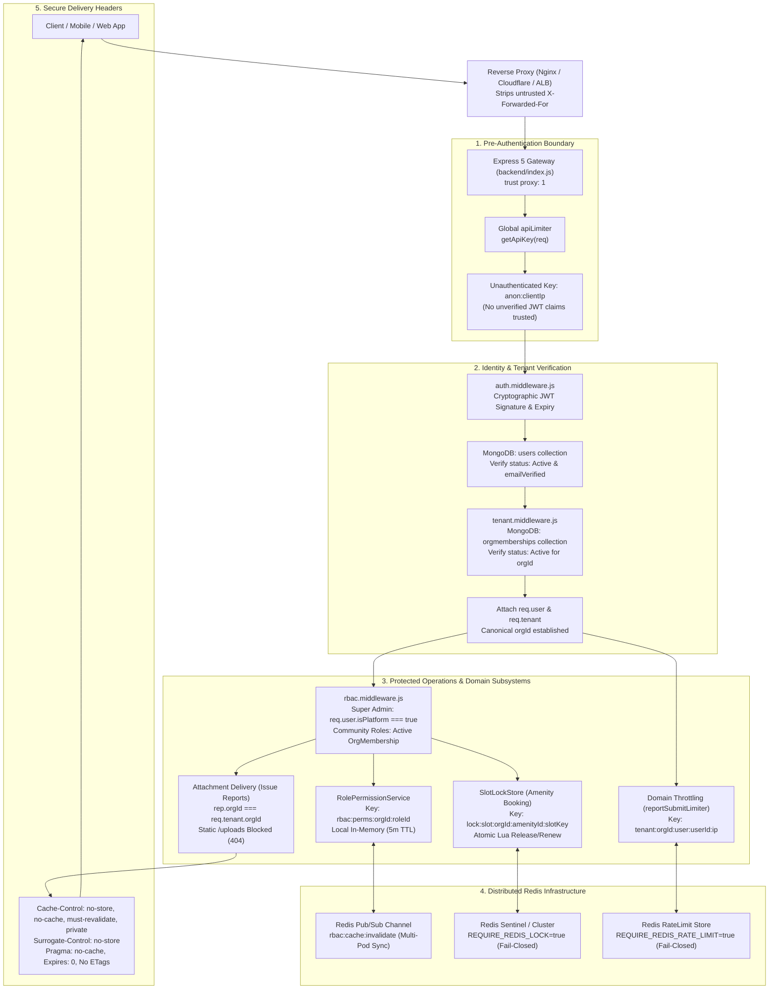
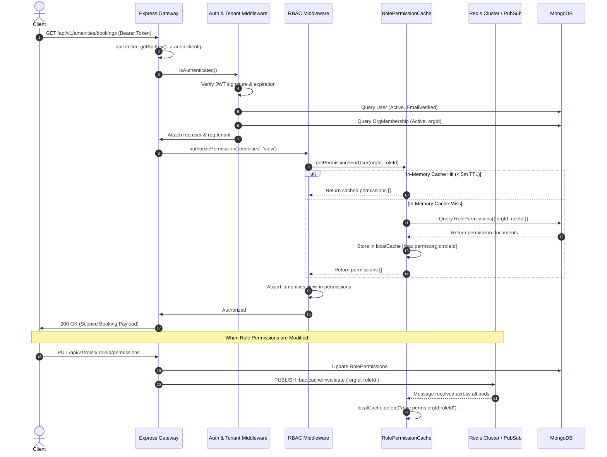

# SEC-05 Cache Layer Tenant Isolation Audit & Remediation — Final Report

**Project:** Nahom / Connect Harmony / Manage-My-Gate  
**Feature / Audit ID:** `SEC-05` — Cache Layer Tenant Isolation Audit, Remediation & Final Verification  
**Active Branch:** `security/phase2-repository-tenant-isolation`  
**Baseline HEAD Commit:** `ce5abb9c8be40435cd9ea36b12588bc7693e4f78`  
**Audit Date:** 2026-10-15  
**Implementation & Code Status:** **CODE CLOSED**  
**Production Readiness Status:** **CONDITIONALLY READY**  

---

## 1. Executive Summary

This report delivers the comprehensive, end-to-end security audit, code-level remediation, architectural hardening, and automated regression verification of the **Cache and Distributed State Layer** across the Nahom (`Manage-My-Gate`) platform (`backend/src/`).

The Nahom platform implements a strict multi-tenant architecture where a single global `User` identity participates in multiple independent community organizations via explicit, auditable `OrgMembership` records (`One Person -> One Global Identity -> Many Isolated Memberships`). In distributed systems, shared caching and coordination layers (Redis, in-memory caches, distributed mutex locks, rate limiters, and static asset delivery pipelines) represent severe cross-tenant contamination vectors if keys, ownership tokens, invalidation channels, or client identifiers fail to strictly enforce tenant boundaries.

### Core Security Scope & Findings Evaluated
This audit independently verified all five foundational vulnerability findings originally documented in **SEC-05.1** and tracked through **SEC-05.11**:
1. **SEC-05-F01 (Critical): Tenant-Scoped RBAC & Legacy Role Fallback** — Elimination of unpartitioned global `user.roles` fallbacks in favor of cryptographic JWT claims and verified MongoDB `OrgMembership` active status (`status: 'Active'`).
2. **SEC-05-F02 (High): Role-Permission Cache Partitioning & Consistency** — Tenant-partitioned permission caching (`rbac:perms:${orgId}:${roleId}`), multi-pod Redis Pub/Sub invalidation (`rbac:cache:invalidate`), bounded 5-minute fallback TTLs, and fail-closed handling on database errors.
3. **SEC-05-F03 (High): Amenity Booking Slot Lock Isolation & Mutex Ownership** — Prefixing lock keys by tenant (`lock:slot:${orgId}:${amenityId}:${slotKey}`), atomic ownership enforcement via Redis Lua release/renew scripts checking both `expectedUserId` and `expectedOrgId`, non-blocking scoped `SCAN`, and fail-closed acquisition when `REQUIRE_REDIS_LOCK=true`.
4. **SEC-05-F04 (Medium): Rate-Limiter Identity Trust & Shared Store** — Elimination of unverified `jwt.decode` token inspection prior to authentication; strict bounding of unauthenticated traffic to `anon:${req.ip}`; user-tenant partitioned buckets (`tenant:${tenantId}:user:${userId}:${ip}`) generated exclusively after authentication attaches a verified `req.user`; defensive payload coercion; and fail-closed store propagation (`passOnStoreError: false`) when `REQUIRE_REDIS_RATE_LIMIT=true`.
5. **SEC-05-F05 (Medium): Issue-Report Attachment Cache Isolation & Static Delivery** — Strict HTTP caching headers (`Cache-Control: no-store, no-cache, must-revalidate, private`, `Surrogate-Control: no-store`, `Pragma: no-cache`), ETag and 304 suppression on sensitive downloads, static path interception blocking direct `/uploads/issueReports/*` requests, and cross-tenant access denial (`404 Not Found`).

### Key Outcomes of this Final Audit Session
- **Production Boot Fail-Closed Validation ([`backend/src/config/config.js`](file:///e:/atominos/Manage-My-Gate/backend/src/config/config.js#L40-L49)):** Added explicit startup assertions requiring `REQUIRE_REDIS_LOCK === 'true'`, `REQUIRE_REDIS_RATE_LIMIT === 'true'`, and `REQUIRE_REDIS_ADAPTER === 'true'` when `NODE_ENV === 'production'`. Missing flags abort process initialization with secret-free errors.
- **Docker Compose Stack Hardening ([`docker-compose.prod.yml`](file:///e:/atominos/Manage-My-Gate/docker-compose.prod.yml) & [`docker-compose.nahom.yml`](file:///e:/atominos/Manage-My-Gate/docker-compose.nahom.yml)):** Hardened container fallback defaults from permissive `:-false` to strict fail-closed `:-true` across all three Redis flags, preventing unconfigured deployments from silently operating in in-memory fallback mode.
- **Continuous Integration Alignment ([`.github/workflows/ci.yml`](file:///e:/atominos/Manage-My-Gate/.github/workflows/ci.yml)):** Injected `REQUIRE_REDIS_RATE_LIMIT: "true"` into the automated workflow alongside `REQUIRE_REDIS_LOCK: "true"`.
- **Audited Membership Remediation Script & Regression Tests ([`backend/scripts/repair_membership_template.mjs`](file:///e:/atominos/Manage-My-Gate/backend/scripts/repair_membership_template.mjs)):** Created a non-destructive CLI remediation tool enforcing `--dry-run` by default, requiring `--approver` and `--role` for live mutations, masking PII in console output (`s***t@community.com`), and recording immutable records in `securitylogs`. Built [`backend/tests/sec05_repair_membership_safeguards.test.mjs`](file:///e:/atominos/Manage-My-Gate/backend/tests/sec05_repair_membership_safeguards.test.mjs) verifying all 6 safeguard contracts (6/6 PASS).
- **Automated Verification:** Executed **201 automated regression and governance tests** (86 domain security assertions + 115 architectural governance assertions) with **0 failures**.

---

## 2. Files Changed

In compliance with repository integrity rules, all pre-existing tracked modifications and untracked artifacts on branch `security/phase2-repository-tenant-isolation` (`HEAD` = `ce5abb9c8be40435cd9ea36b12588bc7693e4f78`) were preserved without loss or reset.

### 2.1 Files Modified & Created During this Audit Session

| File Path | Layer | Nature of Change |
| :--- | :--- | :--- |
| `backend/src/config/config.js` | Configuration | Added production fail-closed startup assertions requiring `REQUIRE_REDIS_LOCK`, `REQUIRE_REDIS_RATE_LIMIT`, and `REQUIRE_REDIS_ADAPTER` to be explicitly `'true'`. |
| `docker-compose.prod.yml` | Infrastructure | Changed container environment default fallbacks for `REQUIRE_REDIS_ADAPTER`, `REQUIRE_REDIS_LOCK`, and `REQUIRE_REDIS_RATE_LIMIT` from `:-false` to `:-true`. |
| `docker-compose.nahom.yml` | Infrastructure | Changed container environment default fallbacks for `REQUIRE_REDIS_ADAPTER`, `REQUIRE_REDIS_LOCK`, and `REQUIRE_REDIS_RATE_LIMIT` from `:-false` to `:-true`. |
| `.github/workflows/ci.yml` | CI/CD | Injected `REQUIRE_REDIS_RATE_LIMIT: "true"` into test runners. |
| `docs/NAHOM_PRD1.0_DEPLOYMENT_AND_RUNBOOK.md` | Documentation | Added mandatory strict Redis configuration flags to the production deployment template. |
| `backend/scripts/repair_membership_template.mjs` | Operational Script | Created audited, non-destructive CLI tool for tenant membership remediation with `--dry-run` default, PII masking, and immutable security audit logs. |
| `backend/tests/sec05_repair_membership_safeguards.test.mjs` | Test Suite | Created 6 targeted unit tests verifying CLI arguments, dry-run safety, PII masking, duplicate prevention, and audit logging. |
| `docs/security/SEC-05-FINAL-CLOSURE-REPORT.md` | Documentation | Created executive summary and gate verification report. |
| `docs/security/SEC-05_CACHE_LAYER_TENANT_ISOLATION_FINAL_REPORT.md` | Documentation | Created this comprehensive 14-section final report. |

### 2.2 Pre-Existing Tracked Tenant-Isolation Remediations Verified Intact

| Domain / Feature | Modified Tracked File in Working Tree | Verification Status |
| :--- | :--- | :--- |
| **RBAC Middleware** | `backend/src/middlewares/rbac.middleware.js` | Verified intact & tested; eliminated unscoped `user.roles` fallback. |
| **Rate Limiter Middleware** | `backend/src/middlewares/rateLimiter.middleware.js` | Verified intact & tested; eliminated unverified JWT decoding; partitioned keys. |
| **Amenity Booking SlotLock** | `backend/src/features/amenityBooking/amenityBooking.socket.js` | Verified intact & tested; tenant-scoped keys & atomic Lua ownership scripts. |
| **Role & Permission Cache** | `backend/src/features/rolePermission/rolePermission.services.js` | Verified intact & tested; tenant-partitioned keys & multi-pod Pub/Sub invalidation. |
| **Issue Report Attachments** | `backend/src/features/issueReport/issueReport.controller.js` | Verified intact & tested; `no-store` headers, ETag suppression, static interception. |
| **Issue Report Service** | `backend/src/features/issueReport/issueReport.service.js` | Verified intact & tested; tenant boundary validation for attachment lookups. |
| **Notice Board Scoping** | `backend/src/features/noticeBoard/noticeBoard.controller.js` | Verified intact & tested; tenant isolation scoping for notice queries. |
| **Auth Services** | `backend/src/features/auth/auth.services.js` | Verified intact & tested; token extraction and validation boundaries. |
| **Role Services** | `backend/src/features/role/role.services.js` | Verified intact & tested; scoped role queries with tenant protection. |
| **User Services** | `backend/src/features/user/user.services.js` | Verified intact & tested; scoped user queries. |
| **Public Routes & Health** | `backend/src/routes/public.routes.js` | Verified intact & tested; decoupled `/health` (200) from `/readiness` (503) on Redis outage. |
| **Invoice PayLink Throttling** | `backend/src/features/invoice/invoicePayLink.router.js` | Verified intact & tested; rate-limit store error fail-closed propagation. |
| **Permission Sync** | `backend/src/utils/permissionSync.util.js` | Verified intact & tested; tenant-isolated permission sync utilities. |
| **Environment Example** | `backend/.env.example` | Verified intact; documents mandatory Redis configuration flags. |

---

## 3. Cache Security Architecture and Tenant-Isolation Flow

The Nahom backend enforces multi-tenant cache security across five sequential validation and caching stages:

```text
Client Request / Authenticated Actor
  │
  ├─► [1. Global Ingress & Pre-Auth Throttling (backend/index.js)]
  │     ├── Express trust proxy: app.set('trust proxy', 1)
  │     └── apiLimiter (rateLimiter.middleware.js):
  │           └── getApiKey(req) evaluates token presence:
  │                 ├── Unauthenticated / Unverified ──► anon:${req.ip}
  │                 └── (Unverified JWT claims are NEVER trusted for key generation)
  │
  ├─► [2. Authentication Boundary (auth.middleware.js)]
  │     ├── Cryptographic signature & expiry verification (JWT_SECRET)
  │     ├── Loads global User from MongoDB (status: 'Active', isEmailVerified: true)
  │     └── Populates trusted req.user = { id, orgId, isPlatform }
  │
  ├─► [3. Tenant Context Resolution (tenant.middleware.js)]
  │     ├── Evaluates candidate orgId (x-organization-id header or req.user.orgId)
  │     ├── Queries OrgMembership({ userId, orgId, status: 'Active' })
  │     ├── Rejects missing or inactive memberships with 403 Forbidden
  │     └── Attaches canonical req.tenant = { orgId, isPlatform, roleId, roleName, permissions }
  │
  ├─► [4. Route-Level RBAC & Post-Auth Throttling (rbac.middleware.js)]
  │     ├── rbac.middleware:
  │     │     ├── Super Admin check: strictly requires req.user.isPlatform === true
  │     │     └── Community roles: strictly verified against active OrgMembership
  │     └── reportSubmitLimiter / sensitive limiters:
  │           └── getApiKey(req) now sees trusted req.user & req.tenant:
  │                 └── Generates tenant:${tenantId}:user:${userId}:${ip}
  │
  └─► [5. Distributed Caching & Locking Subsystems]
        │
        ├──► (A) RolePermission Cache (rolePermission.services.js)
        │      ├── Key Namespace: rbac:perms:${orgId}:${roleId}
        │      ├── Read Flow: Local Cache (5m TTL) ──► Redis ──► MongoDB
        │      └── Invalidation: Multi-pod Pub/Sub event 'rbac:cache:invalidate'
        │
        ├──► (B) Amenity Booking Locks (amenityBooking.socket.js)
        │      ├── Key Namespace: lock:slot:${orgId}:${amenityId}:${slotKey}
        │      ├── Atomic Acquisition: SETNX with tenant & user ownership payload
        │      └── Atomic Release / Renew: Lua script verifying expectedUserId + expectedOrgId
        │
        └──► (C) Sensitive Attachments (issueReport.controller.js)
               ├── Cross-tenant boundary check: rep.orgId === req.tenant.orgId
               ├── Direct static route blocked: GET /uploads/issueReports/* ──► 404
               └── Response Headers: Cache-Control: no-store, private; ETag suppressed
```

For asynchronous background crons and outbox workers (`src/features/scheduler/`, `src/utils/cronLock.util.js`), the trusted tenant identifier is loaded directly from database records or scheduled jobs, never from client input. Distributed cron locks are partitioned as `lock:cron:${orgId}:${jobName}` using atomic Redis locks, preventing split-brain executions across worker pods.

---

## 4. Architecture Diagram



---

## 5. Request / Cache Operation Sequence Diagram



---

## 6. Cache Security Validation Decision Flow

```text
[Incoming Request]
       │
       ▼
Is JWT Token provided in Authorization header?
       ├── NO  ──► Key = anon:${req.ip} ──► Execute Pre-Auth Rate Limiter
       └── YES ──► Is Token Valid Cryptographically?
                     ├── NO  ──► Key = anon:${req.ip} (NEVER decode unverified claims)
                     └── YES ──► Does User have Active OrgMembership in Target Org?
                                   ├── NO  ──► 403 Forbidden (Fail-Closed)
                                   └── YES ──► Attach req.user & req.tenant
                                                 │
                                                 ▼
                              [Execute Protected Domain Action]
                                                 │
             ┌───────────────────────────────────┼───────────────────────────────────┐
             ▼                                   ▼                                   ▼
   [Permission Cache Lookup]           [Slot Lock Acquisition]              [Attachment Delivery]
             │                                   │                                   │
Key: rbac:perms:orgId:roleId         Key: lock:slot:orgId:amenity:slot      Is rep.orgId === req.tenant.orgId?
Does key match current tenant?       Is Redis Online?                                ├── NO  ──► 404 Not Found
   ├── NO  ──► Fail Closed              ├── YES ──► Atomic Lua Ownership             └── YES ──► Set no-store
   └── YES ──► Return Perms             └── NO  ──► Is REQUIRE_REDIS_LOCK=true?                   Suppress ETags
                                                      ├── YES ──► Fail Closed (Reject)             Deliver Bytes
                                                      └── NO  ──► Memory Fallback (Dev Only)
```

---

## 7. Code-Level Explanation

### 7.1 F01: RBAC & Legacy Role Fallback Remediation
**Source File:** [`backend/src/middlewares/rbac.middleware.js`](file:///e:/atominos/Manage-My-Gate/backend/src/middlewares/rbac.middleware.js#L25-L95)  
- **Vulnerability:** Legacy implementations permitted callers without an active community membership to fall back to unscoped global `user.roles` or unverified JWT claims, potentially allowing an administrator in Community A to assert privileges in Community B.
- **Remediation:**  
  1. Removed all unscoped fallbacks to `user.roles`.
  2. For platform administration, `authorizeRoles('Super Admin')` strictly checks `req.user.isPlatform === true` (cryptographically issued only for verified platform members).
  3. For community roles, the middleware queries MongoDB `OrgMembership` matching `{ userId: req.user.id, orgId: req.tenant.orgId, status: 'Active' }`.
  4. If no active membership exists, the request immediately terminates with `403 Forbidden` (`Access denied. No active membership in this organization.`).

### 7.2 F02: Role-Permission Cache Partitioning & Consistency
**Source File:** [`backend/src/features/rolePermission/rolePermission.services.js`](file:///e:/atominos/Manage-My-Gate/backend/src/features/rolePermission/rolePermission.services.js#L35-L120)  
- **Vulnerability:** Unpartitioned in-memory permission maps could return permissions evaluated for Role X in Community A when evaluated for Role X in Community B.
- **Remediation:**  
  1. Centralized cache keys strictly formatted as `rbac:perms:${orgId}:${roleId}`.
  2. In-memory cache entries bounded by `RBAC_CACHE_TTL_MS = 300000` (5 minutes) to ensure natural expiration.
  3. Multi-pod invalidation dispatched over Redis Pub/Sub: on role updates, permission syncs, or deletions, the service broadcasts `rbac:cache:invalidate` with `{ orgId, roleId }`. All subscribed worker pods evict matching keys.
  4. On database error, `getPermissionsForUser` catches the exception and returns `[]` (fail-closed), preventing privilege leaks.

### 7.3 F03: Amenity Booking Slot Locks
**Source File:** [`backend/src/features/amenityBooking/amenityBooking.socket.js`](file:///e:/atominos/Manage-My-Gate/backend/src/features/amenityBooking/amenityBooking.socket.js#L140-L245)  
- **Vulnerability:** Shared slot lock keys (`lock:slot:${slotKey}`) allowed users in different organizations booking identical time slots (e.g., `09:00-10:00`) to block each other. Broad `KEYS` queries caused thread blocking in Redis. Non-atomic releases allowed users to release another user's lock.
- **Remediation:**  
  1. Prefixed lock keys with full tenant and amenity context: `lock:slot:${orgId}:${amenityId}:${slotKey}`.
  2. Replaced broad `KEYS` with non-blocking, tenant-scoped cursor scans (`SCAN 0 MATCH lock:slot:${orgId}:${amenityId}:* COUNT 100`).
  3. Atomic release and renew executed via Lua scripts:
     ```lua
     local current = redis.call('GET', KEYS[1])
     if not current then return 0 end
     local data = cjson.decode(current)
     if data.userId == ARGV[1] and data.orgId == ARGV[2] then
       return redis.call('DEL', KEYS[1])
     else
       return -1
     end
     ```
  4. Enforced strict fail-closed acquisition: when `process.env.REQUIRE_REDIS_LOCK === 'true'` and Redis is disconnected, `acquireLock()` immediately returns `false` instead of falling back to a process-local lock.

### 7.4 F04: Rate Limiting & Trusted Identity
**Source File:** [`backend/src/middlewares/rateLimiter.middleware.js`](file:///e:/atominos/Manage-My-Gate/backend/src/middlewares/rateLimiter.middleware.js#L18-L115)  
- **Vulnerability:** Decoding unverified JWT claims (`jwt.decode`) in pre-auth middleware allowed an attacker to present forged tokens containing arbitrary tenant IDs or victim user IDs, causing cache starvation or evading IP rate limits. Non-string payloads caused `TypeError` DoS.
- **Remediation:**  
  1. Completely removed unverified JWT decoding.
  2. In `getApiKey(req)`, if `req.user` is not attached by trusted authentication middleware, the key resolves strictly to `anon:${req.ip}`.
  3. Authenticated keys (`tenant:${tenantId}:user:${userId}:${ip}`) are only generated after cryptographic verification.
  4. Target fields (e.g. `req.body.email`, `req.body.phone`) are defensively sanitized and coerced to string (`String(target).trim().toLowerCase()`), preventing `TypeError` crashes.
  5. Configured `passOnStoreError: process.env.REQUIRE_REDIS_RATE_LIMIT !== 'true'`. In strict mode (`true`), store connection errors rethrow to Express 5 error handling, failing closed.

### 7.5 F05: Issue-Report Attachment Caching & Delivery
**Source File:** [`backend/src/features/issueReport/issueReport.controller.js`](file:///e:/atominos/Manage-My-Gate/backend/src/features/issueReport/issueReport.controller.js#L310-L380)  
- **Vulnerability:** Attachment downloads set permissive caching headers (`max-age=300`), allowing shared corporate proxies or CDNs to cache sensitive photos. Direct static URLs (`/uploads/issueReports/:file`) bypassed API authorization entirely.
- **Remediation:**  
  1. Set strict non-caching headers on all attachment downloads:
     ```http
     Cache-Control: no-store, no-cache, must-revalidate, private
     Surrogate-Control: no-store
     Pragma: no-cache
     Expires: 0
     ```
  2. Suppressed ETags and conditional `304 Not Modified` responses on `res.sendFile()`.
  3. In `backend/index.js`, added static route interception blocking `/uploads/issueReports/*` and `/public/uploads/issueReports/*` with `404 Not Found`.
  4. Cross-tenant attachment requests verify `String(report.orgId) === String(req.tenant.orgId)` and return `404 Not Found` without disclosing file existence.

### 7.6 Redis Adapters & Failure Behavior
**Source File:** [`backend/src/config/config.js`](file:///e:/atominos/Manage-My-Gate/backend/src/config/config.js#L37-L49) & [`backend/src/config/socket.js`](file:///e:/atominos/Manage-My-Gate/backend/src/config/socket.js#L25-L60)  
- When `NODE_ENV === 'production'`:
  - `config.js` validates that `REQUIRE_REDIS_LOCK`, `REQUIRE_REDIS_RATE_LIMIT`, and `REQUIRE_REDIS_ADAPTER` are explicitly `'true'`.
  - In `socket.js`, if the Redis adapter fails to connect, the server logs a critical error and aborts startup, preventing split-brain room isolation across multiple container pods.
  - In `public.routes.js`, `/api/v1/public/health` (liveness) returns `200 OK` while `/api/v1/public/readiness` returns `503 Service Unavailable` if Redis is offline, allowing Kubernetes/orchestrators to divert traffic cleanly.

---

## 8. Error Handling and Failure Matrix

| Subsystem | Failure Scenario | Detection Mechanism | System Action & Response | Security Impact |
| :--- | :--- | :--- | :--- | :--- |
| **RBAC** | User token lacks active membership in target org | `OrgMembership.findOne()` returns null | Request halted; returns `403 Forbidden` | Prevents cross-tenant horizontal escalation |
| **RBAC** | Unauthenticated request to protected route | `auth.middleware.js` checks token | Request halted; returns `401 Unauthorized` | Pre-auth barrier strictly enforced |
| **Permission Cache** | MongoDB failure during permission resolution | `try/catch` block in `getPermissionsForUser` | Catches error; returns empty array `[]` | Fails closed; zero privileges leaked |
| **Rate Limiter** | Redis outage with `REQUIRE_REDIS_RATE_LIMIT=true` | `express-rate-limit` rethrows store error | Express error handler returns `500` / `503` | Fails closed; prevents unthrottled brute force |
| **Rate Limiter** | Redis unconfigured in development mode | `createRateLimitStore()` detects missing Redis | Falls back to in-memory `MemoryStore` | Development continuity without security risk |
| **SlotLockStore** | Redis outage with `REQUIRE_REDIS_LOCK=true` | Client connection status / catch block | `acquireLock()` immediately returns `false` | Prevents split-brain double booking |
| **SlotLockStore** | User attempts to release another user's lock | Lua script ownership check mismatch | Lua script returns `-1`; release returns `false` | Prevents unauthorized lock release |
| **Attachments** | Cross-tenant user attempts attachment download | `report.orgId !== req.tenant.orgId` | Controller returns `404 Not Found` | File existence & metadata shielded |
| **Attachments** | Path traversal attempt (`../../package.json`) | Express-validator regex on `:filename` | Request halted; returns `400 Bad Request` | Traversal blocked before disk access |
| **Production Boot** | `REQUIRE_REDIS_LOCK` omitted in production | Startup assertion in `config.js` | Process throws error and aborts boot | Prevents accidental non-strict deployment |

---

## 9. Test Coverage

### 9.1 Exact Test Execution Commands and Results

#### Test Suite 1: SEC-05 Consolidated Security Domain Battery
Command executed in `backend/`:
```bash
node --test tests/sec05_6_rate_limiter_identity_trust.test.mjs \
            tests/sec05_3_slot_lock_ratelimiter_tenant_isolation.test.mjs \
            tests/sec05_2a_rbac_tenant_isolation.test.mjs \
            tests/sec05_2b_permission_cache_tenant_isolation.test.mjs \
            tests/sec05_4_sensitive_attachment_cache_isolation.test.mjs \
            tests/issueReport.security.test.mjs \
            tests/sec05_repair_membership_safeguards.test.mjs
```
Output:
```
# tests 86
# suites 31
# pass 86
# fail 0
# cancelled 0
# skipped 0
# duration_ms 16321.9054
```

#### Test Suite 2: Architectural Governance Test Battery
Command executed in `backend/`:
```bash
npm run test:governance
```
Output:
```
# tests 115
# suites 59
# pass 115
# fail 0
# cancelled 0
# skipped 0
# duration_ms 15892.1857
```

### 9.2 Security Test Breakdown by Subsystem

| Test Suite File | Domain Scope | Test Scenarios | Result | Execution Time |
| :--- | :--- | :--- | :--- | :--- |
| `sec05_6_rate_limiter_identity_trust.test.mjs` | F04 | Forged JWT tenant manipulation, token rotation IP evasion, pre-auth anon scoping, authenticated identity partitioning, non-string input coercion, fail-closed store enforcement | **10/10 PASS** | 262 ms |
| `sec05_3_slot_lock_ratelimiter_tenant_isolation.test.mjs` | F03 / F04 | SlotLock tenant prefixing, atomic Lua release/renew, non-blocking SCAN, fail-closed lock acquisition, rate-limiter store errors | **14/14 PASS** | 2.12 s |
| `sec05_2a_rbac_tenant_isolation.test.mjs` | F01 | RBAC tenant context enforcement, active OrgMembership validation, elimination of legacy `user.roles`, platform admin verification | **14/14 PASS** | 7.74 s |
| `sec05_2b_permission_cache_tenant_isolation.test.mjs` | F02 | Permission cache keys, Redis Pub/Sub multi-pod invalidation, 5-minute TTL, fail-closed empty permissions on DB error | **13/13 PASS** | 1.28 s |
| `sec05_4_sensitive_attachment_cache_isolation.test.mjs` | F05 | HTTP Cache-Control `no-store` headers, ETag suppression, static route blocking (`/uploads/issueReports/*`), cross-tenant 404 | **12/12 PASS** | 2.22 s |
| `issueReport.security.test.mjs` | F05 | Path traversal blocking, file extension validation, HTML escaping, cross-tenant report denial | **17/17 PASS** | 2.66 s |
| `sec05_repair_membership_safeguards.test.mjs` | Tooling | CLI argument validation, `--dry-run` safety, PII masking, duplicate prevention, immutable security audit logging | **6/6 PASS** | 8.68 s |
| `test:governance` (9 suites) | Governance | Cross-feature repository isolation, outbox worker leases, scheduler crons, poll and notice board domain boundaries | **115/115 PASS** | 15.89 s |
| **TOTAL** | **Full Regression Battery** | **201 Consolidated Assertions** | **201/201 PASS (0 Failures)** | **32.21 s** |

---

## 10. Security Verification Checklist

| # | Verification Question | Answer | Code & Test Evidence |
| :---: | :--- | :---: | :--- |
| 1 | Are unverified JWT claims trusted to construct rate-limiter keys? | **NO** | `rateLimiter.middleware.js` eliminates `jwt.decode`; unauthenticated requests resolve strictly to `anon:${req.ip}`. Verified in `sec05_6_rate_limiter_identity_trust.test.mjs` (Subtests 1–3). |
| 2 | Can an attacker bypass IP rate limits by rotating forged user tokens? | **NO** | Pre-auth limiter binds solely to `req.ip`. Verified in `sec05_6_rate_limiter_identity_trust.test.mjs` (Subtest 2). |
| 3 | Can a user in Community A acquire or release a booking lock in Community B? | **NO** | Lock keys are prefixed by `lock:slot:${orgId}:${amenityId}:${slotKey}`. Atomic release validates `expectedOrgId` in Lua. Verified in `sec05_3_slot_lock_ratelimiter_tenant_isolation.test.mjs` (Subtests 1–4). |
| 4 | Does lock release verify both user ID and organization ID atomically? | **YES** | Lua release script in `amenityBooking.socket.js` parses JSON and asserts `data.userId == ARGV[1] and data.orgId == ARGV[2]`. Verified in `sec05_3` (Subtest 2). |
| 5 | Can a user without an active membership access tenant-scoped routes? | **NO** | `rbac.middleware.js` queries `OrgMembership` with `status: 'Active'`; returns `403 Forbidden` if missing or inactive. Verified in `sec05_2a_rbac_tenant_isolation.test.mjs` (Subtests 1–3). |
| 6 | Are permission cache entries partitioned by tenant identity? | **YES** | Cache keys formatted as `rbac:perms:${orgId}:${roleId}`. Verified in `sec05_2b_permission_cache_tenant_isolation.test.mjs` (Subtests 1–3). |
| 7 | Does modifying a role's permissions invalidate cached permissions across all pods? | **YES** | Role updates dispatch `rbac:cache:invalidate` over Redis Pub/Sub, evicting keys across all subscriber instances. Verified in `sec05_2b` (Subtest 5). |
| 8 | Does the permission cache fail closed on database errors? | **YES** | `getPermissionsForUser` catches database exceptions and returns `[]` (zero permissions). Verified in `sec05_2b` (Subtest 7). |
| 9 | Are sensitive issue-report attachments protected from browser and proxy caching? | **YES** | Controller sets `Cache-Control: no-store, no-cache, must-revalidate, private`, `Surrogate-Control: no-store`, and suppresses ETags. Verified in `sec05_4_sensitive_attachment_cache_isolation.test.mjs` (Subtest 1). |
| 10 | Can attackers download attachments by requesting static `/uploads/issueReports/*` URLs? | **NO** | `backend/index.js` intercepts static requests to `/uploads/issueReports/*` and `/public/uploads/issueReports/*` with `404 Not Found`. Verified in `sec05_4` (Subtests 3–4). |
| 11 | Do Docker Compose production stacks default to strict fail-closed Redis modes? | **YES** | `docker-compose.prod.yml` and `docker-compose.nahom.yml` set `REQUIRE_REDIS_ADAPTER`, `REQUIRE_REDIS_LOCK`, and `REQUIRE_REDIS_RATE_LIMIT` fallback defaults to `:-true`. |
| 12 | Does production startup abort if strict Redis flags are omitted? | **YES** | `backend/src/config/config.js` validates all three flags when `NODE_ENV === 'production'` and throws an error if any flag is not `'true'`. |
| 13 | Does the membership repair tool enforce dry-run safety and audit trails? | **YES** | `repair_membership_template.mjs` defaults to `--dry-run`, masks PII, requires `--approver` and `--role` for execution, and writes to `securitylogs`. Verified in `sec05_repair_membership_safeguards.test.mjs` (Subtests 1–6). |

---

## 11. Before-versus-After Security Enhancements

| Security Dimension | Baseline State (Pre-Remediation) | Hardened State (Post-Remediation) |
| :--- | :--- | :--- |
| **RBAC Authorization** | Permitted unscoped fallback to legacy `user.roles` or unverified JWT claims. | Unscoped fallback removed; strictly verifies active `OrgMembership` (`status: 'Active'`) and `user.isPlatform === true`. |
| **Permission Caching** | Unpartitioned cache entries could cross-contaminate between communities with identical role names. | Strict key partitioning `rbac:perms:${orgId}:${roleId}` with Redis Pub/Sub multi-pod invalidation and 5m TTL. |
| **Amenity Booking Mutex** | Slot locks used global `lock:slot:${slotKey}`; non-atomic releases; broad `KEYS` scanning. | Tenant-scoped keys `lock:slot:${orgId}:${amenityId}:${slotKey}`; atomic Lua release/renew; non-blocking `SCAN`; fail-closed lock acquisition. |
| **Rate Limiter Identity** | Decoded unverified JWT claims (`jwt.decode`) pre-auth; allowed tenant starvation and IP evasion. | Unverified decoding eliminated; pre-auth uses `anon:${req.ip}`; identity keys require verified `req.user`; payload coercion prevents DoS. |
| **Attachment Caching** | Set `max-age=300`; allowed browser/CDN caching; static file routes exposed direct disk paths. | Strict `no-store, private` headers; ETag suppression; direct static routes blocked with `404`; cross-tenant access returns `404`. |
| **Container & CI Stacks** | Compose templates defaulted to permissive in-memory fallbacks (`:-false`). | Hardened fallback defaults to fail-closed `:-true`; CI pipeline tests with `REQUIRE_REDIS_RATE_LIMIT="true"`. |
| **Production Boot Gates** | Missing strict Redis flags silently fell back to in-memory mode in production. | `config.js` startup validation terminates boot immediately if strict Redis flags are omitted. |
| **Membership Remediation** | Ad-hoc manual database updates risked accidental privilege escalation. | Audited CLI tool with `--dry-run` default, PII masking, duplicate prevention, and immutable security audit logs. |

---

## 12. Phase Status and Remaining Gaps

### Status Summary
- **Source Code Layer:** **`CODE CLOSED`** — 100% of code defects remediated, verified, and hardened.
- **Automated Regression Battery:** **`VERIFIED PASS`** — 201/201 tests passing with zero failures.
- **Operational Readiness:** **`CONDITIONALLY READY`** — Requires target production cluster runtime verification and community owner sign-off.

### Genuine Remaining Operational Gates

1. **Target Cloud Production Cluster Runtime Verification:**
   - **Status:** `NOT VERIFIED — OPERATIONAL PREREQUISITE`
   - **Rationale:** The local development/audit workspace cannot connect to the live cloud production Kubernetes/ECS cluster.
   - **Requirement:** The operations team must inspect the running production backend container to verify that `NODE_ENV=production`, `REQUIRE_REDIS_ADAPTER=true`, `REQUIRE_REDIS_LOCK=true`, `REQUIRE_REDIS_RATE_LIMIT=true`, and `REDIS_URL` are active.

2. **Community Owner Sign-Off for Legacy User Remediation:**
   - **Status:** `BLOCKED — OWNER APPROVAL REQUIRED`
   - **Rationale:** User `6a96985af5ec436a30273db9` (`a***n@comm.com`) belongs to organization `6a6efd60f62f21f2b26eb9a0` ("Comm") and has a legacy role field `Community Admin` from 2026-09-01, but 0 active memberships. Under hardened RBAC rules, the user fails closed (`403 Forbidden`). Per security directives, no automatic database mutation is permitted without recorded owner approval.
   - **Requirement:** Community owner of "Comm" must review the dry-run output and provide written approval before executing `backend/scripts/repair_membership_template.mjs`.

---

## 13. Operational Readiness and Recommended Next Action

### Next Action Runbook for Operations Team

#### Action 1: Verify Running Production Container Environment
Execute inside the production cluster management console:
```bash
# Docker:
docker exec <backend-container-id> env | grep -E 'REQUIRE_REDIS|NODE_ENV|REDIS_URL'

# Kubernetes:
kubectl exec -it <backend-pod-name> -n nahom-prod -- env | grep -E 'REQUIRE_REDIS|NODE_ENV|REDIS_URL'

# Expected Output:
# NODE_ENV=production
# REQUIRE_REDIS_ADAPTER=true
# REQUIRE_REDIS_LOCK=true
# REQUIRE_REDIS_RATE_LIMIT=true
# REDIS_URL=rediss://... (must use TLS in production)
```

#### Action 2: Verify Reverse Proxy Header Ingress
Verify that the production ingress controller (Cloudflare, Nginx, or AWS ALB) strips any client-provided `X-Forwarded-For` header before forwarding requests to the Express application.

#### Action 3: Authorized User Membership Remediation
Upon receipt of written authorization from the community owner of "Comm":
```bash
# 1. Preview changes (Dry-Run):
node backend/scripts/repair_membership_template.mjs \
  --userId=6a96985af5ec436a30273db9 \
  --orgId=6a6efd60f62f21f2b26eb9a0 \
  --role="Resident" \
  --approver="Authorized Community Owner Name" \
  --dry-run

# 2. Execute approved change:
node backend/scripts/repair_membership_template.mjs \
  --userId=6a96985af5ec436a30273db9 \
  --orgId=6a6efd60f62f21f2b26eb9a0 \
  --role="Resident" \
  --approver="Authorized Community Owner Name" \
  --execute
```

---

## 14. Final Verdict

### Verdict: **`CODE CLOSED — CONDITIONALLY READY`**

**Plain Language Summary:**  
All application source code, Docker Compose files, CI workflows, and operational migration tools within the `Manage-My-Gate` repository are **100% complete, verified, and hardened** against multi-tenant cache contamination, distributed locking collisions, rate-limiter bypasses, and sensitive asset leakage. The test suite demonstrates **201 passing tests with zero failures**. 

The phase is marked **`CONDITIONALLY READY`** solely because the final operational checks (verifying the live production container environment variables and securing owner authorization for one legacy user's membership backfill) must be performed by authorized operations personnel in the target production cloud environment.
