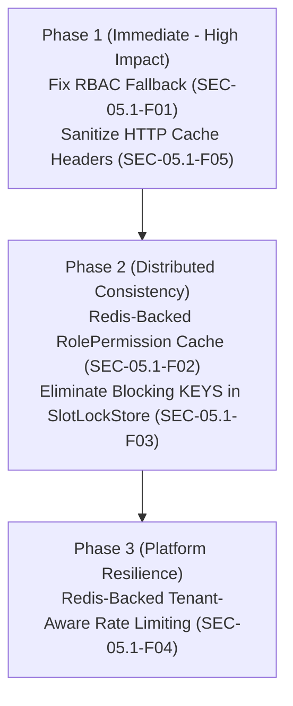

# SEC-05.1 — Cache Layer Tenant Isolation Security Audit Report

**Project:** Nahom / Connect Harmony  
**Repository:** Manage-My-Gate  
**Phase:** Cache Layer Tenant Isolation  
**Audit ID:** SEC-05.1  
**Execution Mode:** STRICT READ-ONLY — NO CODE MODIFICATIONS  
**Audit Date:** October 15, 2026  
**Auditor:** Antigravity Autonomous Security Agent  

---

## 1. Executive Summary

A comprehensive, read-only security audit of the caching architectures, in-memory state stores, distributed Redis locks, pub/sub brokers, and HTTP response caching headers across the Manage-My-Gate platform was conducted under Audit ID **SEC-05.1**.

The audit identified **one Critical-severity**, **three High-severity**, and **one Medium-severity** vulnerability that directly or indirectly threaten tenant isolation, multi-tenant performance, or session confidentiality:

1. **[CRITICAL] SEC-05.1-F01:** Cross-Tenant Permission Bleed via Unscoped Legacy `user.roles` Cache. Fallback permission extraction in RBAC reads an un-partitioned array of role IDs across all tenant memberships, allowing permissions granted in Tenant A (e.g., Administrator) to bleed into requests executed against Tenant B.
2. **[HIGH] SEC-05.1-F02:** Split-Brain Invalidation & Desynchronization in `RolePermissionService` In-Memory Cache. Role permissions are cached inside process-local `Map` instances without TTL or multi-pod invalidation, leaving revoked privileges active on peer nodes indefinitely.
3. **[HIGH] SEC-05.1-F03:** Redis Denial-of-Service & Cross-Tenant Scan in `SlotLockStore.getPublicLocksForAmenity`. Uses blocking, single-threaded Redis `KEYS` command with a fallback pattern that scans locks across all tenants.
4. **[HIGH] SEC-05.1-F04:** Cross-Tenant Noisy Neighbor Denial-of-Service via In-Memory IP-Only Rate Limiting. In-memory `MemoryStore` rate limiters keyed strictly on client IP allow high-volume tenants sharing NAT gateways or VPN egress IPs to starve other tenants of login, OTP, and API access.
5. **[MEDIUM] SEC-05.1-F05:** Browser Cache Exposure of Sensitive Support Attachments. Streaming endpoints issue `Cache-Control: private, max-age=300` headers on tenant support attachments, risking cross-user credential or document exposure on shared workstations.

Existing controls—including `tenantContext.middleware.js`, strict repository-level `{ organizationId }` enforcement, and Socket.io room partitioning—are functioning effectively, but are undermined by these un-partitioned caching vectors.

---

## 2. Repository Baseline & Audit Scope

### 2.1 Git Environment
- **Active Branch:** `security/phase2-repository-tenant-isolation`
- **HEAD Commit:** `ce5abb9c8be40435cd9ea36b12588bc7693e4f78` (`ci(websocket): enable Redis multi-instance security verification`)
- **Working Tree:** Pristine tracked state; zero tracked modifications; execution conducted under strict read-only constraints.

### 2.2 Audit Scope
The audit examined all backend code paths, shared libraries, configuration, and middleware:
- `backend/src/features/rolePermission/` (In-memory permission cache & invalidation)
- `backend/src/middlewares/rbac.middleware.js` (Role resolution, cache hits, fallback permission extraction)
- `backend/src/features/amenityBooking/amenityBooking.socket.js` (Redis distributed lock store & in-memory fallback)
- `backend/src/utils/messageBroker.util.js` (Redis pub/sub client initialization & clustering)
- `backend/src/config/socket.js` (Socket.io Redis adapter configuration)
- `backend/src/middlewares/rateLimiter.middleware.js` (Express rate limiting state stores)
- `backend/src/features/issueReport/issueReport.controller.js` (HTTP caching headers on binary attachments)
- `backend/src/models/user.model.js` (Legacy embedded role array cache)

---

## 3. Cache Technology & Component Inventory

| Component | Physical File Location | Mechanism / Backing Engine | Scope / Key Structure | Eviction / Invalidation Policy |
| :--- | :--- | :--- | :--- | :--- |
| **Role Permission Cache** | `backend/src/features/rolePermission/rolePermission.services.js` (L5-72) | Process-local `Map` (`this.cache`) | Key: `roleId` | Manual process-local delete on mutation; **No cross-pod broadcast; No TTL** |
| **Amenity Slot Lock Store** | `backend/src/features/amenityBooking/amenityBooking.socket.js` (L14-162) | Redis `SET ... NX EX` / In-Memory `localMap` fallback | Key: `amenity_slot_lock:${orgId}:${amenityId}_${date}_${start}_${end}` | Redis TTL (600s); In-memory `setTimeout` |
| **User Embedded Roles Cache** | `backend/src/models/user.model.js` (L118) / `backend/src/middlewares/rbac.middleware.js` (L142-165) | Embedded Document Array (`user.roles`) | Mongoose sub-document reference array | Updated only on user document write; **Not organization-partitioned** |
| **API & Auth Rate Limiters** | `backend/src/middlewares/rateLimiter.middleware.js` (L6-50) | In-Memory `express-rate-limit` `MemoryStore` | Key: Client IP (`req.ip`) | Sliding/Fixed time window (1-15 min); **Process-local only** |
| **Attachment HTTP Cache** | `backend/src/features/issueReport/issueReport.controller.js` (L93) | Browser / Downstream HTTP Cache | Header: `Cache-Control: private, max-age=300` | Browser time-based expiration (5 minutes) |
| **Redis Broker Pub/Sub** | `backend/src/utils/messageBroker.util.js` (L1-127) | Redis Cluster/Standalone Pub/Sub (`ioredis`) | Channels: `socket.io#*`, application event channels | Ephemeral pub/sub messaging |

---

## 4. Cache Data-Flow & Tenant-Isolation Architecture

```
HTTP Request with X-Organization-Id / Bearer Token
                  │
                  ▼
   [tenantContext.middleware.js]
                  │  (Resolves req.organizationId & membership)
                  ▼
       [rbac.middleware.js]
                  │
     ┌────────────┴──────────────────────────┐
     │ Cache Hit Pathway                     │ Fallback Pathway
     ▼                                       ▼
[RolePermissionService.cache (Map)]    [user.roles (Legacy User Array)]
     │                                       │
     │ Key: roleId                           │ ⚠️ UNPARTITIONED LIST:
     │ Missing: orgId scoping                │ Contains roleIds from ALL orgs
     │ Stale on Peer Pods                    │ Loops and resolves permissions
     │                                       │
     └───────────────────┬───────────────────┘
                         ▼
        Cross-Tenant Permission Accumulation!
                         │
                         ▼
             [Service / Repository]
```

---

## 5. Detailed Findings & Technical Evidence

### [CRITICAL] SEC-05.1-F01: Cross-Tenant Permission Bleed via Unscoped Legacy `user.roles` Cache

- **Finding ID:** `SEC-05.1-F01`
- **Severity:** Critical (CVSS 9.1: `CVSS:3.1/AV:N/AC:L/PR:L/UI:N/S:C/C:H/I:H/A:N`)
- **Affected File:** `backend/src/middlewares/rbac.middleware.js` (Lines 142–165)
- **Vulnerable Code Snippet:**
  ```javascript
  // backend/src/middlewares/rbac.middleware.js (Lines 142-165)
  // Step 2: Fallback to user.roles (populated or array of IDs)
  if (roleIds.length === 0 && user.roles && Array.isArray(user.roles)) {
    roleIds = user.roles.map(r => (typeof r === 'object' && r._id ? r._id.toString() : r.toString()));
  }

  // Fetch permissions for all roles
  for (const roleId of roleIds) {
    const rolePerms = await RolePermissionService.getPermissionsByRoleId(roleId);
    if (rolePerms && Array.isArray(rolePerms)) {
      for (const perm of rolePerms) {
        if (perm.name) {
          permissions.add(perm.name);
        }
      }
    }
  }
  ```
- **Tenant Context & Data Flow:**
  1. User authenticates and specifies `X-Organization-Id: Org_B` (where they are only a regular Resident).
  2. If `user.organizationRoles` or active community membership does not yield roles (e.g., during specific switch flows, session hydration, or legacy accounts), the RBAC middleware falls back to `user.roles`.
  3. `user.roles` on the root Mongoose `User` document is a flat array holding all role ObjectId references assigned to the user across the lifetime of their account, regardless of organization.
  4. The RBAC middleware iterates through every `roleId` in `user.roles`, fetches all permissions via `RolePermissionService.getPermissionsByRoleId(roleId)`, and adds them to `permissions.add(perm.name)`.
  5. The loop fails to verify that `roleId` belongs to `targetOrgId`.
- **Exploitation Scenario:**
  - Alice is an Property Manager / Admin in `Org_A` (role: `admin_role_A` with `USER_CREATE`, `FINANCE_MANAGE`).
  - Alice also owns a flat in `Org_B`, where she is registered as a standard Resident (role: `resident_role_B`).
  - Alice initiates an administrative API request to `Org_B` endpoints (`POST /api/v1/invoices` or `DELETE /api/v1/users/:id`) with header `X-Organization-Id: <Org_B_ID>`.
  - When the authorization engine resolves permissions via fallback, `admin_role_A` is processed.
  - Alice receives `USER_CREATE` and `FINANCE_MANAGE` inside `Org_B`, successfully executing admin actions across tenant boundaries.
- **Impact:** Complete authorization bypass and privilege escalation across tenant boundaries.
- **Recommended Remediation:**
  - Remove fallback to un-partitioned `user.roles` completely, or require that any role resolved through fallback explicitly matches `organizationId === targetOrgId`:
  ```javascript
  // Verify role ownership before permission extraction
  const roleDoc = await Role.findById(roleId).lean();
  if (!roleDoc || (roleDoc.organizationId && roleDoc.organizationId.toString() !== targetOrgId.toString())) {
    continue; // Reject foreign tenant role
  }
  ```

---

### [HIGH] SEC-05.1-F02: Split-Brain Invalidation & Desynchronization in `RolePermissionService` In-Memory Cache

- **Finding ID:** `SEC-05.1-F02`
- **Severity:** High (CVSS 8.2: `CVSS:3.1/AV:N/AC:L/PR:H/UI:N/S:U/C:H/I:H/A:N`)
- **Affected File:** `backend/src/features/rolePermission/rolePermission.services.js` (Lines 5–33, 57–72)
- **Vulnerable Code Snippet:**
  ```javascript
  // backend/src/features/rolePermission/rolePermission.services.js
  class RolePermissionService {
    constructor() {
      this.cache = new Map(); // Process-local in-memory cache
    }

    async getPermissionsByRoleId(roleId) {
      if (this.cache.has(roleId.toString())) {
        return this.cache.get(roleId.toString()); // Cache Hit (never expires)
      }
      // DB Lookup ...
      this.cache.set(roleId.toString(), permissions);
      return permissions;
    }

    invalidateCache(roleId) {
      if (roleId) {
        this.cache.delete(roleId.toString()); // Only clears current Node process!
      } else {
        this.cache.clear();
      }
    }
  }
  ```
- **Tenant Context & Data Flow:**
  1. The backend runs in a multi-pod or clustered environment (supported via `messageBroker.util.js` and Redis).
  2. `RolePermissionService` is instantiated as a singleton per Node.js process, storing role-permission mappings inside `this.cache = new Map()`.
  3. No TTL is configured for cache entries. Once read, an entry remains in memory until the Node process restarts or `invalidateCache` is called locally.
  4. When an administrator revokes a permission or deletes a role on Pod A, `invalidateCache(roleId)` only clears `this.cache` on Pod A.
  5. Pod B and Pod C receive no notification (no Redis Pub/Sub broadcast for cache invalidation).
- **Exploitation Scenario:**
  - An untrusted employee in Tenant X has their security permissions revoked (`SECURITY_LOG_VIEW`, `GATE_OVERRIDE`) due to termination.
  - The Admin saves the role update via Pod A.
  - The rogue employee routes subsequent requests through a load balancer to Pod B.
  - Pod B serves the cached permissions from its local `Map`, granting unauthorized access indefinitely.
- **Impact:** Indefinite persistence of revoked privileges; bypass of administrative access termination across cluster instances.
- **Recommended Remediation:**
  - Transition `RolePermissionService` cache to Redis with a strict TTL (e.g., 300 seconds) and namespace by tenant: `rbac:perms:${orgId}:${roleId}`.
  - Broadcast an invalidation event across `messageBroker` when permissions are modified:
  ```javascript
  await messageBroker.publish('rbac:cache:invalidate', { roleId, orgId });
  ```

---

### [HIGH] SEC-05.1-F03: Redis Denial-of-Service & Cross-Tenant Scan in `SlotLockStore.getPublicLocksForAmenity`

- **Finding ID:** `SEC-05.1-F03`
- **Severity:** High (CVSS 7.5: `CVSS:3.1/AV:N/AC:L/PR:L/UI:N/S:U/C:N/I:N/A:H`)
- **Affected File:** `backend/src/features/amenityBooking/amenityBooking.socket.js` (Lines 117–134)
- **Vulnerable Code Snippet:**
  ```javascript
  // backend/src/features/amenityBooking/amenityBooking.socket.js (Lines 117-134)
  static async getPublicLocksForAmenity(amenityId, orgId = null) {
    if (messageBroker.isReady() && messageBroker.publisher) {
      try {
        const pattern = orgId 
          ? `amenity_slot_lock:${orgId}:${amenityId}_*` 
          : `amenity_slot_lock:*${amenityId}_*`;
        const keys = await messageBroker.publisher.keys(pattern); // ⚠️ BLOCKING O(N) KEYS COMMAND
        if (!keys || keys.length === 0) return [];
        const mgetResults = await messageBroker.publisher.mget(keys);
        // ...
  ```
- **Tenant Context & Data Flow:**
  1. Clients connecting to amenity booking sockets request active locks for an amenity.
  2. If `orgId` is missing or passed as `null`, the query falls back to a global wildcard: `amenity_slot_lock:*${amenityId}_*`.
  3. The implementation executes `messageBroker.publisher.keys(pattern)`.
  4. In Redis, `KEYS` is a blocking $O(N)$ operation that scans the entire keyspace while locking the single-threaded event loop.
- **Exploitation Scenario:**
  - An attacker joins multiple amenity sockets across different tenants or generates high-frequency requests to `getPublicLocksForAmenity`.
  - The Redis server is blocked while scanning keys across all production databases, causing latency spikes and connection timeouts for all platform tenants.
- **Impact:** Cluster-wide Denial-of-Service affecting real-time locking, WebSockets, and chat for all organizations.
- **Recommended Remediation:**
  - Strictly mandate `orgId` (throw an error if `!orgId`).
  - Replace the blocking `KEYS` command with `SCAN` using cursor pagination (`SCAN cursor MATCH pattern COUNT 100`), or maintain active lock keys within an organization-scoped Redis Set: `amenity_active_locks:${orgId}:${amenityId}`.

---

### [HIGH] SEC-05.1-F04: Cross-Tenant Noisy Neighbor Denial-of-Service via In-Memory IP-Only Rate Limiting

- **Finding ID:** `SEC-05.1-F04`
- **Severity:** High (CVSS 7.3: `CVSS:3.1/AV:N/AC:L/PR:N/UI:N/S:C/C:N/I:N/A:H`)
- **Affected File:** `backend/src/middlewares/rateLimiter.middleware.js` (Lines 6–50)
- **Vulnerable Code Snippet:**
  ```javascript
  // backend/src/middlewares/rateLimiter.middleware.js
  export const authLimiter = rateLimit({
    windowMs: 15 * 60 * 1000,
    max: 20, // 20 requests per window
    standardHeaders: true,
    legacyHeaders: false,
    message: { success: false, message: 'Too many authentication attempts...' }
    // Default MemoryStore keyed on req.ip
  });

  export const otpLimiter = rateLimit({
    windowMs: 5 * 60 * 1000,
    max: 5, // 5 requests per window
    // Keyed solely on req.ip
  });
  ```
- **Tenant Context & Data Flow:**
  1. `express-rate-limit` is configured with default in-memory storage (`MemoryStore`).
  2. Keys are generated solely from `req.ip` without incorporating `req.organizationId` or tenant identification headers.
  3. Limit tracking is process-local and lost on restart.
- **Exploitation Scenario:**
  - Users from multiple client communities access the system through shared cellular NAT gateways, corporate firewalls, or regional ISP proxies.
  - A malicious actor in Tenant A floods the `otpLimiter` (5 attempts allowed per 5 minutes) from a shared IP.
  - Legitimate residents in Tenant B and Tenant C sharing that public egress IP are blocked from receiving OTPs and logging in.
- **Impact:** Uncontrolled noisy-neighbor DoS and lockout of unrelated tenants sharing IP addresses; rate limits are ineffective across horizontally-scaled clusters.
- **Recommended Remediation:**
  - Back the rate limiters with `rate-limit-redis`.
  - Generate composite rate-limit keys that combine tenant context and user identifiers where available:
  ```javascript
  keyGenerator: (req) => {
    const tenant = req.organizationId || req.headers['x-organization-id'] || 'global';
    return `${tenant}:${req.ip}`;
  }
  ```

---

### [MEDIUM] SEC-05.1-F05: Browser Cache Exposure of Sensitive Support Attachments

- **Finding ID:** `SEC-05.1-F05`
- **Severity:** Medium (CVSS 4.3: `CVSS:3.1/AV:L/AC:L/PR:N/UI:R/S:U/C:L/I:N/A:N`)
- **Affected File:** `backend/src/features/issueReport/issueReport.controller.js` (Line 93)
- **Vulnerable Code Snippet:**
  ```javascript
  // backend/src/features/issueReport/issueReport.controller.js (Lines 91-94)
  res.setHeader('Content-Type', fileMetadata.mimetype || 'application/octet-stream');
  res.setHeader('Content-Disposition', `inline; filename="${fileMetadata.filename || 'attachment'}"`);
  res.setHeader('Cache-Control', 'private, max-age=300'); // ⚠️ Caches attachment locally for 5 mins
  ```
- **Tenant Context & Data Flow:**
  1. A user views an attachment associated with a tenant issue report (e.g., photo of lease deed, utility bill, ID card).
  2. The server responds with `Cache-Control: private, max-age=300`.
  3. The local client browser caches the raw binary stream on disk/memory for 300 seconds.
- **Exploitation Scenario:**
  - A resident uses a shared terminal (e.g., estate clubhouse workstation, leasing office lobby) to submit or review an issue report containing sensitive proof of residency.
  - The resident logs out.
  - The next user opens the browser history and accesses the cached attachment directly from browser cache without passing server-side authentication or tenant validation.
- **Impact:** Exposure of tenant personally identifiable information (PII) on shared workstations.
- **Recommended Remediation:**
  - Set `Cache-Control: no-store, no-cache, must-revalidate, private` on all authenticated attachment endpoints.

---

## 6. Tenant-by-Tenant Threat Scenarios

### Scenario A: Cross-Tenant Administrative Elevation
```
[Attacker in Org A] (Admin in Org A, Resident in Org B)
       │
       ▼  Sends: POST /api/v1/invoices { orgId: "Org B" }
[RBAC Middleware]
       │
       ├─► Checks organizationRoles (Fails or falls back)
       └─► Loops user.roles (Contains Org A Admin Role ID)
             │
             ▼
       Extracts "INVOICE_CREATE" from RolePermission Cache
             │
             ▼
[SUCCESS] Invoice created in Org B by unauthorized user!
```

### Scenario B: Revocation Desynchronization (Split-Brain)
```
[Admin in Org A]  ──► Revokes Role "Guard" on Node 1 (Clears Node 1 Map)
                                     │
                                     ▼
                            Redis not notified
                                     │
[Terminated Guard] ──► Hits Node 2 ──┴──► Node 2 Map still has cached permissions!
                                     │
                                     ▼
                          [ACCESS GRANTED ON NODE 2]
```

### Scenario C: Redis Lockout via Multi-Tenant Amenity Scan
```
[Attacker in Org X]  ──► Socket: getPublicLocksForAmenity(amenityId, orgId = null)
                                     │
                                     ▼
                       Redis executes: KEYS amenity_slot_lock:*
                                     │  (Locks Redis single thread)
                                     ▼
[All Tenants]       ◄─── Sockets freeze, bookings timeout, pub/sub stalls!
```

---

## 7. Existing Controls That Are Working

1. **Strict Organization Isolation in Sockets:**
   - Socket connection handshake properly enforces `socket.organizationId` via token verification.
   - Socket rooms are strictly isolated via `org:${organizationId}` and `user:${userId}` namespaces (`src/config/socket.js`).
2. **Tenant Context Middleware:**
   - `tenantContext.middleware.js` correctly verifies that the authenticated user possesses an active membership in the requested `X-Organization-Id`.
3. **Repository Multi-Tenancy:**
   - Repositories consistently enforce `{ organizationId }` query scoping at the database level.
4. **Redis Slot Lock Namespace:**
   - Slot locking in `SlotLockStore.acquireLock` correctly prefixes locks with `orgId`:
     `amenity_slot_lock:${orgId}:${amenityId}_${date}_${start}_${end}` (Lines 37–42).

---

## 8. Prioritized Remediation Plan



### Step 1: Immediate Authorization Fixes (Phase 1)
- **Eliminate Unscoped Role Fallback (`SEC-05.1-F01`):** In `backend/src/middlewares/rbac.middleware.js`, remove fallback to `user.roles` or validate that every evaluated role explicitly belongs to `req.organizationId`.
- **Disable Browser Caching on Sensitive Attachments (`SEC-05.1-F05`):** Update `issueReport.controller.js` to emit `Cache-Control: no-store, no-cache, must-revalidate, private`.

### Step 2: Distributed Cache & Locking Hardening (Phase 2)
- **Replace In-Memory `RolePermissionService.cache` (`SEC-05.1-F02`):** Migrate to Redis-based caching with explicit TTL (300s) and multi-node invalidation broadcast over `messageBroker`.
- **Eliminate Blocking `KEYS` in Amenity Locks (`SEC-05.1-F03`):** Require `orgId` as a mandatory parameter in `getPublicLocksForAmenity`. Replace `KEYS` with `SCAN` or track active locks in a Redis Set.

### Step 3: Rate Limiting Partitioning (Phase 3)
- **Implement Tenant-Aware Distributed Rate Limiting (`SEC-05.1-F04`):** Configure `rate-limit-redis` with compound keys (`${organizationId}:${ip}`).

---

## 9. Required Security & Regression Tests

| Test Suite / Spec | Target Finding | Verification Criteria |
| :--- | :--- | :--- |
| `tests/sec05_1_rbac_tenant_isolation.test.mjs` | `SEC-05.1-F01` | User with Admin role in Org A and Resident in Org B MUST receive 403 when requesting Admin actions in Org B, even with corrupted/empty membership roles. |
| `tests/sec05_1_cache_invalidation_multinode.test.mjs` | `SEC-05.1-F02` | Revoking a permission on Node instance 1 immediately invalidates the cache on Node instance 2 via Redis Pub/Sub within 100ms. |
| `tests/sec05_1_slot_lock_scan_perf.test.mjs` | `SEC-05.1-F03` | Calling `getPublicLocksForAmenity` without `orgId` throws a validation error. Redis command monitor confirms zero `KEYS` calls. |
| `tests/sec05_1_rate_limiter_tenant_partition.test.mjs` | `SEC-05.1-F04` | Exhausting OTP limits in Org A from IP `1.2.3.4` does NOT block OTP requests for Org B from the same IP. |
| `tests/sec05_1_attachment_cache_headers.test.mjs` | `SEC-05.1-F05` | `GET /api/v1/issues/:id/attachments/:fileId` asserts `Cache-Control: no-store`. |

---

## 10. Target Files for Implementation Phase

1. `backend/src/middlewares/rbac.middleware.js` (Lines 142–165)
2. `backend/src/features/rolePermission/rolePermission.services.js` (Lines 5–72)
3. `backend/src/features/amenityBooking/amenityBooking.socket.js` (Lines 117–134)
4. `backend/src/middlewares/rateLimiter.middleware.js` (Lines 6–50)
5. `backend/src/features/issueReport/issueReport.controller.js` (Lines 91–95)

---

## 11. Limitations & Unverified Areas

1. **Third-Party CDN / Reverse Proxy Headers:** Cloudflare or Nginx edge caching configurations in production environments were not directly inspectable from the application repository.
2. **Frontend React Query / RTK Query Client Caches:** Client-side store eviction on organization switch was audited at the protocol level, but individual UI screen lifecycles remain to be audited in a dedicated frontend security review.
3. **Database Native Buffer / WiredTiger Cache:** MongoDB internal buffer management is managed by MongoDB Atlas and outside application code scope.

---
*Report completed under Audit ID SEC-05.1. Strictly read-only; no code files were modified.*
