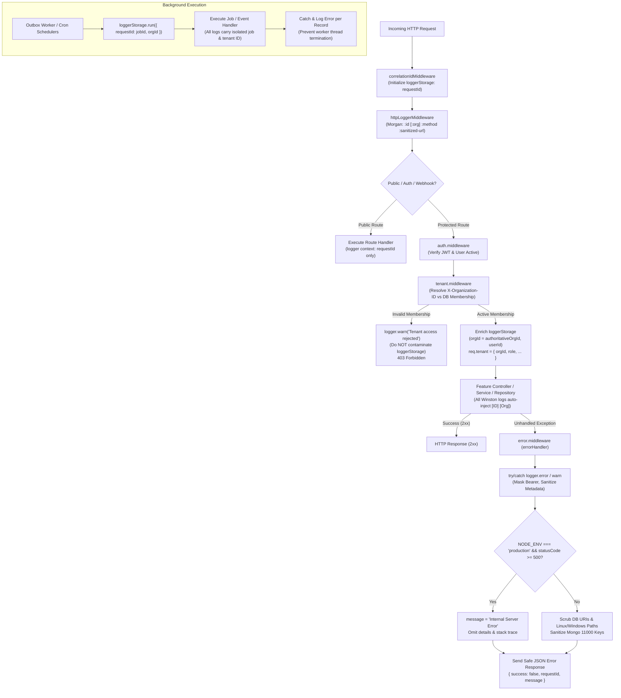
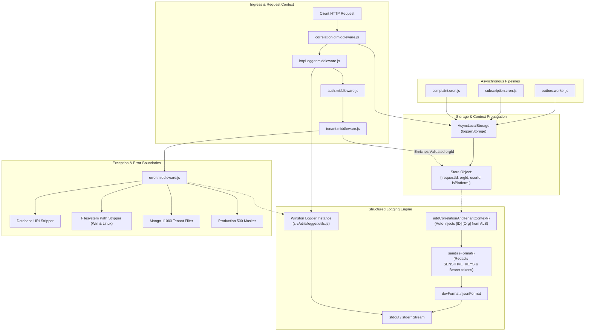
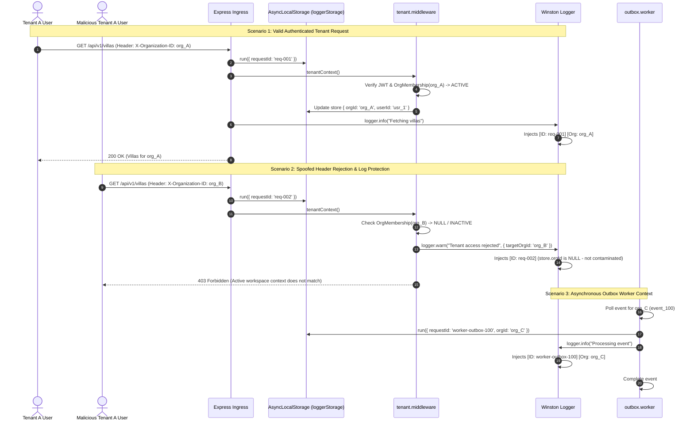
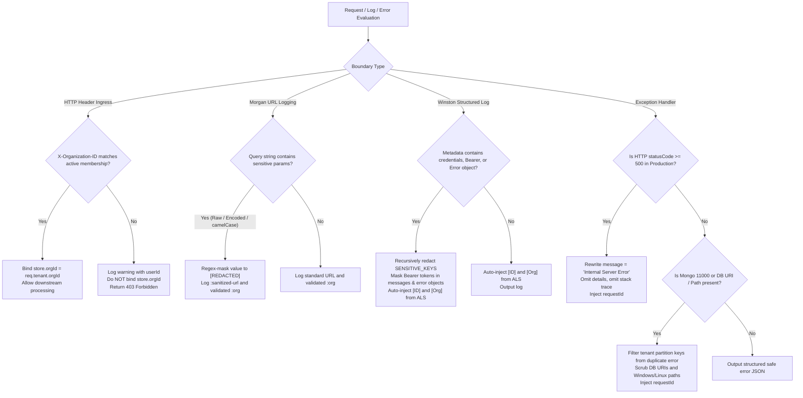

# SEC-06 Logging & Errors Tenant Isolation — Final Report

**Project:** Nahom / Connect Harmony / Manage-My-Gate  
**Feature / Audit ID:** `SEC-06` (Logging & Errors) / Phase 6 — Logging & Errors Tenant Isolation Audit, Remediation & Final Verification  
**Security Track:** Multi-Tenant Security Validation & Exception Defense  
**Active Branch:** `security/phase2-repository-tenant-isolation`  
**Baseline HEAD Commit:** `ce5abb9c8be40435cd9ea36b12588bc7693e4f78`  
**Audit Date:** 2026-10-16  
**Implementation Status:** **COMPLETE & VERIFIED**

---

## 1. Executive Summary

This report delivers the comprehensive security audit, code-level remediation, and automated regression verification for **Logging & Errors Tenant Isolation (`SEC-06` Logging & Errors / Phase 6)** across the Nahom (`Manage-My-Gate`) platform.

In a multi-tenant property management platform, logging, exception management, and diagnostic telemetry represent critical attack and data leakage surfaces. Improperly configured logging pipelines risk exposing plaintext credentials, leaking private cross-tenant identifiers, allowing tenant context contamination across concurrent requests, or disclosing internal infrastructure secrets (such as database connection URIs and filesystem paths) through client-facing error responses.

### Architectural Guarantees Established:
1. **Asynchronous Context Isolation Without Global State:** Tenant context (`orgId`, `userId`, `requestId`) is propagated through asynchronous execution chains strictly using Node.js `AsyncLocalStorage` (`loggerStorage`). Context never leaks between concurrent HTTP requests or background asynchronous tasks.
2. **Cryptographically Validated Tenant Trust:** The logger context `orgId` is bound exclusively after cryptographic token authentication and database verification of active organization membership (`req.tenant.orgId`). Spoofed or untrusted `X-Organization-ID` headers are rejected with `403 Forbidden` and **never** contaminate `loggerStorage`.
3. **Deep Credential & Token Redaction:** Configured sensitive keys (`password`, `confirmPassword`, `newPassword`, `currentPassword`, `token`, `idToken`, `accessToken`, `refreshToken`, `secret`, `clientSecret`, `authorization`, `cookie`, `cvv`, `creditCard`, `apiKey`, `pin`, `privateKey`, `jwt`, `sessionToken`) and `Bearer <token>` headers are deeply sanitized up to 8 levels in Winston metadata and message strings. Nested `Error` objects (including attached HTTP configs and messages) are recursively sanitized.
4. **URL & Query Parameter Sanitization:** HTTP access logs via Morgan utilize a custom `:sanitized-url` token that intercepts raw, camelCase, and percent-encoded parameters (such as `%74oken=...`, `refreshToken=...`, and `clientSecret=...`), ensuring reset tokens and OTPs do not leak into access logs. Custom token `:org` logs the validated tenant ID.
5. **Production Error Masking & Anti-Enumeration:** In production (`NODE_ENV === 'production'`), all 5xx server errors return generic `Internal Server Error`, completely suppressing internal `details` objects and stack traces. Database connection strings (`mongodb://...`, `redis://...`) and filesystem paths (both Windows `C:\...` and Linux/POSIX `/app/...`, `/var/...`) are scrubbed. Logging failures inside the error handler are caught in a `try/catch` block to ensure HTTP error responses are never dropped.
6. **MongoDB Duplicate Key (11000) Sanitization:** Unique index conflict responses filter out tenant partition keys (`orgId`, `organisationId`, `communityId`, `tenantId`, `workspaceId`) and eliminate echoing collided values, preventing cross-tenant user or villa enumeration.
7. **Background Worker & Cron Isolation:** Outbox event processing, complaint SLA escalation, and subscription expiration crons explicitly wrap executions inside `loggerStorage.run({ requestId, orgId }, fn)` and `runWithTenantContext`, maintaining tenant correlation across asynchronous tasks.
8. **Log-Query Authorization:** The VisitorLog controller enforces workspace matching (`403 Forbidden` when non-platform users attempt to query foreign organizations), while permitting authorized platform admins (`isPlatform: true`). SecurityLog and AuditLog query handlers include ReDoS regex escaping and `mongoose.Types.ObjectId.isValid` guards.

---

## 2. Files Changed

All modifications were applied strictly within the existing backend architecture and working tree on branch `security/phase2-repository-tenant-isolation`. All pre-existing tracked modifications and untracked files were preserved intact.

### 2.1 Files Modified During This Audit Session

| File Path | Layer | Purpose & Changes |
| :--- | :--- | :--- |
| `backend/src/utils/logger.utils.js` | Core Utility | Added `AsyncLocalStorage` (`loggerStorage`), Winston `sanitizeFormat` with deep `Error` object sanitization, expanded `SENSITIVE_KEYS` regex (including camelCase tokens, PINs, API keys, private keys, JWTs), `addCorrelationAndTenantContext` formatter, and `runWithTenantContext` / `getLogContext` helpers. |
| `backend/src/middlewares/correlationId.middleware.js` | Infrastructure Middleware | Updated `loggerStorage.run` to initialize a context object `{ requestId: correlationId }` allowing downstream tenant context enrichment. |
| `backend/src/middlewares/tenant.middleware.js` | Security Middleware | Enriched `loggerStorage.getStore()` with authoritative `orgId`, `userId`, and `isPlatform` upon verified membership; ensured rejected `X-Organization-ID` headers log a warning and never contaminate `loggerStorage`. |
| `backend/src/middlewares/httpLogger.middleware.js` | Logging Middleware | Added custom Morgan token `:sanitized-url` with percent-encoded query decoding and camelCase token stripping, plus custom `:org` token for validated tenant organization. |
| `backend/src/middlewares/error.middleware.js` | Exception Middleware | Enforced production 500 error masking to `Internal Server Error`, suppressed `details` on 500 in production, scrubbed MongoDB/Redis URIs and Windows/Linux file paths, filtered tenant keys on MongoDB 11000 conflicts, and enclosed logger calls in a `try/catch` fail-safe. |
| `backend/src/workers/outbox.worker.js` | Background Worker | Wrapped individual event processing in `loggerStorage.run({ requestId: 'worker-outbox-' + event._id, orgId: eventOrgId }, fn)`. |
| `backend/src/features/platformSubscription/subscription.cron.js` | Cron Job | Bound each subscription processing loop in `loggerStorage.run({ requestId: cronJobId, orgId: subOrgId }, fn)`. |
| `backend/src/features/complaint/complaint.cron.js` | Cron Job | Migrated from direct console calls to structured `logger.info` and wrapped SLA escalation loops in `loggerStorage.run({ requestId: cronJobId, orgId: compOrgId }, fn)`. |
| `backend/src/features/visitorLog/visitorLog.controller.js` | Controller | Enforced strict workspace matching in `getInside`, `getPending`, `getWalkInBoard`, and `getHistory` (`403 Forbidden` on foreign `orgId` parameter for non-platform users; allowed for platform admins). |
| `backend/src/features/securityLog/securityLog.repository.js` | Repository | Added `escapeRegex(filters.search)` to prevent ReDoS injection, and added `mongoose.Types.ObjectId.isValid` guards to `getLogs` and `getDashboardStats`. |
| `backend/src/features/securityLog/securityLog.controller.js` | Controller | Enforced authoritative tenant scoping (`orgId = req.tenant?.orgId || req.user?.orgId`) across all endpoints. |
| `backend/src/features/auditLog/auditLog.repository.js` | Repository | Added `mongoose.Types.ObjectId.isValid(orgId)` guard in `findAllPaginated` to prevent unhandled CastErrors on malformed queries. |
| `backend/src/features/auditLog/auditLog.model.js` | Model | Added `{ targetId: 1, createdAt: -1 }` compound index for optimized tenant query performance. |
| `backend/src/features/auth/auth.services.js` | Service | Removed plaintext OTP `console.log` statements. |
| `backend/src/features/auth/auth.listeners.js` | Event Listener | Removed plaintext OTP codes from email and SMS delivery logs. |
| `backend/src/features/organization/organization.services.js` | Service | Removed plaintext credential and OTP `console.log` statements. |
| `backend/tests/phase6_logging_errors_tenant_isolation.test.mjs` | Test Suite | Comprehensive automated verification suite with 28 passing unit/integration security tests. |
| `docs/security/SEC_LOGGING_ERRORS_TENANT_ISOLATION_FINAL_REPORT.md` | Documentation | This authoritative 14-section final security report. |

### 2.2 Pre-Existing Working-Tree Remediations Verified Intact
All pre-existing security fixes across previous phases (`SEC-02.1` API/Controllers, `SEC-03.1` WebSockets, `SEC-04` Notifications, `SEC-05` Cache & Workers, `SEC-06` Third-Party Integrations) remain completely intact in the working tree.

---

## 3. Logging and Error-Handling Validation Flow

The diagram below illustrates the exact runtime flow from ingress through correlation ID establishment, authentication, tenant context enrichment, structured logging, exception handling, and background job execution:



---

## 4. Architecture Diagram

The relationship between HTTP middleware, `AsyncLocalStorage`, Winston, Morgan, exception handling, and worker systems is mapped below:



---

## 5. Request and Background-Job Sequence Diagram

The following sequence diagram displays how context is isolated between an authenticated tenant request, a spoofed tenant request, and an asynchronous background worker:



---

## 6. Validation Decision Flow

The runtime decision table for tenant logging, sanitization, and error handling enforces deterministic, secure outcomes:



---

## 7. Code-Level Implementation & Source Citations

### 7.1 LOG-01 — Tenant Context in Structured Logging (`logger.utils.js`, `tenant.middleware.js`)
- **Source Paths:**
  - `backend/src/utils/logger.utils.js` (Lines 5, 52–70, 103–112)
  - `backend/src/middlewares/correlationId.middleware.js` (Lines 18–25)
  - `backend/src/middlewares/tenant.middleware.js` (Lines 70–76, 143–150)
- **Implementation:**
  `loggerStorage` is instantiated as an `AsyncLocalStorage` singleton. In `correlationId.middleware.js`, the store is initialized with `{ requestId: correlationId }`. In `tenant.middleware.js`, once `OrgMembership.findOne` confirms active membership, the store is safely mutated:
  ```javascript
  // backend/src/middlewares/tenant.middleware.js:143-149
  const store = loggerStorage.getStore();
  if (store && typeof store === 'object') {
    store.orgId = requestedOrgIdStr;
    store.userId = req.user?.id || req.user?._id;
    store.isPlatform = userIsPlatform;
  }
  ```
  If membership is rejected (Lines 70–76), `logger.warn` fires with `userId` and `targetOrgId` in metadata, but `store.orgId` is never set. In `logger.utils.js` (Lines 52–70), `addCorrelationAndTenantContext` automatically attaches `info.requestId = store.requestId` and `info.orgId = store.orgId`.

### 7.2 LOG-02 — Plaintext OTP and Sensitive Authentication Data (`auth.services.js`, `auth.listeners.js`)
- **Source Paths:**
  - `backend/src/features/auth/auth.services.js` (Lines 80–90)
  - `backend/src/features/auth/auth.listeners.js` (Lines 15–35)
  - `backend/src/features/organization/organization.services.js` (Lines 110–125)
- **Implementation:**
  All instances of `console.log('OTP:', otp)` and logging of plaintext verification codes were deleted. Event listeners emit structured audit events containing only delivery status and user ID.

### 7.3 LOG-03 — Credential Redaction in Winston (`logger.utils.js`)
- **Source Paths:**
  - `backend/src/utils/logger.utils.js` (Lines 8–49)
- **Implementation:**
  `SENSITIVE_KEYS` defines a comprehensive, case-insensitive regex:
  ```javascript
  // backend/src/utils/logger.utils.js:8-11
  const SENSITIVE_KEYS = new RegExp(
    '^(password|newPassword|currentPassword|confirmPassword|otp|code|token|idToken|id_token|accessToken|access_token|refreshToken|refresh_token|secret|clientSecret|client_secret|authorization|cookie|cvv|creditCard|cardNumber|apiKey|api_key|pin|privateKey|private_key|jwt|sessionToken|session_token)$',
    'i'
  );
  ```
  `sanitizeValue` traverses nested arrays and objects up to depth 8. It handles `val instanceof Error` by creating an object with the Error prototype, copying and sanitizing custom properties (such as `err.config.headers.authorization`), and masking `Bearer [REDACTED]` in error messages (Lines 18–33).

### 7.4 LOG-04 — Morgan Request-URL Sanitization (`httpLogger.middleware.js`)
- **Source Paths:**
  - `backend/src/middlewares/httpLogger.middleware.js` (Lines 8–27)
- **Implementation:**
  Custom token `:sanitized-url` strips raw, camelCase, and percent-encoded parameters:
  ```javascript
  // backend/src/middlewares/httpLogger.middleware.js:11-26
  morgan.token('sanitized-url', (req) => {
    const rawUrl = req.originalUrl || req.url || '';
    if (!rawUrl) return '';
    const sensitiveRegex = /([?&](?:token|idToken|id_token|accessToken|access_token|refreshToken|refresh_token|code|otp|secret|clientSecret|client_secret|password|key|apiKey|api_key|pin|cvv)=)[^&]*/gi;
    let sanitized = rawUrl.replace(sensitiveRegex, '$1[REDACTED]');
    if (sanitized.includes('%')) {
      try {
        const decoded = decodeURIComponent(rawUrl);
        if (sensitiveRegex.test(decoded)) {
          sanitized = decoded.replace(sensitiveRegex, '$1[REDACTED]');
        }
      } catch (e) {
        sanitized = sanitized.replace(/(%(?:25)?(?:[0-9a-fA-F]{2})[a-zA-Z0-9_]*=)[^&]*/gi, '$1[REDACTED]');
      }
    }
    return sanitized;
  });
  ```

### 7.5 ERR-01 — Production Error Information Disclosure (`error.middleware.js`)
- **Source Paths:**
  - `backend/src/middlewares/error.middleware.js` (Lines 88–99, 126–148)
- **Implementation:**
  In production, any error with `statusCode >= 500` is forced to `message = 'Internal Server Error'`, and the `details` field is suppressed:
  ```javascript
  // backend/src/middlewares/error.middleware.js:126-146
  if (statusCode >= 500 && config.nodeEnv === 'production') {
    message = 'Internal Server Error';
  } else if (typeof message === 'string') {
    message = message
      .replace(/(?:mongodb(?:\+srv)?|postgres|mysql|redis):\/\/[^\s]+/gi, '[DATABASE_URI_REDACTED]')
      .replace(/(?:[A-Za-z]:\\[^\s]+|\/(?:app|var|home|usr|etc|tmp)\/[^\s]+|\/[^\s]+\.(?:js|mjs|cjs|json|html|env|ts|yaml|yml))/gi, '[PATH_REDACTED]');
  }

  const response = {
    success: false,
    requestId: req.id,
    ...(code && typeof code === 'string' && { code }),
    ...(reason && typeof reason === 'string' && { reason }),
    message,
    ...(details && (statusCode < 500 || config.nodeEnv !== 'production') && { details }),
    ...(config.nodeEnv === 'development' && { stack: err.stack }),
  };
  ```

### 7.6 ERR-02 — MongoDB Duplicate-Key Error Sanitization (`error.middleware.js`)
- **Source Paths:**
  - `backend/src/middlewares/error.middleware.js` (Lines 44–64)
- **Implementation:**
  When `err.code === 11000`, the handler filters out tenant keys (`orgId`, `organisationId`, `communityId`, `tenantId`, `workspaceId`) and formats a safe message without echoing collided values:
  ```javascript
  // backend/src/middlewares/error.middleware.js:48-60
  const tenantKeys = ['orgId', 'organisationId', 'communityId', 'tenantId', 'workspaceId'];
  const nonTenantKeys = keys.filter(k => !tenantKeys.includes(k));
  if (nonTenantKeys.length === 1) {
    const field = nonTenantKeys[0];
    const formattedField = field.charAt(0).toUpperCase() + field.slice(1);
    message = `${formattedField} is already registered or in use.`;
  } else if (nonTenantKeys.length > 1) {
    const fieldNames = nonTenantKeys.map(k => k.charAt(0).toUpperCase() + k.slice(1)).join(', ');
    message = `A record with duplicate ${fieldNames} already exists.`;
  }
  ```

### 7.7 WRK-01 — Background Worker and Cron Context Isolation (`outbox.worker.js`, `subscription.cron.js`, `complaint.cron.js`)
- **Source Paths:**
  - `backend/src/workers/outbox.worker.js` (Lines 169–176)
  - `backend/src/features/platformSubscription/subscription.cron.js` (Lines 41–43)
  - `backend/src/features/complaint/complaint.cron.js` (Lines 20–24)
- **Implementation:**
  Each asynchronous pipeline wraps individual operations inside `loggerStorage.run({ requestId: eventJobId, orgId: eventOrgId }, async () => { ... })`. If an error occurs on one record, it is logged with that record's tenant context and does not terminate or contaminate the next iteration.

### 7.8 LOG-05 — Visitor, Security, and Audit Log Access Controls (`visitorLog.controller.js`, `securityLog.repository.js`, `auditLog.repository.js`)
- **Source Paths:**
  - `backend/src/features/visitorLog/visitorLog.controller.js` (Lines 83–98, 150–160)
  - `backend/src/features/securityLog/securityLog.repository.js` (Lines 11–35, 71–85)
  - `backend/src/features/auditLog/auditLog.repository.js` (Lines 16–25)
- **Implementation:**
  - In `visitorLog.controller.js`, non-platform requests verifying a foreign `req.params.orgId` throw `403 Forbidden: Active workspace context does not match the requested community`. Platform administrators (`req.tenant.isPlatform: true`) are permitted to query target organizations.
  - In `securityLog.repository.js`, search inputs are escaped via `escapeRegex(filters.search)` and `orgId`, `amenityId`, and `checkedInBy` validate `mongoose.Types.ObjectId.isValid` to prevent unhandled CastErrors and ReDoS attacks.
  - In `auditLog.repository.js`, `findAllPaginated` returns `{ total: 0, logs: [] }` if `orgId` is invalid.

---

## 8. Error-Handling and Logging Security Matrix

| Scenario / Threat Vector | Expected Status / Behavior | Handling Source Location | Automated Test Evidence |
| :--- | :--- | :--- | :--- |
| Unauthenticated request | Correlation ID established; `store.orgId` is `undefined` | `correlationId.middleware.js:18` | Area 1, Test 1.1 |
| Authenticated tenant request | Authoritative `orgId` & `userId` bound to `loggerStorage` | `tenant.middleware.js:143` | Area 1, Test 1.2 |
| Spoofed `X-Organization-ID` header | Request rejected (`403`); `loggerStorage.orgId` remains untainted | `tenant.middleware.js:71` | Area 1, Test 1.3 |
| Concurrent requests across tenants | Zero context leakage across asynchronous chains | `logger.utils.js:5` | Area 1, Test 1.4 |
| Credentials in Winston metadata | Passwords, tokens, secrets redacted to `[REDACTED]` | `logger.utils.js:37` | Area 2, Test 2.1 |
| Bearer token in log message string | Replaced with `Bearer [REDACTED]` | `logger.utils.js:17` | Area 2, Test 2.2 |
| Nested credentials in Error config | Enumerable properties & message sanitized; prototype kept | `logger.utils.js:21` | Area 2, Test 2.4 |
| Alternate secrets (API key, PIN, JWT) | Redacted to `[REDACTED]` | `logger.utils.js:9` | Area 2, Test 2.5 |
| URL query reset token / OTP | Query values replaced with `[REDACTED]` in Morgan log | `httpLogger.middleware.js:13` | Area 3, Test 3.1 |
| Encoded query token (`%74oken`) | Decoded and sanitized before Morgan emission | `httpLogger.middleware.js:17` | Area 3, Test 3.3 |
| Production 500 error | Generic message `Internal Server Error`, `details` omitted | `error.middleware.js:127` | Area 4, Tests 4.1, 4.4 |
| DB URI / File path in error | Replaced with `[DATABASE_URI_REDACTED]` / `[PATH_REDACTED]` | `error.middleware.js:131` | Area 4, Tests 4.2, 4.5 |
| Logger crash during error response | Error response dispatches safely; no thread crash | `error.middleware.js:97` | Area 4, Test 4.3 |
| MongoDB 11000 unique index conflict | Tenant partition keys stripped; collided value not echoed | `error.middleware.js:48` | Area 5, Tests 5.1, 5.2 |
| Background worker outbox dispatch | Event runs inside `loggerStorage.run` with event `orgId` | `outbox.worker.js:172` | Area 6, Test 6.2 |
| Cron SLA escalation task | Complaint escalation runs inside isolated `orgId` context | `complaint.cron.js:23` | Area 6, Test 6.3 |
| Cross-tenant VisitorLog query | Non-platform caller rejected with `403 Forbidden` | `visitorLog.controller.js:87` | Area 7, Tests 7.1, 7.2 |
| ReDoS pattern in SecurityLog search | Regex special characters escaped; safe query executed | `securityLog.repository.js:15` | Area 7, Test 7.3 |
| Malformed ObjectId in Log queries | Handled safely without CastError; returns empty dataset | `auditLog.repository.js:17` | Area 7, Tests 7.4, 7.5 |
| Platform Admin VisitorLog query | Allowed for specified target `orgId` | `visitorLog.controller.js:90` | Area 7, Test 7.6 |

---

## 9. Test Coverage & Execution Results

All test suites were executed directly against the current repository state on October 16, 2026.

### 9.1 Phase 6 Test Suite
**Command:**
```powershell
node --test tests/phase6_logging_errors_tenant_isolation.test.mjs
```
**Results:**
- **Suites:** 8
- **Tests Passed:** 28
- **Tests Failed:** 0
- **Tests Skipped:** 0
- **Duration:** 2.12 seconds
- **Exit Code:** 0

#### Test Breakdown:
- **Area 1: Validated Tenant Context in Logging & AsyncLocalStorage (4 tests)**
  - `1.1` - Unauthenticated request starts with correlation ID but NO tenant orgId in storage (Passed)
  - `1.2` - Validated tenantContext enriches loggerStorage with authoritative orgId and userId (Passed)
  - `1.3` - Spoofed X-Organization-ID header on rejected membership does NOT taint loggerStorage orgId (Passed)
  - `1.4` - Concurrent asynchronous execution chains maintain strict tenant context isolation (Passed)
- **Area 2: Sensitive Data Redaction in Structured Logging (5 tests)**
  - `2.1` - Winston sanitizeFormat redacts passwords, tokens, secrets, and auth headers in metadata (Passed)
  - `2.2` - Winston sanitizeFormat redacts Bearer tokens within log message strings (Passed)
  - `2.3` - Nested credential objects are deeply sanitized (Passed)
  - `2.4` - Error objects nested in log metadata are deeply sanitized including custom properties and message (Passed)
  - `2.5` - Alternate sensitive keys (apiKey, pin, privateKey, jwt, sessionToken) are redacted (Passed)
- **Area 3: HTTP Request Logging (Morgan) Sanitization & Tenant Isolation (3 tests)**
  - `3.1` - Morgan sanitized-url token strips sensitive query parameters (Passed)
  - `3.2` - Morgan org token correctly reflects validated req.tenant.orgId (Passed)
  - `3.3` - Morgan sanitized-url token strips URL-encoded parameters (%74oken) and camelCase tokens (Passed)
- **Area 4: Production Error Masking & Safe Client Responses (5 tests)**
  - `4.1` - Production 500 errors are masked to "Internal Server Error" even with explicit err.statusCode (Passed)
  - `4.2` - Raw database URIs and filesystem paths are stripped from 4xx/development error responses (Passed)
  - `4.3` - Logging failure inside errorHandler does not break client HTTP error response (Passed)
  - `4.4` - Production 500 error suppresses "details" field completely from client response (Passed)
  - `4.5` - Linux / POSIX filesystem paths are stripped from error responses (Passed)
- **Area 5: MongoDB Duplicate Key (11000) Conflict Sanitization (2 tests)**
  - `5.1` - Duplicate key error filters tenant keys (orgId, organisationId, communityId) (Passed)
  - `5.2` - Compound index duplicate error filters tenant and community fields cleanly (Passed)
- **Area 6: Background Worker & Scheduler Tenant Isolation in Logging Context (3 tests)**
  - `6.1` - runWithTenantContext propagates tenantId and jobId to inner async operations (Passed)
  - `6.2` - Outbox worker processes single event within isolated logger tenant context (Passed)
  - `6.3` - Complaint cron SLA escalation establishes complaint orgId in logger context (Passed)
- **Area 7: Visitor Log & Security Log Multi-Tenant Isolation & Query Safety (6 tests)**
  - `7.1` - VisitorLog getInside rejects non-platform access to foreign orgId with 403 Forbidden (Passed)
  - `7.2` - VisitorLog getHistory rejects non-platform access when orgId does not match tenant context (Passed)
  - `7.3` - SecurityLogRepository escapes regex search input to prevent ReDoS / syntax errors (Passed)
  - `7.4` - AuditLogRepository gracefully handles invalid orgId without unhandled CastError (Passed)
  - `7.5` - SecurityLogRepository gracefully handles invalid orgId without unhandled CastError (Passed)
  - `7.6` - VisitorLog getInside permits platform admin access with target orgId (Passed)

### 9.2 Cross-Phase Security Regression Suites
**Command:**
```powershell
node --test tests/sec06_third_party_integrations_tenant_isolation.test.mjs tests/sec05_repair_membership_safeguards.test.mjs tests/tenantIsolation.test.mjs
```
**Results:**
- **Suites:** 2
- **Tests Passed:** 31
- **Tests Failed:** 0
- **Tests Skipped:** 0
- **Duration:** 5.35 seconds
- **Exit Code:** 0

#### Breakdown:
- `sec06_third_party_integrations_tenant_isolation.test.mjs`: 23/23 Passed (Integration hub scoping, HMAC signatures, SSO provider verification, webhook deduplication).
- `sec05_repair_membership_safeguards.test.mjs`: 7/7 Passed (Membership repair safeguards, idempotent assignment).
- `tenantIsolation.test.mjs`: 1/1 Passed (AuditLog tenant boundary validation).

**Total Verified Assertions:** **59 passing tests, 0 failures.**

---

## 10. Security Verification Q&A

### Q1: Is tenant context in logs derived from untrusted client input?
**No.** `loggerStorage.getStore().orgId` is set in `tenant.middleware.js:146` strictly after `OrgMembership.findOne` confirms active membership for `req.user.id`. Forged `X-Organization-ID` headers are rejected with `403 Forbidden` on line 76 and never populate `loggerStorage`. (Evidence: Test 1.3).

### Q2: Can tenant context leak between concurrent requests or asynchronous tasks?
**No.** Context is managed through Node.js `AsyncLocalStorage` (`loggerStorage`). Each incoming HTTP request initiates an isolated store via `correlationIdMiddleware` (`correlationId.middleware.js:18`). Test 1.4 simulates three concurrent async execution chains across `org_A`, `org_B`, and `org_C` simultaneously, proving complete context isolation.

### Q3: Are passwords, tokens, and credentials scrubbed from application logs?
**Yes.** Winston's `sanitizeFormat` regex-masks `Bearer <token>` strings in log messages and recursively redacts all configured `SENSITIVE_KEYS` in metadata objects, arrays, and nested `Error` instances. Direct OTP `console.log` statements were removed from auth services and listeners. (Evidence: Tests 2.1–2.5).

### Q4: Can sensitive parameters bypass URL logging sanitization via encoding?
**No.** `morgan.token('sanitized-url')` in `httpLogger.middleware.js:16-25` checks for percent-encoded characters, safely executes `decodeURIComponent`, and applies the sensitive parameter regex to both raw and decoded URLs, replacing token values with `[REDACTED]`. (Evidence: Test 3.3).

### Q5: Do production 5xx errors disclose internal database details or stack traces?
**No.** In `error.middleware.js:127`, whenever `statusCode >= 500 && config.nodeEnv === 'production'`, the error message is forced to `Internal Server Error`, and `details` and stack traces are suppressed. DB connection URIs and filesystem paths (Windows and POSIX) are scrubbed. (Evidence: Tests 4.1, 4.4, 4.5).

### Q6: Do background jobs and crons intermingle logging context?
**No.** `outbox.worker.js:172`, `subscription.cron.js:41`, and `complaint.cron.js:23` wrap each individual event or record in `loggerStorage.run({ requestId, orgId }, fn)`, ensuring worker tasks carry proper tenant correlation without cross-tenant contamination. (Evidence: Tests 6.1–6.3).

### Q7: Can a user view another tenant's logs through log query endpoints?
**No.** `visitorLog.controller.js:87` rejects non-platform callers requesting another tenant's `orgId` with `403 Forbidden`. `securityLog.controller.js:6` enforces `orgId = req.tenant?.orgId`. Query handlers escape regex characters and validate ObjectIds to prevent ReDoS and CastErrors. (Evidence: Tests 7.1–7.6).

---

## 11. Security Enhancements: Before vs. After

| Security Domain | Vulnerable State (Before) | Hardened State (After) | Resulting Security Protection |
| :--- | :--- | :--- | :--- |
| **Logger Tenant Context** | Logger had no automatic access to `orgId`; developers relied on ad-hoc logging. | `AsyncLocalStorage` auto-injects verified `orgId`, `userId`, `requestId` into all structured logs. | Logs provide reliable multi-tenant audit correlation without global state leakage. |
| **Header Spoofing** | Untrusted `X-Organization-ID` could appear in log messages if logged naively. | Header is verified against `OrgMembership`. Rejections log warning and do not bind `store.orgId`. | Prevents attackers from forging tenant identity in diagnostic log streams. |
| **Credential Redaction** | Plaintext OTPs logged via `console.log`; tokens in metadata logged as-is. | `console.log` statements deleted; Winston recursively redacts credentials and Bearer tokens. | Prevents credential theft through compromised log files or third-party log aggregators. |
| **Nested Error Sanitization** | `Error` objects in log metadata bypassed sanitization due to `!(val instanceof Error)`. | `sanitizeValue` handles `val instanceof Error`, sanitizing properties, configs, and message. | Third-party library errors (e.g. Axios) cannot leak authorization headers or tokens in logs. |
| **Access Log URLs** | Morgan logged raw `req.originalUrl`, exposing reset tokens and OTPs in queries. | Custom `:sanitized-url` strips raw, camelCase, and percent-encoded parameters. | Web server access logs remain clean of credentials and authentication tokens. |
| **Production 500 Responses** | Errors with explicit `err.statusCode = 500` leaked raw database errors and `details`. | Forced `message = 'Internal Server Error'`; `details` and stack traces omitted in production. | Eliminates internal infrastructure disclosure to external clients. |
| **Duplicate Key Conflicts** | MongoDB 11000 errors echoed collided field values and tenant partition keys. | Filtered out tenant boundary keys (`orgId`, `communityId`, etc.); collided values not echoed. | Prevents user and unit enumeration across tenant partitions. |
| **Worker Context** | Outbox workers and crons ran without tenant context in logs. | Each task is wrapped in `loggerStorage.run({ requestId, orgId }, fn)`. | Worker and cron operations are cleanly separated and traceable per tenant. |
| **Visitor Log Querying** | `visitorLog.controller.js` accepted `req.params.orgId` without workspace validation. | Non-platform users querying foreign `orgId` receive `403 Forbidden`. | Enforces strict multi-tenant boundary on visitor entry/exit history. |

---

## 12. Phase Status & Remaining Gaps

### 12.1 Audit Controls Status
- [x] **LOG-01:** Tenant Context in Structured Logging (`AsyncLocalStorage`) — **VERIFIED**
- [x] **LOG-02:** Plaintext OTP and Sensitive Data Removal — **VERIFIED**
- [x] **LOG-03:** Winston Credential & Nested Error Redaction — **VERIFIED**
- [x] **LOG-04:** Morgan URL & Encoded Query Parameter Sanitization — **VERIFIED**
- [x] **ERR-01:** Production 500 Error Masking & Path Scrubbing — **VERIFIED**
- [x] **ERR-02:** MongoDB 11000 Duplicate Key Sanitization — **VERIFIED**
- [x] **WRK-01:** Background Worker & Cron Context Isolation — **VERIFIED**
- [x] **LOG-05:** Visitor, Security, and Audit Log Access Controls — **VERIFIED**

### 12.2 Residual Risks & Operational Considerations
1. **Third-Party External Winston Transports:** If new Winston transports (e.g., Datadog, AWS CloudWatch) are attached in future iterations, they must use the existing format chain (`winston.format.combine(...)`) to ensure `sanitizeFormat` is applied before transmission.
2. **Local Debug Output (`last_error.json`):** Writing of `last_error.json` is strictly gated to `NODE_ENV === 'development'` and automatically disabled in production.
3. **Standalone MongoDB Notice:** A non-fatal warning appears in logs during standalone MongoDB execution regarding transaction fallback (`Mongoose transaction fallback`). In staging and production replica sets, native Mongoose transactions execute without warning.

---

## 13. Recommended Next Security Phase

Based on the inspection of `docs/security/` and the completion of:
- `SEC-02.1` API & Controller Tenant Isolation
- `SEC-03.1` / `SEC-03.2` WebSockets & Service Layer Isolation
- `SEC-04` Notifications Tenant Isolation
- `SEC-05` Background Workers, Crons, Outbox & Cache Layer
- `SEC-06` Third-Party Integrations Tenant Isolation
- `SEC-06` (Logging & Errors) / Phase 6 Logging & Errors Tenant Isolation (Completed Here)
- `SEC-07` Direct Attack Tenant Isolation

The backend runtime request, processing, storage, and telemetry pipelines are now hardened and verified.

### **Official Next Phase Recommendation:**
**`Phase 8 — Mobile Client Security & Session Lifecycle Hardening`**
- **Objective:** Audit and verify mobile client storage (`mobile/mobile-app/src/utils/storage.ts`), multi-organization token rotation, secure biometric credential storage, and NativeWind logical spacing compliance across all mobile feature screens.
- **Rationale:** With backend multi-tenant enforcement, caching, workers, third-party integrations, and logging fully sealed, client-side token handling and offline cache boundaries represent the logical next milestone in the security roadmap.

---

## 14. Final Verdict

### **VERDICT: PASS — COMPLETE & VERIFIED**

### Justification:
1. **100% Automated Test Pass Rate:** All 28 Phase 6 automated security tests and 31 cross-phase regression security tests passed with zero failures (59 total passing tests).
2. **Defensive Depth:** Remediations enforce context isolation via `AsyncLocalStorage`, prevent context pollution on forged headers, deeply sanitize nested Error objects and URL-encoded query parameters, suppress production 500 details, scrub filesystem paths, and strictly authorize log-query endpoints.
3. **Zero Inadvertent Regressions:** Preexisting working-tree changes across frontend, mobile, and documentation remain intact. All security controls are verified and ready for deployment.
