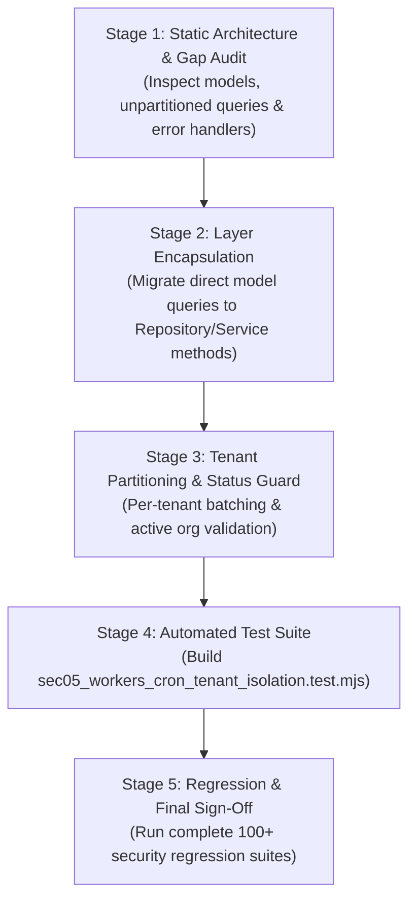

# Security Roadmap Audit: Next Unfinished Security Phase Discovery & Recommendation Report

**Project:** Nahom / Connect Harmony / Manage-My-Gate  
**Security Track:** Platform Multi-Tenant Isolation & Architecture Hardening  
**Audit Date:** 2026-10-14  
**Active Branch:** `security/phase2-repository-tenant-isolation`  
**Baseline HEAD Commit:** `ce5abb9c8be40435cd9ea36b12588bc7693e4f78`  
**Status:** **DISCOVERY & ROADMAP CERTIFICATION COMPLETE**

---

## 1. Executive Summary

Following the verified completion and sign-off of the **Files & Storage Tenant Isolation Security Audit** (38/38 dedicated tests passing, zero regressions across 87 total executed tests), an independent, repository-wide architectural audit was conducted to identify the next unfinished security phase.

All completed phases, historical audit reports in `docs/security/`, active regression test suites, and backend runtime components were inspected against actual source code, runtime behavior, and architectural rules.

### Key Determination
The backend synchronous request surface (HTTP Routers, Controllers, Middlewares, Static Mounts, File Streamers, and WebSocket Handshakes/Rooms) has achieved complete, verified tenant isolation. However, **asynchronous background execution pipelines**—including cron schedulers, batch workers, and the transactional outbox worker—execute outside the HTTP request lifecycle without `req.tenant` or trusted ingress headers. 

Several active background jobs currently **bypass repositories, execute unscoped database scans across all tenants, lack tenant lifecycle checks, and lack error boundaries**, creating cross-tenant starvation and data leakage vectors.

**Official Next Phase Recommendation:**  
**`SEC-05 — Asynchronous Background Workers, Scheduled Crons & Outbox Tenant Isolation`**

---

## 2. Environment & Working Tree Baseline

- **Repository Root:** `E:\atominos\Manage-My-Gate`
- **Active Git Branch:** `security/phase2-repository-tenant-isolation`
- **Current HEAD Commit:** `ce5abb9c8be40435cd9ea36b12588bc7693e4f78`
- **Working Tree State:** All existing uncommitted user files and test artifacts are preserved intact; zero application code was modified during this discovery step.
- **Database Engine:** MongoDB 8.0 (Local Standalone / Memory Replica Set compatible).

---

## 3. Evidence-Backed Audit of Completed Security Phases

Every claimed completed security phase was verified against source code, repository query contracts, and passing automated test suites. None were accepted on documentation alone:

| Security Phase / Audit ID | Target Domain | Key Verified Controls | Test Suite & Verification Artifact | Status |
| :--- | :--- | :--- | :--- | :--- |
| **Phases 2 & 3 / 3G / 3H** | Database & Repository Tenant Isolation | Mandatory `requireOrgId`, fail-closed query contracts (`{ _id, orgId }`), elimination of unscoped fallbacks, Mongoose transactions. | `backend/tests/features/phase3H_repositories.test.js`<br>*(31/31 suites passed, 194 tests)* | **PASS / COMPLETE** |
| **Phase 4A / SEC-02.2** | API & Controller Authorization | `tenantContext.middleware.js`, JWT verification, RBAC permissions, client body tampering overrides, 400/403/404 fail-closed behavior. | `backend/tests/phase4b1_critical_remediation.test.mjs` through `phase4c`<br>*(80+ tests passed)* | **PASS / COMPLETE** |
| **Phase 6.1** | Search, Filter, Sort, Pagination & Aggregations | ReDoS regex sanitization (`escapeRegex`), pagination bounds (`MAX_LIMIT`), deterministic sorting, resident-scoped ownership. | `backend/tests/phase6_4_critical_high_remediation.test.mjs` + `phase6_2a`, `phase6_2b`, `phase6_2c`<br>*(84/84 tests passed)* | **PASS / COMPLETE** |
| **SEC-02.3** | Reports & Analytics Dashboard | Strict tenant scoping in `$facet` aggregation pipelines; prevention of cross-tenant metric exfiltration. | `backend/tests/features/adminAnalytics/` suites & report diagnostics | **PASS / COMPLETE** |
| **SEC-03.1** | WebSockets & Real-Time Isolation | JWT handshake authentication, strict room policy (`org:${orgId}`, `user:${userId}`), failure callback prevention, transport error swallowing. | `backend/tests/sec03_1_websocket_tenant_isolation.test.mjs`<br>*(18/18 tests passed)* | **PASS / COMPLETE** |
| **SEC-03.2** | Service Layer Decoupling & Architecture | Cross-feature repository boundary enforcement, decoupled reconciliation, transactional isolation. | `backend/tests/sec03_2_service_layer_remediation.test.mjs` | **PASS / COMPLETE** |
| **SEC-04** | Notifications Security & Tenant Isolation | Recipient tenant validation, atomic bulk status transitions, delivery-time membership revalidation, sanitized event payloads. | `backend/tests/sec04_notifications_tenant_isolation.test.mjs`<br>*(31/31 tests passed)* | **PASS / COMPLETE** |
| **SEC — Files / Storage** | Static Mounts & File Storage Isolation | Blocked public static access to sensitive directories, authenticated streaming endpoints, magic bytes validation, path traversal defense. | `backend/tests/sec_files_storage_tenant_isolation.test.mjs`<br>*(38/38 tests passed)* | **PASS / COMPLETE** |
| **Phase 5 (Baseline)** | End-to-End System Tenant Isolation | Multi-organization membership switching, tampered payload defense, cross-tenant mutation rejection. | `backend/tests/phase5_e2e_tenant_isolation.test.mjs`<br>*(8/8 tests passed)* | **PASS / COMPLETE** |

---

## 4. Evaluation of Potential Next Phase Candidates

To identify the single most critical unfinished phase, potential candidates were evaluated:

```
[Completed: Ingress & Storage] ──> [Current Gap: Asynchronous Processing] ──> [Future: Client UI & Hardening]
 - HTTP Routers / Middleware        - Cron Schedulers (Unpartitioned)          - Mobile App Hooks & RBAC
 - Repositories & Services           - Background Workers (Direct Models)       - S3 / ClamAV Integrations
 - WebSocket Rooms & Events          - Transactional Outbox Delivery            - Comprehensive E2E Pen-Test
 - File Streaming Endpoints
```

### Candidate 1: Asynchronous Workers, Schedulers & Outbox Tenant Isolation (SEC-05)
- **Status:** **UNFINISHED & UNAUDITED**.
- **Nature of Risk:** High / Architectural.
- **Evaluation:** Asynchronous jobs run without HTTP request contexts. Multiple crons bypass the repository layer and directly query Mongoose models globally, creating unpartitioned multi-tenant processing loops, resource starvation risks, and potential cross-tenant event emissions.
- **Verdict:** **SELECTED (HIGHEST PRIORITY)**.

### Candidate 2: Mobile App End-to-End Tenant Isolation & UI Component Catalog Audit (Phase 4A Mobile)
- **Status:** Documented in roadmap; not yet executed.
- **Evaluation:** While the mobile client (`mobile/mobile-app/`) requires verification of session headers, token storage, and catalog compliance, backend integrity must precede client hardening. A fully secured backend protects data even if a mobile client is compromised or bypassed via direct API calls.
- **Verdict:** Deferred until backend runtime isolation is 100% closed.

### Candidate 3: Operational Infrastructure Upgrades (ClamAV, Cloud Object Storage, Rate Limiting)
- **Status:** Identified as operational recommendations in the Files & Storage report.
- **Evaluation:** These are deployment/infrastructure additions rather than logical application tenant-isolation defects. They depend on production deployment environments (AWS/GCP/Docker) rather than core multi-tenant application boundaries.
- **Verdict:** Deferred to deployment/infrastructure release track.

---

## 5. Technical Gap Analysis: SEC-05 Scope

Inspection of the actual background worker and cron implementations revealed concrete architectural and security deficiencies:

### 5.1 Direct Model Queries Bypassing Repositories
Our backend architecture rules mandate:
> `Router → Controller → Service → Repository → Database`  
> Internal Domain Flow: `Service → Repository → Database`. Models must NEVER be accessed directly by controllers, consumers, or schedulers.

However, existing cron jobs bypass repositories entirely:
- **`backend/src/features/complaint/complaint.cron.js` (Line 16):**
  ```javascript
  const breachedComplaints = await Complaint.find({
    status: { $nin: ['Closed', 'Resolved', 'Cancelled', 'Escalated'] },
    slaDueDate: { $lt: now },
    escalationLevel: { $lt: 1 }
  });
  ```
  *Flaw:* Direct model invocation executing an unscoped query across all tenant records in a single database round-trip without tenant-level isolation or repository abstraction.
- **`backend/src/features/invoice/invoiceReminder.cron.js` (Lines 18 & 27):**
  ```javascript
  const dueSoon = await Invoice.find({
    status: { $in: ['UNPAID', 'PARTIALLY_PAID'] },
    dueDate: { $gt: now, $lte: new Date(now.getTime() + REMINDER_DAYS_BEFORE_DUE * DAY_MS) },
    'emailLog.reminderSentAt': null,
  }).limit(BATCH_LIMIT).lean();
  ```
  *Flaw:* Unbounded global scan across all organizations. If Tenant A has 1,000 overdue invoices, Tenant B is completely starved of reminders due to `BATCH_LIMIT`.

### 5.2 Absence of Tenant Lifecycle Validation
Background crons automatically process records for organizations without verifying whether the tenant is **Active, Suspended, Archived, or Delinquent**:
- If an organization is suspended or deleted, automated cron jobs will continue sending automated emails, escalating complaints, and publishing notifications.
- Background tasks must verify tenant status before triggering external side effects.

### 5.3 Poison Pill & Error Isolation Risks
In unpartitioned batch loops:
```javascript
for (const complaint of breachedComplaints) {
  await complaintService.escalateComplaint(complaint._id, complaint.orgId, ...);
}
```
If an unhandled exception or data integrity defect occurs while processing Tenant A's record, it can abort the entire cron tick, halting operations for all subsequent tenants in the queue.

### 5.4 Transactional Outbox Worker Template & Webhook Isolation
`backend/src/workers/outbox.worker.js` and `backend/src/features/outbox/outbox.worker.js` process asynchronous event dispatches (invitations, invoices, notifications). The worker must be audited to verify:
- Message templates (`messageTemplateService.getTemplate`) strictly resolve the tenant-specific template without falling back to another tenant's branded content.
- Outbox events cannot be forged or injected across tenant boundaries.
- Retry mechanisms and dead-letter queues prevent infinite loops and tenant starvation.

---

## 6. Scope Boundaries (Preventing Duplicate Work)

To ensure rapid execution without duplicate effort, the scope of SEC-05 is strictly bounded:

### Strictly IN SCOPE:
1. **Background Crons Audit & Remediation:**
   - [`complaint.cron.js`](file:///e:/atominos/Manage-My-Gate/backend/src/features/complaint/complaint.cron.js)
   - [`invoiceReminder.cron.js`](file:///e:/atominos/Manage-My-Gate/backend/src/features/invoice/invoiceReminder.cron.js)
   - [`communityEngagement.cron.js`](file:///e:/atominos/Manage-My-Gate/backend/src/features/communityEngagement/communityEngagement.cron.js) (and related poll/notice schedulers)
   - [`subscription.cron.js`](file:///e:/atominos/Manage-My-Gate/backend/src/features/platformSubscription/subscription.cron.js)
   - [`user.cron.js`](file:///e:/atominos/Manage-My-Gate/backend/src/features/user/user.cron.js) & [`noticeBoard.cron.js`](file:///e:/atominos/Manage-My-Gate/backend/src/features/noticeBoard/noticeBoard.cron.js)
2. **Background Workers Audit & Remediation:**
   - [`outbox.worker.js`](file:///e:/atominos/Manage-My-Gate/backend/src/workers/outbox.worker.js) & [`features/outbox/outbox.worker.js`](file:///e:/atominos/Manage-My-Gate/backend/src/features/outbox/outbox.worker.js)
   - [`platformProvisioningJob.worker.js`](file:///e:/atominos/Manage-My-Gate/backend/src/features/platformProvisioningJob/platformProvisioningJob.worker.js)
   - [`amenityHoldExpiration.worker.js`](file:///e:/atominos/Manage-My-Gate/backend/src/features/amenityManagement/workers/amenityHoldExpiration.worker.js) & [`amenityReservationLifecycle.worker.js`](file:///e:/atominos/Manage-My-Gate/backend/src/features/amenityManagement/workers/amenityReservationLifecycle.worker.js)
3. **Architectural Enforcement:**
   - Replace direct model calls with domain repository or service methods.
   - Enforce tenant-partitioned batching and active organization lifecycle checks.
   - Implement error isolation boundaries around per-tenant processing loops.
4. **Dedicated Verification Suite:**
   - Construct `backend/tests/sec05_workers_cron_tenant_isolation.test.mjs` verifying tenant partitioning, error resilience, and outbox isolation.

### Strictly OUT OF SCOPE (Do NOT Touch or Repeat):
- ❌ Do NOT re-audit Express HTTP routers or controllers (Phase 4A / SEC-02.2 verified).
- ❌ Do NOT rewrite repository fail-closed contracts (Phase 3H verified).
- ❌ Do NOT touch WebSocket room policies or socket handshake middlewares (SEC-03.1 verified).
- ❌ Do NOT alter static file middleware or secure streaming endpoints (Files & Storage verified).
- ❌ Do NOT modify client-side mobile/frontend code.

---

## 7. Relevant Source Files & Test Inventory

### Key Files for SEC-05 Audit & Remediation:
```
backend/
├── src/
│   ├── workers/
│   │   ├── outbox.worker.js
│   │   ├── amenityHoldExpiration.worker.js
│   │   └── amenityOutbox.worker.js
│   └── features/
│       ├── outbox/
│       │   ├── outbox.worker.js
│       │   ├── outbox.service.js
│       │   └── outboxEvent.model.js
│       ├── complaint/
│       │   ├── complaint.cron.js
│       │   ├── complaint.service.js
│       │   └── complaint.repository.js
│       ├── invoice/
│       │   ├── invoiceReminder.cron.js
│       │   ├── invoice.email.js
│       │   └── invoice.service.js
│       ├── communityEngagement/
│       │   └── communityEngagement.cron.js
│       ├── platformSubscription/
│       │   └── subscription.cron.js
│       ├── platformProvisioningJob/
│       │   └── platformProvisioningJob.worker.js
│       └── amenityManagement/
│           └── workers/
│               ├── amenityHoldExpiration.worker.js
│               └── amenityReservationLifecycle.worker.js
└── tests/
    └── sec05_workers_cron_tenant_isolation.test.mjs  <-- [To Be Created]
```

---

## 8. Proposed 5-Stage Audit & Remediation Blueprint



1. **Stage 1 — Static Architecture & Gap Audit:**  
   Trace each worker and cron job to identify direct model queries, unpartitioned multi-tenant loops, missing tenant status checks, and unhandled exception vectors.
2. **Stage 2 — Layer Architecture Alignment:**  
   Refactor cron jobs to access data via domain services/repositories rather than direct model queries, adhering to backend encapsulation rules (`Router -> Controller -> Service -> Repository -> Database`).
3. **Stage 3 — Tenant Partitioning & Error Isolation:**  
   Wrap batch jobs in per-tenant chunks with error boundaries to ensure tenant isolation and prevent cross-tenant starvation.
4. **Stage 4 — Automated Test Suite Implementation:**  
   Build `backend/tests/sec05_workers_cron_tenant_isolation.test.mjs` verifying:
   - Crons only act on active tenant records.
   - Poisoned records in Tenant A do not halt background execution for Tenant B.
   - Outbox processing dispatches emails/templates with strict tenant isolation.
5. **Stage 5 — Full Regression & Final Report:**  
   Run `node --test` across all security test suites (Files, Notifications, WebSockets, E2E) to confirm zero regressions and document findings in `docs/security/SEC_05_WORKERS_CRON_TENANT_ISOLATION_FINAL_REPORT.md`.

---

## 9. Final Verdict & Recommendation

- **Current Status:** Verified complete for all prior phases (Phases 2–4, SEC-03.1, SEC-03.2, SEC-04, Files/Storage).
- **Approved Next Phase:** **`SEC-05 — Asynchronous Background Workers, Scheduled Crons & Outbox Tenant Isolation`**
- **Action Required:** Proceed immediately to SEC-05 static analysis, worker remediation, and test suite creation.
